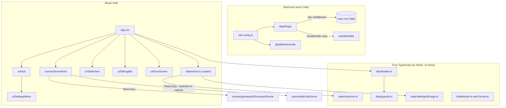
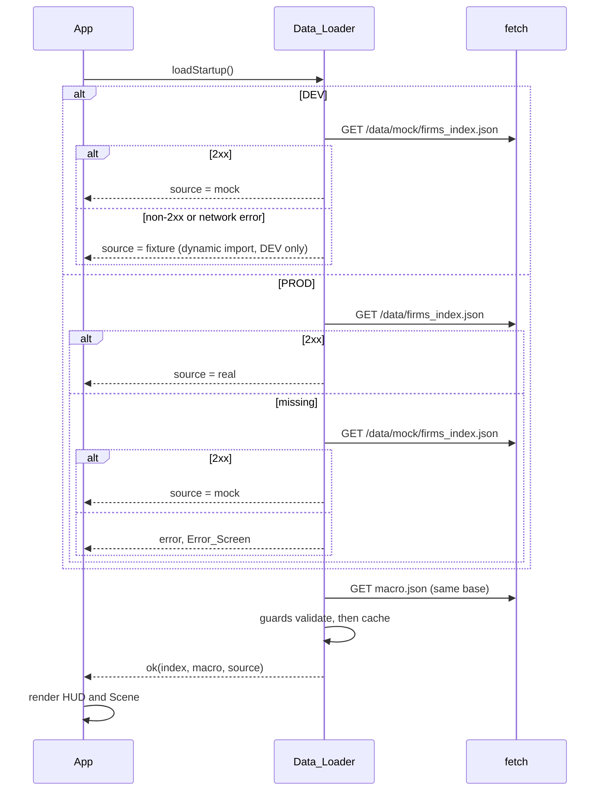
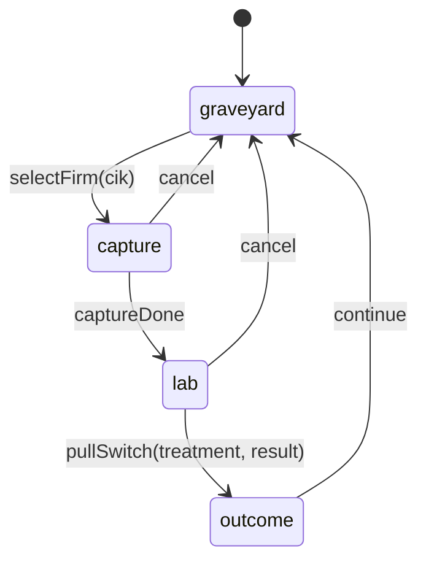

# Design Document

## Overview

The app-shell is the deployable skeleton of Zombie Firm Radar: a Vite + React 19 + TypeScript project in `/web` with the Night feed tokens, a typed game-flow state machine, a validating data loader, global settings, a HUD frame, an accessible Table view, two lazy-loaded empty R3F canvases, a debug bar and a static Vercel deploy.

Design goals:

- **Pure core, thin shell.** The game machine, data guards, settings codec, table sorting, formatters and data-source selection are pure TypeScript with no React or three.js imports. React components only wire them to the DOM. This keeps nearly all logic testable with Vitest and fast-check.
- **One source of truth.** One zustand store holds shared state. The game state changes only through the machine's `transition` function.
- **Never show wrong numbers.** Every loaded file passes a hand-written guard. A failure shows the Error_Screen and never a Scene.
- **Static and small.** The output is static files. Initial JS is at most 400 KB gzipped, with the 3D chunks lazy-loaded.

### Research summary

Findings from context7 and the steering files that shape the design:

- **Tailwind v4** is configured in CSS with `@theme` variables and the first-party `@tailwindcss/vite` plugin; there is no `tailwind.config.js`. Tokens in `@theme` become utilities (`bg-panel`, `text-status-zombie`). A data-attribute variant is declared with `@custom-variant`, which fits the lights theme attribute. Sources: [Tailwind v4 announcement](https://tailwindcss.com/blog/tailwindcss-v4), [hover, focus and other states](https://tailwindcss.com/docs/hover-focus-and-other-states).
- **React Three Fiber 9 `<Canvas>`** owns and disposes the renderer it creates on unmount and calls `forceContextLoss()`, so unmounting the Canvas releases the WebGL context (Requirement 13.10). `frameloop="demand"` is suitable for empty placeholder canvases to save GPU time. Source: [R3F Canvas API](https://github.com/pmndrs/react-three-fiber/blob/master/docs/API/canvas.mdx).
- **Steering:** `tech.md` fixes the version line (react 19, fiber 9, drei 10), exact pins, Vitest + fast-check, Tailwind HUD; `structure.md` fixes the folder layout and keeps `web/src/engine` free of React/three; `design-system.md` gives colors, fonts and the lights-on rules; `kiro-workflow.md` requires context7 lookups before using three/R3F/drei APIs in later specs. This spec uses only `Canvas` from `@react-three/fiber`; `drei`, `postprocessing`, `three-custom-shader-material` and Theatre are not installed yet.

### Design decisions

| Decision | Rationale |
| --- | --- |
| Hand-written pure state machine (`transition(state, event)`), not XState | Four states, six events. Requirement 3.8 wants invalid transitions to fail at compile time, which discriminated unions give directly. No extra dependency or bundle cost. |
| Hand-written data guards (no ajv at runtime) | Requirement 15.5 forbids ajv in the bundle. ajv is a devDependency used only by tests to prove guards and JSON Schemas agree. |
| `tools/` scripts stay untouched | They already exist (`guard-ownership.mjs`, `run-engine-tests.mjs`, `validate-data.mjs`). The shell adds a new `web/scripts/check-bundle.mjs` for the size check. |
| Data served by a small Vite plugin, not `publicDir` | `/data` is outside `/web`. The plugin reads it in place (Requirement 5.4) and copies on build with the mock fallback rule. |
| Overlay mode lives beside the machine in the store | Requirement 4.3: table is an overlay, not a game state. |
| Data source decided once at startup by a pure `selectSource` over a probe function | Makes the mock, fixture, real and error cases testable with a mocked `fetch`. |

## Architecture



### Startup and data flow



### Game-flow machine



`setRateShock` is valid in every state and does not change the state name. It is a context-only event, so it is listed in the event union and handled in all four states.

### Folder layout

All new code is under `/web` (user-owned). Nothing under `/pipeline` or `/data` changes. `vercel.json` is added at the repo root.

```
vercel.json
web/
  package.json, pnpm-lock.yaml, tsconfig.json, tsconfig.node.json
  vite.config.ts, vitest.config.ts, eslint.config.js, .prettierrc.json, index.html
  README.md
  scripts/check-bundle.mjs
  src/
    main.tsx, App.tsx, index.css          (Tailwind @import, @theme, root theme attribute rules)
    types/data.ts                          (exists, unchanged)
    data/
      guards.ts, loader.ts, source.ts, errors.ts
    dev/fixtures/                          (DEV only; index.ts, firms.ts, macro.ts)
    engine/                                (empty placeholder .gitkeep; ESLint rule guards it)
    state/
      machine.ts, types.ts, store.ts, settings.ts, settingsStorage.ts
    scenes/
      SceneHost.tsx, ScenePlaceholder.tsx, webgl.ts
      graveyard/GraveyardScene.tsx
      lab/LabScene.tsx
    ui/
      Hud.tsx, Clock.tsx, SettingsMenu.tsx, SkipSlot.tsx, ErrorScreen.tsx, DebugBar.tsx, SkipLink.tsx
      table/TableView.tsx, sort.ts, format.ts, StatusLabel.tsx
      useFocusTrap.ts
    test/setup.ts, helpers
  plugins/dataPlugin.ts                    (Vite plugin, Node-side, outside src)
```

`structure.md` already lists these folders; no top-level folder changes, but `tech.md` "Common commands" is updated (Requirement 17.9). `plugins/` and `scripts/` are subfolders of `/web`, so `structure.md` stays valid.

### Tooling configuration

- **Versions.** `packageManager: "pnpm@12.18.0"`, `engines.node: ">=22"`. The user runs Node 26, which satisfies this. Every dependency is pinned without `^` or `~`. The exact versions are resolved at install time with `pnpm add --save-exact`, then recorded in the lockfile. `.npmrc` sets `save-exact=true`.
- **Dependencies:** `react`, `react-dom` (19), `@react-three/fiber` (9), `three` (version required by fiber 9), `zustand`, `@fontsource/cormorant-garamond`, `@fontsource/inter`, `@fontsource/jetbrains-mono`. `@react-three/drei` 10 is not needed by the shell and is added by the graveyard spec.
- **Dev dependencies:** `vite`, `@vitejs/plugin-react`, `typescript`, `tailwindcss`, `@tailwindcss/vite`, `vitest`, `jsdom`, `@testing-library/react`, `@testing-library/user-event`, `@testing-library/jest-dom`, `vitest-axe`, `fast-check`, `ajv`, `ajv-formats`, `eslint` with `typescript-eslint`, `eslint-plugin-react-hooks`, `prettier`, `@types/*`.
- **Scripts:** `dev` (`vite`), `build` (`tsc -b && vite build && node scripts/check-bundle.mjs`), `preview`, `test` (`vitest run`), `lint` (`eslint .`), `format` (`prettier --check .`), `typecheck` (`tsc -b --noEmit`). A separate `format:write` is optional.
- **TypeScript:** `strict: true`, `noUncheckedIndexedAccess: true`, `moduleResolution: bundler`, `jsx: react-jsx`. `include` has `src`, `plugins`, `vite.config.ts` through a node config.
- **ESLint:** flat config. `no-restricted-imports` for `web/src/engine/**` blocks `react`, `react-dom`, `react/*`, `three`, `three/*`, `@react-three/*`. The same restriction is applied to `src/state/machine.ts`, `src/state/types.ts`, `src/data/**` and `src/state/settingsStorage.ts` (Requirement 3.15 and general purity).
- **Vite config:** plugins `react()`, `tailwindcss()`, `dataPlugin({ dataDir: '../data' })`. Because `/data` is outside the Vite root, the dev middleware reads files directly with `node:fs`, not through Vite's file serving, so `server.fs.allow` is not needed. `build.rollupOptions.output.manualChunks` is not used; the lazy `import()` calls create the Scene chunks. `build.manifest` is `true` so `check-bundle.mjs` can compute the initial chunk set.
- **Vitest config:** `environment: 'jsdom'`, `setupFiles: ['src/test/setup.ts']` (registers jest-dom matchers and `vitest-axe/extend-expect`), `globals: false`, `css: false`. `pnpm test` uses `vitest run`, so no watch mode.
- **`.gitignore`:** already ignores `node_modules` and tool output per structure.md; the design adds `web/dist` if missing. Per `structure.md`, `/.kiro` is never ignored. (The `.gitignore` edit is outside this spec's design folder and is done in the implementation task.)
- **Fonts:** imported in `main.tsx` through the per-weight latin files, for example `@fontsource/inter/latin-400.css`, `latin-500.css`, `latin-600.css`; `@fontsource/cormorant-garamond/latin-500.css`, `latin-600.css`; `@fontsource/jetbrains-mono/latin-400.css`, `latin-500.css`. Fontsource CSS sets `font-display: swap`. Fonts bundle as local assets, so no third-party origin is contacted.

## Components and Interfaces

### Design tokens (`src/index.css`)

```css
@import "tailwindcss";

@custom-variant lights-on (&:where([data-lights="on"], [data-lights="on"] *));

@theme {
  --color-ink: #05070a;            /* stage background */
  --color-text: #e6e2d6;
  --color-text-2: #a9b4bf;
  --color-rec: #e0473b;
  --color-status-healthy: #8cc2a5;
  --color-status-endangered: #e8b85c;
  --color-status-zombie: #e8665a;
  --color-status-insufficient: #a9b4bf;
  --color-panel: rgba(6, 8, 11, 0.78);
  --color-panel-border: rgba(230, 226, 214, 0.2);
  --radius-panel: 6px;
  --font-display: "Cormorant Garamond", serif;
  --font-ui: "Inter", system-ui, sans-serif;
  --font-mono: "JetBrains Mono", ui-monospace, monospace;
}

:root[data-lights="on"] {            /* brighter token set, same information */
  --color-ink: #1b2430;
  --color-text: #f4f1e8;
  --color-text-2: #c9d3dc;
  --color-panel: rgba(14, 20, 28, 0.88);
}
```

The `lights-on` variant is for rare component-level overrides. Because tokens are CSS variables, the root attribute alone switches the palette, which meets "within one animation frame" (Requirement 2.7) with no React re-render of every component. Status colors and REC red stay identical in both modes so that meaning does not shift. The lights-on `--color-ink` stays dark enough that the text and status colors keep at least 4.5:1; the contrast test in `contrast.test.ts` computes ratios from the token hex values with a small WCAG luminance function and asserts the threshold for each HUD and Table pair in both modes, so jsdom's lack of computed color is not a gap for the token pairs. Rendered-pixel contrast is the manual Playwright check (Requirement 17.6) recorded in `/docs`.

`ThemeSync` is a small effect in `App.tsx`: `useLayoutEffect(() => { document.documentElement.dataset.lights = lights }, [lights])`. A `reducedMotion` attribute (`data-reduced-motion="true"`) is set the same way, and CSS rule `:root[data-reduced-motion="true"] *:not(.clock-text) { transition: none !important; animation: none !important; }` implements Requirement 9.12.

### Game machine (`src/state/types.ts`, `src/state/machine.ts`)

```ts
export type Cik = string & { readonly __brand: 'Cik' };      // 10-digit zero-padded
export type RateShock = number & { readonly __brand: 'RateShock' }; // 0..0.05
export type Result = 'revived' | 'undead' | 'liquidated';

export interface ToolChoice { name: string; params: Record<string, number | boolean> }
export type Treatment = readonly ToolChoice[]; // length 0..3, enforced by parseTreatment

export interface GameContext {
  cik: Cik | null;
  treatment: Treatment;
  rateShock: RateShock;
  result: Result | null;
}

export type GameState = 'graveyard' | 'capture' | 'lab' | 'outcome';

export type GameEvent =
  | { type: 'selectFirm'; cik: unknown }
  | { type: 'captureDone' }
  | { type: 'pullSwitch'; treatment: unknown; result: unknown }
  | { type: 'continue' }
  | { type: 'cancel' }
  | { type: 'setRateShock'; value: unknown }
  | { type: 'setTreatment'; treatment: unknown }   // lab only; used by the debug bar and later specs
  | { type: 'setResult'; result: unknown };        // debug bar only, outcome/lab

export interface Machine { state: GameState; ctx: GameContext }

export type TransitionOutcome =
  | { ok: true; machine: Machine }
  | { ok: false; machine: Machine; rejected: { event: GameEvent['type']; state: GameState; reason: string; value?: unknown } };

export function initialMachine(): Machine;
export function transition(m: Machine, e: GameEvent): TransitionOutcome;
```

Compile-time transition safety (Requirement 3.8): a typed table `Allowed` maps each state to the events it accepts, and `transition` is implemented as an exhaustive `switch (m.state)` whose cases only construct the next state names listed in the table. A type-level test (`machine.types.test.ts`, checked by `tsc` through `expectTypeOf`) asserts that `NextState<'graveyard', 'captureDone'>` is `never`. Raw event payloads are `unknown` so that parsers (`parseCik`, `parseRateShock`, `parseTreatment`, `parseResult`) run inside `transition` and produce the rejection reasons required by Requirement 3.14, including for `NaN` and `Infinity` (`Number.isFinite` check before the range check).

Transition semantics:

- `graveyard` + `selectFirm(cik)` → `capture`, `ctx.cik = cik`.
- `capture` + `captureDone` → `lab`, ctx unchanged.
- `lab` + `pullSwitch(treatment, result)` → `outcome`, stores both.
- `outcome` + `continue` → `graveyard`; clears `cik`, `treatment`, `result`; keeps `rateShock`. The finished result is reported in the returned machine's `lastResult` side record `{ cik, result }` so the graveyard can write it on the tombstone (Requirement 3.6). To keep `GameContext` as specified, the record is a separate field `history: ReadonlyMap<Cik, Result>` on `Machine`, updated only by `continue`. It is not part of `GameContext`.
- `capture | lab` + `cancel` → `graveyard`; clears `cik` and `treatment`, keeps `rateShock`. The result stays null.
- `setRateShock` is accepted in any state. `setTreatment` is accepted in `lab`. `setResult` is accepted in `lab` and `outcome`. These three keep the state and change only the context, and they exist because the store actions in Requirement 4.5 (set Rate_Shock, set Treatment, set Result) must go through the machine (Requirement 4.2).
- Anything else returns `{ ok: false, machine: m, rejected }` with the same `machine` object reference, so state and context are unchanged by construction.

### Store (`src/state/store.ts`)

```ts
interface StoreState {
  machine: Machine;                        // state + ctx
  settings: Settings;
  overlay: 'none' | 'table';
  debugBar: boolean;
  data: LoadedData | null;                 // { index, macro, source }
  firm: Firm | null;                       // firm file for the lab
  skipHandler: (() => void) | null;
  lastRejection: Rejection | null;
  // actions
  send(e: GameEvent): TransitionOutcome;
  setSetting<K extends keyof Settings>(k: K, v: Settings[K]): void;
  toggleOverlay(): void; closeOverlay(): void;
  toggleDebugBar(): void;
  setData(d: LoadedData): void; setFirm(f: Firm | null): void;
  registerSkip(fn: (() => void) | null): void;
}
```

Named actions required by Requirement 4.5 (`selectFirm`, `setRateShock`, `setTreatment`, `setResult`) are thin wrappers over `send`. `toggleOverlay` touches only `overlay`, so `machine` keeps the same reference (Requirement 4.4). The initial `debugBar` value is computed by the pure `initialDebugBar(isDev, search)` function: `isDev || new URLSearchParams(search).get('debug') === '1'`.

`reducedMotion` is stored as `Settings.reducedMotion: boolean | null` where `null` means follow the media query; a `useEffect` in `App` subscribes to `matchMedia('(prefers-reduced-motion: reduce)')` and updates a separate `systemReducedMotion` store field. The selector `effectiveReducedMotion(s) = s.settings.reducedMotion ?? s.systemReducedMotion` is what consumers read. This implements Requirements 9.3 and 9.4 without mutating the user's explicit choice.

### Settings (`src/state/settings.ts`, `settingsStorage.ts`)

```ts
export interface Settings {
  lights: 'off' | 'on';
  sound: boolean;
  lowQuality: boolean;
  reducedMotion: boolean | null;   // null = follow system
}
export const DEFAULT_SETTINGS: Settings = { lights: 'off', sound: false, lowQuality: false, reducedMotion: null };
export function serializeSettings(s: Settings): string;           // JSON.stringify
export function parseSettings(raw: string | null): Settings;      // per-field fallback to defaults
export function readSettings(storage?: Pick<Storage,'getItem'>): Settings;   // try/catch
export function writeSettings(s: Settings, storage?: Pick<Storage,'setItem'>): boolean; // try/catch, false on failure
```

`parseSettings` handles invalid JSON, non-objects and per-field type errors by using the default for just that field (Requirement 9.8). The storage key is `zfr.settings.v1`. The store subscribes to `settings` changes and calls `writeSettings`, ignoring a `false` result (Requirement 9.7). `sound` is a flag only; no `AudioContext` is created.

### Data layer (`src/data/*`)

**Guards (`guards.ts`).** Each guard returns `GuardResult<T> = { ok: true; value: T } | { ok: false; path: string; expected: string; actual: string }`. Guards use small combinators (`obj`, `str`, `num`, `nullable`, `arrayOf`, `oneOf`, `cik`, `ascending`) that walk the value and report the JSON path of the first failure, such as `$.firms[3].latest_icr`. A missing key is distinct from `null`: `nullable(x)` accepts `null` but rejects `undefined` (Requirement 7.3). Guards check the CIK regex `^\d{10}$`, the `FirmStatus` enum, and ascending order of `meta.fiscal_years` and `years[].fy`. The numeric checks use `Number.isFinite`. `guardFirmsIndex`, `guardFirm` and `guardMacro` are the three public guards. They are strict about required fields and tolerant of extra fields, matching the JSON Schemas' behaviour that the ajv agreement test measures (the test also records whether the schemas set `additionalProperties: false` and the guard follows the schema).

**Loader (`loader.ts`, `source.ts`).**

```ts
export type DataSource = 'real' | 'mock' | 'fixture';
export interface LoadedData { index: FirmsIndex; macro: Macro; source: DataSource }
export type LoadError = { file: string; status: number | 'network error' | 'invalid json' | 'invalid data'; detail?: GuardFailure };

export interface LoaderDeps { fetch: typeof fetch; isDev: boolean; loadFixture?: () => Promise<FixtureBundle> }
export function createLoader(deps: LoaderDeps): {
  loadStartup(): Promise<Result<LoadedData, LoadError>>;
  loadFirm(cik: string): Promise<Result<Firm, LoadError>>;
  retry(): void;           // clears cached failures; successes stay cached only if the source is unchanged
};
```

Source selection per Requirements 6.3 to 6.6:

1. DEV: probe `/data/mock/firms_index.json`. 2xx → `mock`, base `/data/mock/`. Otherwise `fixture`, using `deps.loadFixture()`. The fixture import is `() => import('../dev/fixtures')` behind `if (import.meta.env.DEV)`, so Rollup removes it in production (Requirement 6.7, 15.5).
2. PROD: probe `/data/firms_index.json`. 2xx → `real`, base `/data/`, never touching `/data/mock/`. Otherwise try `/data/mock/firms_index.json` → `mock`. If that also fails → error for `/data/mock/firms_index.json`, which the App renders in the Error_Screen. No fixture in production.

The probe response is reused as the index fetch (no second request), so the cache rule "no second network request" holds. Cache is a `Map<string, unknown>` keyed by full URL holding only validated values. A failure never writes to the cache (Requirement 6.8). `loadFirm` first checks `/^\d{10}$/` and membership in `index.firms`; otherwise it returns an error naming the CIK without calling `fetch` (Requirement 6.12). In `fixture` mode firm files come from the in-memory fixture and make no request. The loader requests only the three file kinds (Requirement 6.11).

JSON handling: `await res.text()` then `JSON.parse` in try/catch to give an `invalid json` error containing the path before guards run (Requirement 6.9).

**Errors (`errors.ts`).** `formatLoadError(e: LoadError): { title: string; file: string; reason: string }` is a pure function used by the Error_Screen.

### Fixture (`src/dev/fixtures/`)

Three fictional firms with fixed fictional 10-digit CIKs in a reserved-looking range (`9000000001` to `9000000003`). The names are invented ("Ashgrove Works" zombie, "Larkmoor Textiles" endangered, "Brindle & Quay Foods" healthy; to be checked against listed names during implementation). Ashgrove values come from the Glossary: revenue 1.20e9, EBIT 38e6, interest 61e6, debt 1.05e9, assets 1.60e9, equity 140e6; ICR = 38e6/61e6 ≈ 0.6230. Its `years` array has 5 ascending fiscal years 2020 to 2024 with ICR below 1 in 2022 to 2024 and age at least 10; the other two firms are built to satisfy `zombie-definition.md` for their stated status. `macro.json` has `dgs10.value = 0.042`. The index entries are derived from the firm files by a helper `indexEntryFrom(firm, meta)` so that consistency (Requirement 8.5) holds by construction, and a test asserts it.

### Vite data plugin (`plugins/dataPlugin.ts`)

```ts
export interface DataPluginOptions { dataDir: string /* absolute */ }
export function dataPlugin(opts: DataPluginOptions): Plugin;
export function resolveInsideData(dataDir: string, urlPath: string): string | null; // pure, tested
export function planCopy(dataDir: string, files: string[]): { include: string[]; mode: 'real' | 'mock' | 'none' }; // pure, tested
```

- `configureServer` adds middleware for `/data/`. It decodes the URL, resolves it against `dataDir` with `path.resolve`, and returns 404 if the result is not `dataDir` or inside `dataDir + path.sep` (Requirement 5.5; covers `..`, encoded `%2e%2e`, absolute paths and backslashes). Missing files also yield 404. `Cache-Control: no-cache` is set. The middleware serves `schema/` too in dev, but the build excludes it.
- `closeBundle` (build only, `apply: 'build'`) runs `planCopy`: if `firms_index.json` exists, copy everything except `schema/` and `mock/` to `dist/data` (Requirement 5.3); else copy `mock/` to `dist/data/mock` excluding `schema/`. Files are copied with `fs.cpSync` and filtered by relative path. The plugin logs `[data] copied N files (real|mock)` (Requirement 5.6). If neither exists it logs a warning and the app falls to the Error_Screen at runtime. Nothing is written under `/web` except `dist` (Requirement 5.4).
- The `keeper_log.json` file is copied with the rest in `real` mode; the app never fetches it.

### Bundle check (`scripts/check-bundle.mjs`)

Reads `dist/.vite/manifest.json`. The initial set is the entry chunk plus its static `imports` closure, excluding `dynamicImports`. It gzips each file with `node:zlib`, prints "Initial JS: X KB gzipped" and "Total after graveyard scene: Y KB gzipped" (entry closure plus the graveyard chunk closure), and exits 1 if X is over 400. It also scans the built JS text for fixture markers (`Ashgrove Works`), `@theatre/studio`, and ajv's identifying string, failing if found (Requirement 15.5). It checks that the lab chunk is not in the initial closure (Requirement 15.6).

### HUD (`src/ui/Hud.tsx` and children)

- `SkipLink`: first element in the DOM; "Skip to table view" focuses the Table button and activates it (Requirement 13.15).
- `Hud` layout: CSS grid with the stage as `position: fixed; inset: 0` canvas behind. Top-left panel (`REC · CAM 03` with `<span aria-hidden="true">` red dot, then `<Clock/>`). A right/bottom docked column holds the Skip slot, Settings button, Table view button and "Mock data" label. Footer text sits in a bottom bar. Below `900px` (`max-[900px]:` utilities) panels become a normal-flow column under the stage and the stage takes `h-[60vh]`. No panel is placed in the center region (Requirement 10.11).
- `Clock`: `useEffect` with `setInterval(…, 1000)` updates a string from the pure `formatTimestamp(date)` (`YYYY-MM-DD HH:mm:ss`, local time). The element has the `clock-text` class, exempt from the reduced-motion rule. No `aria-live`, so screen readers are not spammed each second.
- `SkipSlot`: reads `skipHandler`; with no handler, renders `<button aria-disabled="true" disabled hidden>`-equivalent (decision: rendered hidden via the `hidden` attribute so it is not a dead tab stop). With a handler it shows "Skip". A `keydown` listener for `Escape` on `window` calls the handler once per press when registered and Settings_Menu / Table_View are closed (those two consume Esc first, using `stopPropagation` in capture phase on their own handlers; the HUD listener checks `event.defaultPrevented`).
- `MockLabel`: shown when `data` is loaded and `source !== 'real'`; text "Mock data", color `text` on `panel`, border in `endangered` color for emphasis. Before `source` is known nothing renders (Requirement 6.13).
- Footer: always the literal "Data: SEC EDGAR. Not investment advice." It is rendered in `App`, outside any conditional on game state or overlay, and sits above the overlay's z-index backdrop region so it stays visible while the Table view is open (the overlay leaves the bottom footer row uncovered).

### Settings menu (`src/ui/SettingsMenu.tsx`)

A button "Settings" with `aria-expanded`, `aria-controls`, `aria-haspopup="dialog"`. The panel is a `role="dialog"` with `aria-label="Settings"`. Four native `<input type="checkbox">` controls wrapped in `<label>` with the required texts, each followed by a text state ("On"/"Off") — `Reduced motion` shows "On"/"Off" from the effective value, plus a "Follow system" note while the stored value is `null`. `useFocusTrap(ref, { onEscape })` moves focus into the panel on open (first control), cycles Tab/Shift+Tab, and on Esc closes and returns focus to the trigger. Visible focus uses a `focus-visible:outline` utility with the text color. The hook is shared with the Table view.

### Table view (`src/ui/table/*`)

Pure modules:

```ts
export type SortKey = 'name' | 'sector' | 'status' | 'icr' | 'debt';
export type SortDir = 'asc' | 'desc';
export interface SortState { key: SortKey | null; dir: SortDir }
export function nextSort(cur: SortState, clicked: SortKey): SortState;   // new column → asc; same column → flip
export function sortRows(rows: readonly FirmIndexEntry[], s: SortState): FirmIndexEntry[];
export function formatIcr(v: number | null): string;      // "0.50", "-1.25", "n/a"
export function formatDebt(v: number | null): string;     // "$1.1B", "$950", "n/a"
export function statusLabel(s: FirmStatus): { text: string; glyph: string };
```

`sortRows` rules (Requirements 12.9 to 12.14): `key === null` returns the input order unchanged. Otherwise it builds a comparator per key. Name and sector use `localeCompare` with `sensitivity: 'base'` after `toLowerCase()`; ICR and debt compare numerically; status uses rank `zombie 0, endangered 1, healthy 2, insufficient_data 3`. Nulls (only ICR and debt) always go last in both directions: the null check runs before the direction flip. Ties break by name ascending (case-insensitive) regardless of direction, then by original index to be stable. The result is a new array (permutation of the input; input not mutated).

`formatDebt` thresholds: below 1e3 → whole dollars with no suffix (rounded, `$950`); `[1e3,1e6)` K, `[1e6,1e9)` M, `[1e9,1e12)` B, `≥1e12` T, one decimal. A value that rounds up to the next unit (for example 999,950) is handled by choosing the unit after rounding: if `round(v/unit, 1) >= 1000` and a next unit exists, move up (so `$1.0M`, not `$1000.0K`). Negative debt is formatted with a leading `-` before `$` using the absolute value for unit choice. `formatIcr` uses `toFixed(2)` and normalizes `-0.00` to `0.00`.

`TableView` renders a `role="dialog" aria-modal="true" aria-labelledby` container with a native `<table>`, `<caption>`, and `<th scope="col"><button>` headers carrying `aria-sort` (`ascending`/`descending` on the active column; attribute omitted otherwise). Rows come from `sortRows`. Each row has the Status_Label (glyph in `aria-hidden` span plus text, colored by status token) and a "Select" button only when `rescue_eligible`, with `aria-label="Select {name}"`. The "Select" handler calls `store.send({ type: 'selectFirm', cik })`; when `machine.state !== 'graveyard'` it does not send and shows `role="status"` text "Selection is only possible in the graveyard." (Requirement 12.22). On success in the graveyard, it closes the overlay. Zero firms: one row `<td colSpan=6>No firms in the data set</td>`. Focus management: on open, focus the first focusable element (the Close button, first in DOM order); on close return focus to the "Table view" button via a ref held in the store-free `HudRefs` context. Esc closes. Opening, sorting and closing never call `send` (Requirement 12.18). Sort state is local component state and resets to the initial order on each open (Requirement 12.15).

Status glyphs: zombie `✝`, endangered `▲`, healthy `●`, insufficient `○`, always paired with text "Zombie", "Endangered", "Healthy", "Not enough data".

### Scenes (`src/scenes/*`)

```ts
const GraveyardScene = lazy(() => import('./graveyard/GraveyardScene'));
const LabScene = lazy(labImport);            // labImport = () => import('./lab/LabScene')
export const preloadLab = () => labImport(); // memoised promise
```

`SceneHost` selects `graveyard` for states `graveyard|capture` and `lab` for `lab|outcome`, and renders `<SceneBoundary key={sceneKey}>` around `<Suspense fallback="Loading feed…">`. The `key` forces unmount of the previous Canvas on change, and R3F disposes its renderer and forces context loss on unmount (Requirement 13.10). `useEffect` on `machine.state === 'capture'` calls `preloadLab()` once (Requirement 13.6); it is not called at start (Requirement 13.5). Each scene component renders:

- `<Canvas frameloop="demand" gl={{ antialias: !lowQuality }} style={{ background: '#05070A' }}>` with no children.
- A sibling HTML label ("Graveyard scene placeholder" or "Lab scene placeholder", plus " Low quality" when `lowQuality`), positioned in the safe area away from HUD panels.
- Data only from the store via selectors (Requirement 13.14).

`webgl.ts` exports `hasWebGL(): boolean` (creates a throwaway canvas, tries `webgl2` then `webgl`, and releases it). When false the scene shows the label and "3D view unavailable. Use Table view." and does not mount `<Canvas>` (Requirement 13.12). `SceneBoundary` is a class error boundary; on a chunk-load error it renders a message and a Retry button that bumps a `retryKey` and re-attempts the dynamic import (React's `lazy` caches a rejected promise, so Retry rebuilds the lazy component via a small `lazyWithRetry(factory)` factory that creates a fresh `lazy` per attempt). The HUD sits outside the boundary and stays operable (Requirement 13.11).

### Error screen (`src/ui/ErrorScreen.tsx`)

Full-screen panel with a title, failing file path, reason (from `formatLoadError`) inside `<div role="alert">`, and a Retry `<button>` focused on mount. Retry calls `loader.retry()` and reruns `loadStartup`. The HUD footer is still rendered under it. No Scene mounts while an error exists (Requirement 7.5).

### Debug bar (`src/ui/DebugBar.tsx`)

Rendered only when `store.debugBar` is true. The component and its imports are gated by `import.meta.env.DEV || new URLSearchParams(location.search).get('debug') === '1'`. Per Requirement 15.5, "Debug_Bar development-only code" must be absent from production, so the bar is split: the bar itself (`DebugBar.tsx`) is small and needed with `?debug=1` in production, so it is loaded through `lazy(() => import('./DebugBar'))` and only mounted if `debugBar` is true. Development-only helpers (fixture picker shortcuts, anything importing `dev/fixtures`) live in `dev/` and are imported under `import.meta.env.DEV`. The check script confirms no fixture content ships.

It contains a firm `<select>` (labelled, from `data.index.firms`), buttons Capture / Lab / Outcome / Graveyard, a Rate_Shock `<input type="number" min="0" max="0.05" step="0.005">`, and a Result `<select>`. A pure helper `debugButtonStates(state): Record<'Capture'|'Lab'|'Outcome'|'Graveyard', boolean>` marks which are enabled: Capture enabled in `graveyard` (needs a picked firm, sends `selectFirm`), Lab in `capture` (`captureDone`), Outcome in `lab` (`pullSwitch` with the current debug treatment and result), Graveyard in `capture|lab|outcome` (`cancel` or `continue`). The bar docks at the bottom with `bottom` offset equal to the footer height so it never covers the footer. All elements are native controls with labels.

### Firm loading in the lab

A `useEffect` in `App` watches `machine.state === 'lab'` and `ctx.cik`; it calls `loader.loadFirm(cik)` and puts the result in `store.firm`. A load failure goes to the Error_Screen (Requirement 6.2, 7.5). Scenes can render the placeholder while `firm` loads.

## Data Models

All data types come from `web/src/types/data.ts` (unchanged). New types of this spec:

| Type | Location | Shape |
| --- | --- | --- |
| `Cik` | `state/types.ts` | branded string, `^\d{10}$` |
| `RateShock` | `state/types.ts` | branded number, finite, `0 <= x <= 0.05` |
| `Treatment`, `ToolChoice` | `state/types.ts` | up to 3 `{ name: string; params: Record<string, number \| boolean> }` |
| `Result` | `state/types.ts` | `'revived' \| 'undead' \| 'liquidated'` |
| `GameContext`, `GameState`, `GameEvent`, `Machine` | `state/types.ts` | see Components |
| `Settings` | `state/settings.ts` | `{ lights, sound, lowQuality, reducedMotion }` |
| `DataSource`, `LoadedData`, `LoadError` | `data/loader.ts` | see Components |
| `GuardResult<T>` | `data/guards.ts` | ok value or `{ path, expected, actual }` |
| `SortState`, `SortKey` | `ui/table/sort.ts` | see Components |

`Machine` is `{ state, ctx, history }`, with `history: ReadonlyMap<Cik, Result>`, a record of completed outcomes for the graveyard (Requirement 3.6). `history` is in-memory only; persistence is for a later spec.

Local storage holds one key, `zfr.settings.v1`, containing the `Settings` JSON.

`vercel.json` (repo root):

```json
{
  "installCommand": "npx --yes pnpm@12.18.0 --dir web install --frozen-lockfile",
  "buildCommand": "npx --yes pnpm@12.18.0 --dir web build",
  "outputDirectory": "web/dist",
  "headers": [
    { "source": "/assets/(.*)", "headers": [{ "key": "Cache-Control", "value": "public, max-age=31536000, immutable" }] },
    { "source": "/data/(.*)", "headers": [{ "key": "Cache-Control", "value": "no-cache" }] }
  ]
}
```

It defines no functions or rewrites. Because there is no pnpm workspace at the repo root, `pnpm --dir web` treats `/web` as a standalone project and `pnpm-lock.yaml` lives in `/web`. Both commands run `npx --yes pnpm@12.18.0`, because corepack reads `packageManager` from the current directory and the repo root has no `package.json`. The smoke test checks that this version equals `packageManager` in `web/package.json`. Vercel's build runs from the repo root, which lets the Vite plugin reach `../data`. Note for the implementation task: the Vercel project's root directory must stay at the repository root (not `web`), otherwise `/data` is not in the build context.


## Correctness Properties

_A property is a characteristic or behavior that should hold true across all valid executions of a system-essentially, a formal statement about what the system should do. Properties serve as the bridge between human-readable specifications and machine-verifiable correctness guarantees._

Reflection result: the prework found 13 property candidates. Rejection of bad machine input (3.9, 3.14) was merged into one property; sort order, permutation, null placement and tie-breaking (12.9 to 12.14, 12.26) were merged into one sort property; the three debug visibility criteria (14.1 to 14.3) were merged into one truth-table property. The guard round trip (Property 3) and the single-field corruption rejection (Property 4) are kept apart because the first covers acceptance and the second covers rejection with an error path; neither implies the other. Everything not listed here (tokens, HUD layout, focus handling, scenes, tooling, deploy) is an example or smoke test, as described in the Testing Strategy.

### Property 1: Machine invariants hold for any event sequence

*For any* sequence of 0 to 100 events, where each event is either a valid event with valid payload or an arbitrary event with an arbitrary payload (including `NaN`, infinities, out-of-range shocks, treatments with more than 3 tools and malformed CIKs), applying them in order through `transition` from `initialMachine()` always leaves the machine in one of `graveyard`, `capture`, `lab` or `outcome`, with a Treatment of at most 3 tools and a Rate_Shock that is finite and within 0 to 0.05 inclusive.

**Validates: Requirements 3.1, 3.11, 3.12, 3.17**

### Property 2: Invalid events and invalid values leave the machine unchanged

*For any* machine reachable from the initial machine and *for any* event that is not valid in its current state, or that carries an invalid value (a Rate_Shock outside 0 to 0.05, a non-finite number, a Treatment with more than 3 tools, or a CIK that is not a 10-digit string), `transition` returns `ok: false`, returns the same machine (state and context deep-equal and reference-equal to the input), and reports the rejected event name, the current state name and a non-empty reason.

**Validates: Requirements 3.9, 3.14**

### Property 3: Data guards accept every JSON round trip of a valid value

*For any* valid `FirmsIndex`, `Firm` or `Macro` value generated from the data-contract arbitraries, `guard(JSON.parse(JSON.stringify(value)))` returns `ok: true`.

**Validates: Requirements 7.1, 7.2, 7.3, 7.9**

### Property 4: Data guards reject any single-field corruption and name its path

*For any* valid `FirmsIndex`, `Firm` or `Macro` value and *for any* single mutation of one field (delete a required key including a nullable key, replace a value with a wrong type, break the CIK format, use an unknown status, or break ascending order of years), the matching guard returns `ok: false` and the reported `path` points at the mutated field or its parent array element.

**Validates: Requirements 7.2, 7.3, 7.4**

### Property 5: Settings round trip

*For any* valid `Settings` value, `parseSettings(serializeSettings(s))` is deep-equal to `s`, and `writeSettings` followed by `readSettings` on an in-memory storage returns an equal value.

**Validates: Requirements 9.5, 9.6, 9.11**

### Property 6: Settings parsing never throws and falls back per field

*For any* string or `null` input to `parseSettings` (including invalid JSON, non-object JSON, and objects whose fields have wrong types), the call returns a valid `Settings` object, and each field whose stored value is invalid equals the default for that field while each valid field keeps its stored value.

**Validates: Requirements 9.2, 9.8**

### Property 7: Table sorting is a correctly ordered permutation

*For any* list of firm index entries (with null `latest_icr` and `total_debt_usd` values, duplicate names and mixed-case names and sectors), *for any* sortable column and *for any* direction, `sortRows` returns a permutation of the input without mutating it, the rows are in non-decreasing (ascending) or non-increasing (descending) order of the column's comparison (status by the order zombie, endangered, healthy, insufficient_data; text case-insensitively; numbers numerically), null values come after all non-null values in both directions, and rows that compare equal on the column are ordered by name ascending case-insensitively and then by original position. With `key: null`, the output equals the input order.

**Validates: Requirements 12.9, 12.12, 12.13, 12.14, 12.15, 12.26**

### Property 8: ICR formatting

*For any* finite number `v`, `formatIcr(v)` matches `^-?\d+\.\d{2}$`, never produces `-0.00`, and parses to within 0.005 of `v`; `formatIcr(null)` is exactly `n/a`.

**Validates: Requirements 12.6**

### Property 9: Debt formatting picks the unit by magnitude

*For any* finite number `v >= 0` across magnitudes from 0 to beyond 1e15, `formatDebt(v)` starts with `$`; for `v < 1e3` it is a whole-dollar number with no suffix; otherwise it has exactly one decimal and the suffix `K`, `M`, `B` or `T` whose unit is the largest one not exceeding the rounded value, with a numeric part below 1000 unless the suffix is `T`; and the displayed value times its unit is within 5% of one displayed-unit step of `v`. `formatDebt(null)` is exactly `n/a`.

**Validates: Requirements 12.7**

### Property 10: Data path resolution never escapes the data folder

*For any* URL path string (including `..` segments, percent-encoded dots and slashes, backslashes, absolute paths, drive letters and null bytes), `resolveInsideData(dataDir, path)` returns either `null` or an absolute path that equals `dataDir` or lies inside `dataDir`.

**Validates: Requirements 5.1, 5.5**

### Property 11: Unknown or malformed CIKs never reach the network

*For any* string that is not a 10-digit zero-padded CIK present in the loaded `firms_index.json`, `loadFirm` returns an error that contains that string and the mocked `fetch` is called zero times.

**Validates: Requirements 6.2, 6.12**

### Property 12: Debug bar default visibility

*For any* boolean `isDev` and *for any* URL query string, `initialDebugBar(isDev, search)` is true exactly when `isDev` is true or the query contains the parameter `debug` with the value `1`.

**Validates: Requirements 14.1, 14.2, 14.3**

### Property 13: HUD timestamp format

*For any* valid `Date`, `formatTimestamp(d)` matches `^\d{4}-\d{2}-\d{2} \d{2}:\d{2}:\d{2}$` and its components equal the local year, month, day, hours, minutes and seconds of `d`.

**Validates: Requirements 10.2**

## Error Handling

| Situation | Handling | Requirement |
| --- | --- | --- |
| Fetch network error or non-2xx | Loader returns `LoadError` with file path and status or "network error"; failure is not cached; previous cache unchanged. | 6.8 |
| Response is not valid JSON | `LoadError` with path and `invalid json`; guards are not run. | 6.9 |
| Guard rejection | `LoadError` with file path, JSON path, expected and actual type; App shows the Error_Screen instead of any Scene. | 7.4, 7.5 |
| Production: no real index | Fall back to `/data/mock/`; if that fails too, Error_Screen. No fixture in production. | 6.6 |
| Retry pressed | `loader.retry()` clears cached failures; startup load reruns. | 7.8 |
| Unknown CIK for the lab | Error naming the CIK, no request. | 6.12 |
| Invalid machine event or value | `transition` returns `ok: false` with the same machine and a reason; the store keeps `lastRejection` for the caller and logs it with `console.warn` in DEV only. | 3.9, 3.14 |
| `localStorage` throws or holds bad data | Wrapped in try/catch; in-memory settings continue; bad fields use defaults. No error UI. | 9.5 to 9.8 |
| Scene chunk fails to load | `SceneBoundary` shows message and Retry; HUD remains outside the boundary. | 13.11 |
| WebGL unavailable | `hasWebGL()` false: no `<Canvas>`, show the placeholder label and "3D view unavailable. Use Table view." | 13.12 |
| WebGL context lost at runtime | Not handled in this spec; the canvas stays empty. Later specs add recovery. | n/a |
| Data path escapes `/data` | Dev middleware returns 404. | 5.5 |
| Neither real nor mock data at build time | Plugin logs a warning and copies nothing; the deployed app shows the Error_Screen. | 5.3, 6.6 |
| Select pressed outside the graveyard | State and overlay unchanged; text message shown with `role="status"`. | 12.22 |
| Bundle over budget or forbidden content | `check-bundle.mjs` exits 1, which fails `pnpm build`. | 15.4, 15.5 |

## Testing Strategy

### Approach

Property-based testing applies to the pure core: the game machine, guards, settings codec, table sort and formatters, path containment, loader CIK validation, debug visibility and timestamp format. It does not apply to tooling, design tokens, HUD layout, focus management, scene lazy-loading, the Vercel config and bundle size. Those use example-based tests, component tests with Testing Library, axe checks, and smoke checks of build output.

### Property-based tests (fast-check)

- Library: `fast-check` with Vitest. No hand-rolled generators of random data beyond fast-check arbitraries.
- Each of Properties 1 to 13 is implemented by a single `fc.assert(fc.property(...))` test.
- Each runs at least 100 iterations (`{ numRuns: 100 }` minimum; the machine and guard properties use 200).
- Each test has a header comment of the form `// Feature: app-shell, Property N: <property text>`.
- Shared arbitraries live in `src/test/arbitraries.ts`: `arbCik`, `arbStatus`, `arbFirmIndexEntry`, `arbFirmsIndex`, `arbFirm` (ascending `fy`, nullable fields), `arbMacro`, `arbSettings`, `arbEvent`, `arbBadEvent`, and `arbCorruption(value)` for Property 4. The arbitraries build values from the types in `web/src/types/data.ts`, so a contract change that updates the types also breaks the arbitraries at compile time.

### Example and unit tests

- **Machine:** table-driven tests for each valid transition (3.3 to 3.7) and for every invalid state and event pair, each asserting the state and context are unchanged; `expectTypeOf` tests for compile-time transition safety (3.8); the `history` map update on `continue` (3.6).
- **Store:** overlay toggle leaves `machine` reference unchanged; actions route through `transition`.
- **Loader:** mocked `fetch` scenarios for `mock`, `fixture`, `real`, production missing index with mock fallback, production with neither (Error_Screen), non-2xx, invalid JSON, cache hit (one request), failure not cached, `real` mode makes no `/data/mock/` request, and `keeper_log.json` is never requested (6.3 to 6.15).
- **Schema agreement:** ajv with `ajv-formats` loads `/data/schema/*.json`; the fixture and every file in `/data/mock` (when it exists) pass both ajv and the guards; a list of invalid samples fails both (7.10 to 7.12).
- **Fixture:** Ashgrove Works values, macro value, three statuses, index and firm consistency, fictional names and CIKs (8.1 to 8.7).
- **Data plugin:** `planCopy` and a temporary directory run of the copy: with an index file (real, excluding `schema` and `mock`), without (mock only), with neither (17.11, 5.2, 5.3, 5.6).
- **Settings:** defaults, throwing storage, media query follow and explicit override, `sound` creates no `AudioContext` (9.x).
- **Theme:** lights toggle sets `data-lights` on the root; reduced-motion attribute; contrast ratios computed from token hex values for all HUD and Table pairs in both modes (2.6, 2.7, 2.9).
- **HUD:** REC text, footer in every game state and with the Table open, Mock data label for `mock` and `fixture` and not for `real`, no label while loading, Skip slot disabled or hidden then enabled, Esc calls the handler once, panel placement classes (10.x, 17.3).
- **Settings menu:** labels, state text, focus moves in, Tab trap, Esc closes and restores focus, persistence on toggle, axe with the menu open (11.x, 17.5).
- **Table view:** columns, one row per firm, Status_Label text and glyph, header buttons inside `th scope="col"`, `aria-sort`, Enter and Space sorting, focus on open, trap, Esc and Close restore focus, Select gating by `rescue_eligible` and by game state, empty state row, no machine change from open, sort or close, vitest-axe with the fixture (12.x, 17.2).
- **Scenes:** `sceneForState` for all four states, exactly one Canvas (mocked `@react-three/fiber` `Canvas` in jsdom, since jsdom has no WebGL), fallback text, lab preload on first `capture` and not at start, chunk failure with Retry, WebGL-unavailable message, `Low quality` label suffix, skip link is first focusable (13.x).
- **Debug bar:** button enablement per state, shock input range, result picker, axe-clean, hidden without `debug=1` in production mode (14.x).
- **Config smoke tests:** a test reads `web/package.json` and asserts exact pins (no `^`, `~`, `*`, ranges), the scripts list, `packageManager`, `engines`, react 19, fiber 9, no drei 9 or fiber 8; reads `vercel.json` and asserts the fields and the absence of functions and rewrites (1.x, 16.x).

### Build-time checks (not Vitest)

- `pnpm build` runs `tsc -b`, `vite build` and `scripts/check-bundle.mjs`; the script prints initial and total sizes, fails over 400 KB gzipped initial JS, fails when forbidden strings are in the bundle, and checks that the lab chunk is outside the initial closure (15.x). The measured numbers go in the final report (15.7).
- ESLint's restricted-imports rule is itself verified by a lint fixture test that runs ESLint programmatically on a sample file inside `src/engine` importing `react` and expects an error (1.10).
- Manual: Playwright MCP contrast check of the running app in both lights modes, recorded in `/docs` (17.6). Rendered output of the scene placeholders needs no scene-critic review, as they hold no 3D content; later scene specs must name the matching `/reference` screenshot and offer a scene-critic run, per `kiro-workflow.md`.

### Test environment

Vitest runs with jsdom, jest-dom matchers and vitest-axe, no network and no dev server (17.7). `fetch` is replaced per test with a `vi.fn` returning `Response` objects. `matchMedia` and `localStorage` are stubbed in `src/test/setup.ts`. The `Canvas` component is mocked in scene tests.

### Risks and open points for implementation

- The exact pinned versions (including `three` for fiber 9, Tailwind 4.x and pnpm 12 lockfile behaviour) are resolved at install time and must be recorded exactly; the lookup of any three, R3F or drei API beyond `Canvas` needs a context7 check first, per `kiro-workflow.md`.
- `.gitignore` and `tech.md` "Common commands" edits belong to implementation tasks, because this design step changes only `.kiro/specs/app-shell`.
- Debug bar: Requirement 15.5 says "Debug_Bar development-only code" must not ship, while Requirement 14.2 requires the bar on a production build with `?debug=1`. The design resolves this by shipping only the small, fixture-free bar in a lazy chunk and keeping DEV-only helpers behind `import.meta.env.DEV`. If the owner wants the bar removed from production entirely, Requirement 14.2 needs to change.
- Vercel must use the repository root as the project root so that `/data` is reachable at build time.
