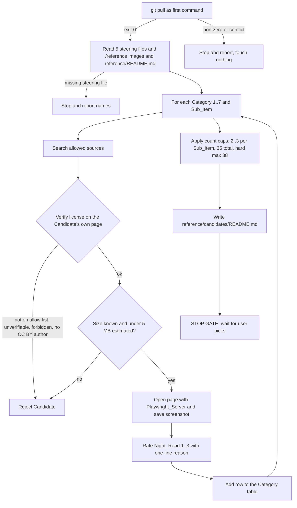
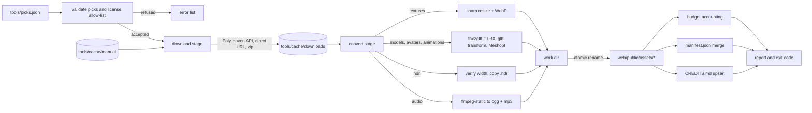

# Design Document

## Overview

The asset-pipeline supplies licensed 3D models, textures, HDRIs, avatars, animations and sounds for the graveyard and lab scenes. It runs in two phases with a hard stop between them.

- **Phase 1 (Scouting)** is an agent workflow, not code. The Scout_Agent finds 2-3 Candidates per Sub_Item in 7 Categories, verifies each license on the Candidate's own page, captures a Preview_Screenshot with the Playwright_Server, and writes `reference/candidates/README.md`. It then stops (Requirement 13).
- **Phase 2 (Download and Convert)** is a Node 22+ script, `tools/fetch-assets.mjs`, driven by a committed picks file. It downloads into a git-ignored cache, converts to web formats, enforces three size budgets, and writes `web/public/assets/manifest.json` and rows in `CREDITS.md`. It runs on Windows with PowerShell and is re-runnable with identical output.

The design keeps the Phase 2 script as a thin orchestrator over small, mostly pure helper modules. Pure modules (picks validation, license check, output planning, budget accounting, manifest merge, credits-table upsert) carry the correctness rules and are property-tested. Impure modules (HTTP, filesystem, sharp, gltf-transform, ffmpeg, fbx2gltf) are injected into the orchestrator, so tests can run the whole flow with stubs.

### Research summary

Findings that shaped the design (looked up on 2026-11; versions from `npm view`):

- **Poly Haven API.** Documented at [polyhaven.com/our-api](https://polyhaven.com/our-api). Base URL `https://api.polyhaven.com`. `GET /assets` lists assets and metadata (including `polycount` for models, `max_resolution`, `authors`, `files_hash`, `type` 0/1/2 for HDRI/texture/model). `GET /files/{id}` returns download URLs with `size` and `md5` per resolution and format. No key or login is needed. Two conditions apply: a unique `User-Agent` on every request, and a visible "Powered by Poly Haven" style credit when the live API is used. The assets themselves are CC0. The credit condition is why the script writes a Poly Haven line and a "Visible in app" note into `CREDITS.md`; the visible Credits button itself belongs to the graveyard-scene spec (see Open items for other specs). Content was rephrased for compliance with licensing restrictions.
- **glTF Transform.** The scripting API (`@gltf-transform/core`, `/extensions`, `/functions`) is documented at [gltf-transform.dev](https://gltf-transform.dev). Meshopt output needs `EXTMeshoptCompression` registered on `NodeIO`, `MeshoptEncoder` from `meshoptimizer` registered as `meshopt.encoder`, `await MeshoptEncoder.ready`, then `document.transform(meshopt({ encoder: MeshoptEncoder, level: 'medium' }))`. WebP textures use `textureCompress({ encoder: sharp, targetFormat: 'webp', resize: [w, h] })`; the written GLB then uses `EXT_texture_webp`, so the extension must be registered too. The simplest correct setup is `registerExtensions(ALL_EXTENSIONS)`. `resize` is a bounding box, so `[1024, 1024]` limits the longest side to 1024 px without distorting aspect ratio.
- **FBX to glTF.** The npm package `fbx2gltf` (BSD-3-Clause) bundles the FBX2glTF binaries for Windows, macOS and Linux inside the package and exposes `convert(srcPath, destPath, args) -> Promise<string>`. It does not download anything at install time. The latest version is `0.9.7-p1` (last published 2023-04). `@cocos/fbx2gltf` is a maintained-in-parallel alternative and is the named fallback if `fbx2gltf` fails on a Rocketbox file. The binary is third-party prebuilt code, so it is announced before install (Requirement 19.3).
- **Audio.** `ffmpeg-static` 5.3.0 downloads an ffmpeg binary from GitHub releases in its install script (`node install.js`). This is a prebuilt-binary install. pnpm 12 blocks dependency build scripts by default, so the package must be added to the `onlyBuiltDependencies` allow-list in `tools/package.json` (or `pnpm approve-builds`) after the user approves it.
- **sharp.** Version 0.35.5 ships prebuilt libvips through platform-specific optional dependencies (`@img/sharp-win32-x64`). No compile step runs on Windows.
- **Zip extraction.** Node has no built-in zip reader. `fflate` 0.8.3 is pure JavaScript with no binary and is used for `.zip` packs (Kenney, Quaternius, ambientCG).

Open point not yet verified: the exact JSON shape of `GET /files/{id}` for textures and models (the public page only shows the HDRI shape). The design assumes `textures[<map>][<res>][<fmt>] = { url, size, md5 }` and `gltf[<res>].gltf = { url, size, md5, include: { <relative path>: { url, size, md5 } } }`, and the implementation task must confirm this against one live response per type before coding `polyhaven.mjs`.

## Architecture

### Phase 1: scouting workflow



**Sources** (Requirement 2.5): Poly Haven, ambientCG, Kenney, Quaternius, Sketchfab (downloadable, CC BY or CC0), Freesound (CC0 only), OpenGameArt (CC0 only). Microsoft Rocketbox on GitHub is used only as the Category 5 Fallback.

**Order of work.** Fallback rows are verified first (they are fixed by the requirements), then pack Candidates that cover several Sub_Items, then single-item Candidates. Category 6 is always Manual_Pick. Category 7 never carries a Night_Read_Rating.

**Playwright screenshot flow.** For each Candidate, via the Playwright MCP server:

1. `browser_navigate` to the Candidate's own page.
2. `browser_wait_for` the main preview or licence element to be present.
3. Read the licence, author and size text from the page (`browser_snapshot`) and record them verbatim with the page URL.
4. `browser_take_screenshot` to `reference/candidates/<category>/<name>.png`.
5. If the file is 1 MB or larger, re-take at a smaller viewport (1280x720, then 1024x576) until it is under 1 MB.
6. If the page fails to load, record "preview unavailable: <reason>" in the table row. The Candidate stays only if its license was verified by another means (Requirement 11.3).

Screenshot names use lowercase letters, digits and hyphens only. Category folder names are `01-ground-stone`, `02-night-sky`, `03-graveyard-props`, `04-lab-props`, `05-avatars`, `06-zombie-hands`, `07-sound`. Filenames are validated against `^[a-z0-9-]+\.png$` before writing.

**Candidates README structure** (`reference/candidates/README.md`, Requirement 12):

```markdown
# Asset candidates (Phase 1)

Status: waiting for picks. Nothing has been downloaded.

## How to read this
(Night-read legend, "Fallback" label, "Manual pick" label, size basis note.)

## Comparison with /reference
(One short paragraph per reference image, linking to the images, then how the Candidates compare.)

## Category 1: Ground and stone textures
### Sub_Item: ground
| Name | Preview | Source URL | Author | License | File size | Poly count | Night-read | Night-read reason | Why it fits |
| --- | --- | --- | --- | --- | --- | --- | --- | --- | --- |
| brown_mud_leaves_01 (Fallback) |  | https://polyhaven.com/a/brown_mud_leaves_01 | Rob Tuytel | CC0 | ~1.4 MB (WebP est., from 1k jpg 3.1 MB) | n/a | 3 | Dark mid-albedo, strong normal detail catches a raking light | ... |

(... one table per Sub_Item, grouped under the Category heading ...)

## Sub_Items with no suitable candidate
| Sub_Item | Sources searched |

## Totals
Distinct Candidates: N (limit 35, hard max 38).
```

Column rules:

- `Preview` is a relative path to an existing screenshot (Requirement 12.5), or `preview unavailable: <reason>`.
- `File size` is "X.Y MB" plus the basis (source file size or stated compression ratio).
- `Poly count` is "n/a" for textures, HDRIs and sounds.
- `Night-read` is `1`, `2` or `3`; `Night-read reason` is one line based on roughness, albedo and surface detail. Both columns are `n/a` for every Category 7 row (Requirement 12.3).
- Category-specific extras are added as additional columns on those tables only: PBR maps present (Cat. 1), 1k/2k available and background-or-environment role (Cat. 2), skeleton type and retargeting effort with one sentence (Cat. 5), duration and file format (Cat. 7), author profile link and "Manual pick" (Cat. 6).
- Fallback rows come first in each Sub_Item and carry the label "(Fallback)".

**Count enforcement.** After the tables are drafted, the agent counts distinct Candidates (a pack counts once). If the total exceeds 35 it removes lowest-ranked third Candidates until it is at most 38 or at most 35 where possible, never leaving a Sub_Item below 2.

**Stop gate.** After writing the README the agent reports the totals and the list of files it created, states that `web/public/assets`, `manifest.json`, `CREDITS.md` and `tools/fetch-assets.mjs` are unchanged, and ends its turn. Phase 2 tasks are added to `tasks.md` only after the user sends picks (Requirement 13.4). This design does not produce `tasks.md`.

### Phase 1 extension: picks, provenance, Category 8

**Category 8 (horror dressing).** A new Category with screenshots in `reference/candidates/08-horror-dressing/` and its own README table. Sub_Items: skull and bones (replicas only), body bag, morgue drawer, chains and hooks, restraint straps, blood/handprint/drag decals (CC0), cobwebs, rotten cloth, blank headstones (intact, cracked, broken). Exactly 2 Candidates per Sub_Item, no Fallbacks, same sources, license checks, Night_Read_Rating and screenshot rules as Categories 1 to 7. The 35/38 cap does not apply. Headstone rows add columns for source triangle count and "decimation needed" (limit 20,000 per stone), and the notes state that the face is blank and the state reads from the silhouette. A set covering all three states is one row repeated under each state sub-table.

**Picks and Rejected.** Two README sections placed after the Category tables. "Picks" has one line per pick: name, scene, role. Names must match an existing table row, otherwise the line is left out and reported. "Rejected" lists names with reasons. Dropped Candidates keep their table rows and screenshots. Rocketbox animations in Picks are checked against the repository and the verified commit SHA is recorded for Phase 2 pinning.

**Provenance check.** For each Manual_Pick whose author says it reworks another sculpt (the two Greenall models), the agent searches the author's page, description, comments and linked posts for the original. Evidence (URLs, quotes under 30 words) is written in a "Provenance" subsection of the README. Confirmed: the model goes to Picks. Unconfirmed: it goes to Rejected ("provenance unconfirmed") and one replacement is proposed (emaciated corpse or skeleton; clawing hand) under the Requirement 10 criteria, as a Manual_Pick.

**Stop gate.** After validation the agent runs `git pull --no-edit`, commits only Owned_Paths, and waits for the user. No Phase 2 tasks, no installs.

### Phase 2: fetch-assets script



Processing is per pick, fail-soft: one pick failing never stops the others, and the final exit code is non-zero if any pick failed, was refused, or any budget is exceeded.

### Ownership and git safety

- `tools/` is owned by the user (structure.md). Everything this spec adds lives in the Owned_Paths: `tools/`, `web/public/assets`, `reference/candidates`, `CREDITS.md`, `.gitignore`, `.kiro/specs/asset-pipeline`.
- The script never writes outside `web/public/assets`, `tools/cache`, `CREDITS.md` and `tools/cache/manual/README.md`. A `paths.mjs` guard resolves every output path and throws if it is not inside one of these roots (path-traversal guard for pick names as well).
- The script never runs git. Staging is done by the agent with explicit `git add <path>` per file or folder, never `-A`, `.`, `--all`, `stash`, `reset`, `checkout`, `clean` or `restore` outside the Owned_Paths. The one permitted `git restore --staged <path>` unstages a file outside the Owned_Paths before commit and is reported. A parallel chat holds uncommitted work in `web/src/engine` and `web/src/state`; those files must stay byte-identical. No commit is made unless the user asks. Commit messages use `<type>(asset-pipeline): <description>`, subject at most 72 characters.
- `/pipeline` and `/data` generation code are never touched.
- `.gitignore` gains exactly these entries, in this order, plus an entry for local tool output, and nothing that ignores `.kiro`:

  ```
  tools/cache/*
  !tools/cache/manual/
  tools/cache/manual/*
  !tools/cache/manual/README.md
  ```

  Git cannot re-include a file whose parent folder is excluded, which is why the rules ignore the folder's contents (`tools/cache/*`) instead of the folder, re-include `manual/`, ignore its contents, and re-include only the README. `git add -f` and `git add --force` are never used. After writing the entries the agent verifies with `git check-ignore -v`: `tools/cache/manual/README.md` is NOT ignored (exit code 1), `tools/cache/downloads/example/file.bin` is ignored, and `tools/cache/manual/example/file.fbx` is ignored (Requirements 15.2, 15.3, 21.7).

## Components and Interfaces

### File layout

```
tools/
  package.json            private, "type": "module", exact pins, own pnpm lockfile
  pnpm-lock.yaml
  picks.json              user decisions, committed
  fetch-assets.mjs        CLI entry and orchestrator
  asset-lib/
    paths.mjs             repo roots, safe join, output path planning
    picks.mjs             load + validate picks.json
    licenses.mjs          allow-list, forbidden hosts, normalisation
    http.mjs              download with User-Agent, timeout, retry
    polyhaven.mjs         /files/{id} client and file selection
    cache.mjs             download cache records, skip logic
    archive.mjs           zip extraction (fflate)
    convert-texture.mjs   sharp resize + WebP
    convert-model.mjs     fbx2gltf, gltf-transform, Meshopt
    convert-hdri.mjs      .hdr width check and copy
    convert-audio.mjs     ffmpeg-static to ogg and mp3
    budgets.mjs           group accounting and report
    manifest.mjs          manifest merge and serialisation
    credits.mjs           CREDITS.md table upsert
    manual-readme.mjs     generate tools/cache/manual/README.md
    report.mjs            console output and exit code
    *.test.mjs            Vitest + fast-check tests
  cache/                  git-ignored (see Cache layout)
```

### Prebuilt-binary packages to announce before the first install

Per Requirement 19.3 the agent lists these to the user and waits for approval before running `pnpm install` in `tools/`. All are npm packages; no binary is run that npm did not install (Requirement 19.4).

| Package | Pinned version | What it brings | How the binary arrives |
| --- | --- | --- | --- |
| `sharp` | 0.35.5 | libvips for resize and WebP | prebuilt `@img/sharp-win32-x64` optional dependency |
| `ffmpeg-static` | 5.3.0 | ffmpeg executable for ogg and mp3 | install script downloads from GitHub releases; needs build-script approval in pnpm 12 |
| `fbx2gltf` | 0.9.7-p1 | FBX2glTF executables (BSD-3-Clause, contains Autodesk FBX SDK code) | shipped inside the npm tarball (about 35 MB unpacked) |
| `meshoptimizer` | 1.3.0 | WASM encoder (no native binary) | npm tarball |

Pure JavaScript dependencies (also pinned exactly): `@gltf-transform/core`, `@gltf-transform/extensions`, `@gltf-transform/functions` all `4.5.1`; `fflate` `0.8.3`. Dev dependencies match `web/package.json`: `vitest` `5.1.0`, `fast-check` `4.10.2`. Versions come from `npm view` at design time and are re-checked at install. If `fbx2gltf` cannot be installed or run, the agent asks the user for another approach (for example `@cocos/fbx2gltf`) and does not fetch a binary from outside npm (Requirement 19.5). Before writing code against the Poly Haven API, gltf-transform or the FBX converter, the agent re-checks current docs via context7 or the web (Requirement 19.7).

### CLI

```
node tools/fetch-assets.mjs [--picks tools/picks.json] [--only <name>[,<name>...]] [--dry-run]
```

Run from the repository root in PowerShell, for example `node tools/fetch-assets.mjs; echo $LASTEXITCODE`. Add a script `fetch-assets` in `tools/package.json` and tests as `pnpm --dir tools test`. `--dry-run` validates picks, prints the plan and budget projection from source sizes and writes nothing.

### Module interfaces

```ts
// picks.mjs
loadPicks(path: string): Pick[]                         // throws PicksFileError on bad JSON/schema
validatePick(p: unknown): { ok: true; pick: Pick } | { ok: false; errors: PickError[] }

// licenses.mjs
checkLicense(pick: Pick): { ok: true; canonical: CanonicalLicense } | { ok: false; reason: string }

// paths.mjs
planOutputs(pick: Pick, produced: ProducedFile[]): PlannedOutput[]   // pure; rel paths under asset root
safeJoin(root: string, ...parts: string[]): string                    // throws if result escapes root

// cache.mjs
isCached(cacheDir: string, record: DownloadRecord): Promise<boolean>

// budgets.mjs
accountBudgets(files: { path: string; bytes: number; group: Group | null }[]): BudgetReport
LIMITS = { graveyard: 26_214_400, lab: 26_214_400, total: 62_914_560 }

// manifest.mjs
mergeManifest(prev: Manifest, entries: ManifestEntry[]): Manifest
serializeManifest(m: Manifest): string          // stable key order, 2-space indent, LF, trailing newline

// credits.mjs
upsertCreditRows(markdown: string, rows: CreditRow[]): { markdown: string; warnings: string[] }
ensureCmuLine(markdown: string): string
ensureVisibleNote(markdown: string): string     // exactly one "## Visible in app" section, first

// orchestrator, all side effects injected
runFetch(opts: {
  picks: Pick[]; env: Env;                      // Env = { fs, http, convert, clock-free }
}): Promise<RunResult>                          // { exitCode, refused, failed, budgets, written }
```

`Env` contains `fs` (a subset of `node:fs/promises`), `http.get`, and the four converters. Production wiring is in `fetch-assets.mjs`; tests pass a temp directory and fake converters that return deterministic bytes derived from the input.

### Picks file

`tools/picks.json` is written by the agent from the user's picks and committed. It is the single input of the script.

```json
{
  "version": 1,
  "picks": [
    {
      "name": "brown-mud-leaves-01",
      "kind": "texture",
      "category": 1,
      "group": "graveyard",
      "title": "Brown Mud Leaves 01",
      "author": "Rob Tuytel",
      "sourceUrl": "https://polyhaven.com/a/brown_mud_leaves_01",
      "license": "CC0",
      "role": "ground-main",
      "source": { "type": "polyhaven", "id": "brown_mud_leaves_01", "resolution": "2k", "maps": ["Diffuse", "nor_gl", "Rough"] }
    }
  ]
}
```

Fields:

| Field | Type | Notes |
| --- | --- | --- |
| `name` | string | `^[a-z0-9][a-z0-9-]*$`, unique; becomes the output subfolder |
| `kind` | `texture \| hdri \| model \| avatar \| animation \| audio` | selects converter and output folder |
| `category` | 1..7 | matches Candidates_README |
| `group` | `graveyard \| lab` | budget group; if missing the file counts only in the total (warning) |
| `title`, `author`, `sourceUrl`, `license` | non-empty strings | copied to manifest and credits; license text is the exact string recorded in Phase 1 |
| `changes` | string, optional | overrides the generated "changes we made" text |
| `role` | `ground-main \| background \| environment`, optional | `ground-main` raises texture limit to 2048; `background`/`environment` pick HDRI width 2048/1024 |
| `source` | union below | where bytes come from |

`source` variants:

- `{ "type": "polyhaven", "id": string, "resolution": "1k"\|"2k"\|..., "maps"?: string[], "format"?: string }`. HDRIs use `.hdr`; models use the `gltf` entry with its `include` files.
- `{ "type": "url", "url": string, "sha256"?: string, "archive"?: "zip", "entry"?: string }`. `entry` names the file inside the archive to convert; `sha256`, if present, is verified after download.
- `{ "type": "manual", "pageUrl": string, "expectedFile": string, "entry"?: string }`. Used for Sketchfab (Category 6) and any login-gated download.

Unknown keys are rejected so typos cannot silently disable a check.

### Cache layout

```
tools/cache/                        contents git-ignored via "tools/cache/*" (README re-included)
  downloads/<name>/                 one folder per pick
    .download.json                  { sourceUrls[], files: [{ file, bytes, sha256, md5? }], apiResponse? }
    <downloaded files...>
  manual/                           Manual_Cache
    README.md                       tracked (re-included in .gitignore, plain git add), generated from picks
    <name>/<expectedFile>           placed by the user, never fetched
  work/<name>-<pid>/                staging for one pick; removed on success or failure
```

Rules:

- A pick is "cached" when `.download.json` exists, every listed file exists, and each file's size and SHA-256 equal the record. A cached pick causes zero HTTP requests, including to the Poly Haven API, because the file list and URLs are stored in `.download.json`.
- Manual picks never create `downloads/<name>`; the script reads `manual/<name>/<expectedFile>` directly and makes no network request (Requirement 14.8). If the file is missing it prints the expected file name and `pageUrl`, skips the pick and marks the run failed (14.9).
- `manual/README.md` is regenerated at the start of every run from the manual picks, in pick-name order, as a table of `name`, `expected file name`, `source page URL`. The content depends only on picks, so repeated runs rewrite identical bytes (Requirement 15.1).

### HTTP stage (`http.mjs`, `polyhaven.mjs`)

- Every request sends `User-Agent: ZombieFirmRadar-asset-fetch/1.0 (+https://github.com/<owner>/zombie-firm-radar)`. The contact URL is read from `package.json` `repository.url` at run time, so it is not hard-coded.
- Timeout 60 s per request using `AbortSignal.timeout(60000)`. Up to 2 retries after the first attempt on network error, timeout or non-2xx, with 1 s then 2 s back-off. After the last failure the pick is reported as `asset name: cause`, existing cache and output files for it are left alone, the loop continues, and the run exit code is non-zero (Requirement 14.5).
- Only documented Poly Haven endpoints are called: `GET /files/{id}` (and `GET /assets/{id}` only if metadata is needed). Download URLs come from the `/files` response and are on `dl.polyhaven.org`. Requests are sequential per host, so the rate stays well below any fair-use limit.
- Downloads stream to a `.part` file in `work/`, then verify `size` and `md5` from the API when present, then move into `downloads/<name>/`.
- Zip archives are extracted with `fflate` into `work/`. Entry names are checked with `safeJoin` to block zip-slip.

### Conversion pipeline

All converters write only into the pick's `work/` folder. After every converter for a pick has succeeded, the folder's files are moved into `web/public/assets/<typeDir>/<name>/` with `fs.rename`. If any step fails the work folder is deleted and nothing is written to the asset root, so no partial output remains (Requirement 16.9). If a previous output exists for that pick it is left untouched.

| Kind | Output folder | Converter |
| --- | --- | --- |
| texture | `textures/<name>/` | `convert-texture.mjs` |
| hdri | `hdri/<name>/` | `convert-hdri.mjs` |
| model | `models/<name>/` | `convert-model.mjs` |
| avatar | `avatars/<name>/` | `convert-model.mjs` |
| animation | `animations/<name>/` | `convert-model.mjs` (animation-only GLB) |
| audio | `audio/<name>/` | `convert-audio.mjs` |

**Textures** (`convert-texture.mjs`). For each source map (PNG or JPG), `sharp(input).resize({ width: L, height: L, fit: 'inside', withoutEnlargement: true }).webp({ quality: 82, effort: 4 })`, where `L` is 2048 for `role: "ground-main"` and 1024 otherwise. Output `<name>/<name>_<map>.webp`. Normal maps use `quality: 90, nearLossless: false` so tangent data is not smeared. No KTX2 and no `toktx` (Requirement 16.2). Images inside models are handled by `textureCompress` below.

**HDRIs** (`convert-hdri.mjs`). Requirement 16.3 says no format conversion, and 16.7 sets widths 2048 (background) and 1024 (environment). The script therefore selects the matching Poly Haven resolution (`2k` = 2048 px wide, `1k` = 1024 px wide) and copies the `.hdr` byte for byte. It reads the Radiance header (`-Y <h> +X <w>`) and fails the pick if the width is not the required value, so a mismatched non-Poly-Haven HDRI is refused instead of silently resampled. Output `hdri/<name>/<name>_<res>.hdr`.

**Models, avatars, animations** (`convert-model.mjs`).

```js
import { NodeIO } from '@gltf-transform/core';
import { ALL_EXTENSIONS } from '@gltf-transform/extensions';
import { dedup, prune, resample, textureCompress, meshopt } from '@gltf-transform/functions';
import { MeshoptEncoder } from 'meshoptimizer';
import sharp from 'sharp';
import convertFbx from 'fbx2gltf';

await MeshoptEncoder.ready;
const io = new NodeIO()
  .registerExtensions(ALL_EXTENSIONS)
  .registerDependencies({ 'meshopt.encoder': MeshoptEncoder });

// 1. if source is .fbx: await convertFbx(src, tmpGlb, ['--binary'])   // fbx2gltf npm package
// 2. const doc = await io.read(srcGltfOrGlb)
// 3. await doc.transform(
//      dedup(), prune(), resample(),
//      textureCompress({ encoder: sharp, targetFormat: 'webp', resize: [L, L] }),
//      meshopt({ encoder: MeshoptEncoder, level: 'medium' }))
// 4. await io.write(outGlb, doc)
```

- `L` is 1024 for model textures (2048 only for a `ground-main` role, which does not occur on models). `resample()` is applied for animation and avatar picks only; static props skip it.
- `.gltf` sources with external textures (Poly Haven models) are read from the cache folder, where the `include` files keep their relative paths, and written as one self-contained `.glb`.
- Rocketbox LICENSE: for avatar picks from Rocketbox the converter also copies the repository `LICENSE` file into the same output folder (Requirement 18.5). The license file is itself an asset row in manifest and credits, with the title "Microsoft Rocketbox LICENSE".
- The `meshopt` transform quantizes geometry. The agent checks one skinned avatar visually after the first conversion; if skinning artefacts appear it lowers quantization (`quantizePosition: 14`) for avatars only. This is noted in the task, not in the pick.
- Retargeting CMU clips to the Rocketbox skeleton is a different tool (animation-direction.md) and is out of scope here. This pipeline converts and compresses only.

**Audio** (`convert-audio.mjs`). `ffmpeg-static` provides the binary path. Two spawns per pick:

```
ffmpeg -nostdin -y -i <src> -map_metadata -1 -fflags +bitexact -flags:a +bitexact -c:a libvorbis -q:a 4 <name>.ogg
ffmpeg -nostdin -y -i <src> -map_metadata -1 -fflags +bitexact -flags:a +bitexact -c:a libmp3lame -q:a 4 -id3v2_version 0 -write_xing 0 <name>.mp3
```

Arguments are passed as an array to `child_process.spawn` (no shell, so no quoting or injection issues with file names). `bitexact` and metadata stripping remove encoder version strings and random serial numbers. If the shipped ffmpeg build lacks `libvorbis`, the pick fails with a clear message and the agent proposes `-c:a vorbis -strict -2` or another approach; it does not fall back to a system ffmpeg.

**Idempotence layering.** Idempotence does not rely on encoder determinism alone. Each manifest entry stores `inputs_sha256` (hash of the sorted source file hashes) and `recipe` (hash of the converter name, converter package versions and settings). If a pick's output files exist, their stored SHA-256 equals the files on disk, and `inputs_sha256` and `recipe` match, the pick is skipped without running any converter. Determinism of the converters is the second layer and covers a cleaned output folder.

### Budget accounting (`budgets.mjs`)

```ts
type Group = 'graveyard' | 'lab';
interface BudgetReport {
  used:   { graveyard: number; lab: number; total: number };
  limit:  { graveyard: 26214400; lab: 26214400; total: 62914560 };
  exceeded: ('graveyard' | 'lab' | 'total')[];
  largest: Record<'graveyard' | 'lab' | 'total', { path: string; bytes: number }[]>; // top 3 per exceeded budget
  unassigned: string[];            // counted in total only, warned
  oversizeFiles: { path: string; bytes: number; mb: string; suggestion: string }[]; // > 5,242,880
}
```

- Input is the list of every file found by walking `web/public/assets` (not only this run's output), with `stat` sizes and a group looked up from the manifest entry for that path.
- `used.total` is the sum of all files. `used.graveyard` and `used.lab` sum files with that group. Files with no manifest group (including `manifest.json` itself and LICENSE files, which are treated as `meta`) count in total only; non-meta ones produce a warning (Requirement 17.6). Because groups are disjoint subsets of the total, `graveyard + lab <= total` always.
- 1 MB is 1,048,576 bytes. A budget is exceeded when `used > limit` (equality passes).
- Files over 5,242,880 bytes are reported with path, size in MB rounded to 2 decimals and a suggestion ("re-run with a lower texture limit or higher Meshopt level" for models, "use the 1k HDRI" for HDRIs, "lower -q:a" for audio). They are kept (Requirement 16.8).
- Output on success: one line per file with byte size, then `graveyard X / 26214400`, `lab X / 26214400`, `total X / 62914560`, exit 0 (17.4). On failure: names of exceeded budgets with used and limit, then the three largest files in each exceeded budget, exit non-zero (17.5). If a file cannot be `stat`ed the path and reason are printed and the exit code is non-zero (17.7).

### License allow-list enforcement (`licenses.mjs`)

Applied in two places: when picks are loaded (before any download) and again immediately before writing each file to the asset root. The second check makes it impossible to write a file whose pick record was mutated in memory.

1. Normalise the license string: trim, collapse whitespace, case-fold, replace `_` with space.
2. Reject if it contains a token matching `/(^|[\s-])nc([\s-]|$)/` or `/non[\s-]?commercial/`, or if `sourceUrl` host is one of `mixamo.com`, `cgtrader.com`, `fab.com`, `turbosquid.com` (including subdomains). The reason is reported as "forbidden".
3. Accept only an exact match against the alias table, whole string, not prefix:

| Canonical | Accepted aliases (after normalisation) |
| --- | --- |
| CC0 | `cc0`, `cc0 1.0`, `cc0-1.0`, `creative commons zero` |
| CC BY | `cc by`, `cc by 4.0`, `cc-by-4.0`, `cc by 3.0`, `cc-by-3.0`, `attribution 4.0 international` |
| MIT | `mit`, `mit license` |
| Apache-2.0 | `apache-2.0`, `apache 2.0`, `apache license 2.0` |
| SIL OFL | `sil ofl`, `ofl-1.1`, `sil open font license 1.1` |
| Own work | `own work`, `our own work` |
| CMU Graphics Lab motion capture | `cmu graphics lab motion capture` |

4. Anything else is refused with "not on allow list", including `CC BY-SA`, `CC BY-ND`, `CC BY-NC*`, an empty string and unknown strings. Refusal means: do not write the file, do not add a manifest entry or credits row, print the file name and the license value as an error, continue, and exit non-zero (Requirement 18.7, 18.9).
5. Missing or empty `sourceUrl`, `author` or `license` is refused with the file name and the field name (18.8). `CC BY` also needs `author` and an `http(s)` `sourceUrl`.

### Manifest (`manifest.mjs`)

File: `web/public/assets/manifest.json`. Keys are repo-relative paths under the asset root. One entry per file means one key per file.

```json
{
  "version": 1,
  "files": {
    "models/large-iron-gate/large-iron-gate.glb": {
      "pick": "large-iron-gate",
      "title": "Large Iron Gate",
      "author": "Poly Haven contributors",
      "sourceUrl": "https://polyhaven.com/a/large_iron_gate",
      "license": "CC0",
      "changes": "Converted glTF to single GLB, textures resized to 1024 px WebP, geometry Meshopt-compressed",
      "group": "graveyard",
      "bytes": 1843200,
      "sha256": "<hex>",
      "inputsSha256": "<hex>",
      "recipe": "<hex>"
    }
  }
}
```

- `author`, `sourceUrl`, `license`, `changes` are non-empty strings (Requirement 18.1).
- Serialisation sorts keys by path (ordinal), uses 2-space indent, LF line endings and a trailing newline, and contains no timestamps or absolute paths. Equal inputs give identical bytes.
- `mergeManifest(prev, entries)` replaces entries by key and never removes other keys. Stale keys (file no longer on disk) are reported as warnings.
- The file is written after all picks finish via temp file plus rename, so a crash cannot leave half a JSON file.

### Credits management (`credits.mjs`)

`CREDITS.md` already has a table under `## Assets` with the header `| Path | Title | Author | Source URL | License | Changes we made |`.

- `upsertCreditRows` parses only the lines of that table (from the header separator to the first non-table line). It builds a map `Path -> row`, applies upserts (insert if absent, replace if present), and re-emits rows sorted by Path ordinal. Text outside the table is returned byte-for-byte.
- Rows are generated only for files that were written or confirmed present in this run and exist on disk at write time (Requirement 18.3). Paths are written as `web/public/assets/<typeDir>/<name>/<file>`. Cell text is escaped (`|` becomes `\|`, newlines become spaces) and every cell must be non-empty.
- Rows for paths that no longer exist are not deleted automatically; they are listed as warnings so a hand-edited row is never lost.
- Row count after run N+1 with unchanged inputs equals the count after run N, with one row per Path (18.4).
- `ensureCmuLine` checks the `## Motion capture` section for the fixed sentence "The data used in this project was obtained from mocap.cs.cmu.edu. The database was created with funding from NSF EIA-0196217." It adds the section and line only if CMU picks exist and the line is absent, and never duplicates it (18.6). The line is already present today, so this is a no-op until CMU clips are added.
- Poly Haven credit: if any pick uses `source.type = "polyhaven"`, the script ensures one line "Powered by Poly Haven (polyhaven.com), CC0 assets via the Poly Haven API." exists under a `## Services` section.
- **Visible in app note (Requirement 22).** `CREDITS.md` starts with a first section headed `## Visible in app`, before the title table or any row, containing a fixed note: the content of this file is shown in the Credits button of the Settings menu in the app; that UI is delivered by the graveyard-scene spec; the note is required because Poly Haven's terms need a visible credit. `ensureVisibleNote(markdown)` is the single function that handles it:
  - It identifies the note by its heading line `## Visible in app` and by the fixed body text.
  - If the note is absent it inserts it once at the top of the file. If a title line (`# ...`) is the first line, the note goes directly after the title and before every other section, so it remains the first section.
  - If several copies exist it keeps the first one and removes the others.
  - If the note exists in a position other than first, or with changed body text, it is rewritten to the fixed text and moved to the first section.
  - Text outside the note is returned byte for byte. Line endings of the original are preserved.
  - `upsertCreditRows` and `ensureCmuLine` never touch the note, and the script calls `ensureVisibleNote` on every write of `CREDITS.md`, so a second run with unchanged inputs leaves exactly one note.
  - The script does not build the Credits button. That belongs to the graveyard-scene spec (see Open items for other specs).
- File is written with temp file plus rename. Line endings are preserved from the original file (the repo uses `.gitattributes`).

### Asset-auditor loop

After the Phase 2 conversion finishes with exit code 0, the Scout_Agent invokes the `asset-auditor` agent (Requirement 20). Loop:

1. Run auditor. If it reports no findings, stop.
2. For each finding fix it in the Owned_Paths only: add a missing credits row (by re-running the script with corrected picks, not by hand), replace a forbidden-license pick (ask the user), add missing attribution to the pick, or shrink a file over 5 MB (lower `maxTextureSize` or Meshopt level in the pick, or ask the user to choose a lighter Candidate).
3. Re-run the script, then the auditor again.
4. Repeat until there are no findings. If the same finding survives two fixes the agent stops and asks the user instead of looping (per the working rules on repeated failures).

The auditor is a reviewer. The script's own checks (allow-list, one row per file, budgets) are a first line; the auditor is the independent second line.

## Data Models

```ts
type Kind = 'texture' | 'hdri' | 'model' | 'avatar' | 'animation' | 'audio';
type Group = 'graveyard' | 'lab';
type Role = 'ground-main' | 'background' | 'environment';

type Source =
  | { type: 'polyhaven'; id: string; resolution: string; maps?: string[]; format?: string }
  | { type: 'url'; url: string; sha256?: string; archive?: 'zip'; entry?: string }
  | { type: 'manual'; pageUrl: string; expectedFile: string; entry?: string };

interface Pick {
  name: string;               // ^[a-z0-9][a-z0-9-]*$, unique
  kind: Kind;
  category: 1 | 2 | 3 | 4 | 5 | 6 | 7;
  group?: Group;
  title: string; author: string; sourceUrl: string; license: string;
  changes?: string;
  role?: Role;
  source: Source;
}

interface DownloadRecord {
  name: string;
  sourceUrls: string[];
  files: { file: string; bytes: number; sha256: string; md5?: string }[];
}

interface ProducedFile { relPath: string; bytes: Uint8Array | string /* path in work dir */ }
interface PlannedOutput { relPath: string /* e.g. models/gate/gate.glb */; pick: string }

interface ManifestEntry {
  pick: string; title: string; author: string; sourceUrl: string; license: string;
  changes: string; group: Group | null; bytes: number;
  sha256: string; inputsSha256: string; recipe: string;
}
interface Manifest { version: 1; files: Record<string, ManifestEntry> }

interface CreditRow { path: string; title: string; author: string; sourceUrl: string; license: string; changes: string }

interface RunResult {
  exitCode: 0 | 1;
  written: string[]; skipped: string[];
  refused: { name: string; reason: string }[];
  failed: { name: string; cause: string }[];
  budgets: BudgetReport;
}
```

Derived rules:

- `CreditRow.path = 'web/public/assets/' + ManifestEntry key`, so manifest keys and credits paths correspond one to one.
- `exitCode` is 1 if `failed`, `refused`, missing manual files, an exceeded budget or an unreadable file size exists, otherwise 0.
- Default `changes` text is generated from the converter that ran (for example "Resized to 1024 px longest side, encoded as WebP quality 82").

## Correctness Properties

*A property is a characteristic or behavior that should hold true across all valid executions of a system-essentially, a formal statement about what the system should do. Properties serve as the bridge between human-readable specifications and machine-verifiable correctness guarantees.*

Scope: these properties apply to the Phase 2 script and its helper modules only. Phase 1 is an agent research workflow over web content and is verified by review (see Testing Strategy), not by property tests.

Reflection notes: the per-budget limit criteria (17.1-17.3) and the unassigned-file rule (17.6) fold into one accounting property. The retry bound, failure isolation and exit-code criteria (14.5, 14.9, 16.9) split into two properties (bounded retries; no partial output with isolation). The positive and negative sides of the allow-list (18.7) are one "accepted if and only if" property. Manifest-per-file and credits-per-file stay separate because they are produced by different modules.

### Property 1: Re-run idempotence

*For any* set of valid picks and any fake download and conversion results, running the script a second time with unchanged picks and unchanged cache SHALL issue zero HTTP requests, leave every file under the asset root with the same SHA-256, and leave `manifest.json` and `CREDITS.md` byte-identical to their state after the first run.

**Validates: Requirements 14.3, 18.4**

### Property 2: Budget accounting invariants

*For any* list of files with non-negative sizes and groups in {graveyard, lab, none}, `accountBudgets` SHALL return `used.total` equal to the sum of all sizes, `used.graveyard` and `used.lab` equal to the sums of files in those groups, limits of exactly 26,214,400, 26,214,400 and 62,914,560 bytes, `used.graveyard + used.lab <= used.total`, and an `exceeded` set that contains a budget if and only if its used value is greater than its limit. Files without a group SHALL add to the total only, and every non-meta such file SHALL appear in `unassigned`.

**Validates: Requirements 17.1, 17.2, 17.3, 17.6**

### Property 3: Budget report content and exit code

*For any* list of files, the report SHALL include every file with its byte size; for every exceeded budget it SHALL list the three largest files of that budget in descending size order (or all of them if fewer than three); `oversizeFiles` SHALL contain exactly the files larger than 5,242,880 bytes, each with its size in MB rounded to two decimals, and no file SHALL be dropped from the accounting because it is oversize; and the exit code SHALL be 0 if and only if `exceeded` is empty and no file size was unreadable.

**Validates: Requirements 16.8, 17.4, 17.5, 17.7**

### Property 4: Manifest has one complete entry per written file

*For any* set of valid picks run to completion with successful converters, the set of keys in `manifest.json` SHALL equal the set of files under the asset root (excluding `manifest.json` itself), each entry SHALL have non-empty `sourceUrl`, `author`, `license` and `changes`, and the serialisation of the manifest SHALL be identical for any order of the input picks.

**Validates: Requirements 18.1**

### Property 5: Credits table has exactly one row per file and is stable

*For any* existing `CREDITS.md` containing a table with any rows (including duplicates of the same Path) and any list of new rows, `upsertCreditRows` SHALL return a document where every Path appears exactly once, every new row's cells equal the supplied values with no empty cell, all text outside the table is unchanged byte for byte, and applying the same upsert a second time SHALL return the same document.

**Validates: Requirements 18.2, 18.3, 18.4**

### Property 6: CMU credit line appears exactly once

*For any* `CREDITS.md` content containing zero, one or several copies of the fixed CMU sentence, `ensureCmuLine` SHALL return content with exactly one copy when CMU picks exist, and applying it twice SHALL give the same result as applying it once.

**Validates: Requirements 18.6**

### Property 7: License allow-list is exact

*For any* pick, `checkLicense` SHALL accept it if and only if its normalised license string (trimmed, case-folded, whitespace-collapsed) is exactly one of the allowed aliases and its `sourceUrl` host is not a forbidden marketplace host. Every license string containing an NC token or "non-commercial", every CC BY-SA or CC BY-ND variant, every empty string and every other string SHALL be refused.

**Validates: Requirements 18.7**

### Property 8: Refused picks leave no trace and fail the run

*For any* set of picks in which a subset has a non-allowed license or an empty `sourceUrl`, `author` or `license`, the run SHALL write no file for the refused picks, add no manifest entry and no credits row for them, name each refused pick and the license value or missing field in its error output, process all remaining valid picks normally, and return exit code 1.

**Validates: Requirements 18.7, 18.8, 18.9**

### Property 9: Output paths follow kind and name and never escape

*For any* valid pick, `planOutputs` SHALL place every produced file under `<assetRoot>/<typeDir>/<name>/` where `typeDir` is determined by `kind` (texture to `textures`, hdri to `hdri`, model to `models`, avatar to `avatars`, animation to `animations`, audio to `audio`); and *for any* sequence of path segments, including `..`, absolute paths and drive letters, `safeJoin(root, ...segments)` SHALL either return a path inside `root` or throw.

**Validates: Requirements 14.4, 21.1, 21.9**

### Property 10: Retries are bounded and failures are isolated

*For any* assignment of failure counts to downloads, a download that fails fewer than 3 consecutive times SHALL succeed and a download that fails 3 or more times SHALL be attempted exactly 3 times (the first attempt plus 2 retries) and then be reported with its pick name and cause; in all cases every other pick SHALL still be processed, existing cache and output files of the failed pick SHALL be unchanged, and the exit code SHALL be 1 if and only if at least one pick failed.

**Validates: Requirements 14.5**

### Property 11: Conversion failure leaves no partial output

*For any* set of picks and any subset whose converter throws at a random step, the asset root SHALL contain no file belonging to a failed pick that was not already there before the run, no `work/` folder SHALL remain for it, all non-failing picks SHALL be written, and the exit code SHALL be 1.

**Validates: Requirements 16.9**

### Property 12: Network discipline

*For any* set of picks, every HTTP request issued by the script SHALL carry a non-empty `User-Agent` header, every request to the Poly Haven host SHALL target `/files/{id}` or `/assets`, and a pick of type `manual` SHALL cause zero HTTP requests whether its file is present (the file is read from the Manual_Cache) or absent (the pick is skipped, reported with the expected file name and page URL, and the run exits with code 1 after processing the remaining picks).

**Validates: Requirements 14.6, 14.8, 14.9**

### Property 13: HDRI is copied unchanged and width is enforced

*For any* valid Radiance `.hdr` bytes, the output file SHALL have the same SHA-256 as the input; and *for any* declared width and role, the width check SHALL accept the file if and only if the width equals 2048 for `background` or 1024 for `environment`.

**Validates: Requirements 16.3, 16.7**

### Property 14: Texture size limit preserves aspect ratio

*For any* source width and height of at least 1 pixel and either limit L in {1024, 2048}, `fitInside(w, h, L)` SHALL return dimensions whose longest side equals `min(max(w, h), L)`, SHALL never enlarge either side, and SHALL preserve the aspect ratio within one pixel of rounding; and L SHALL be 2048 if and only if the pick role is `ground-main`.

**Validates: Requirements 16.6**

### Property 15: Manual README lists every manual pick

*For any* set of picks, the generated `tools/cache/manual/README.md` SHALL contain, for every manual pick, its `expectedFile` and `pageUrl`, SHALL contain no entry for non-manual picks, and generating it twice from the same picks SHALL produce identical bytes.

**Validates: Requirements 15.1**

### Property 16: Visible-in-app note is first, unique and preserved

*For any* `CREDITS.md` content (with zero, one or several copies of the note, at any position, with or without altered body text, and with arbitrary other text and table rows), `ensureVisibleNote` SHALL return content in which the `## Visible in app` section appears exactly once and is the first section, its body equals the fixed text, and all text outside the note is unchanged byte for byte; applying it twice SHALL give the same result as applying it once; and *for any* sequence of `upsertCreditRows` and `ensureCmuLine` calls applied after it, the note SHALL remain unchanged, first and unique.

**Validates: Requirements 22.1, 22.2, 22.3, 22.4, 22.5**

## Error Handling

All errors are collected, never thrown past the per-pick boundary, and printed at the end in a summary. Messages name the pick and the cause. A single run result decides the exit code.

| Situation | Behaviour | Exit |
| --- | --- | --- |
| `picks.json` unreadable, bad JSON, unknown key, duplicate `name` | Print the file and path of the first problem per pick; no downloads start | 1 |
| Pick has non-allowed license or forbidden host | Refuse that pick, report name and license value, continue (18.7) | 1 at end |
| Pick has empty `sourceUrl`, `author` or `license` | Refuse that pick, report name and field, continue (18.8) | 1 at end |
| Download network error, timeout (60 s) or non-2xx | Retry up to 2 times, then report `name: cause`, keep old cache and outputs, continue (14.5) | 1 at end |
| Poly Haven `size` or `md5` mismatch after download | Treated as a download failure and retried | 1 at end |
| Archive entry escapes the extraction folder | Pick fails with "unsafe archive entry" | 1 at end |
| Manual file missing | Report expected file and page URL, skip, continue (14.9) | 1 at end |
| Converter failure (unreadable source, missing binary, tool error, wrong HDR width) | Delete the work folder, report path and cause, leave existing output, continue (16.9) | 1 at end |
| `libvorbis` or `libmp3lame` missing in ffmpeg-static build | Pick fails with a message naming the codec; no system ffmpeg fallback | 1 at end |
| File over 5 MB | Report path, MB (2 decimals) and suggestion; keep the file (16.8) | 0 unless a budget is exceeded |
| Budget exceeded | Print budget name, used and limit, three largest files (17.5) | 1 |
| Unassigned (no group) file | Warn with file name; counts toward total only (17.6) | 0 |
| File size cannot be read | Print path and reason (17.7) | 1 |
| Stale manifest key or credits row for a missing file | Warn, never auto-delete | 0 |
| Output path would leave the allowed roots | Throw from `safeJoin`; pick fails | 1 at end |
| `manifest.json` or `CREDITS.md` write fails | Temp file is removed, original remains, error printed | 1 |

Atomicity: every write to the asset root, manifest, credits and manual README goes through a temp file in the same folder and `rename`. A crash leaves either the old file or the new file.

Phase 1 failures are different: they stop the agent and are reported to the user. `git pull` non-zero or conflict (stop, report output, change nothing, no reset or stash), missing steering file (stop, name it), no images in `/reference` (continue and report), `reference/README.md` unreadable (rate from images only and report), Playwright page load failure (record "preview unavailable"), Candidate with no verifiable license, no CC BY author link, or unknown file size (excluded).

## Testing Strategy

### Approach

Property-based testing applies to the Phase 2 helpers because they are pure or near-pure functions over a large input space (strings, sizes, path segments, markdown, failure schedules). It does not apply to Phase 1 (agent research over live web pages), to the real converters' visual quality, or to the dependency-install steps. Those use review, smoke tests and examples.

Libraries: Vitest 5.1.0 and fast-check 4.10.2 (same versions as `web/package.json`), installed in `tools/` as dev dependencies, not re-implemented. Tests live next to the modules as `tools/asset-lib/*.test.mjs` and run with `pnpm --dir tools test` (`vitest run`). Property tests do not use real network, real ffmpeg or the real asset root.

### Property tests

- Each of the 16 properties above is implemented as exactly one `fc.assert(fc.property(...))` test with `numRuns: 100` or more (200 for the license and credits properties).
- Each test carries a comment tag in this form: `// Feature: asset-pipeline, Property 7: License allow-list is exact`.
- Orchestrator-level properties (1, 4, 8, 10, 11, 12) run `runFetch` against a temp directory with injected fakes: an `http` fake that records every request (URL, headers) and applies a generated failure schedule, and converter fakes that return bytes derived deterministically from the input hash and can be told to throw at a generated step.
- Generators: valid picks (names from `^[a-z0-9][a-z0-9-]*$`, each kind, each source type, licenses drawn from the alias table with random case and padding); invalid licenses (arbitrary strings, allowed names with `-NC`, `-SA`, `-ND` appended, empty and whitespace-only); path segments including `..`, `.`, `C:\`, `/`, `\` and unicode; markdown documents with a credits table of random rows including duplicate Paths and arbitrary text before and after; file lists with sizes concentrated around the three limits (`limit - 1`, `limit`, `limit + 1`).

### Unit and example tests

- Smoke: `tools/asset-lib/*` exists at the documented paths; `tools/package.json` has only exact versions (no `^`, `~`, `>`, `*`); `.gitignore` contains the four cache entries in the required order and no `.kiro` entry; `git check-ignore tools/cache/downloads/x/y.bin` and `git check-ignore tools/cache/manual/x/y.fbx` succeed, `git check-ignore tools/cache/manual/README.md` reports not ignored, and plain `git add tools/cache/manual/README.md` stages it without `-f`. `web/package.json` and the `web/` lockfile contain none of the Fetch_Script dependencies.
- Converters with tiny real fixtures (committed under `tools/asset-lib/fixtures/`, each under 50 KB and original or CC0, listed in no asset root): PNG to WebP header check; a minimal glTF to GLB with `EXT_meshopt_compression` present when read back with `NodeIO` and `ALL_EXTENSIONS`; a 0.1 s generated WAV to `OggS` and MP3 sync bytes; a tiny FBX through `fbx2gltf` (skipped with a visible note if no fixture is available). These tests are tagged slow and excluded from the default watch run.
- Rocketbox: one example that an avatar pick from Rocketbox yields a `LICENSE` file beside the GLB with its own manifest entry and credits row.
- Poly Haven client: parsing of recorded `/files/{id}` JSON samples for one HDRI, one texture and one model (recorded once from the live API during implementation and stored as fixtures), resolution and format selection, and `include` map handling.

### Phase 1 verification (no PBT)

- A small checker script (`tools/check-candidates.mjs`, example-based, optional) reads `reference/candidates/README.md` and verifies: every preview link points to an existing PNG of at most 1 MB with a name matching `^[a-z0-9-]+\.png$`; every Sub_Item table has 2-3 rows; total distinct Candidates is at most 38; every row has a non-empty license and source URL; CC BY rows have an author; Category 7 rows have `n/a` ratings; Fallback rows come first and are labelled.
- The stop gate is verified by `git status --short web/public/assets tools/fetch-assets.mjs CREDITS.md` showing no change before picks arrive.
- Final gate for Phase 2: run the script, then the `asset-auditor` loop until it reports no findings (Requirement 20).

### Final check before any commit

From the repository root in PowerShell: `pnpm --dir tools test; node tools/fetch-assets.mjs`, then check that `$LASTEXITCODE` is 0, then run the auditor. Staging uses explicit paths inside the Owned_Paths only, and no commit is created unless the user asks.

## Open Questions

1. **`/files` JSON shape for textures and models** must be confirmed against live responses during implementation (see Research summary).
2. **Quantization on avatars.** Meshopt quantization may affect skinned meshes. The first avatar conversion is checked visually and the avatar setting adjusted if needed.

## Open items for other specs

- **graveyard-scene spec: Credits button.** The graveyard-scene spec must add a "Credits" button in the Settings menu that shows the content of `CREDITS.md`. Poly Haven's terms require a visible credit, so this is a release requirement. The asset-pipeline spec does not build any UI and does not touch `web/src`. It only guarantees that `CREDITS.md` begins with the "Visible in app" note (Requirement 22) and that the Fetch_Script preserves that note unchanged and without duplicates (Property 16). The graveyard-scene spec should read `CREDITS.md` at build time (for example as a raw import) so the shown text always matches the file.

## Decisions fixed by the project owner

- **Separate tools package.** Fetch_Script dependencies (sharp, ffmpeg-static, fbx2gltf, meshoptimizer, gltf-transform, fflate and the test libraries) live only in `tools/package.json` with its own lockfile in `tools/`. They are never added to `web/package.json` or the `web/` lockfile, so the web bundle and the web CI install never see these tools (Requirement 19.8).
- **Git ignore rules for the cache.** The four `.gitignore` entries shown in "Ownership and git safety" replace any `git add -f` approach. `git add -f` and `git add --force` are never used (Requirements 15.2 to 15.4, 21.7).

## Phase 1, round 3 (lab and finale, sounds, extra avatars)

Round 3 follows the same Phase 1 process as the earlier categories (Requirements 28 to 31). It adds no application code and no Phase 2 design.

- **Category 9, lab and finale.** Sub_Items: knife switch or lever, old heavy door, lab wall texture, lab floor texture; 2 Candidates each, no Fallbacks. Wall and floor prefer Poly Haven or ambientCG CC0 and record PBR map availability. Screenshots go to `reference/candidates/09-round-3/`. Notes are written to `reference/candidates/notes/09-round-3.md` and merged into the README.
- **Category 10, sounds.** Sub_Items: jump-scare sting, digging in dirt, shambling footsteps, cloth rustle, electrical hum, crows (optional). Freesound CC0 only, 2 each, every row "Manual pick", duration and format recorded, night-read `n/a`. Page screenshots share `reference/candidates/09-round-3/`. If crows has no CC0 fit, the row says "no suitable candidate found" and work continues.
- **Cap.** Categories 8, 9 and 10 are outside the 35/38 cap of Requirement 2; the README Totals line lists them separately.
- **Extra Rocketbox avatars.** Six more avatars on the Bip01 skeleton, mixed ages and genders, everyday or work clothes. Each is verified by path at the pinned SHA `0943055db6ec570bcef9f2c8b41c9e5467c808f9` (for example via the GitHub contents API or raw URL for `Assets/Avatars/...`). The list table records path, MIT license, clothing, age group, gender, "no real person or brand", and a link to the repo preview image. No screenshots, no download.
- **README updates.** Add Categories 9 and 10 and an "Extra Rocketbox avatars" table, update the Status line and the "Decisions needed" list (round 2 and round 3 together), then delete `reference/candidates/notes`.
- **Commit.** Not part of the default flow. The agent reports and asks; it commits owned paths only if the user requests it.
- **Stop gate.** After merge and validation, stop and wait for picks for rounds 2 and 3 together.
