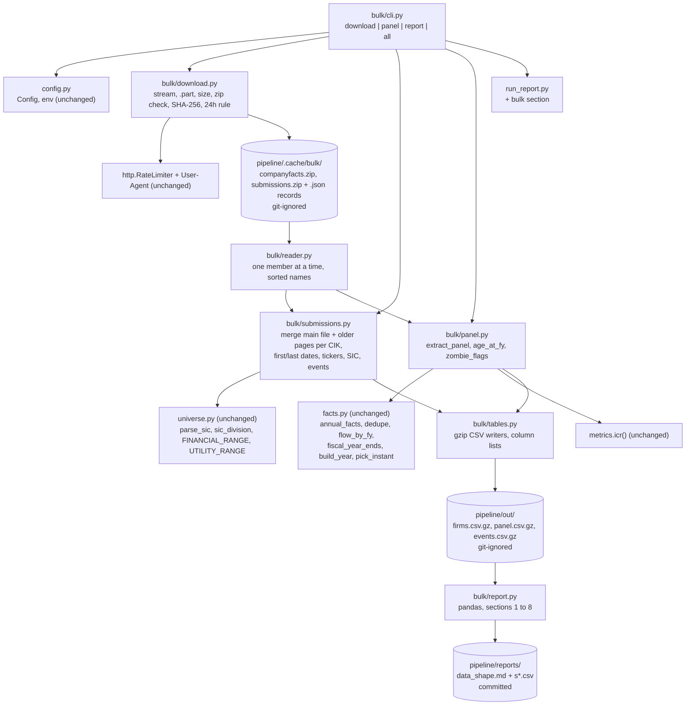
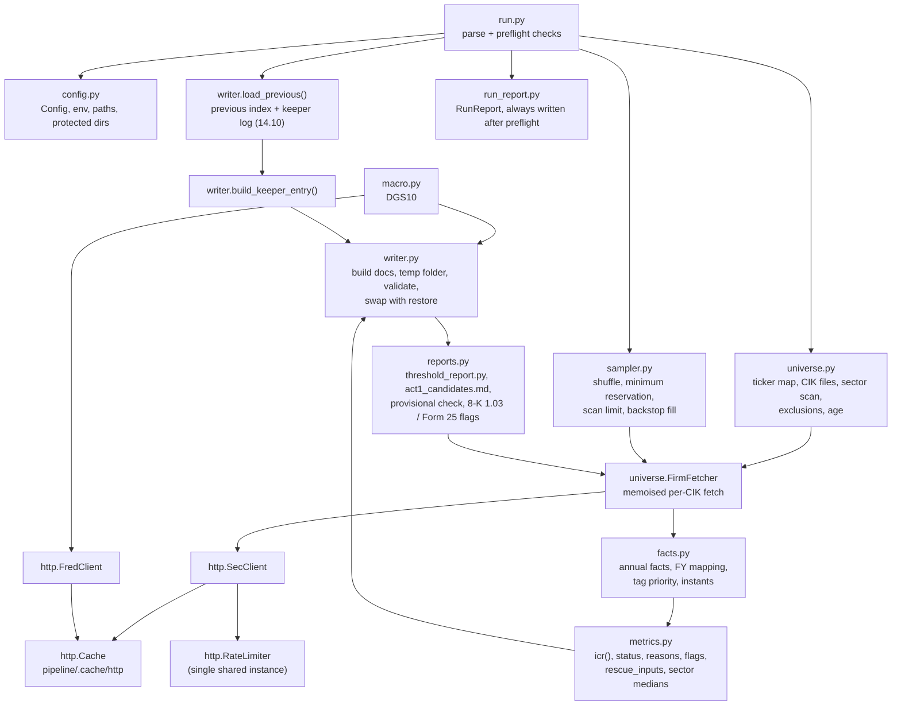

# Design Document: data-pipeline

## Overview

**Phases.** On 2026-11-16 the goal changed. Phase 1 (section "Phase 1 design") downloads the two SEC bulk files and writes a data shape report. Phase 2 (all sections after the "Phase 2 design" marker) is the contract-v2 pipeline and stays as designed. Requirements 20 to 29 are phase 1; Requirements 1 to 19 are phase 2 except where the Phases table in `requirements.md` says Kept.

The pipeline is a single-process, synchronous Python 3.11+ package under `/pipeline`. One command, `.venv/bin/python -m pipeline.run`, selects firms, fetches SEC EDGAR submissions and companyfacts plus FRED DGS10 through one cached, rate-limited HTTP layer, scores every firm with one shared `icr()`, writes the four data contract v2 files into a temporary folder, validates them against `data/schema`, and only then swaps them into the output folder. After the swap it runs the existing `pipeline/scripts/threshold_report.py` and writes `pipeline/reports/act1_candidates.md`. Every run that gets past argument checking writes `pipeline/.cache/run_report.json`.

Design goals, in priority order:

1. Correct, traceable numbers: every value comes from one chosen XBRL fact, with its tag, filing date, form and accession number kept alongside it.
2. Never corrupt `/data`: validate first, swap second, restore on a failed swap, never touch `data/mock`, `data/schema` or `data/fixtures`.
3. Deterministic: same Cache, arguments, seed and Run_Year give byte-identical files apart from `meta.generated_at` and the keeper log date (Requirement 13.10).
4. Buildable in one day: standard library plus `requests` and `jsonschema` at runtime, no threads, no async, no database.

### Research findings that shape the design

- **companyfacts shape** ([SEC EDGAR APIs](https://www.sec.gov/search-filings/edgar-application-programming-interfaces)): `facts.{taxonomy}.{tag}.units.{unit}[]`, each fact with `start` (flows only), `end`, `val`, `accn`, `fy`, `fp`, `form`, `filed` and optional `frame`. Instants have no `start`. The `fy` field is the fiscal year of the filing, not of the fact, which is why the design maps facts to Fiscal_Years by `end` date (Requirement 6.2).
- **submissions shape**: top-level `sic`, `name`, `tickers`, and `filings.recent` as parallel arrays (`accessionNumber`, `filingDate`, `form`, `items`, ...). Older history sits in `filings.files[]`, each entry naming a page such as `CIK0000320193-submissions-001.json` with the same parallel-array layout at its top level. The `items` string of an 8-K lists item numbers such as `"1.03,9.01"`, which the Act 1 bankruptcy flag reads (Requirement 15.9).
- **SEC fair access**: max 10 requests per second and a descriptive User-Agent ([SEC developer resources](https://www.sec.gov/about/developer-resources)). The design defaults to 5 per second (Requirement 4.4).
- **FRED**: `https://fred.stlouisfed.org/graph/fredgraph.csv?id=DGS10` returns a two-column CSV (date column, then `DGS10`), with `.` for missing days. The API endpoint `https://api.stlouisfed.org/fred/series/observations?series_id=DGS10&file_type=json&api_key=...` returns `observations[]` with `date` and `value` strings, also `.` for missing ([FRED API docs](https://fred.stlouisfed.org/docs/api/fred/series_observations.html)).
- **jsonschema**: `Draft202012Validator(schema, format_checker=FormatChecker())` checks `format: date` with the standard library. `format: date-time` is only checked when an extra package (`rfc3339-validator`) is installed. The design does not add it; `meta.generated_at` is produced by one formatting function that is unit-tested instead.
- **Python `random`**: `random.Random(seed).shuffle` on an integer seed is stable across CPython 3.x, so the Sampler order is reproducible (Requirements 3.1 and 3.8).

### Sampling rule (decided)

Frank decided the sampling rule. `--sample N --seed S` draws a seeded simple random sample: the Sampler shuffles the unique CIK list once and accepts Eligible_Firms in shuffled order. The only departure from pure randomness is a reservation of places for the two Minimum_Divisions ("Retail Trade" and "Transportation, Communications, Electric, Gas and Sanitary Services"). Until each of them has m = 5 accepted firms (m = min(5, floor(N / 2)) when N < 10), one place per missing firm is held back, so any other firm can only take the remaining free places (Requirement 3.4). No other division has a target share, so sector shares follow their natural frequency.

The Scan_Limit, max(10 * N, 200) visited CIKs, and the overflow list are a backstop only. The limit keeps a run inside the 5-minute target (Requirement 18.1); the overflow list fills the sample when the scan ends with fewer than N firms (Requirements 3.3, 3.5, 3.6). An unmet minimum is a warning, not an error (Requirement 3.10). The request budget and its risk are in [Performance and request budget](#performance-and-request-budget).

### Smaller gaps resolved in the design

| Gap | Design decision |
| --- | --- |
| SIC code that is a valid integer in 0100-9999 but in no SIC_Division (1800-1999, 9000-9099, 9730-9899) for a `--tickers`/`--ciks` firm. The output needs a `sector` string. | Treated as exclusion reason `no_sic`. SEC does not assign codes in these ranges, so this is a guard, not a real case. |
| A firm with Annual_Facts but no Firm_Window (Requirement 6.13) has no exclusion reason in 2.13's fixed list. | Left out of the output and listed in a separate Run_Report field `no_firm_window`, so 2.13's six reasons stay exactly as specified. |
| How the Rate_Limiter rate is configured (Requirement 4.5). | CLI flag `--rate R`, default 5. |
| Connection errors and timeouts (not HTTP statuses). | Retried with the same policy as 429/5xx (Requirement 4.7). A firm that still fails is a Failed_Firm with reason `connection_error: <class>`. |
| Which ticker an output firm gets when a CIK has several tickers. | The first `company_tickers.json` entry for that CIK in key order (`"0"`, `"1"`, ...), else the first entry of submissions `tickers`, else null. |
| `--sample` together with `--ciks`: Requirement 2.9 and 3.7. | The Sampler judges recency on its own picks; the per-firm output check skips recency if `--ciks` selected the firm. Both use the same cached responses. |
| `icr()` in `make_mock.py`. | `make_mock.py` keeps its own copy (it is frozen by Requirement 19.8 and is a standalone script, not a Pipeline module). The static check for Requirement 8.1 scans `pipeline/*.py` only, not `pipeline/scripts/`. |

## Phase 1 design (current work): bulk data and data shape report

Phase 1 answers one question quickly: what does the real data look like? It reads two SEC bulk archives once, builds an internal firm-year panel and an events table, and writes a report. It does not write any data contract file. Everything from `## Architecture` onward is the Phase 2 design (contract-v2 outputs, sampling, Act 1) and stays as written, except where a line says otherwise.

### Design decisions

| Decision | Reason |
| --- | --- |
| New package `pipeline/bulk/`, started with `python -m pipeline.bulk`. No edit to `extract()`, `icr()`, `universe.py` or `HttpClient.get()`. | Requirement 29.5. Phase 2 code keeps working and keeps its tests. |
| `YearValues.sources` already holds every `Fact` behind a written value (tag, end, accn, filed). The panel maps facts to fields by tag, so `facts.py` needs no change. | Requirement 24.4 needs per-field accession, tag and date without touching the extractor. |
| Cash is picked in the new module with the existing `pick_instant()`. | Requirement 24.5. `facts.py` has no cash tag, and adding one there would change `extract()` inputs. |
| Members are read in sorted name order. | The panel is written row by row and is sorted by CIK (24.1) without holding it in memory. |
| Submissions are aggregated first (small per-CIK records), companyfacts second. | Age_At_FY (24.6) needs the first filing date before the panel rows are written. |
| The report is built with pandas from the three CSV files. | pandas is already a pinned dependency (19.1). The panel is about 200,000 rows, which fits in memory. The archives never do. |
| CSV with gzip (`mtime=0`), not Parquet. | No new dependency (24.10, 29.1), and byte-identical output (26.13). |
| Streaming download with `requests` `stream=True`, written to `.part`, then renamed. | `HttpClient.get()` reads the whole body (`resp.content`) and `Cache` keeps whole bodies, so they cannot hold a multi-GB archive. |
| No resume. Fail clearly and delete the `.part` file. | Requirement 21.3. |

### Phase 1 architecture



### Phase 1 run sequence

1. **Preflight (no network)**: parse the sub-command and `--use-cached`; for `download` and `all`, read `SEC_CONTACT_EMAIL` and the rate (4.1, 4.2, 4.5; 20.2). For `panel` and `report`, no email is needed because they send no request (20.3).
2. **Download** (`download`, `all`): for each zip, decide from its record whether the cache is fresh (21.5). Fresh or `--use-cached`: no request. Otherwise stream to `.part`, check size and zip, hash, rename, write the record (21.2 to 21.6).
3. **Submissions pass** (`panel`, `all`): iterate the members of `submissions.zip` in sorted order, merge each into a per-CIK `SubAgg` (23.3, 23.4, 25.1 to 25.5).
4. **Companyfacts pass**: iterate the members of `companyfacts.zip` in sorted order. For each firm, `extract_panel()` returns 11 rows. Rows go straight to `panel.csv.gz`. Only a small `FirmFacts` record (CIK, entity name, `parse_error`) stays in memory.
5. **Tables**: join `SubAgg` and `FirmFacts` into the Firm_Table (flags, ages), keep events of Universe_P1 CIKs only, write `firms.csv.gz` and `events.csv.gz`.
6. **Report** (`report`, `all`): read the three files with pandas, compute sections 1 to 8, write `data_shape.md` and the CSVs (26.x).
7. **Run_Report**: written in a `finally` block with the `bulk` section and the exit code (27.x).

### Phase 1 module layout

```
pipeline/bulk/
  __init__.py
  __main__.py        # from pipeline.bulk.cli import main; raise SystemExit(main())
  cli.py             # argument parsing, run sequence, exit codes, Run_Report
  download.py        # BulkSource, download_if_needed, stream_to_part, read/write record
  reader.py          # member_names, iter_members, classify_member
  submissions.py     # SubAgg, merge_member, aggregate, event extraction
  panel.py           # extract_panel, age_at_fy, zombie_flags, field mapping, URLs
  tables.py          # column lists, deterministic gzip CSV writers/readers
  report.py          # section functions, outcome classification, Markdown rendering
pipeline/tests/
  test_bulk_download.py  test_bulk_reader.py  test_bulk_submissions.py
  test_bulk_panel.py  test_bulk_report.py  test_bulk_properties.py  test_bulk_cli.py  test_bulk_static.py
```

### Phase 1 components and interfaces

#### `pipeline/bulk/download.py`

```python
COMPANYFACTS_URL = "https://www.sec.gov/Archives/edgar/daily-index/xbrl/companyfacts.zip"
SUBMISSIONS_URL = "https://www.sec.gov/Archives/edgar/daily-index/bulkdata/submissions.zip"
CHUNK_BYTES = 1 << 20
MAX_AGE = timedelta(hours=24)

@dataclass(frozen=True)
class BulkRecord:                    # written as <zip>.json next to the zip (21.6)
    url: str; downloaded_at: str     # ISO 8601 UTC
    size_bytes: int; sha256: str; last_modified: str | None

@dataclass(frozen=True)
class BulkFile:
    name: str                        # "companyfacts.zip" | "submissions.zip"
    path: Path; record: BulkRecord; from_cache: bool

def read_record(zip_path: Path) -> BulkRecord | None: ...        # None if missing, unreadable, or size differs from the file on disk
def is_fresh(record: BulkRecord, now: datetime) -> bool: ...     # pure; age < 24 h (21.5)
def stream_to_part(resp, part: Path, chunk: int = CHUNK_BYTES) -> tuple[int, str]: ...  # (bytes, sha256 hex); hashes while writing
def check_download(part: Path, written: int, expected: int | None) -> None: ...         # raises BulkDownloadError (21.3)
def fetch_bulk(cfg, session, limiter, stats, url: str, use_cached: bool, now: datetime) -> BulkFile: ...
```

`fetch_bulk` follows this order:
1. If a record exists and is fresh, or `use_cached` is set and a zip exists: return it with `from_cache=True`, no request.
2. With `use_cached` and no zip: raise `MissingBulkFileError` naming the file (20.4).
3. Otherwise acquire one `RateLimiter` slot per attempt, send `session.get(url, headers={"User-Agent": ...}, stream=True, timeout=(10, 120))`. Retry only the connection phase on 429 and 5xx with the existing `BACKOFF_SECONDS` and `parse_retry_after()`. A failure while reading the stream is not retried.
4. `stream_to_part` writes `<name>.part` and hashes as it writes. `check_download` compares the bytes written with `Content-Length` when that header is present and no `Content-Encoding` header is present. Then `zipfile.ZipFile(part)` must open and list at least one member. On any failure the `.part` file is deleted, the older zip and record stay unchanged, and `BulkDownloadError` carries the file, expected size and actual size (21.3).
5. On success: `os.replace(part, zip)`, then write the record (temp file plus `os.replace`).
6. A failed refetch of a stale zip raises; the stale zip is not used unless `use_cached` was given (21.5).

The email never appears in any message: errors go through `http.redact()` (21.8).

#### `pipeline/bulk/reader.py`

```python
CIK_MEMBER = re.compile(r"^CIK(\d{10})\.json$")
PAGE_MEMBER = re.compile(r"^CIK(\d{10})-submissions-(\d{3})\.json$")

def member_names(zf: zipfile.ZipFile) -> list[str]: ...        # sorted; central directory only, no data read
def classify_member(name: str) -> tuple[str, str] | None: ...  # ("main"|"page", cik10) or None (22.5)
def iter_members(zip_path: Path) -> Iterator[tuple[str, bytes | Exception]]: ...
```

`iter_members` opens the zip once and yields one member at a time in sorted name order. It reads a member with `zf.open(name)` and yields `(name, raw bytes)`. A `BadZipFile` or CRC error on one member is yielded as `(name, exception)` so the caller records it and continues (22.4). The previous member's bytes are not referenced by the iterator when it reads the next one (22.2). `zipfile` checks each member's CRC while reading, which is the integrity check for member contents (21.3).

#### `pipeline/bulk/submissions.py`

```python
@dataclass
class SubAgg:
    cik: str
    has_main: bool = False
    name: str | None = None
    tickers: tuple[str, ...] = ()
    sic: object = None
    first_filing: date | None = None        # min over every page
    last_filing: date | None = None         # max over every page
    last_10k: date | None = None            # max over 10-K / 10-K/A rows
    events: dict[tuple[str, str], EventRow] = field(default_factory=dict)  # key (accession, event_type)
    pages: list[str] = field(default_factory=list)
    parse_error: bool = False

EVENT_FORMS_8K = frozenset({"8-K", "8-K/A"})
EVENT_RULES = ...   # (event_type, forms, item) table, one source of truth (25.2)

def filing_rows(obj: dict, kind: str) -> Iterator[Filing]: ...   # kind "main" -> obj["filings"]["recent"], "page" -> obj itself
def merge_member(agg: SubAgg, name: str, kind: str, obj: dict) -> None: ...
def event_rows(cik: str, filings: Iterable[Filing], source_member: str) -> list[EventRow]: ...  # pure
def aggregate(zip_path: Path, report: RunReport) -> dict[str, SubAgg]: ...
def filing_url(cik: str, accession: str) -> str: ...
```

Details:
- A main file has top-level `name`, `sic`, `tickers` and `filings.recent` (parallel arrays `accessionNumber`, `filingDate`, `form`, `items`). An older page has those arrays at the top level. `filing_rows` zips the arrays and skips rows with a missing accession or unparsable date for the event rules, but still counts a valid date for `first_filing` and `last_filing`.
- `event_rows` splits `items` on commas, trims spaces, and applies `EVENT_RULES`. A row can yield several events (items "1.03,2.01" gives two). Rows are keyed `(accession, event_type)`, so merging the same filing twice (for example a page and the main file overlapping) keeps one row (25.4).
- `merge_member` takes min and max of dates, unions events, and sets `has_main` for a main file. These operations are commutative, so any member order gives the same result (25.5).
- `aggregate` ignores `SubAgg`s without `has_main` (orphan older pages) and lists their member names in the Run_Report (25.6). A member that fails to parse sets `parse_error` for its CIK and is logged (22.4).
- `filing_url` builds `https://www.sec.gov/Archives/edgar/data/{int(cik)}/{accession without dashes}/{accession}-index.htm` (24.7). It lives here and is imported by `panel.py`.

#### `pipeline/bulk/panel.py`

```python
PANEL_FIRST_FY, PANEL_LAST_FY = 2015, 2025
FLAG_LOOKBACK = 2                       # icr of FY-1 and FY-2 are needed (Zombie_Flag)
CASH_TAG = "CashAndCashEquivalentsAtCarryingValue"
FIELDS = ("operating_income", "interest_expense", "revenue", "total_debt", "cash", "total_assets", "equity")

def age_at_fy(first_filing: date | None, fye: date | None) -> int | None: ...   # pure; whole years by date arithmetic
def zombie_flags(icr_by_fy: Mapping[int, float | None],
                 age_by_fy: Mapping[int, int | None],
                 years: Iterable[int]) -> dict[int, bool]: ...                  # pure (Zombie_Flag)
def field_facts(y: YearValues, cash: Fact | None) -> dict[str, tuple[Fact, ...]]: ...   # field -> contributing facts, in Requirement 7 order
def panel_row(cik: str, y: YearValues, cash: Fact | None, first_filing: date | None) -> dict[str, object]: ...  # pure
def extract_panel(cik: str, companyfacts: Mapping[str, object], first_filing: date | None) -> list[dict[str, object]]: ...  # exactly 11 rows
def gap_panel(cik: str) -> list[dict[str, object]]: ...                          # 11 Gap_Rows (parse error, 23.x)
```

`extract_panel` mirrors `extract()` but with a fixed range. It does not call `extract()`.
1. `tagged[tag] = dedupe(annual_facts(cf, tag))` for `ALL_TAGS + (CASH_TAG,)`.
2. `flows = {tag: flow_by_fy(tagged.get(tag, ())) for tag in all flow tags}`, `ends = fiscal_year_ends(flows)` (same calls as `extract()`).
3. For `fy` in `2013 .. 2025`: if `fy in ends`, `y = build_year(fy, ends[fy], tagged)` and `cash = pick_instant(tagged.get(CASH_TAG, ()), ends[fy])`. Otherwise it is a Gap_Row (Requirement 6.10 behaviour, 24.3).
4. `icr_by_fy[fy] = icr(y.ebit, y.interest)` for every year in 2013 to 2025. These are the only `icr()` calls.
5. `zombie_flags` is computed on 2013 to 2025. Rows for 2013 and 2014 are dropped; rows for 2015 to 2025 are written (24.8).
6. A Gap_Row has every money field, tag, end date, accession, URL, `fye`, `icr` and `age_at_fy` empty, and `zombie_flag` false. Its `fy` is always set. Gap_Rows keep the row count at 11 (24.1).

`field_facts` mapping, by tag over `y.sources`:
- `revenue`: the fact whose tag is `y.revenue_tag`.
- `operating_income`: the fact with tag `y.ebit_tag` (`OperatingIncomeLoss`). For the fallback, the pretax fact first, then the interest fact (`y.interest_tag`), so the tag column reads `PretaxTag;InterestTag` (24.4).
- `interest_expense`: the fact whose tag is `y.interest_tag`.
- `total_debt`: facts whose tags are in `y.debt_tags`, in that order.
- `total_assets`, `equity`: `Assets` and `StockholdersEquity` facts.
- `cash`: the cash fact.

For each field the tag, end date, accession and URL columns are the `;`-joined values of those facts. An empty field gives empty cells. `<field>_end` is `fact.end.isoformat()` (the period end for a flow, the instant date for a balance-sheet item) (24.4).

`age_at_fy(first, fye)` returns `None` when either argument is `None`. Otherwise `fye.year - first.year - ((fye.month, fye.day) < (first.month, first.day))`. A first filing on 29 February completes its year on 1 March in non-leap years because the tuple comparison treats `(3, 1) > (2, 29)`.

`zombie_flags` returns, for each year `Y` in `years`, `True` only if `age_by_fy[Y]` is not `None` and is at least 10, and the three values `icr_by_fy[Y]`, `icr_by_fy[Y-1]`, `icr_by_fy[Y-2]` are all not `None` and each below 1 (missing keys count as `None`).

Per-firm cost: about 18 tags `annual_facts` scans plus `dedupe`. The existing `extract()` does the same work, so the panel costs about as much as running `extract()` once per firm.

#### `pipeline/bulk/tables.py`

```python
FIRM_COLUMNS = ("cik","name","tickers","sic","sic_division","first_filing_date","last_10k_date","last_filing_date",
                "is_financial","is_utility","no_sic","age_under_10","parse_error")
PANEL_COLUMNS = ("cik","fy","fye","age_at_fy") + per-field ("<f>","<f>_tag","<f>_end","<f>_accn","<f>_url") + ("icr","zombie_flag")
EVENT_COLUMNS = ("cik","date","form","item","event_type","accession","url","source_member")

class GzipCsvWriter: ...     # context manager; gzip.GzipFile(mtime=0), newline="\n", UTF-8, header row, csv.QUOTE_MINIMAL
def cell(value) -> str: ...  # None -> "" ; bool -> "true"/"false"; float -> repr; int -> str; date -> ISO
def read_table(path, columns=None) -> pandas.DataFrame: ...   # dtype=str for ids, parse dates explicitly
```

`cell(None)` is `""`. A value of `0` is `"0"`, so 0 and missing differ in the file (24.9). Booleans use `true`/`false`.

The Firm_Table is built by `build_firm_row(cik, agg: SubAgg | None, facts: FirmFacts, run_year)`:
- `sic` is `str(agg.sic)` when parseable, else empty; `sic_division` comes from `universe.sic_division(parse_sic(...))`.
- `is_financial` and `is_utility` use `FINANCIAL_RANGE` and `UTILITY_RANGE`; both are false when the SIC is null.
- `no_sic` is true when `parse_sic` returns `None` or when there is no submissions record.
- `age_under_10` is true when `first_filing_date` is null or `run_year - first.year < 10`.
- With no submissions record, name falls back to `entityName` and tickers are empty (23.2).

#### `pipeline/bulk/report.py`

Each section is a pure function from DataFrames to a small result object (a DataFrame for the CSV plus the numbers used in the Markdown). The panel is read once with the needed columns only.

```python
def core_mask(panel, firms) -> Series: ...             # not financial, not utility, age_at_fy >= 10
def present_mask(panel) -> Series: ...                  # any money field non-null
def s1_firm_counts(panel, firms) -> Table: ...          # FY2015-2025: present firms, core present firms
def s2_zombies(panel, firms) -> Table: ...              # FY2017-2025: count, share over present, share over non-null icr
def classify_outcome(zombie_row_end: date, events: list[EventRow], last_fy_with_data: int | None, icr_2024: float | None, zombie_2024: bool) -> str: ...  # pure; precedence of 26.6
def s3_outcomes(panel, firms, events) -> Table: ...     # for zombie FY2019 and FY2020; counts + CIK lists; "filed item 2.01" column
def s4_recoveries_reversed(panel, firms) -> Table: ...  # icr >= 1.5 in FY2019 and icr < 1 in FY2020
def s5_zombie_then_bankrupt(panel, firms, events) -> Table: ...
def breaking_rate_pp(ebit, interest, debt) -> float | None: ...  # pure: (ebit - interest) / debt * 100; None unless interest > 0 and debt > 0 and ebit not None
def s6_breaking_rate(panel, firms) -> Table: ...        # latest year per firm and fixed FY2024; histogram; below 1..5 pp
def s7_data_quality(panel, firms) -> Table: ...         # per year; all firms and core
def s8_largest_firms(panel, firms) -> Table: ...        # top 200 by max annual revenue, history string FY2017-FY2025
def render_markdown(sections, meta) -> str: ...
```

Definitions fixed here so the numbers can be reproduced:
- **Breaking rate** is `(EBIT - interest) / debt * 100`. It is not `icr()`, so it does not touch the one-ICR-function rule (8.1). It is the rate rise in percentage points that makes interest equal EBIT. `breaking_rate_pp` lives in `report.py`; the static check for 8.1 looks for `ebit / interest` and `ebit_usd / interest` only, and this formula divides by debt.
- **Histogram**: left-closed buckets `[lo, lo + 0.5)` for `lo` from -10.0 to 19.5, plus `< -10` and `>= 20`. Bucket index is `floor((x + 10) / 0.5)` computed on the value rounded to 9 decimals, so edge values land in a defined bucket.
- **Below +k pp** is `breaking_rate < k` for k = 1 to 5. Firms already below 0 count at every k.
- **Latest year for section 6** is the highest `fy` of the firm with a computable breaking rate. The fixed-FY2024 variant uses only the FY2024 row.
- **Section 3 window**: events with `date` after the `fye` of the zombie year and on or before 2024-12-31. Category order: `bankruptcy`, `delisted_or_deregistered`, `stopped_filing`, `recovered`, `still_zombie`, `other_alive`. Every zombie gets exactly one category (Property 35).
- **Section 5** uses events of type `bankruptcy` with `date` from 2022-01-01 to 2023-12-31.
- **Section 8** ranks by `max(revenue)` over FY2015 to FY2025 and breaks ties by CIK. The history string has one character per FY2017 to FY2025: `1` or `0`.
- **Section 2 shares** use `round(x, 6)`. CSV and Markdown numbers use fixed formats (counts as integers, shares with 6 decimals in CSV and with 2 in the Markdown percent).
- Rows in every CSV are sorted by their natural key (year, then CIK). The Markdown has no timestamps other than the source block (26.13).

`render_markdown` starts with the source block (zip URLs, download time, size, SHA-256, `Last-Modified`, from the records in `pipeline/.cache/bulk/`), the definitions, and the text "Data: SEC EDGAR. Not investment advice." plus the age-proxy note (26.2, 26.12). The CIK lists go to CSVs (`s3_outcomes_cik.csv`, `s4_*.csv`, `s5_*.csv`). The Markdown links to them and shows counts.

If the zip records are missing (report run without a download), the source block says "unknown, no download record" and does not fail.

#### `pipeline/bulk/cli.py`

```python
def main(argv: list[str] | None = None) -> int: ...
```

- Sub-commands `download`, `panel`, `report`, `all`; flags `--use-cached`, `--rate R` (default 5, as Requirement 4.4).
- Constants added to `config.py` as additive lines: `BULK_CACHE_DIR = CACHE_DIR / "bulk"`, `PHASE1_OUT_DIR = REPO_ROOT / "pipeline" / "out"`, `PHASE1_REPORTS_DIR = REPO_ROOT / "pipeline" / "reports"`. `Config` is unchanged; the bulk code takes these paths as parameters so tests pass temp folders.
- New exceptions in `config.py`: `BulkDownloadError(PipelineError)` and `MissingBulkFileError(PipelineError)`.
- Safety: the CLI refuses to write anywhere outside `pipeline/out` and `pipeline/reports` and never into `data` or a Protected_Dir (20.5, using `is_protected`).
- Progress: one line to stderr every 1,000 members during each pass, with the count and total.

#### `pipeline/run_report.py` (additive)

One new field: `bulk: dict | None = None`. It is serialised by the existing `to_dict()` and redacted by the existing `_redact_obj`. The bulk section:

```json
"bulk": {
  "command": "all", "use_cached": false,
  "zips": {"companyfacts.zip": {"url": "...", "downloaded_at": "...", "size_bytes": 0, "sha256": "...", "last_modified": null, "from_cache": false}, "submissions.zip": {}},
  "members": {"companyfacts": {"read": 0, "ignored": 0, "parse_failed": [{"member": "...", "error": "..."}]}, "submissions": {}},
  "universe_p1": 0, "submissions_only_ciks": 0, "orphan_pages": [],
  "panel_rows": 0, "gap_rows": 0, "events": {"bankruptcy": 0, "acquisition_disposition": 0, "delisting": 0, "deregistration": 0}
}
```

### Phase 1 data models

```python
# bulk/submissions.py
@dataclass(frozen=True)
class Filing:       accession: str; filed: date | None; form: str; items: tuple[str, ...]
@dataclass(frozen=True)
class EventRow:     cik: str; date: date; form: str; item: str | None; event_type: str; accession: str; url: str; source_member: str

# bulk/panel.py
@dataclass(frozen=True)
class FirmFacts:    cik: str; entity_name: str | None; has_annual: bool; parse_error: bool
```

#### On-disk formats (phase 1)

| Path | Content | Git |
| --- | --- | --- |
| `pipeline/.cache/bulk/companyfacts.zip`, `submissions.zip` | the downloaded archives, unmodified | ignored |
| `pipeline/.cache/bulk/<zip>.json` | `BulkRecord` | ignored |
| `pipeline/.cache/bulk/<zip>.part` | partial download, deleted on failure | ignored |
| `pipeline/.cache/run_report.json` | Run_Report with the `bulk` section | ignored |
| `pipeline/out/firms.csv.gz`, `panel.csv.gz`, `events.csv.gz` | Firm_Table, Panel, Events_Table | ignored |
| `pipeline/reports/data_shape.md`, `pipeline/reports/s<N>_<topic>.csv` | Data_Shape_Report and section CSVs | committed |

### Phase 1 performance and size

These are planning figures, not measurements. The manual live-run task records the real numbers.

| Step | Expectation |
| --- | --- |
| Download | 2 requests. Time is set by bandwidth; each archive is on the order of 1 GB compressed. SEC rebuilds both files nightly. |
| Submissions pass | Each member is small. About 10,000 to 20,000 main files plus older pages. Minutes. |
| Companyfacts pass | About 18,000 members of 0.1 to 10 MB each, one JSON parse and one extraction per member. Roughly 10 to 30 minutes on one core. No multiprocessing in v1: the code stays simple and the order stays sorted. |
| Memory | One parsed companyfacts member at a time (a large firm can be hundreds of MB of Python objects), plus `SubAgg` records (a few hundred bytes plus events). The report holds the panel with only the columns it needs. |
| Disk | Both zips plus `pipeline/out` (a few hundred MB uncompressed CSV, much less gzipped). |

If the first live run shows the companyfacts pass is too slow, the fallback is a worker pool that processes members in chunks and writes in sorted order. That is a Phase 1 follow-up, not part of this design.

### Phase 1 correctness properties

These continue the numbering of the Phase 2 properties (1 to 27). Each is one `@given` test on a pure function or an in-memory zip, offline.

#### Property 28: Missing is never written as 0

*For any* generated companyfacts document in which some tags are absent for some years, every panel cell for an absent value is empty, and a cell is `0` only when the chosen fact's value is exactly 0. The EBIT fallback with one missing part gives an empty `operating_income` and empty `operating_income_tag`.

**Validates: Requirements 7.11, 24.2, 24.9**

#### Property 29: Every firm keeps all 11 rows and stays in the Firm_Table

*For any* set of generated firms, including firms with a bankruptcy event, firms whose last filing is before FY2025, firms with a parse error and firms with every flag set, the Panel has exactly 11 rows per firm for FY2015 to FY2025 in ascending order, and the Firm_Table has one row per firm of Universe_P1.

**Validates: Requirements 23.1, 23.6, 24.1**

#### Property 30: The yearly zombie flag matches the definition

*For any* random `icr_by_fy` and `age_by_fy` maps, `zombie_flags` equals an independent oracle: true exactly when age at Y is not null and at least 10 and the icr values of Y, Y-1 and Y-2 are all not null and below 1. The flag is false when any of the three is null.

**Validates: Requirements 24.8, 28.4, zombie-definition.md (yearly flag)**

#### Property 31: Age at a fiscal year

*For any* first-filing date and fiscal-year-end date, `age_at_fy` equals the number of completed anniversaries counted by an independent loop, is non-decreasing in `fye`, and is `None` when either date is `None`.

**Validates: Requirements 24.6, Glossary (Age_At_FY)**

#### Property 32: Events are de-duplicated by accession and type

*For any* list of filings, with repeated accession numbers and several items per filing, `event_rows` followed by the merge gives at most one row per (accession, event type). The set of keys equals the set of (accession, type) pairs that match the rules in Requirement 25.2. A filing with items "1.03,2.01" gives exactly two rows.

**Validates: Requirements 25.2, 25.4, 28.5**

#### Property 33: Member order does not change the result

*For any* generated set of submissions members for several CIKs, with the main file and older pages in any order, merging them gives the same `SubAgg` per CIK (first, last, last 10-K dates, tickers and events). An event present only on an older page is in the result.

**Validates: Requirements 22.3, 25.1, 25.5, 28.6**

#### Property 34: Outcome categories partition the zombies

*For any* generated panel and events, every firm that is a zombie in FY2019 (and every one in FY2020) is in exactly one outcome category, and the category counts sum to the number of zombies. The precedence order of Requirement 26.6 holds: a firm with a bankruptcy event in the window is `bankruptcy` whatever else is true.

**Validates: Requirements 26.6**

#### Property 35: Breaking-rate histogram and thresholds match a brute force

*For any* list of (EBIT, interest, debt) triples, the histogram counts sum to the number of firms with a computable breaking rate, the below-k counts are non-decreasing in k, and each below-k count equals a brute-force count of `breaking_rate_pp < k`.

**Validates: Requirements 26.9**

#### Property 36: Streaming digest does not depend on chunking

*For any* byte string and any chunk size, `stream_to_part` writes the same file and returns the same SHA-256 as `hashlib.sha256` over the whole bytes, and the byte count equals the length.

**Validates: Requirements 21.2, 21.4**

#### Property 37: Report output is deterministic

*For any* generated panel, firms and events, rendering the report twice, and after shuffling the input rows, gives byte-identical Markdown and CSV text.

**Validates: Requirements 26.13**

### Phase 1 error handling

Exit codes for `python -m pipeline.bulk` only. The Phase 2 table (codes 1 to 12) belongs to `pipeline.run`.

| Code | Failure | Requirements | Network before exit | Files |
| --- | --- | --- | --- | --- |
| 0 | success | | as needed | written |
| 1 | unexpected exception (bug) | | maybe | whatever was reached; Run_Report written with a redacted traceback summary |
| 2 | argument or environment error: unknown sub-command, bad `--rate`, missing `SEC_CONTACT_EMAIL` for `download` or `all`, output path in a Protected_Dir | 20.2, 20.5, 4.2, 4.5 | none | unchanged |
| 3 | download failed: HTTP error after retries, size mismatch, not a zip, stream error | 21.3, 21.5 | yes | `.part` deleted, older zip and record unchanged |
| 4 | a needed zip is not cached (`--use-cached`, or `panel` without a zip) | 20.4 | none | unchanged |
| 5 | an output file could not be written | 20.5, 29.3 | no | partial output removed |

Typed exceptions: `PreflightError` (existing), `BulkDownloadError`, `MissingBulkFileError`.

Per-member problems never stop the run (22.4):
- A member that cannot be read or parsed is logged in the Run_Report. If its CIK is known, the CIK's `parse_error` is true. In the Panel such a firm gets 11 Gap_Rows, so it stays visible (Property 29).
- A member whose name matches no pattern is ignored and counted (22.5).
- A companyfacts member with no Annual_Fact is not in Universe_P1 and is counted in the Run_Report (23.1).
- The 2% rule does not apply (22.4).

Atomicity: each output file is written to `<name>.tmp` and renamed with `os.replace`, so an interrupted run leaves either the old file or the new one. The three tables are written in the order panel, firms, events, and `report` refuses to run when one is missing (exit 4).

### Phase 1 testing strategy

- All tests are offline and use in-memory zips built with `zipfile.ZipFile(io.BytesIO())`, a fake streaming session and the existing socket guard (28.1). `tests/builders.py` gets small helpers: `make_zip(members: dict[str, bytes])`, `make_companyfacts(...)` (tags, years, units), `make_submissions_main(...)`, `make_submissions_page(...)`.
- The existing `FakeSession` serves whole bodies. A second fake, `StreamSession`, implements `get(url, headers, timeout, stream)` and returns an object with `status_code`, `headers`, `iter_content(chunk_size)` and `close()`. It can cut the stream short to simulate a partial download.
- Property tests use the existing `pipeline` hypothesis profile and carry the comment tag `# Feature: data-pipeline, Property N: ...`.
- Example tests (28.8 to 28.10):
  - download: size mismatch removes `.part` and keeps the older zip; a record younger than 24 hours means zero requests; a stale zip with a failed refetch raises and is not used; the record has size and SHA-256 equal to `hashlib` of the bytes; `use_cached` with no zip exits 4.
  - reader: sorted order; names matching no pattern are ignored and counted; one corrupt member is yielded as an error and the next member is still read; the instrumented reader sees one live member at a time (22.6).
  - submissions: bankruptcy 8-K only on an older page is found (28.6); items "1.03,2.01" give two rows; Form 25, 25-NSE, 15-12B, 15-12G and 15-15D give the right types; `25-NSE/A` and `15F-12B` give none; an orphan older page is skipped and listed; a CIK without a submissions file is kept with `no_sic` true.
  - panel: a gap year; a firm that stops filing in 2019 still has 11 rows; a January year end maps to the prior FY; the EBIT fallback; cash picked within 7 days; the FY2013 and FY2014 `icr` feeding the FY2015 and FY2016 flags without rows for those years; accession and URL columns for multi-fact debt.
  - report: each section on a hand-built panel; the outcome precedence; histogram edges (exactly 0.5, -10, 20); a firm with debt 0 or interest 0 is left out and counted.
  - cli: preflight failures send zero requests; `panel` and `report` send zero requests; an end-to-end `all` run with fake sources writes the three tables and the report into temp folders and leaves the repository paths unchanged (28.11).
- Static checks (new file `test_bulk_static.py`, so Phase 2 task 19 can still create `test_static.py`): `.gitignore` contains `pipeline/out/` and `pipeline/.cache/`; no file under `pipeline/bulk` imports `react`, `three` or `requests` outside `download.py`; `ebit / interest` appears only in `metrics.py`; `pipeline/requirements.txt` is unchanged.

### Phase 1 requirement map

| Requirement | Where |
| --- | --- |
| 20 Entry point | `bulk/cli.py`, exit codes 2 and 4 |
| 21 Bulk download | `bulk/download.py`, Properties 36, exit code 3 |
| 22 Streaming read | `bulk/reader.py`, 22.6 test |
| 23 Universe and Firm_Table | `bulk/submissions.py`, `bulk/tables.py`, Property 29 |
| 24 Panel | `bulk/panel.py`, Properties 28 to 31 |
| 25 Events | `bulk/submissions.py`, Properties 32 and 33 |
| 26 Report | `bulk/report.py`, Properties 34, 35, 37 |
| 27 Run report | `run_report.py` (`bulk` field) |
| 28 Tests | `tests/test_bulk_*.py` |
| 29 Docs, deps, commits | steering updates (done), no new dependency, `test_static.py` |

### What phase 1 leaves for phase 2

Phase 2 keeps its design in the sections below. The pieces phase 1 builds that phase 2 can reuse: `age_at_fy`, `filing_url`, the member reader (a bulk-based universe could replace the per-firm fetcher), and the event rules (the Act 1 flags for 8-K item 1.03 and Form 25 in `reports.py`). Whether phase 2 reads from the bulk files or from per-firm requests is decided after the game design.

---

## Phase 2 design (unchanged below, built after the design is chosen)

## Architecture



### Run sequence

1. **Preflight (no network)**: parse arguments; check that at least one selection option is given (1.8), the sector name is valid (1.7), `--sample`/`--seed`/`--rate` are valid (3.11, 4.5), `--out` is not a Protected_Dir (1.10, 13.5), the ticker/CIK files are readable (1.13), and `SEC_CONTACT_EMAIL` is set (4.2). Any failure exits with code 2 and writes nothing. From here on a `RunReport` exists and is written on every exit (16.1).
2. **Previous outputs**: load and schema-check `{out}/firms_index.json` and `{out}/keeper_log.json` if they exist (14.10). A corrupt file stops the run before any network request.
3. **Ticker map**: fetch `company_tickers.json` (4.13).
4. **Selection**: resolve `--tickers` and `--ciks`, run `--sector` (full submissions scan with notice and progress lines, 18.4 and 18.5) and the Sampler, and take the union with per-CIK `selected_by` sets (1.16 to 1.18). An empty union exits (1.15).
5. **Per firm**: `FirmFetcher.get(cik)` returns cached submissions (all pages) and companyfacts; `universe.classify()` applies exclusions in the order of 2.11; `facts.extract()` builds the Firm_Window and years; `metrics.score()` computes status, reasons and flags.
6. **Failure gate**: if Failed_Firms / Attempted_Firms > 2%, exit (4.12).
7. **Macro**: fetch DGS10 (12.x). Compute sector medians and fill fallback `rescue_inputs` (11.x).
8. **Write**: build the four documents and the keeper log entry, write them into a temp folder, validate, swap (13.x, 14.x).
9. **Reports**: run `threshold_report.py` on the new index, then write `act1_candidates.md` (15.x).
10. **Run_Report**: written in a `finally` block with the exit code (16.x).

The order puts every check that can stop the run without network before the first request, and every check that can stop it with network before the write, so a failed run never changes Output_Dir.

## Components and Interfaces

All modules live in `pipeline/`. Type hints use `from __future__ import annotations`. Functions marked *pure* do no I/O, which is what makes them property-testable.

Module layout:

```
pipeline/
  config.py  http.py  universe.py  sampler.py  facts.py  metrics.py
  macro.py  writer.py  reports.py  run_report.py  run.py
  requirements.txt
  scripts/
    make_mock.py            # frozen (19.8)
    threshold_report.py     # frozen (19.8)
    record_fixtures.py      # new; manual, needs network, not part of the test run (17.12, 19.10)
  tests/                    # see Testing Strategy; includes test_fixtures_clean.py (17.13)
```

### `pipeline/config.py`

```python
REPO_ROOT: Path                      # Path(__file__).resolve().parents[1]
SCHEMA_DIR: Path                     # REPO_ROOT / "data" / "schema"
PROTECTED_DIRS: tuple[Path, ...]     # data/mock, data/schema, data/fixtures (resolved)
DEFAULT_RATE = 5.0
MAX_RATE = 10.0
SAMPLE_SCAN_FACTOR = 10              # scan limit = max(SAMPLE_SCAN_FACTOR * N, SAMPLE_SCAN_FLOOR) (3.3)
SAMPLE_SCAN_FLOOR = 200
MIN_PER_DIVISION = 5                 # m for N >= 10 (3.2)
MINIMUM_DIVISIONS = ("Retail Trade",
                     "Transportation, Communications, Electric, Gas and Sanitary Services")
REDACTED = "[REDACTED]"

@dataclass(frozen=True)
class Config:
    out_dir: Path                    # resolved, symlinks followed
    cache_dir: Path                  # default REPO_ROOT / "pipeline" / ".cache"
    reports_dir: Path                # default REPO_ROOT / "pipeline" / "reports"
    schema_dir: Path
    rate: float
    contact_email: str               # stripped; never logged
    fred_api_key: str | None         # None when unset or empty
    run_start: datetime              # UTC, taken once
    @property
    def run_year(self) -> int: ...
    @property
    def run_report_path(self) -> Path: ...   # cache_dir / "run_report.json"

def resolve_out_dir(raw: str) -> Path: ...           # relative to REPO_ROOT, Path.resolve()
def is_protected(path: Path) -> bool: ...            # path == p or p in path.parents, for every Protected_Dir
def read_env() -> tuple[str, str | None]: ...        # raises PreflightError("SEC_CONTACT_EMAIL ...")
def secrets(cfg: Config) -> list[str]: ...           # non-empty secret values, for redaction
```

`cache_dir`, `reports_dir` and `out_dir` are parameters so tests point them at `tmp_path` (17.4).

### `pipeline/http.py`

```python
class RateLimiter:
    def __init__(self, rate: float, clock=time.monotonic, sleep=time.sleep): ...
    def acquire(self) -> None: ...
    # Sliding-window log of the last floor(rate) send times. Before a send, if the log is full
    # and now - oldest < 1.0, sleep until oldest + 1.0. Guarantees t[i + k] - t[i] >= 1.0 for
    # k = floor(rate), i.e. at most k sends in any half-open 1-second window (4.6).
    # A threading.Lock guards the log so the class stays correct if fetching is ever parallelised.

class Cache:
    def __init__(self, root: Path, clock=lambda: datetime.now(UTC)): ...
    def key(self, redacted_url: str) -> str: ...          # sha256 hex of the redacted URL
    def get(self, redacted_url: str, *, json_body: bool) -> CacheHit | None: ...
    #   None when missing, unreadable, no timestamp, bad JSON body (5.8), or age >= 24 h (5.3).
    def put(self, redacted_url: str, body: bytes, fetched_at: datetime) -> None: ...
    #   Writes http/{key}.body and http/{key}.meta.json ({"url", "fetched_at"}) via temp file +
    #   os.replace, so a crash never leaves a half-written entry.

class HttpClient:                      # shared retry + cache logic
    def __init__(self, cache: Cache, limiter: RateLimiter | None, session, secrets: list[str],
                 stats: RequestStats, sleep=time.sleep, max_attempts: int = 5): ...
    def get(self, url: str, *, json_body: bool, headers: dict[str, str],
            no_retry_statuses: frozenset[int] = frozenset()) -> FetchResult: ...
    # 1. cache hit -> FetchResult(ok, body, from_cache=True); no limiter slot (4.3, 5.2).
    # 2. up to 5 attempts; before each attempt limiter.acquire(); waits 1, 2, 4, 8 s before
    #    attempts 2..5, or max(backoff, Retry-After) (4.7). Retry on 429, 5xx, ConnectionError,
    #    Timeout. Other statuses return at once (4.8).
    # 3. success = 2xx, body read without error, JSON parses when json_body (5.1) -> cache.put.
    # 4. failures are never cached (4.9, 5.7); a stale entry is never returned (5.4).
    # 5. every error string passes through redact() (19.5).

class SecClient(HttpClient):
    def get_json(self, url: str) -> FetchResult: ...           # User-Agent "ZombieFirmRadar <email>"
    def company_tickers(self) -> FetchResult: ...
    def submissions(self, cik: str) -> FetchResult: ...
    def submissions_page(self, name: str) -> FetchResult: ...
    def companyfacts(self, cik: str) -> FetchResult: ...       # 404 -> FetchResult(status=404), no retry (4.11)

class FredClient(HttpClient):                                  # limiter=None: FRED is not SEC-limited
    def dgs10(self) -> FetchResult: ...                        # CSV when no key (12.1), API JSON with key (12.2)

def redact(text: str, secrets: list[str]) -> str: ...          # pure; also replaces api_key=... values
def redact_url(url: str) -> str: ...                           # pure; api_key query value -> REDACTED (19.4)
def parse_retry_after(value: str | None, now: datetime) -> float | None: ...  # pure; seconds or HTTP-date
```

`FredClient` keys the Cache by `redact_url(url)`, so two runs with different keys share an entry (19.4). The User-Agent email appears only in the outgoing header; `RequestStats` and the Run_Report store `"ZombieFirmRadar [REDACTED]"` if they record headers at all (16.7).

### `pipeline/universe.py`

```python
SIC_DIVISIONS: tuple[tuple[int, int, str], ...]   # (low, high, name) from the Glossary
EXCLUDED_DIVISION = "Finance, Insurance and Real Estate"
OUTPUT_DIVISIONS: tuple[str, ...]                 # the 10 non-excluded names, sorted

def sic_division(sic: int) -> str | None: ...                     # pure
def parse_sic(raw: object) -> int | None: ...                     # pure; None unless int in 100..9999
def match_sector(name: str) -> str | None: ...                    # pure; casefold + strip (1.6, 1.7)

def load_ticker_map(body: dict) -> TickerMap: ...                 # pure; ticker.upper() -> cik, cik -> first ticker
def read_ticker_file(path: Path) -> list[str]: ...                # strip, skip blanks (1.2)
def read_cik_file(path: Path) -> tuple[list[str], list[SkippedInput]]: ...   # 1..10 digits, zfill(10) (1.3, 1.12)

def first_filing_year(pages: list[dict]) -> int | None: ...       # pure; min filingDate year over all pages
def has_recent_10k(pages: list[dict], since: date) -> bool: ...   # pure; any 10-K/10-K/A filed >= since

def classify(sub: Submissions, facts: ExtractResult | None, run_year: int,
             skip_recency: bool) -> str | None: ...               # pure; exclusion reason or None, order of 2.11

class FirmFetcher:
    """Fetches each CIK at most once per run and counts Attempted/Failed firms (4.9, 4.10)."""
    def __init__(self, sec: SecClient, report: RunReport): ...
    def submissions(self, cik: str, *, with_older_pages: bool = True) -> Submissions | Failed: ...
    def companyfacts(self, cik: str) -> dict | NotFound | Failed: ...

def select_sector(division: str, cik_list: list[str], fetcher: FirmFetcher,
                  run_year: int, progress: Callable[[int, int], None]) -> list[str]: ...
```

Exclusion order (2.11) is natural: `no_sic`, `financial`, `utility` and `age_under_10` need only submissions, so `companyfacts` is fetched only for firms that pass them. `no_annual_facts` and `not_recent` need companyfacts.

### `pipeline/sampler.py`

```python
class Decision(Enum):
    ACCEPT_IF_ELIGIBLE = "accept_if_eligible"   # would-accept: confirm age and recency, then accept
    PENDING_OVERFLOW = "pending_overflow"       # not accepted now; kept lazy for the backstop fill

@dataclass(frozen=True)
class SampleResult:
    selected: list[str]              # CIKs in acceptance order (3.8)
    requested: int                   # N
    shortfall: int                   # N - len(selected)
    seed: int
    visited: int                     # CIKs whose submissions the Sampler tried to read
    scan_limit: int
    scan_limit_hit: bool             # scan ended on the limit with accepted < N and CIKs left unvisited
    per_division: dict[str, int]     # selected count per SIC_Division
    minimums_unmet: list[dict]       # {"division", "required", "selected"} (3.10)
    failed: list[str]                # Failed_Firm CIKs seen while sampling (3.12)

def scan_limit(n: int) -> int: ...                  # pure; max(SAMPLE_SCAN_FACTOR * n, SAMPLE_SCAN_FLOOR) (3.3)
def division_minimum(n: int) -> int: ...            # pure; min(5, n // 2) when n < 10, else 5 (3.2)
def shuffled_ciks(ticker_map: TickerMap, seed: int) -> list[str]: ...
#   pure; unique CIKs ascending, then random.Random(seed).shuffle (3.1)
def decide(n: int, accepted: int, counts: Mapping[str, int], division: str) -> Decision: ...
#   pure (3.4). m = division_minimum(n);
#   deficit = sum(max(0, m - counts.get(d, 0)) for d in MINIMUM_DIVISIONS);
#   ACCEPT_IF_ELIGIBLE when (division in MINIMUM_DIVISIONS and counts.get(division, 0) < m)
#                       or n - accepted - deficit >= 1; otherwise PENDING_OVERFLOW.
def sample(n: int, seed: int, ticker_map: TickerMap, fetcher: FirmFetcher, run_year: int) -> SampleResult: ...
```

`sample()` walks `shuffled_ciks()` in order and stops when `accepted == n`, when the list is exhausted, or when `visited == scan_limit(n)`. For each CIK it does the cheapest check first and stops at the first rejection:

| Step | Request | Outcome |
| --- | --- | --- |
| 1 | submissions main page | rejected if the SIC is missing, in 6000-6799 or 4900-4999, or in no division (3.7). A failed fetch is recorded in `failed` and skipped (3.12). |
| 2 | none | rejected if the main page lists no 10-K or 10-K/A filed on or after 2024-06-01 (pre-filter, see below). |
| 3 | none | `decide(n, accepted, counts, division)`. `PENDING_OVERFLOW`: append the CIK to the pending list and stop here, with no further request. |
| 4 | older submissions pages, only if `files` is non-empty | rejected if Age_Years < 10 (3.7). |
| 5 | companyfacts | rejected if there is no Annual_Fact or Latest_FY < 2024 (3.7). |
| 6 | none | accept: `accepted += 1`, `counts[division] += 1`. |

After the scan, if `accepted < n`, the backstop fill drains the pending list from the front (3.6). Each pending CIK goes through steps 4 and 5 and is accepted if it passes. A pending CIK whose fetch fails is recorded in `failed` and skipped. The fill ignores `decide()`; it stops at N accepted or when the list is empty. Finally `minimums_unmet` lists every Minimum_Division with fewer than m selected firms, and `shortfall = n - len(selected)`.

**Pre-filter in step 2.** A Fiscal_Year >= 2024 ends on or after 2024-06-01 under the Compustat convention, so any 10-K carrying it is filed on or after that date, and such a recent filing is in the main page (`filings.recent` holds the newest 1,000 or more filings). A candidate without one cannot pass the Recency_Rule, so dropping it before companyfacts never changes the result. It removes foreign private issuers (20-F/40-F filers) and firms that stopped filing, which would otherwise cost a companyfacts request each.

**Why lazy confirmation selects the same firms as eager confirmation.** Requirement 3.4 judges an Eligible_Firm, and eligibility needs companyfacts. An eager Sampler would fetch companyfacts for every candidate that passes steps 1 and 2. The lazy Sampler applies `decide()` first. The decision depends only on the number of firms already accepted and their per-division counts, never on the candidate's own eligibility. Both versions start from the same state and change it only by accepting a firm, so they apply `decide()` to the same state at each step. A candidate with `PENDING_OVERFLOW` is exactly one that the eager Sampler would also not accept if it is eligible, so the eager Sampler would append it to the overflow list if eligible and drop it if not. The lazy Sampler defers that confirmation until the backstop fill reaches it, and drops it there if it is ineligible. A `ACCEPT_IF_ELIGIBLE` candidate is confirmed at once in both versions. The accepted list, the overflow order and `visited` are therefore identical, and the lazy Sampler saves every companyfacts request for pending candidates that the fill never reaches. Property 18 checks this against an eager reference.

**Worked example, N = 50.** Here m = 5, so at the start `accepted = 0`, `deficit = 5 + 5 = 10` and `free = 50 - accepted - deficit = 40`. The first 40 eligible firms of any division are accepted. Suppose these include 1 Retail Trade firm and 0 Transportation firms. Then `accepted = 40`, `deficit = 4 + 5 = 9` and `free = 1`, so one more firm of any division is accepted, and now `free = 0`. From here on a Manufacturing candidate gets `PENDING_OVERFLOW`, while a Retail candidate (count below 5) or a Transportation candidate (count below 5) gets `ACCEPT_IF_ELIGIBLE`. Accepting such a firm raises `accepted` by 1 and lowers `deficit` by 1, so `free` stays 0. After 4 more Retail and 5 more Transportation firms, `accepted = 50` and the scan stops. The 10 reserved places were never taken by other divisions.

The Run_Report receives `SampleResult` (Requirements 3.9, 16.9), and `run.py` prints a warning for each entry of `minimums_unmet` while the exit code stays 0 (Requirement 3.10).

### `pipeline/facts.py`

```python
FLOW_TAGS: dict[str, tuple[str, ...]] = {
    "revenue": ("Revenues", "RevenueFromContractWithCustomerExcludingAssessedTax", "SalesRevenueNet"),
    "ebit": ("OperatingIncomeLoss",),
    "pretax": ("IncomeLossFromContinuingOperationsBeforeIncomeTaxesExtraordinaryItemsNoncontrollingInterest",),
    "interest": ("InterestExpense", "InterestExpenseNonoperating", "InterestExpenseDebt", "InterestAndDebtExpense"),
}
DEBT_PART_TAGS = ("LongTermDebtNoncurrent", "LongTermDebtCurrent", "ShortTermBorrowings")
DEBT_FALLBACK_TAG = "LongTermDebt"
INSTANT_TAGS = DEBT_PART_TAGS + (DEBT_FALLBACK_TAG, "Assets", "StockholdersEquity")
ANNUAL_FORMS = frozenset({"10-K", "10-K/A"})
INSTANT_WINDOW_DAYS = 7
FLOW_MIN_DAYS, FLOW_MAX_DAYS = 350, 380

def compustat_fy(end: date) -> int: ...                                   # pure (6.3)
def annual_facts(companyfacts: dict, tag: str) -> list[Fact]: ...         # pure; us-gaap, USD, 10-K/10-K/A, fp FY, finite (6.1, 7.12)
def has_any_annual_fact(companyfacts: dict) -> bool: ...                  # pure; any taxonomy and unit (2.10)
def dedupe(facts: list[Fact]) -> list[Fact]: ...                          # pure; per (start, end): max (filed, accn) (6.7, 6.8)
def flow_by_fy(facts: list[Fact]) -> dict[int, list[Fact]]: ...           # pure; 350..380 days, keyed by compustat_fy(end) (6.4)
def fiscal_year_ends(flows: dict[str, dict[int, list[Fact]]]) -> dict[int, date]: ...  # pure; latest end per FY (6.12)
def pick_flow(facts_for_fy: list[Fact], fye: date) -> Fact | None: ...    # pure; exactly one fact ending on fye, else None (7.1)
def pick_instant(facts: list[Fact], fye: date) -> Fact | None: ...        # pure; exact, else closest within 7 days, tie earlier (6.5, 6.6, 6.14, 6.16)
def build_year(fy: int, fye: date, tagged: TaggedFacts) -> YearValues: ...  # pure; tag priority (7.2 to 7.11)
def extract(companyfacts: dict) -> ExtractResult: ...                     # pure; Firm_Window, years with gaps (6.9, 6.10, 6.13)
```

Key rules inside `build_year`:

- Revenue: first tag in priority whose `pick_flow` returns a fact (7.2).
- Interest: first tag in Interest_Tag_Priority with a usable value, including 0 and negatives (7.6). The chosen tag name is kept for the Run_Report (7.7).
- EBIT: `OperatingIncomeLoss` if usable (7.3). Otherwise, if pretax is usable and the chosen interest fact has the same `start` and `end`, EBIT = pretax + interest with `ebit_tag` set to the pretax tag (7.4). Otherwise null (7.5). The fallback never tries a lower-priority interest tag to find a matching period.
- Debt: sum of usable parts, each matched to its own instant date (6.15, 7.8), else `LongTermDebt` (7.9), else null and `[]`.
- Assets and equity: only `Assets` and `StockholdersEquity` (7.10).
- Values are copied as reported (`int` stays `int`, `float` stays `float`), never scaled or rounded (7.12).

`extract` returns, besides the years, the Fact provenance of every written value, from which `as_of_filing` (6.11) and `filings_read` (14.6) are derived.

### `pipeline/metrics.py`

```python
def icr(ebit: float | int | None, interest: float | int | None) -> float | None: ...   # pure; THE icr() (8.x)
#   None if either argument is None, a bool, not int/float, or not finite; None if interest <= 0;
#   else ebit / interest. Python's correctly rounded division gives the fixture values exactly
#   (99.999 / 100 == 0.9999899999999999) and is monotone in ebit (8.8).

def status_and_reasons(years: list[YearValues], latest_fy: int, age_years: int) -> tuple[Status, list[str]]: ...  # pure (9.1 to 9.11)
def implied_rate(latest: YearValues) -> float | None: ...            # pure (10.1)
def shock_eligible(rate: float | None) -> bool: ...                  # pure (10.2)
def rescue_eligible(latest: YearValues, window_size: int) -> bool: ...   # pure (10.3)
def own_history_stats(years: list[YearValues], window: list[int]) -> OwnHistory: ...   # pure (11.1 to 11.5)
def sector_medians(stats: dict[str, list[RawStats]]) -> dict[str, RawStats]: ...       # pure (11.6 to 11.8, 11.12)
def finalize_rescue_inputs(own: OwnHistory, medians: dict[str, RawStats], sector: str) -> RescueInputs: ...  # pure; round 6 (11.11)
def score(firm: FirmFacts, age_years: int) -> ScoredFirm: ...        # pure; wires the above
```

`status_and_reasons` checks the rules in order and returns at the first match (9.1):

| # | Condition on Latest_FY (L) and window | Status | Reason |
| --- | --- | --- | --- |
| 2 | L has Missing_Interest | insufficient_data | `Interest expense missing in FY{L}` |
| 3 | L has EBIT null and/or interest < 0 | insufficient_data | `EBIT missing in FY{L}` and/or `Interest expense negative in FY{L}`, in that order |
| 4 | no 3 adjacent FYs with EBIT non-null and interest >= 0 | insufficient_data | `Fewer than 3 consecutive fiscal years with both EBIT and interest expense available` |
| 5 | age >= 10 and icr(L-2), icr(L-1), icr(L) all non-null and < 1 | zombie | `ICR below 1 in FY{L-2}, FY{L-1}, FY{L}` |
| 6 | L has Reported_Zero_Interest | healthy | `No interest expense in FY{L}` |
| 7 | icr(L) non-null < 1, or >= 2 of the three non-null < 1 | endangered | `ICR below 1 in FY..`, the below-1 years ascending |
| 8 | otherwise | healthy | `ICR {icr(L):.2f} in FY{L}, at least 1` |

Years L-1 and L-2 are looked up by FY number, so a gap year (absent or a null row) yields `icr = None` and breaks the streak (9.9, 9.10). Rules 2 and 3 guarantee that `icr(L)` is non-null in rules 7 and 8.

Only `metrics.py` contains the expression `ebit / interest`. `reports.py` imports `icr` from it (8.1).

### `pipeline/macro.py`

```python
def parse_fred_csv(body: bytes) -> list[tuple[date, str]]: ...       # pure
def parse_fred_json(body: bytes) -> list[tuple[date, str]]: ...      # pure
def latest_numeric(obs: list[tuple[date, str]]) -> tuple[date, float] | None: ...   # pure; skips "." and "" (12.3)
def dgs10_doc(obs_date: date, percent: float) -> dict: ...           # pure; round(percent / 100, 4) (12.4)
def fetch_dgs10(fred: FredClient) -> dict: ...                       # raises MacroError (12.6, 12.7)
```

The API request uses `sort_order=desc&limit=30` so the response is small; the CSV request fetches the full series (about 400 KB).

### `pipeline/writer.py`

```python
def dumps(doc: dict) -> str: ...      # json.dumps(indent=2, ensure_ascii=False, allow_nan=False) + "\n", same as make_mock.py
def index_row(f: ScoredFirm) -> dict: ...          # keys in data-contract.md order
def firm_doc(f: ScoredFirm) -> dict: ...
def index_doc(firms: list[ScoredFirm], generated_at: str) -> dict: ...   # sorted by cik, counts, fiscal_years union (13.6, 13.7)
def macro_doc(dgs10: dict, medians: dict[str, RawStats]) -> dict: ...    # one key per output sector (11.10)
def iso_utc(ts: datetime) -> str: ...                                    # "YYYY-MM-DDTHH:MM:SSZ"

def load_previous(out_dir: Path, schema_dir: Path) -> Previous: ...      # raises CorruptPreviousError (14.10)
def build_keeper_entry(prev_index: dict | None, new_index: dict, filings_read: int, run_date: date) -> dict: ...  # pure (14.2 to 14.7)
def build_keeper_log(prev_log: dict | None, entry: dict) -> dict: ...    # pure; prepend, cap 60 (14.1, 14.8)
def summary_sentence(filings_read: int, risen: int, revived: int) -> str: ...  # pure; "Read 212 filings. 3 rose, 1 returned to rest."

def validate_dir(tmp: Path, schema_dir: Path) -> list[ValidationProblem]: ...  # parse + Draft202012Validator + FormatChecker (13.2)
def write_outputs(out_dir: Path, docs: OutputDocs, schema_dir: Path) -> None: ...
```

`write_outputs`:

1. `tmp = tempfile.mkdtemp(prefix=".pipeline-tmp-", dir=out_dir)`. It is inside Output_Dir but none of its four output paths, and never inside a Protected_Dir, because `out_dir` itself is not protected (13.1, 13.5). Same filesystem, so `os.replace` is atomic.
2. Write `firms_index.json`, `macro.json`, `keeper_log.json` and `firms/{cik}.json` into `tmp`.
3. `validate_dir(tmp)`. Any problem raises `OutputInvalidError` listing `file: json-path: message` (13.4).
4. Swap: `bak = mkdtemp(prefix=".pipeline-bak-", dir=out_dir)`. For each of the four outputs: if it exists, `os.replace(out/x, bak/x)`; then `os.replace(tmp/x, out/x)`. The whole `firms/` folder is moved, so stale firm files disappear (13.3).
5. If any step of 4 raises, undo in reverse: delete the new `out/x` that were moved in, move every `bak/x` back, then raise `SwapError` (13.12).
6. `finally`: remove `tmp` and, on success, `bak`.

`write_outputs` asserts `not is_protected(out_dir)` again before step 1 as a second guard.

### `pipeline/reports.py`

```python
PROVISIONAL_KAPPA = 0.3
PROVISIONAL_TOOLS = ("do_nothing", "cut_costs", "cut_debt")
EXPECTED_HOLDS = {"temporary profit drop": {"cut_costs"}, "too much debt": {"cut_debt"}, "broken business": set()}

def run_threshold_report(index_path: Path, reports_dir: Path) -> None: ...
#   Loads pipeline/scripts/threshold_report.py with importlib.util.spec_from_file_location, sets
#   module.REPORT_DIR = reports_dir, calls module.main([str(index_path)]). The file is not changed.
#   Any exception or SystemExit != 0 raises ReportStepError("threshold report") (15.1, 15.3).

def complete_window(doc: dict, sic: int) -> list[dict] | None: ...      # pure; 15.4 filter
def is_temporary_drop(rows: list[dict]) -> bool: ...                     # pure (15.5)
def is_too_much_debt(rows: list[dict]) -> bool: ...                      # pure (15.6)
def is_broken_business(rows: list[dict]) -> bool: ...                    # pure (15.7)
def provisional_projection(revenue: float, ebit: float, interest: float, margin_mean: float) -> dict[str, list[float | None]]: ...  # pure (15.11)
def holds(icrs: list[float | None]) -> bool: ...                         # all non-null and >= 1
def distress_filings(pages: list[dict]) -> list[DistressFiling]: ...     # pure; 8-K with item 1.03, 25, 25-NSE (15.9)
def rank(cands: list[Candidate], case: str) -> list[Candidate]: ...      # pure; expected-holds group first, then CIK (15.13, 15.15)
def render_act1(cases: dict[str, list[Candidate]]) -> str: ...           # pure; three sections always (15.2, 15.8, 15.12, 15.14)
def write_act1_report(out_dir: Path, reports_dir: Path, fetcher: FirmFetcher) -> None: ...
```

`provisional_projection` follows 15.11, which matches `make_mock.py` except that interest is the Latest_FY interest directly (make_mock computes `interest / debt * debt`, which is the same number when debt > 0 but fails when debt is null). The Act 1 report reads the firm files just written to Output_Dir, so it shows exactly the stored values (15.8). Submissions pages come from `FirmFetcher`, which already holds them in memory; a failure gives `"not checked"` (15.10). Null money values render as `missing`; a null ticker renders as `(no ticker)`.

### `pipeline/run_report.py`

```python
@dataclass
class RunReport: ...                         # see Data Models
    def add_failed(self, cik: str, url: str, reason: str) -> None: ...
    def add_skipped(self, kind: str, text: str) -> None: ...      # ticker_not_found / invalid_cik
    def add_excluded(self, reason: str, cik: str) -> None: ...
    def to_json(self, secrets: list[str]) -> str: ...             # sorted lists, redacted (16.7)
def write_run_report(report: RunReport, path: Path, secrets: list[str]) -> bool: ...
#   Temp file + os.replace. On OSError prints "run report could not be written: <path>" to stderr
#   and returns False (16.10).
def failure_pct(failed: int, attempted: int) -> float: ...        # pure; 0 when attempted == 0 (16.8)
```

### `pipeline/run.py`

```python
def build_parser() -> argparse.ArgumentParser: ...
def preflight(args) -> Config: ...                     # raises PreflightError -> exit 2
def main(argv: list[str] | None = None, *, session=None, env=None,
         clock=None, cache_dir=None, reports_dir=None) -> int: ...
if __name__ == "__main__": sys.exit(main())
```

`main` accepts injected `session`, `env`, `clock` and folders so the end-to-end tests run fully offline with a fake session. The `pipeline/__main__.py` is not needed; `python -m pipeline.run` runs `run.py` directly.

CLI flags: `--tickers FILE`, `--ciks FILE`, `--sample N`, `--seed S` (default 0), `--sector NAME`, `--out DIR` (default `data`), `--rate R` (default 5). Custom argparse types reject `--sample 0`, `--sample 2.5`, `--seed x` and `--rate 0`/`11` with a message naming the flag (3.11, 4.5). After a sample run, `run.py` prints one line to stderr per entry of `SampleResult.minimums_unmet`, `warning: sample minimum not met: {division}: required {m}, selected {k}`, and the exit code stays 0 (3.10).

### `pipeline/scripts/record_fixtures.py` (manual, not part of the test run)

Frank runs it by hand, with network access: `SEC_CONTACT_EMAIL=... .venv/bin/python pipeline/scripts/record_fixtures.py` (plus `FRED_API_KEY` if the API variant of the FRED fixture is wanted). Pytest runs only `pipeline/tests`, so it never collects the script, and `test_static.py` checks that no test file imports it (17.12). It is not run in CI.

```python
# top of the file: the fixed list of recorded subjects, edited by Frank
SEC_SUBJECTS: tuple[Subject, ...] = (...)   # Subject(label, ticker_or_cik, covers, with_older_pages)
FRED_SERIES = "DGS10"
FIXTURE_DIR = REPO_ROOT / "pipeline" / "tests" / "fixtures"
FRED_KEEP_LINES = 30
FACTS_KEEP_YEARS = 8

def trim_submissions(doc: dict, keep_rows: Callable[[dict], bool]) -> dict: ...   # pure
def trim_companyfacts(doc: dict, today: date) -> dict: ...                        # pure
def trim_fred_csv(body: bytes) -> bytes: ...                                      # pure
def scan_for_secrets(path: Path) -> list[str]: ...                                # "user-agent", "email"
def main() -> int: ...
```

Subjects are chosen to cover the cases in Fixtures below: a December year end, a January year end, a 52/53-week year, a comparative restatement in a later 10-K, an EBIT-fallback firm, a firm with an older submissions page, a firm with an 8-K item 1.03, a financial (SIC 6021) and a utility (SIC 4911).

Flow of `main()`:

1. Read `SEC_CONTACT_EMAIL`. IF unset, empty or whitespace-only, exit 2 with the same error as Requirement 4.2, before any request (17.14).
2. Build the pipeline's own `SecClient` (and `FredClient`) with an empty temporary Cache folder, so the same limiter, retries and User-Agent apply and nothing is read from an earlier run (17.12).
3. Fetch `company_tickers.json`, then for each subject its submissions (and older pages when `with_older_pages` is set) and companyfacts. Fetch the FRED series.
4. Trim each body:
   - **submissions**: keep `cik`, `name`, `sic`, `sicDescription`, `tickers`; keep `filings.recent` only for the columns the pipeline reads (`accessionNumber`, `filingDate`, `form`, `items`) and only for the rows a test needs (every 10-K, 10-K/A, 8-K with item 1.03, Form 25 and 25-NSE row, plus the earliest filing row); keep the `files` entries.
   - **companyfacts**: keep only the tags the extractor reads (`FLOW_TAGS`, `DEBT_PART_TAGS`, `DEBT_FALLBACK_TAG`, `Assets`, `StockholdersEquity`), the 10-K and 10-K/A facts, a few 10-Q and 10-KT facts for the negative tests, and only facts whose `end` is in the last 8 years.
   - **FRED CSV**: header plus the last 30 lines.
   - **`company_tickers.json`**: keep only the rows of the subjects plus one second ticker for a subject CIK.
5. Write into a temporary folder: only the trimmed JSON or CSV body, one file per URL under `sec/` or `fred/`, and `urls.json` mapping each URL to its file name. Response headers are never read into the writer, which takes `FetchResult.body` only. FRED URLs are stored through `redact_url()`, so an API key never reaches `urls.json`.
6. Scan every written file, `urls.json` included, for the text `user-agent` (case-insensitive) and for an email address (`[A-Za-z0-9._%+-]+@[A-Za-z0-9.-]+\.[A-Za-z]{2,}`). IF either is found, delete that file from the temporary folder, print its name and exit 1. The fixture folder is not touched in that case (17.13).
7. Only when every file is clean, replace the recorded files in `FIXTURE_DIR` (`sec/`, `fred/`, `urls.json`) with the new ones, so the run rebuilds every recorded fixture (17.14). `status_cases.json` is hand-written and never overwritten.

The fixture folder layout and the fake session are in the Testing Strategy. `test_fixtures_clean.py` repeats the scan of step 6 on whatever is committed.

### Steering and dependency changes in the same change

- `.kiro/steering/data-contract.md`: add under "XBRL tag priority" the line "Interest expense: `InterestExpense`, then `InterestExpenseNonoperating`, then `InterestExpenseDebt`, then `InterestAndDebtExpense`. Net interest tags are never used." No schema or type change; version stays v2 (19.6).
- `.kiro/steering/zombie-definition.md`: add under EDGE CASES the zero-interest note of 9.13, in the same commit as `metrics.status_and_reasons` (19.7).
- `pipeline/requirements.txt`: exactly `requests==2.34.2`, `pandas==3.1.1`, `pytest==9.2.0`, `hypothesis==6.170.15` and `jsonschema==4.26.0` (19.1). These versions are already installed in `.venv` (Python 3.13.2), and `pip check` reported no broken requirements. `test_static.py` asserts the exact pins. pandas is listed because 19.1 and `tech.md` require it; the design does not import it at runtime.

## Data Models

All models are dataclasses in the module that owns them. Money is `int | float | None` as reported.

```python
# facts.py
@dataclass(frozen=True)
class Fact:
    tag: str
    start: date | None          # None for instants
    end: date
    val: int | float
    accn: str                   # "0000320193-24-000123"; compared as a string (fixed width)
    filed: date
    form: str                   # "10-K" | "10-K/A"

@dataclass(frozen=True)
class YearValues:
    fy: int
    revenue: int | float | None
    ebit: int | float | None
    interest: int | float | None
    total_debt: int | float | None
    total_assets: int | float | None
    equity: int | float | None
    ebit_tag: str | None
    revenue_tag: str | None
    debt_tags: tuple[str, ...]
    interest_tag: str | None    # Run_Report only (7.7); not in the firm file
    sources: tuple[Fact, ...]   # every fact behind a written value, for as_of_filing and filings_read
    @property
    def is_gap(self) -> bool: ...

@dataclass(frozen=True)
class ExtractResult:
    has_annual_facts: bool
    window: tuple[int, ...]     # Firm_Window, ascending, <= 5 FYs
    years: tuple[YearValues, ...]   # every FY from window[0] to window[-1], gaps as null rows
    @property
    def latest_fy(self) -> int | None: ...

# universe.py
@dataclass(frozen=True)
class Submissions:
    cik: str
    name: str
    sic_raw: object
    tickers: tuple[str, ...]
    pages: tuple[dict, ...]     # main page "filings.recent" first, then older pages

@dataclass(frozen=True)
class TickerMap:
    by_ticker: dict[str, str]           # upper-case ticker -> 10-digit CIK
    first_ticker: dict[str, str]        # CIK -> first ticker in file order
    ciks_sorted: tuple[str, ...]        # unique, ascending

# metrics.py
Status = Literal["zombie", "endangered", "healthy", "insufficient_data"]

@dataclass(frozen=True)
class RawStats:
    margin_mean: float
    margin_change_mean: float
    margin_change_sd: float
    revenue_growth_median: float

@dataclass(frozen=True)
class OwnHistory:
    stats: RawStats | None      # None -> sector fallback
    history_years: int          # 0..5 (11.1)

@dataclass(frozen=True)
class RescueInputs:
    margin_mean: float
    margin_change_mean: float
    margin_change_sd: float
    revenue_growth_median: float
    history_years: int
    used_sector_fallback: bool

@dataclass
class ScoredFirm:
    cik: str
    name: str
    ticker: str | None
    sector: str
    sic: str
    first_filing_year: int
    age_years: int
    status: Status
    reasons: list[str]
    latest_icr: float | None
    total_debt_usd: int | float | None
    implied_rate: float | None
    shock_eligible: bool
    rescue_eligible: bool
    years: list[YearValues]
    own: OwnHistory
    rescue_inputs: RescueInputs | None   # set after sector medians are known
    as_of_filing: dict                   # {"fiscal_year", "filed", "form"} (6.11)
    selected_by: frozenset[str]          # {"--tickers", "--ciks", "--sample", "--sector"}

# http.py
@dataclass(frozen=True)
class FetchResult:
    ok: bool
    status: int | None
    body: bytes | None
    from_cache: bool
    error: str | None           # redacted

@dataclass
class RequestStats:
    sent: int = 0
    cache_hits: int = 0
    retried: int = 0

# run_report.py
@dataclass
class RunReport:
    started_at: str
    ended_at: str | None
    argv: list[str]                          # redacted
    exit_code: int | None
    failure: dict | None                     # {"requirement": "4.12", "message": ...}
    attempted_firms: int
    failed_firms: list[dict]                 # {"cik", "url", "reason"}
    output_firms: int
    failure_pct: float
    outputs_replaced: bool
    skipped_inputs: list[dict]               # {"reason": "ticker_not_found" | "invalid_cik", "text"}
    exclusions: dict[str, dict]              # all six reasons, {"count", "ciks"} (2.13)
    no_firm_window: list[str]
    selected_by: dict[str, list[str]]        # cik -> options (1.18)
    interest_tags: dict[str, dict[str, str | None]]   # cik -> {fy: tag or None} (7.7)
    sample: dict | None                      # requested, selected, shortfall, seed, visited, scan_limit, scan_limit_hit, per_division (3.9, 16.9); None without --sample
    sample_minimums_unmet: list[dict]        # [{"division", "required", "selected"}]; copy of SampleResult.minimums_unmet (3.10); [] without --sample
    requests: dict[str, dict[str, int]]      # {"sec": {...}, "fred": {...}} sent, cache_hits, retried (16.6, 18.3)
```

### On-disk formats

| Path | Content |
| --- | --- |
| `pipeline/.cache/http/{sha256}.body` | raw response bytes, unmodified |
| `pipeline/.cache/http/{sha256}.meta.json` | `{"url": "<redacted url>", "fetched_at": "<ISO UTC>"}` |
| `pipeline/.cache/run_report.json` | `RunReport`, overwritten every run (16.1) |
| `{out}/firms_index.json`, `{out}/firms/{cik}.json`, `{out}/macro.json`, `{out}/keeper_log.json` | data contract v2, `indent=2`, keys in contract order |
| `pipeline/reports/threshold_{name}.md` | written by the unchanged `threshold_report.py` |
| `pipeline/reports/act1_candidates.md` | Act 1 candidates with PROVISIONAL checks |

### Performance and request budget

The SEC limiter allows 5 requests per second, and requests are sequential, so the effective rate is `1 / max(0.2 s, latency)`. Submissions responses are small: 0.25 s each at 5 req/s including transfer. Companyfacts responses are 1 to 10 MB: about 1.2 s each. **Every share and time below is an estimate to be verified on the first real run**, using the request counts and timings in the Run_Report.

**Assumptions for `--sample 50` under the simple random rule**

- About 30% of visited CIKs end up eligible (SIC allowed, Age_Years >= 10, Latest_FY >= 2024). About half of the visited CIKs pass steps 1 and 2, so about 60% of those turn out eligible after companyfacts.
- Transportation (SIC 4000-4899) and Retail Trade are each only about 4 to 7% of eligible firms. Reaching 5 firms in each therefore needs about 90 to 125 eligible firms, which is about 300 to 450 visited CIKs. The slower of the two divisions decides when the scan can stop.
- The Scan_Limit for N = 50 is 500 visited CIKs. It may bind occasionally. When it does, the scan ends with fewer than N firms or with a minimum unmet, the backstop fill drains the pending list, and `sample_minimums_unmet` records any division still below 5.
- One submissions main page is fetched per visited CIK. Companyfacts is fetched only for would-accept candidates: about 40 free places / 0.6 eligibility, which is about 67, plus about 13 extra Retail and Transportation candidates beyond the first 40 firms, so about 80 to 85. About 30% of these have older submissions pages.

| Requests | Typical (400 visited) | Worst (500 visited, backstop fill of about 10) |
| --- | --- | --- |
| `company_tickers.json` | 1 | 1 |
| submissions main pages | 400 | 500 |
| companyfacts | 85 | 95 |
| older submissions pages | 25 | 28 |
| **SEC total** | **about 511** | **about 624** |
| DGS10 (FRED, not counted against the SEC limiter) | 1 | 1 |
| Time: 0.25 s per submissions page, 1.2 s per companyfacts | about 210 s | about 250 s |
| Time with writing and reports (about 10 to 15 s) | **about 3.7 min** | **about 4.4 min** |

The typical case has a margin of more than a minute against the 5-minute target. The worst case has a margin of about 35 s, so a 15% slower companyfacts download would put it at the limit. If the first real run is slower, the fallback is a fetch-ahead of the next 4 submissions pages through the same limiter. It warms the Cache only: decisions, acceptance order and Failed_Firm accounting stay sequential in shuffled order, so determinism (3.8) is unchanged. It makes the submissions loop limiter-bound at 0.2 s per page (500 pages in 100 s, a saving of about 25 s), wastes at most 4 requests when the scan stops, and needs one worker thread, which is why it is not part of the first build.

**Risk to know about.** If Transportation is nearer 4% than 7% of eligible firms, the 500-CIK Scan_Limit can end the scan before it holds 5 Transportation firms. The run then still exits 0 with a warning and `sample_minimums_unmet`. Raising `SAMPLE_SCAN_FACTOR` fixes this but costs time at about 0.3 s per extra CIK.

**`--sector NAME`:** always a full submissions scan of about 10,000 CIKs, 35 to 45 minutes on an empty Cache, then companyfacts for the matching firms. Requirement 18 only asks for a notice and progress lines, which `select_sector` prints. A second run within 24 hours is served from the Cache with no network requests.

**`--tickers` / `--ciks`:** 1 + 2 to 3 requests per firm.

## Correctness Properties

*A property is a characteristic or behavior that should hold true across all valid executions of a system-essentially, a formal statement about what the system should do. Properties serve as the bridge between human-readable specifications and machine-verifiable correctness guarantees.*

Every property below targets a pure function, or a class with an injected clock or fetcher, so each runs offline in milliseconds. Property reflection merged overlapping candidates: `icr()` totality covers 8.5 to 8.7 in one property; fact filtering and the duplicate rules are one selection property; the rule-by-rule status checks are left to `status_cases.json` examples, and only the invariants that 17.8 and 9.15 name stay as properties; the keeper-log ordering and diff rules are one property. The sampler determinism criteria 3.8 and 3.15 are one property.

### Property 1: icr() is total and exact

*For any* pair of values (EBIT, interest), each drawn from None, booleans, NaN, plus or minus infinity, and finite ints and floats (including 0, negatives and subnormals), `icr()` returns without raising; it returns None exactly when either value is None, a bool or not finite, or interest <= 0; otherwise it returns `ebit / interest`, and the result is 0 when EBIT is 0 and negative when EBIT is negative.

**Validates: Requirements 8.2, 8.5, 8.6, 8.7**

### Property 2: Higher EBIT never lowers ICR (zombie-definition property 1)

*For all* finite interest values > 0 and finite EBIT values e1 <= e2, `icr(e1, interest) <= icr(e2, interest)`.

**Validates: Requirements 8.8**

### Property 3: Compustat fiscal-year mapping

*For all* valid calendar dates d, `compustat_fy(d)` equals `d.year - 1` when `d.month` is 1 to 5 and `d.year` when `d.month` is 6 to 12.

**Validates: Requirements 6.3**

### Property 4: Annual fact selection is filtered, unique and order-independent

*For any* generated companyfacts tag with facts of random form (10-K, 10-K/A, 10-Q, 10-KT, 10-K405, 8-K), `fp` (FY, Q1 to Q3), unit (USD, shares), value (finite, NaN, string) and filing date and accession, and *for any* permutation of those facts, `dedupe(annual_facts(...))` returns the same list; every returned fact has form 10-K or 10-K/A, `fp` FY, unit USD and a finite value; it has exactly one fact per (start, end), and that fact has the largest (filed, accn) among the allowed facts for that period.

**Validates: Requirements 6.1, 6.7, 6.8, 7.12**

### Property 5: Instant date choice matches a brute-force oracle

*For any* Fiscal_Year_End and any set of instant facts with dates 0 to 15 days before or after it, `pick_instant` returns None when no fact lies within 7 days; otherwise it returns the fact whose date minimises (absolute distance in days, date), so an exact date wins, then the closest, then the earlier of two equally close dates, and among facts on that date the one with the largest (filed, accn).

**Validates: Requirements 6.5, 6.6, 6.14, 6.16**

### Property 6: Total debt rule never invents a zero

*For any* subset of usable values for `LongTermDebtNoncurrent`, `LongTermDebtCurrent`, `ShortTermBorrowings` and `LongTermDebt` (each absent or a finite number, including 0 and negatives), total debt equals the sum of the present parts and `debt_tags` lists exactly those parts in contract order when at least one part is present; otherwise total debt equals `LongTermDebt` with `debt_tags == ["LongTermDebt"]` when it is present; otherwise total debt is None and `debt_tags == []`.

**Validates: Requirements 7.8, 7.9, 7.11**

### Property 7: Exclusion reason is the first matching rule

*For any* generated firm (SIC raw value from missing, empty, non-numeric, 0 to 9999; First_Filing_Year; Run_Year; annual facts present or not; Latest_FY 2015 to 2026) and *for any* `skip_recency` flag, `classify()` returns the first reason in the order `no_sic`, `financial`, `utility`, `age_under_10`, `no_annual_facts`, `not_recent` whose condition holds, where `no_sic` also covers SIC values in no SIC_Division, age 10 is kept, Latest_FY 2024 is kept, and `not_recent` is never returned when `skip_recency` is true; it returns None when no condition holds.

**Validates: Requirements 2.3, 2.4, 2.5, 2.7, 2.8, 2.9, 2.11**

### Property 8: Every zombie meets the definition (zombie-definition property 5)

*For any* generated Firm_Window (1 to 5 Fiscal_Years with random gaps, EBIT null, negative, zero or positive, interest missing, zero, negative or positive) and *for any* Age_Years >= 0, if `status_and_reasons` returns `zombie`, then Age_Years >= 10 and the `icr()` values of Latest_FY - 2, Latest_FY - 1 and Latest_FY are all non-null and below 1.

**Validates: Requirements 9.5, 9.9, 9.10, 9.12**

### Property 9: Status invariants for the other statuses

*For any* generated Firm_Window and Age_Years as in Property 8, `status_and_reasons` returns exactly one status with at least one non-empty reason, and: a `healthy` status without Reported_Zero_Interest in Latest_FY has a non-null Latest_FY ICR >= 1 and fewer than 2 non-null ICRs below 1 among Latest_FY - 2 to Latest_FY; an `endangered` status has a non-null Latest_FY ICR below 1 or at least 2 such ICRs below 1, and does not meet the zombie condition; an `insufficient_data` status has Missing_Interest, null EBIT or negative interest in Latest_FY, or no 3 adjacent Fiscal_Years with EBIT non-null and interest >= 0.

**Validates: Requirements 9.1, 9.11, 9.15**

### Property 10: Eligibility flags follow the contract

*For any* generated Latest_FY values (each money field None, 0, negative or positive) and window size 1 to 5, `implied_rate` is non-null exactly when interest and debt are finite and debt > 0, and then equals interest / debt; `shock_eligible` is true exactly when `implied_rate` is non-null and > 0; `rescue_eligible` is true exactly when all six money fields are non-null and the window has at least 3 Fiscal_Years; `latest_icr == icr(ebit, interest)`; and `total_debt_usd` is None exactly when Latest_FY total debt is None.

**Validates: Requirements 10.1, 10.2, 10.3, 10.4, 10.5**

### Property 11: Own-history rescue inputs match a reference computation

*For any* generated Firm_Window (with gap years, null EBIT, and revenue null, zero, negative or positive), `own_history_stats` returns `history_years` equal to the number of Usable_Years in the window (0 to 5); when there are at least 4 Usable_Years and at least 2 consecutive-year margin changes, its statistics equal `statistics.fmean` of margins, `statistics.fmean` of consecutive changes, `statistics.stdev` of those changes and `statistics.median` of consecutive revenue growths, computed in the test from FY-adjacent pairs only; otherwise it returns `stats = None` (sector fallback).

**Validates: Requirements 11.1, 11.2, 11.3, 11.4, 11.5**

### Property 12: Sector medians cover every output sector

*For any* generated set of output firms across random sectors, each with or without own-history statistics, provided at least one firm has them, `sector_medians` returns exactly one entry per distinct output sector; each entry's four values equal `statistics.median` of that sector's unrounded own-history values, or, for a sector without any, the median over all own-history firms; and `finalize_rescue_inputs` for a fallback firm copies its sector entry rounded to 6 decimals with `used_sector_fallback = true`.

**Validates: Requirements 11.6, 11.7, 11.8, 11.10, 11.12**

### Property 13: Latest numeric DGS10 observation

*For any* list of (date, value) observations with values drawn from numeric strings, `"."`, `""` and non-numeric text, in any order, `latest_numeric` returns the observation with the latest date among those whose value parses as a finite number, or None when there is none.

**Validates: Requirements 12.3**

### Property 14: Rate limiter never exceeds its rate in any 1-second window

*For any* configured rate in (0, 10] and *for any* sequence of `acquire()` calls separated by arbitrary non-negative delays on a fake clock (the fake `sleep` advances the clock), the recorded send times satisfy `t[i + k] - t[i] >= 1.0` for every i, where k = floor(rate), so no half-open 1-second window holds more than k sends.

**Validates: Requirements 4.3, 4.6**

### Property 15: Cache round trip

*For any* URL string and any response body bytes, after `put(url, body, t)` a `get(url)` at any time before t + 24 h returns exactly `body`, and a `get(url)` at t + 24 h or later returns None; for a URL that differs only in its `api_key` value, the Cache key is the same.

**Validates: Requirements 5.1, 5.2, 5.3, 19.4**

### Property 16: Redaction removes every secret

*For any* non-empty secret strings (email, API key) and any text built by inserting them zero or more times into random text and into a URL `api_key` query parameter, `redact(text, secrets)` contains no occurrence of either secret, and text without secrets or `api_key` parameters is returned unchanged.

**Validates: Requirements 16.7, 19.3, 19.5**

### Property 17: Sampler determinism

*For any* generated ticker map (with duplicate CIKs), seed S and N >= 1, running `sample()` twice with the same fake fetcher returns the same `SampleResult`, including the same selected CIKs in the same order, and `shuffled_ciks()` returns a permutation of the unique CIKs sorted ascending.

**Validates: Requirements 1.4, 3.1, 3.8, 3.15**

### Property 18: Lazy sampler equals an eager reference sampler

*For any* generated population of candidates (random division including SICs in no division and excluded SICs, age, recent-10-K flag, Latest_FY, fetch failures), *for any* N and seed, the lazy `sample()` returns the same selected CIKs in the same order, the same `visited` and the same per-division counts as a reference sampler that confirms every candidate passing the SIC check up front, would-accept and pending alike, appends the eligible ones that it does not accept to the overflow list, and uses the same scan limit; and the CIKs for which the lazy run requested companyfacts are a subset of those the reference requested.

**Validates: Requirements 3.4, 3.5, 3.6, 3.7, 3.12**

### Property 19: Selection is a bounded subset of the eligible firms

*For any* generated population, N and seed, the selected CIKs are distinct, are a subset of the Eligible_Firms among the visited CIKs, contain no Failed_Firm, and number exactly min(N, the count of Eligible_Firms among the visited CIKs); `shortfall` equals N minus that number.

**Validates: Requirements 3.9, 3.12, 3.13**

### Property 20: Minimums are met when feasible and reported when not

*For any* generated population, seed and N >= 10, IF each Minimum_Division has at least m Eligible_Firms among the first `scan_limit(N)` CIKs of the shuffled order, THEN the selection holds at least m firms of each Minimum_Division; in every case `minimums_unmet` lists exactly the Minimum_Divisions with fewer than m selected firms, each with its required minimum and selected count.

**Validates: Requirements 3.2, 3.4, 3.10, 3.14**

### Property 21: Without Minimum_Division firms the sample is the first N eligible firms

*For any* generated population with no firm in either Minimum_Division, *for any* seed and N, with a scan limit at least the length of the shuffled list, the selection equals the first N Eligible_Firms of the shuffled order; the first N - 2m are accepted directly and the reserved places are filled by the backstop fill.

**Validates: Requirements 3.6, 3.16**

### Property 22: Meta counts match the firm list

*For any* generated list of scored firms, the `meta.counts` of `index_doc` equal the number of firms with each status, and the four counts sum to the length of `firms`.

**Validates: Requirements 13.8**

### Property 23: Every generated output file is schema-valid

*For any* generated list of scored firms (null and non-null money fields, gap years, every status, fallback and own-history rescue inputs), any DGS10 value and any previous keeper log, every document built by `writer` (index, each firm file, macro, keeper log) is valid against its schema in `data/schema` under `Draft202012Validator` with `FormatChecker`, and `dumps()` never raises.

**Validates: Requirements 13.2, 13.9**

### Property 24: Index and firm files agree

*For any* generated list of scored firms, the set of firm file names equals the set of `cik` values in the index; each firm file's `cik`, `name`, `ticker`, `sector` and `status` equal its index row; index rows are sorted ascending by `cik`; every `years` array is sorted ascending by `fy`; and `meta.fiscal_years` is the ascending, duplicate-free union of all `fy` values.

**Validates: Requirements 9.14, 13.6, 13.7, 13.13**

### Property 25: Output bytes do not depend on processing order

*For any* generated list of scored firms and *for any* permutation of that list, `dumps()` of every built document gives identical bytes when `generated_at` is the same.

**Validates: Requirements 13.10**

### Property 26: Keeper log update

*For any* previous log of 0 to 80 entries (or no file), any previous index (or none) and any new index over overlapping CIK sets with random statuses, the new log starts with the new entry followed by the previous entries in their order, holds at most 60 entries; `new_zombies` equals the sorted CIKs that are `zombie` now and were in the previous index with another status; `revived` equals the sorted CIKs that were `zombie` and are now `endangered` or `healthy`; both are empty when there is no previous index; and `summary` is at most 120 characters and contains `filings_read`, `len(new_zombies)` and `len(revived)` in its template positions.

**Validates: Requirements 14.1, 14.3, 14.4, 14.5, 14.7, 14.8**

### Property 27: Provisional check matches make_mock.py

*For any* Latest_FY revenue > 0, EBIT, interest > 0, debt > 0 and margin_mean in [-1, 1], `reports.provisional_projection` returns, for each of the three tools, ICR values within a relative 1e-12 of `make_mock.provisional_projection` on an equivalent firm document (make_mock computes interest as `interest / debt * debt`, which can differ by one ulp), and the same holds/fails verdict whenever no ICR lies within 1e-9 of 1.

**Validates: Requirements 15.11**

## Error Handling

### Exit codes

| Code | Failure | Requirements | Network before exit | Output_Dir | Run_Report |
| --- | --- | --- | --- | --- | --- |
| 0 | success, including a sample run that leaves a Minimum_Division below its minimum (warning only) | 3.10 | yes | replaced | written |
| 1 | unexpected exception (bug) | | maybe | unchanged unless the swap finished | written, with traceback summary (redacted) |
| 2 | argument or environment error: no selection, bad sector, bad `--sample`/`--seed`/`--rate`, protected `--out`, unreadable file, missing `SEC_CONTACT_EMAIL` | 1.7, 1.8, 1.10, 1.13, 1.14, 3.11, 4.2, 4.5, 13.5 | none | unchanged | not written (preflight) |
| 3 | previous `firms_index.json` or `keeper_log.json` corrupt | 14.10 | none | unchanged | written |
| 4 | `company_tickers.json` unavailable | 4.13 | yes | unchanged | written |
| 5 | empty selection | 1.15 | ticker map only | unchanged | written |
| 6 | more than 2% Failed_Firms | 4.12 | yes | unchanged | written with counts and list |
| 7 | DGS10 unavailable or unparseable | 12.6, 12.7 | yes | unchanged | written with reason |
| 8 | no firm has own-history inputs | 11.9 | yes | unchanged | written |
| 9 | output invalid or temp write failed | 13.4 | yes | unchanged | written with file and location of each error |
| 10 | swap failed partway, outputs restored | 13.12 | yes | restored | written |
| 11 | report step failed (threshold report or Act 1 candidates) | 15.3 | yes | replaced, not rolled back | written, `outputs_replaced = true` |
| 12 | Run_Report could not be written and no earlier non-zero code | 16.10 | yes | as reached | not written; error on stderr |

Each failure is a typed exception (`PreflightError`, `CorruptPreviousError`, `TickerMapError`, `EmptySelectionError`, `FailureRateError`, `MacroError`, `NoSectorMedianError`, `OutputInvalidError`, `SwapError`, `ReportStepError`) carrying its exit code and requirement number. `run.main` catches them in one place, records `failure = {"requirement": ..., "message": redact(...)}` and returns the code.

### Per-firm failures

Per-firm problems never stop the run directly:

- Fetch failure after retries, or unparseable JSON (submissions, any older page, companyfacts): Failed_Firm with CIK, redacted URL and reason (`http_503`, `connection_error: ReadTimeout`, `json_error: ...`). Not cached, left out of the output (2.2, 4.9, 4.10).
- companyfacts 404: no annual facts, exclusion `no_annual_facts`, not a Failed_Firm (4.11).
- Data problems inside a filing (missing tags, odd periods): handled by the null rules in Requirements 6 and 7 and end as `insufficient_data` where appropriate, never as an exception.

The 2% gate (6) runs after all firms are processed, so the Run_Report lists every failure, not only the first one.

### Atomicity guarantees

- Nothing under Output_Dir changes before step 8 of the run sequence.
- Temp and backup folders are removed in `finally`. A crash between `os.replace` calls (power loss) can leave a `.pipeline-bak-*` folder next to the outputs. The next run deletes stale `.pipeline-tmp-*` folders but never deletes a `.pipeline-bak-*` folder; it prints a warning naming it, so Frank can restore by hand.
- Cache entries are written with temp file plus `os.replace`, so an interrupted run leaves either the old entry or the new one.
- The Run_Report is written in `finally`, after the exit code is known.

## Testing Strategy

### Layout and tooling

```
pipeline/tests/
  conftest.py                  # socket guard (autouse), FakeSession serving fixtures/urls.json, tmp Config, hypothesis profile
  fixtures/                    # recorded by pipeline/scripts/record_fixtures.py, committed
    urls.json                  # recorded URL -> file name (FRED URLs stored without api_key)
    sec/                       # trimmed recorded SEC responses, one file per URL
    fred/                      # dgs10.csv, dgs10_api.json (trimmed)
    status_cases.json          # 17.6
  test_icr.py                  # fixture cases (parametrized, one test id per case), Properties 1, 2
  test_facts.py                # Properties 3 to 6, 17.11 examples
  test_universe.py             # Property 7, ticker/CIK file parsing, SIC divisions
  test_metrics.py              # Properties 8 to 12, status_cases.json, Ashgrove rescue_inputs example
  test_macro.py                # Property 13, CSV/API examples
  test_http.py                 # Properties 14 to 16, retry/backoff/404/403 examples, stale and corrupt cache
  test_sampler.py              # Properties 17 to 21, scan_limit/division_minimum/decide examples, N = 50 worked example
  test_writer.py               # Properties 22 to 26, swap restore, no-replace-on-invalid
  test_reports.py              # Property 27, Act 1 classifiers, rendering, distress flags
  test_run.py                  # end-to-end offline runs, exit codes, Run_Report contents
  test_fixtures_clean.py       # scans every file under fixtures/ for "user-agent" and emails (17.13)
  test_static.py               # single icr() definition, no shock function, exact pins, no test imports record_fixtures
```

Run with `.venv/bin/python -m pytest pipeline/tests` from the repository root (17.1).

### Offline guarantee

`conftest.py` has an autouse, session-wide fixture that replaces `socket.socket.connect`, `socket.socket.connect_ex` and `socket.create_connection` with a guard. The guard allows `localhost`, `127.0.0.1` and `::1` and raises `BlockedNetworkError("blocked network access to <host>")` for anything else, before any bytes are sent (17.1, 17.2). `test_static.py` checks the guard itself by connecting to `example.com:443` and asserting the error names the host.

The HTTP layer never builds its own session; tests pass a `FakeSession` whose `get(url, headers, timeout)` looks the URL up in `fixtures/urls.json` and returns the recorded body as a response with status 200, or uses a per-test override (status, headers, body). A URL that is neither recorded nor overridden raises `AssertionError("unrecorded URL ...")`, so a test never silently gets an empty answer. Every test uses a `Config` whose `out_dir`, `cache_dir` and `reports_dir` are under `tmp_path`, and `threshold_report.py` is called with `REPORT_DIR` pointed at `tmp_path`, so `pipeline/.cache`, `data` and the Protected_Dirs stay byte-identical (17.4). A session-finish check hashes those folders before and after the run and fails if they changed.

### Fixtures

Recorded responses are written by `pipeline/scripts/record_fixtures.py` (manual, needs network; see Components) and trimmed to the firms, tags and observations that tests reference (17.3). The script is not collected by pytest and no test imports it:

- 3 to 4 real companyfacts files cut down to the 14 tags in `facts.py` and 5 to 7 years, chosen to cover: a December year end, a January year end (FY = end year - 1), a 52/53-week year, a comparative restatement in a later 10-K, and an EBIT fallback firm.
- Matching submissions files, one with an older page under `files`, one with an 8-K item 1.03, one financial (SIC 6021) and one utility (SIC 4911) for exclusions.
- A trimmed `company_tickers.json` with 10 to 15 entries including two tickers on one CIK.
- `dgs10.csv` and `dgs10_api.json`, each trimmed to the last lines of the real series. The `.` missing-marker case is an example test on a synthetic body when the recorded lines contain none.

Synthetic companyfacts built in test code cover the edge cases (17.11): duration 349/350/380/381 days, instants 0/3/6/8 days off, latest-filed-wins, accession tiebreak, debt sum with one part, interest priority with zero and negative values.

`status_cases.json` contains, at minimum, the six cases of 17.6 plus one case per status rule in the table of `metrics.status_and_reasons`, each with per-year EBIT and interest, Age_Years, expected status and expected reasons (17.6, 17.7).

### Property tests

- Library: hypothesis (pinned). Each property above is implemented by exactly one `@given` test.
- Settings: a `pipeline` hypothesis profile registered in `conftest.py` with `max_examples=200` (at least 100 per property), `deadline=None`, and `derandomize=False`; the falsifying example is printed by hypothesis on failure (17.10).
- Each property test carries a comment tag in this format:
  `# Feature: data-pipeline, Property 2: Higher EBIT never lowers ICR (zombie-definition property 1)`
- Generators live next to the tests: `st_money()` (None, 0, negatives, ints, floats, subnormals, large values), `st_window()` (1 to 5 FYs with gaps), `st_fact()`, `st_scored_firm()` (built through `metrics.score` from `st_window()` so the docs are realistic), `st_population()` for the sampler model.
- Property 18 uses a fake fetcher and a 30-line eager reference sampler written directly from Requirements 3.3 to 3.7 in the test file; Properties 19 to 21 reuse the same population generator and fake fetcher. Property 27 imports `pipeline/scripts/make_mock.py` with `importlib` (read-only).
- Requirement 17.8 maps to Properties 2 and 8. Requirement 17.9 maps to Properties 3, 22, 23, 14 and 17 to 21. The remaining properties are additions from the prework.

### Example and edge-case tests

Example tests cover what properties do not: the icr fixture cases (17.5), the status cases (17.7), the 17.11 list, CLI preflight failures with a fake session that asserts zero requests, retry timing with a fake `sleep` (recorded waits `[1, 2, 4, 8]`, and `max(backoff, Retry-After)`), 403 not retried, 404 companyfacts, stale and corrupt cache entries, the 2% gate at exactly 2% (passes) and just above (fails), swap failure injected by patching `os.replace` on its third call, corrupt previous index, Act 1 classifiers on the three `make_mock.py` Act 1 firms (each must match only its own case), and secret scans of the cache folder and Run_Report. Sampler examples: `scan_limit(50) == 500`, `scan_limit(5) == 200`; `division_minimum` for N = 1, 9, 10 and 50 (0, 4, 5, 5); `decide()` on the N = 50 worked example (first 40 accepted, one more at `free = 1`, then Manufacturing pending while Retail and Transportation stay accepted); a scan that ends on the limit with an unmet Transportation minimum gives `scan_limit_hit = true`, a warning and exit code 0.

`test_fixtures_clean.py` is an example test, not a hypothesis test. It walks every file under `pipeline/tests/fixtures` (`urls.json` and `status_cases.json` included), reads it as text, and collects each file that contains `user-agent` (case-insensitive) or matches the email pattern of `record_fixtures.py`. It fails with a message naming each offending file and the pattern that matched (17.13). A second example checks the scanner on a string that contains each pattern.

### End-to-end tests (`test_run.py`)

`main()` runs twice on the fixture set with a fake session and a fixed clock:

1. First run, no previous outputs: exit 0, four outputs valid, excluded firms absent, Run_Report complete, `act1_candidates.md` with three sections.
2. Second run, same inputs and Cache: outputs byte-identical apart from `meta.generated_at` and the new keeper entry date; zero network requests (all cache hits); keeper log has 2 entries.
3. Failure runs, one per exit code from 3 to 11, each asserting Output_Dir is unchanged (or restored), and the Run_Report has the expected exit code and requirement number.

### Static checks (`test_static.py`)

- `ebit / interest` (and `ebit_usd / interest`) appears only in `pipeline/metrics.py` among `pipeline/*.py`; `pipeline/scripts/` is excluded (8.1).
- No function name containing `shock` is defined in `pipeline/*.py` (10.6).
- Every non-empty line of `pipeline/requirements.txt` matches `^[A-Za-z0-9_.-]+==[0-9][^ ]*$` and the five required packages are present (19.1).
- `.gitignore` contains `pipeline/.cache/` (5.6).
- No file in `pipeline/tests` imports `record_fixtures`, and `pipeline/scripts/record_fixtures.py` exists (17.12, 19.10).

### Manual checks, not in pytest

- Performance (18.1 to 18.3): one timed real run of `.venv/bin/python -m pipeline.run --sample 50` with an empty Cache, wall-clock time and request counts read from the Run_Report.
- Frozen paths (19.8): `git diff --stat <base> -- pipeline/scripts/make_mock.py data/mock data/schema data/fixtures` is empty.
- Steering updates (19.6, 19.7) and commit message format (19.9): reviewed in the commit.
- Fixture recording (17.12 to 17.14): Frank runs `pipeline/scripts/record_fixtures.py` with `SEC_CONTACT_EMAIL` set when fixtures need to be rebuilt; it needs network and is never part of `pytest` or CI.
