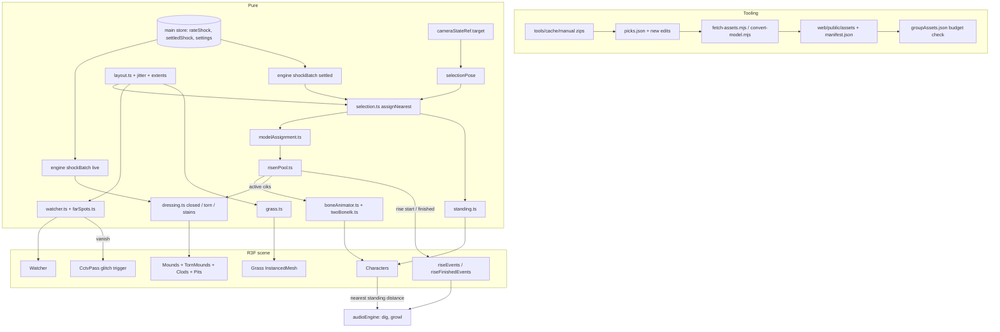
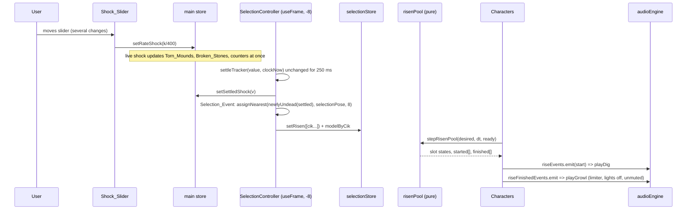

# Design Document

## Overview

The Horror_Pass turns the working graveyard of `graveyard-scene` into the found-footage frames of `reference/graveyard/horror-direction.png` and `horror-direction-sequence.png`. It covers requirements 1 to 22 in `requirements.md` and extends the Base_Spec (`.kiro/specs/graveyard-scene`) without replacing its architecture. Every spooky element keeps a financial meaning: a Risen_Zombie is a Newly_Undead firm, a Standing_Zombie is an Already_Undead firm, a Torn_Mound marks a `zombie` or Newly_Undead firm. The Watcher, the dead grass and the stone jitter are atmosphere only and carry no data.

The work follows the Base_Spec layering ("ingestion, metrics and presentation stay separate") and adds four things to it:

1. **Asset tooling** (`tools/asset-lib`, `tools/picks.json`, `web/scripts/check-bundle.mjs`): three new edit operations, six new picks, a Group_Budget check.
2. **Pure logic** (`web/src/scenes/graveyard/layout`, `.../model`, `web/src/audio`, `web/src/fx`): stone jitter and band-packed layout, selection and the Risen pool, Bone_Animator and two-bone IK, Standing placement, Watcher schedule, grass placement, Growl and Footstep rules. No React or three.js imports, so they are unit and property tested.
3. **Scene** (`web/src/scenes/graveyard/r3f`): characters, torn mounds, grass, Dirt_Burst, Watcher, selection controller.
4. **HUD** (`web/src/ui`, `web/src/state`): Content_Notice and Notice_Link.

Key decisions (each is justified below; the numbered **Decisions** section at the end collects the ones that changed requirements-level assumptions):

| Decision | Choice | Why |
| --- | --- | --- |
| Rise animation | Procedural keyframes on bones (Bone_Animator) plus an analytic two-bone IK for planted hands | The three source rigs have no usable clips for this (animation-direction.md forbids Mixamo clips). IK makes "no hand sliding" (11.7) exact instead of approximate. |
| Selection timing | A Settled_Shock tracker driven by the render-loop clock, not `setTimeout` | Requirement 11.14 asks for the render-loop clock; the tracker is a pure function that tests drive with explicit times. |
| Selection state | A separate small zustand store (`selectionStore.ts`), not the main store | Requirement 20.5 forbids changing the main store shape except `settledShock` and the notice fields. |
| Layout | Band packing: variable column widths and row depths from per-stone extents | Jitter of 0.30 m, 20 degree yaw, fallen stones and a reserved mound zone cannot fit the fixed Base_Spec pitch (1.30 x 1.80). Extents guarantee the 0.15 m gap by construction. |
| Fallen stones | Fall backwards (top away from the camera), base stays at the standing position | The mound stays at the former standing position (7.9) and the body never covers the Pit (8.11). |
| Camera | Eye height 1.5 m, 2.6 m behind the first row | Satisfies 9.1 to 9.4 together; the numbers are derived in the Camera section. |
| Characters | `SkeletonUtils.clone` of one loaded scene per model, shared geometry and materials | At most 13 skinned characters; one network load and one GPU upload per model (5.5). |
| Growl and footsteps | Pure limiter, pure choice, pure gain function; the engine only wires them | Requirements 17.10, 17.11 and 17.21 ask for properties. |
| Budget | `groupAssets.json` is the single list; `assets.ts` and `check-bundle.mjs` both read it | Avoids a third hand-copied key list (the Base_Spec already duplicates `CRITICAL_ASSET_KEYS`). |

### Research summary

Documentation looked up with the context7 MCP server before relying on an API (rule `kiro-workflow`):

- **three 0.187.0** (`/mrdoob/three.js`): `SkeletonUtils.clone(source)` clones a hierarchy so each `SkinnedMesh` is bound to its own cloned bones while geometry and materials are shared by reference. `AnimationMixer.clipAction(clip, root)` returns the same action for the same clip and root. `InstancedMesh.setMatrixAt` needs `instanceMatrix.needsUpdate = true`, and `computeBoundingSphere()` after moving instances. `DataTexture(data, w, h, format, ...)` defaults to nearest filtering and no mipmaps, so grass sets `generateMipmaps`, `minFilter` and `magFilter` itself. `Box3.setFromObject(object, precise)` includes the node hierarchy; it is used to measure characters. `Skeleton.bones` and `Bone.quaternion` are the write targets of the Bone_Animator.
- **@react-three/fiber 9.8.2** (`/pmndrs/react-three-fiber/v9.8.2`): a `useFrame` callback with a **positive** priority takes over the render loop; negative priorities only order callbacks. All Horror_Pass `useFrame` hooks use negative priorities, continuing the Base_Spec order (CameraRig -20, SceneLights -10, Flashlight -5): `SelectionController` -8, `Characters` -4, `DirtBurst` -3.
- **@react-three/drei 10.7.9** (`/pmndrs/drei`): `useGLTF(path, useDraco, useMeshOpt, extendLoader)` with `useDraco = false` (all files are Meshopt, the Base_Spec rule), `useGLTF.preload`, `useAnimations(animations, root)`. The design uses `useGLTF` and a hand-driven `AnimationMixer` (not `useAnimations`) so Reduced_Motion can pause an action on its first frame deterministically.
- **@react-three/postprocessing 3.2.2 / postprocessing 6.39.6**: no new API. The Vanish_Glitch reuses the existing `TrackingGlitchEffect.drive(amount, time)`; only the scheduler gains a `trigger`.
- **@gltf-transform/functions 4.5.1** (`/donmccurdy/gltf-transform`): `metalRough()` converts `KHR_materials_pbrSpecularGlossiness` to metal-roughness and removes the extension; it adds `KHR_materials_ior` and `KHR_materials_specular` (the three `GLTFLoader` reads both). `prune()` drops animations that have no channels, so disposing clips and then pruning leaves no orphan samplers.
- **Not used:** `@theatre/core`, `CameraControls`, KTX2, `CCDIKSolver` (the two-bone solver is 30 lines of plain math and testable without three).

**Packages.** No new dependency is added (requirement 22.10). Everything uses packages already pinned in `web/package.json` and `tools/package.json`.

## Architecture

### Existing code this design extends

| Existing file | What it provides | Change |
| --- | --- | --- |
| `web/src/scenes/graveyard/layout/layout.ts` | `computeLayout`, fixed pitch grid, `StoneLayout`, `PlotLayout` | Replaced internals by band packing; adds jitter, fallen, rows, pit anchor (below). |
| `web/src/scenes/graveyard/layout/camera.ts` | `plotPose`, `overviewPose`, `smooth`, `flickerFactor` | `CAMERA_HEIGHT` 2.15 to 1.5, `CAMERA_BACK` 6.4 to 2.6; adds `selectionPose`. |
| `web/src/scenes/graveyard/layout/pick.ts`, `grid.ts` | Yaw-only box picking; grid with bounding circles | Exact oriented box including pitch and roll; grid radius from `stoneReach`. |
| `web/src/scenes/graveyard/model/dressing.ts` | `planDressing` (mounds = undead only) | Adds `closed`, `torn`, `stains`; `mounds` keeps its name for the union. |
| `web/src/scenes/graveyard/r3f/Mounds.tsx` | One InstancedMesh of closed mounds for undead stones | Split into `Mounds` (closed, every stone) and `TornMounds` (torn, pits, clods, stains). |
| `web/src/scenes/graveyard/r3f/Hands.tsx`, `model/handPool.ts`, `handPose.ts` | Craggle hands | `Hands.tsx` and `handPool.ts` are deleted; `assignHands` moves to `selection.ts` as `assignNearest`. `handPose.ts`, `handConstants.ts`, `handGeometry.test.ts` and the dev close-up page stay (15.2, 15.4). |
| `web/src/scenes/graveyard/riseEvents.ts` | Typed emitter for rise starts | Generalised to `createEmitter<T>()`; `riseEvents` (start) is unchanged, `riseFinishedEvents` is new. |
| `web/src/scenes/graveyard/r3f/Ground.tsx` | 480 m soil ground, 4 m tiles | Texture set becomes the Ground_Texture; soil stays for mounds (6.2). |
| `web/src/scenes/graveyard/r3f/Flashlight.tsx`, `flashlightState.ts` | Spot light, aim from pointer, `coneCovers` source | Reads `coneInput` for Cone_Active and the touch Cone_Target; publishes `coneActive`. |
| `web/src/scenes/graveyard/GraveyardScene.tsx` | Scene composition, `ReadyFlag` | Mounts `SelectionController`, `Characters`, `Watcher`, `TornMounds`, `Grass`, `DirtBurst`; removes `Hands`; initial camera `[0, 1.5, 5.6]`. |
| `web/src/fx/glitchScheduler.ts`, `CctvPass.tsx` | Random tracking glitch | `GlitchScheduler.trigger(now)`; `CctvPass` subscribes to `watcherEvents.vanish`. |
| `web/src/audio/audioEngine.ts`, `useGraveyardAudio.ts`, `scheduler.ts` | Wind, crows, digging, gate; rise subscription | Growl, Footstep_Bed, lights input; `AudioParamLike` gains `linearRampToValueAtTime`. |
| `web/src/state/store.ts`, `graveyard.ts` | Main store, graveyard slice | Adds `settledShock` and a `contentNotice` slice only (20.5). |
| `web/src/ui/Hud.tsx` | Header, controls, footer text | Footer gets the Notice_Link; `ContentNotice` mounts above the footer. |
| `tools/asset-lib/edits/index.mjs`, `picks.mjs`, `convert-model.mjs`, `budgets.mjs`, `manual-readme.mjs` | Edit table, pick validation, model conversion, budgets, README generator | Three edit ops, six picks, a post-write extension check, a new limit, a wider README header. |
| `web/scripts/check-bundle.mjs` | 400 KB JS budget, 25 MB initial download, dev markers | Adds the Group_Budget check and the horror dev marker. |
| `web/scripts/measure-fps.mjs` | Base_Spec task 21.1 (in progress, not yet in the repository) | The Horror_Pass adds `--horror` mode; see Decision 10. |

### Component and data flow



### Selection to rise sequence



### Draw-call and budget impact

| Object | Draw calls | Notes |
| --- | --- | --- |
| Closed mounds (1), torn mounds (1), pits (1), clods (1), ground stains (1) | 5 | Instanced; one added to the Base_Spec "mounds" call. |
| Grass cards | 1 | At most 1,500 cards in the framed Plot. |
| Dirt_Burst | 1 | 8 x 40 = 320 instances capacity. |
| Characters | up to 13 skinned meshes, 1 to 3 draw calls each | Hero about 2 to 3 (materials), Walker and Crawler about 1 to 2. Frustum culling is off for characters (skinned bounds are bind-pose bounds). |
| Removed | Craggle hands (1) | |

Target: the Base_Spec "under 100 draw calls, under 1.5M triangles" still holds. The pipeline keeps each character at or below 30,000 triangles with a `decimate` edit when the source is larger (13 x 30,000 = 0.39M worst case). Requirement 21 measures the real number.

## Components and Interfaces

### 1. Asset pipeline (Requirements 1 to 4)

All code is under `tools/` and is owned by the user (structure.md: `/tools`).

**Picks** (`tools/picks.json`, `version: 2`, validated by `picks.mjs`). Six picks are added; the two Growl sources and the four zips already exist in `tools/cache/manual/<pick>/`.

| id | kind | group | source | expectedFile | edits |
| --- | --- | --- | --- | --- | --- |
| `sketchfab-possessed-undead-giantswing` | model | graveyard | manual zip, `entry: scene.gltf` | `.zip` | `removeAnimations`, `specGlossToMetalRough` (only if needed, see below), `decimate` if above 30,000 triangles |
| `sketchfab-zombie-pxltiger` | model | graveyard | manual zip | `.zip` | `keepAnimations` with `["Idle","Walk1_InPlace","Attack","FallingForward"]` |
| `sketchfab-zombie-walk-oscar` | model | graveyard | manual zip | `.zip` | `removeAnimations` |
| `sketchfab-hooded-horror-woman-purplepoint` | model | graveyard | manual zip | `.zip` | `removeAnimations` |
| `polyhaven-<slug>` (slug chosen in Batch 1) | texture | graveyard | `polyhaven`, `resolution: "1k"` | none | none (no `role`, so `textureLimit` is 1024) |
| `freesound-tonsil5-zombie-growl-5` | audio | graveyard | manual, `.wav` | `.wav` | none |
| `freesound-ezcah-zombie-growl-01` | audio | graveyard | manual, `.flac` | `.flac` | none |

Credits use the exact titles, authors, URLs and `CC BY 4.0` / `CC0` of requirement 3. The "changes" cells carry the text required by 3.5 to 3.7 (Mixamo-named rig kept, clip removed; embedded animation removed; four clips kept; "no AI-generated tag on the Sketchfab model page, checked 2026-11-12"). `category` is the number already used by the nearest existing pick of the same kind (6 for zombie models, 1 for textures, 10 for audio).

**New edit operations** (added to `OPS` in `edits/index.mjs` and to `EDIT_SPECS` in `picks.mjs`, each in its own file next to `remove-node.mjs`):

```js
// keep-animations.mjs : keepAnimations { names: string[] }
// Disposes every animation whose name is not in `names`; order of kept clips is preserved.
// Strict mode throws EditTargetMissing when a requested name is absent (1.5).
// remove-animations.mjs : removeAnimations {}
// Disposes every animation, then prune() removes orphan samplers and accessors (1.4, 1.6).
// spec-gloss.mjs : specGlossToMetalRough {}
// Runs metalRough() when KHR_materials_pbrSpecularGlossiness is used, otherwise a no-op (1.3).
```

`EDIT_SPECS` entries: `keepAnimations: { required: { names: arrayOfStrings }, optional: {} }`, `removeAnimations: { required: {}, optional: {} }`, `specGlossToMetalRough: { required: {}, optional: {} }`. All three are idempotent (second run changes nothing), which the existing `idempotence.property.test.mjs` pattern checks.

**Pipeline stage order for Character_Models** in `convert-model.mjs` stays `Edit_List, dedup, prune, textureCompress (WebP, 1024), meshopt`. Because `specGlossToMetalRough` is an Edit_List entry it runs before `textureCompress`, so the textures it generates are resized and encoded like the rest. The recipe hash already includes `edits`, so a changed edit list changes the output key.

**Post-write checks.** `convertModel` gains one opt-in guard: when `pick.forbidExtensions` is a non-empty array (new optional pick key, validated in `picks.mjs`), it reads `extensionsUsed` of the written glb with the existing `readExtensionsUsed` helper and throws `ForbiddenExtension` naming the extension. The four Character_Models set `forbidExtensions: ["KHR_materials_pbrSpecularGlossiness"]` (1.3). The existing models do not set it, so no existing output can start failing.

**Skeleton report.** `tools/asset-lib/skeleton-report.mjs` exports `skeletonReport(glbPath)` returning `{ skins, jointCount, jointNames, clips: [{name, duration}], triangles, textureBytes }`. The Batch 1 report prints it for each Character_Model; the Vitest test of 1.7 (skinned mesh with at least 15 bones) and the bone-map test of 11.11 read the same data. It reuses `collectJointNames` from `bip01.mjs`.

**Size guard (1.10).** `modelSizeWarning` in `convert-model.mjs` already prints the file name and a suggestion when a model is over 5 MB. The suggestion text for the Character_Models names the three steps of 1.10 (texture size, triangle decimation, KTX2).

**Idempotence (1.8).** `writeBinary` output is deterministic for equal input and the `fetch-assets` idempotence property test already covers "second run changes nothing"; the new picks are added to its fixture list.

**Missing zip or failed step (1.9).** Unchanged behaviour of `run-fetch.mjs`: the pick is skipped, listed with its cause, and the process exits non-zero under `--strict`. The new picks only add entries.

**Manual README.** `render(picks)` already lists every manual pick, so the four zips and two Growl files appear without code change (3.10). The fixed `HEADER` text says "wav, mp3 or m4a"; it becomes "wav, mp3, m4a or flac", and `manual-readme.test.mjs` is updated. The checklist count is derived from the list, so it equals the number of downloads.

**Growl conversion (3.13).** `convertAudio` writes `.ogg` and `.mp3` for every sound. Both are manifest entries (as for the four existing sounds). The Audio_Engine requests `.ogg` first (`pickAudioKey`), so the `.ogg` is the file counted in the Graveyard_Asset_Group.

**License check (4.5, 4.6).** `checkLicense` already refuses `mixamo.com` hosts and accepts CC BY from an http(s) source. No logic changes. `licenses.property.test.mjs` gains two named example tests: `refuses a pick whose source host is mixamo.com (or a subdomain)` and `accepts a CC BY Sketchfab pick whose edits remove the animation clips`. `.kiro/steering/asset-licensing.md` is edited as in 4.1 to 4.4 (allowed: CC BY Sketchfab uploads without an AI-generated tag, the four models listed, checked 2026-11-12; Mixamo clips and hosted files stay forbidden; a CC BY uploader's mesh and skeleton on a Mixamo-style rig are allowed; every other Forbidden entry untouched).

**Ground_Texture selection (2.1 to 2.6).** `tools/asset-lib/polyhaven.mjs` already talks to the Poly Haven API. Batch 1 runs a search for CC0 texture sets in the forest-floor and muddy-leaves categories, filters to sets that list `diffuse`, `nor_gl` and `rough` at `1k`, picks one, and records the slug, URL, reason and two runners-up in the Batch report. If no set qualifies the batch stops and asks (2.6). The bytes limit of 3,000,000 for the three maps is checked from the downloaded sizes before the pick is committed.

**Preview screenshot (2.4).** `tools/preview` gets a `--scene horror-assets` page that shows the chosen ground on a plane with the four models in the lights-off look; `reference/progress/horror-batch1-assets.png` is saved at 1920 x 1080 by a Playwright script using `web/scripts/lib/browser.mjs`.

### 2. Budget accounting and the bundle check (Requirement 5)

**Single list.** `web/src/scenes/graveyard/groupAssets.json`:

```json
{
  "categories": {
    "ground": ["textures/polyhaven-<slug>/polyhaven-<slug>_diffuse.webp", "...nor-gl.webp", "...rough.webp"],
    "characters": ["models/sketchfab-possessed-undead-giantswing/...glb", "...", "...", "..."],
    "stones": ["<three stone glbs>"],
    "props": ["<soil set, lichen set, mutant, corpse, gate, statue, trunk, stumps, lantern, cobwebs, blood and decal textures>"],
    "sounds": ["audio/<name>/<name>.ogg x 7"]
  },
  "hdri": ["<1k hdr>", "<2k hdr>"]
}
```

- `assets.ts` keeps `ASSET_KEYS` and gains `GROUND_SLUG` and `ASSET_KEYS.forestFloor`, `ASSET_KEYS.characters`, `ASSET_KEYS.audio.growls`, `ASSET_KEYS.audio.footsteps`. `assets.test.ts` asserts that `groupAssets.json` equals the set derived from `ASSET_KEYS` (all keys except `craggleHand`, `ruella`, the mp3 fallbacks and the HDRI) so the two cannot drift.
- `check-bundle.mjs` reads the same JSON with `readFileSync` (no TypeScript import) and exports `computeGroupBudget(files, groups)`: bytes per category, HDRI bytes separately, total, `over` and a message `Graveyard asset group <mb> MB exceeds the 25 MB Group_Budget` (5.7). Any key missing from the manifest, any file above 5,000,000 bytes in the group (5.10) and any non-finite `bytes` also fail. The result prints `ground`, `characters`, `stones`, `props`, `sounds`, `hdri`, and the total with and without HDRI, which is the breakdown of 5.8.
- `pnpm build` already runs `check-bundle`, so 21.1 enforces the budget.
- **Pipeline ceiling.** `budgets.mjs` `LIMITS.graveyard` is 26,214,400 and counts every file in the manifest group (both HDRIs, both audio formats, unused sources). It is 23.48 MB today, so the new files would exceed it. See Decision 6: it becomes 40,000,000 bytes on disk (confirmed, 5.12), while the real session budget is the 25 MB Group_Budget above.
- **Fallback order when the group exceeds 25 MB (5.13, 5.14).** Apply in this order and stop at the first step that brings the total to at most 25,000,000 bytes: (1) stop loading and shipping what the graveyard no longer uses: the Craggle_Hand is already outside `groupAssets.json` (15.1, 15.6); the Mutant (570,220 bytes) is removed from `groupAssets.json` and from the scene because the Watcher replaces it, after the user approves superseding Base_Spec Requirement 9 for the Mutant; (2) reduce texture quality: re-encode the largest texture files in the group at a lower resolution or stronger compression (for example the stump, statue or soil sets), never below the texel density of 6.1 for the Ground_Texture. After each step `computeGroupBudget` is rerun and the report prints the per-file and per-category breakdown before and after, naming each removed or recompressed file.

**Estimated Graveyard_Asset_Group** (sizes from the manifest; ground and characters are bounds):

| Category | Bytes | Source |
| --- | --- | --- |
| Soil set (mounds) | 2,268,174 | manifest |
| Lichen set | 908,850 | manifest |
| Stones | 1,061,476 | manifest |
| Props (mutant 570,220; corpse 503,480; gate 656,884; statue 1,037,824; trunk 701,424; stumps 2,201,480; lantern 604,068; cobwebs 934,404) | 7,209,784 | manifest |
| Blood and decal textures | 715,700 | manifest |
| Sounds, `.ogg` (wind 241,168; crows 503,992; digging 251,325; gate 167,231; footsteps 324,704) | 1,488,420 | manifest |
| Growls, `.ogg` | at most 600,000 | estimate, measured in Batch 1 |
| Ground_Texture, 3 maps | at most 3,000,000 | requirement 2.3 |
| **Subtotal without characters** | **at most 17,252,404** | |
| Character_Models | headroom 7,747,596 | about 1.9 MB per model on average |

The Batch 1 report replaces the two estimates with measured values. The sky HDRI files (1,725,527 + 6,981,963) are reported on a separate line.

### 3. Stone_Jitter and the band-packed layout (Requirement 8)

**`layout/jitter.ts`** (pure). All draws come from `mulberry32(fnv1a32(cik))` in a fixed order, 12 uniforms per firm regardless of outcome, so one firm's jitter never depends on any other firm (8.1) and equal input is bit-equal (8.8).

```ts
export const OFFSET_MAX = 0.30;             // metres per axis (8.2)
export const YAW_MAX = (20 * Math.PI) / 180; // 8.3
export const HEIGHT_FACTOR: readonly [number, number] = [0.90, 1.10]; // 8.5
export const FALLEN_RATE = 0.05;            // 8.6
export const FALLEN_SINK_MAX = 0.08;        // 8.7
export interface StoneJitter {
  readonly dx: number; readonly dz: number;     // [-0.30, 0.30]
  readonly yaw: number;                          // [-20deg, 20deg], standing yaw
  readonly heightFactor: number;                 // [0.90, 1.10]
  readonly fallen: boolean;                      // u < 0.05
  readonly fallenSideYaw: number;                // +PI/2 or -PI/2 (8.7)
  readonly fallenSink: number;                   // [0, 0.08]
  readonly widthU: number; readonly sinkU: number; // Base_Spec width and sink draws
  readonly leanMagU: number; readonly leanSplitU: number;
  readonly signP: number; readonly signR: number;
}
export function stoneJitter(cik: string): StoneJitter;
```

The tilt is the Base_Spec status lean (`leanFor`), unchanged except `LEAN_ZOMBIE` becomes `[0.09, 0.13]` (7.4 degrees) so that the total tilt never exceeds 8 degrees = 0.1396 rad (8.4). The ordering rule of Base_Spec 3.9 still holds: minimum endangered lean 0.05 is above maximum healthy lean 0.02. A fallen stone has no lean (it lies flat) and `lean` is 0.

**Final height** is `heightBase * heightFactor` with `heightBase` in `[0.85, 1.6]`, so the range is 0.765 m to 1.76 m (the figure in requirement 20.3).

**Fallen stone geometry** (8.7). A fallen stone keeps its base at the standing anchor, falls backwards (its top points away from the camera, −z in plot space) and lies face up:

- Euler order `YXZ` as in `Stones.tsx`: `pitch = −π/2`, `roll = 0`, `yaw = yawJitter + fallenSideYaw`. `Rx(−π/2)` turns the +z face normal into +y, so the engraved face is up (0 degrees from up, inside the 15 degree limit).
- Lying footprint is `width x height`. Because the model origin is the base centre, the body is centred on the ground plane after rotation; the instance y is `depth/2 − fallenSink` so the lower face sinks by 0 to 0.08 m.
- `StoneLayout` gains `fallen: boolean`, `standingYaw` (the jitter yaw without the ±90 degrees, used by the mound), `baseY` (instance y: `−sink` upright, `depth/2 − fallenSink` fallen) and `pitCentre: {x, z}`. Consumers that used `−s.sink` (`Stones.tsx`, `Flashlight.tsx` for keyboard focus, `FocusMarker.tsx`, `Engravings.tsx`) call `stoneBaseY(s)` and `stoneCentreY(s)` from `layout.ts` instead.
- The engraving decal needs no change: it is projected from the proxy mesh, which uses the same matrix.

**Extents and band packing** (`layout/extents.ts`, `layout.ts`).

Each stone gets a local axis-aligned **extent rectangle** relative to its anchor (the cell centre before jitter): `{ left, right, front, back }` in metres, +z is front (toward the camera). It is the union of:

1. the oriented body footprint after the final yaw (for a standing stone `width x depth`, for a fallen stone `width x height` with its top toward −z), shifted by the stone's own `(dx, dz)`;
2. the **mound zone**: the Pit disc around `pitCentre` (radius `PIT_R_MAX = 0.45`) plus the heap, i.e. `front >= depth/2 + PIT_FRONT + PIT_R_MAX` with `PIT_FRONT = 0.45`. Every stone reserves the torn-mound zone, so the layout does not change when the shock slider moves a firm from closed to torn.

A plot is a table: `cols` columns and `rows` rows as in the Base_Spec (`cols = max(1, ceil(sqrt(n * PITCH_Z / PITCH_X)))`), but column `c` has **left** and **right** extents `L_c = max left`, `R_c = max right` over its members, and row `r` has **front** and **back** extents `F_r`, `B_r` likewise. Column anchors are `cx_0 = 0` and `cx_{c+1} = cx_c + R_c + MIN_GAP + L_{c+1}`; row anchors go from the front row back (−z) the same way with `B_r + MIN_GAP + F_{r+1}`. `MIN_GAP = 0.15`. Because every stone's extent rectangle lies inside its cell box, rectangles of different cells are at least 0.15 m apart, so the oriented footprints are too (8.9). The Base_Spec constants `PITCH_X`, `PITCH_Z` remain only as the `cols` formula inputs. Typical row depth is about 1.9 m for upright rows and about 3.4 m for a row that contains a fallen stone, so a plot with 5 percent fallen stones is about 25 percent deeper than before. This is accepted.

The remaining Base_Spec layout rules are kept: plots sorted by sector name (UTF-16 order), plot grid of `ceil(sqrt(plotCount))` columns, `PLOT_GAP = 1.6`, `PAD = 0.4`, plot 0 centred on x = 0 with its first row anchor at `FIRST_ROW_Z = 3`, stone array indexed by `firmIndex`, `plot.stones` in input order (reading order, 8.13), empty list returns the zero layout. `PlotLayout` gains `rowAnchors: number[]` (anchor z of each row, front first) for the Watcher and the grass.

**Keyboard order and navigation.** `plot.stones` is built from the input order, so reading order does not change with jitter (8.13). `nextFocus` already uses `s.x, s.z`, which are the jittered centres (8.14); it is unchanged.

**Picking** (`layout/pick.ts`, 8.12). `rayStoneT` transforms the ray into the stone's local frame with the full rotation `R = Ry(yaw) · Rx(pitch) · Rz(roll)` (inverse is the transpose) and slab-tests the local box `[−w/2, w/2] x [0, h] x [−d/2, d/2]` (the scaled body, which is also what the instance matrix draws). For a fallen stone the same code works because `pitch = −π/2` is part of `R`; its box is taken above `baseY`. The grid inserts each stone into every cell its **reach circle** touches: `stoneReach(s) = hypot(width, depth)/2 + h * sin(lean)` for upright stones and `hypot(width, height)/2` for fallen ones. `forEachCentreInRect`, `queryRadius`, `nearestToRay`, `perpToRay` use `stoneCentreY` so the 13-slot engraving set still ranks fallen stones correctly.

### 4. Camera inside the plot (Requirement 9)

New constants in `layout/camera.ts`: `CAMERA_HEIGHT = 1.5`, `CAMERA_BACK = 2.6`, `TARGET_Y = 0.2`, `TARGET_AHEAD = 5` (unchanged). `plotPose` keeps its signature: position `(centerX, 1.5, frontZ + 2.6)`, target `(centerX, 0.2, frontZ − 5)`.

Derivation (all lengths in metres, front row anchor at `frontZ`):

- **Distance (9.2):** nearest stone base centre is at horizontal distance `2.6 ± 0.3 <= 2.9 <= 4.0`.
- **Inside the extended boundary (9.4):** the plot rectangle's front edge is `frontZ + F_0 + PAD` with `F_0 >= depth/2 + 0.45 + 0.45 >= 1.04` (mound zone; the narrowest stone has `depth = 0.28`) so the edge is at least `frontZ + 1.44`; extended by `PLOT_GAP = 1.6` it is at least `frontZ + 3.04 > frontZ + 2.6`. Laterally the camera is at the plot's `centerX`. The property test in the Testing section checks this for generated plots.
- **Eye height (9.1):** 1.5.
- **Lower half (9.3):** the camera pitches down by `θ = atan((1.5 − 0.2) / 5) = 14.6°`. The nearest mound base point (front edge of a mound, 0.6 m in front of the stone) is at ground distance `2.0 m`, depression angle `atan(1.5 / 2.0) = 36.9°`. The vertical field of view is 52 degrees (half 26°), so the point sits `36.9° − 14.6° = 22.3°` below the view centre, inside the frame and in its lower half. The same value holds at 390 x 844 because three's `fov` is vertical, and every nearest-row mound at the same distance projects to the same NDC y. The test runs `projectToNdc` (pure, in `camera.ts`) at both aspect ratios.
  *Measured with the pointer at the neutral position and sway 0.* With `pointer.y = −1` the look target drops 1.3 m and the pitch grows to 27.5°, which moves the nearest mounds above the centre; 9.7 keeps the pointer ranges, so 9.3 is defined for the framed pose, not for extreme pointer positions (Decision 8).
- **Look target offset (9.7):** unchanged formula, `target = base + (pointer.x * 3.2, 0.2 + pointer.y * 1.3 relative to the plot look point)`.
- **Overview (9.6):** `overviewPose` is untouched and ignores the 1.5 m rule. `OVERVIEW_Y = 25` in `Stones.tsx` still separates it.
- **Start (9.9):** `GraveyardScene` initial camera becomes `[0, 1.5, 5.6]`, `INITIAL_CAMERA` in `placement.ts` the same, and `FLASHLIGHT_FALLBACK_TARGET` stays `[0, 0.2, −2]` (it equals `target` for `frontZ = 3`).
- **Unchanged (9.5, 9.10):** fov 52, `LOOK_LAMBDA`, sway amplitudes, flashlight offset, 1.2 s plot move, fog rules.

`selectionPose(target, layout, aspect)` returns `plotPose(plot).position` or `overviewPose(...).position`, i.e. the destination pose (Selection_Pose definition). It takes no pointer, sway or flashlight input, which is how 10.3 holds by construction.

### 5. Ground, grass, torn mounds, pits, clods (Requirements 6 and 7)

**Ground (6.1 to 6.3).** `Ground.tsx` loads `ASSET_KEYS.forestFloor` (diffuse, normal, roughness at 1k). `TILE_M = 4` stays: 1024 texels per 4 m is 256 texels per metre, above the 128 required. The failure fallback (`#0b0806` flat ground and the HUD notice) is unchanged.

**Closed mounds (7.1, 7.7).** `Mounds.tsx` now draws one instance for every visible stone that is not in the torn set, with the Base_Spec half-ellipsoid (`MOUND_HEIGHT 0.24`, `MOUND_FRONT 0.45`, `MOUND_SIDE 0.2`), centred on the stone base and oriented with `standingYaw` (7.8, 7.9). The tint still follows `lightsBlendRef`.

**Torn mounds** (`r3f/TornMounds.tsx`, geometry in `model/tornMound.ts`):

- `tornMoundProfile(r)` (pure) gives the heap height for a radial coordinate: crater floor below ground inside `PIT_R`, a broken rim crest of 0.30 m at `PIT_R * 1.15`, falling to 0 at the heap radius. The geometry is a lathe-style disc with 24 x 10 segments and seeded radial noise (the "broken rim"). It is built once from a fixed seed; per-instance variation comes from scale and yaw.
- **Pit (7.2, 7.3):** one InstancedMesh of `CircleGeometry` discs (radius `PIT_R = 0.25 + 0.2 * u`, so width 0.5 to 0.9 m), `MeshBasicMaterial` colour `#050403` at `y = 0.015` with `polygonOffset`, centred on `pitCentre`. Nothing covers the opening. A character emerging through the disc is hidden below `y = 0` by the opaque ground plane, and the rim hides the rest.
- **Clods (7.2):** one InstancedMesh of `IcosahedronGeometry(1, 0)` with the soil material; 6 to 14 per torn mound (`6 + hash % 9`), positions seeded by `cik`, between `PIT_R + 0.05` and 1.2 m from the Pit centre, scale 0.04 to 0.12.
- **Stains (7.11):** lights off only, `stainCount = hash(cik) % 4` (0 to 3) flat quads from the existing drag-mark atlas cells on the heap top, drawn by a small InstancedMesh next to `BloodDecals`. Lights on draws none (7.10).
- **Which mound (7.4 to 7.6):** `tornSet = live undead ∪ activeCiks(pool)`. `planDressing` produces `torn` (live undead) and `closed` (all other firms), and `tornMoundSet(torn, activeCiks)` adds the firms whose Risen_Zombie has not finished lowering, so a Torn_Mound never reverts under a character. A firm that stops being Newly_Undead gets its Closed_Mound back within 2 s: lowering takes at most 1.2 s plus one frame.
- **Already_Undead (7.6):** zombies at shock 0 are in `torn` at every delta, as in the Base_Spec `undead` rule.

**Grass** (`model/grass.ts`, `model/grassTexture.ts`, `r3f/Grass.tsx`):

- `grassTexture(seed)` returns an RGBA `Uint8Array` 128 x 128 drawn by our own code (blade strokes with seeded lengths and lean, alpha 0 or 255); `Grass.tsx` wraps it in a `DataTexture` with `generateMipmaps = true`, `minFilter = LinearMipmapLinearFilter`, `magFilter = LinearFilter`, `colorSpace = SRGBColorSpace`. The material is `MeshStandardMaterial` with `alphaTest = 0.5`, `side = DoubleSide`. The texture is own work, so no `CREDITS.md` row (6.4).
- Geometry: two crossed 0.5 x 0.35 m quads merged into one `BufferGeometry` (card height at most 0.35, 6.5). One `InstancedMesh`, capacity 1,500 (6.11).
- `placeGrass(layout, plotIndex, quality)` (pure) per Plot: seed `fnv1a32(plot.sector)` (so a plot's cards do not depend on other plots, 6.6). `perMound = max(1, min(5, floor(1200 / n)))`; when `n > 1200`, only stones with `hash(cik) % ceil(n / 1200) == 0` get cards. Each mound gets `perMound` cards within 1.0 m of the mound centre; a sparse background adds at most 300 cards over the plot rectangle at a density at least ten times lower than the near density. Candidates inside any stone's oriented footprint or inside a Pit disc are rejected (6.8). Total per Plot is at most 1,500 (6.7). Low quality keeps every other card (6.9). Lights on draws the same cards with lights-on lighting (6.10).
- Only the framed Plot's cards are written to the instance buffer; a plot change rewrites it like the stone buffers.

### 6. Selection, the Settled_Shock and the Risen pool (Requirement 10)

**`model/settle.ts`** (pure):

```ts
export const SETTLE_SECONDS = 0.25;
export interface SettleState { value: number; since: number; settled: number | null }
export function stepSettle(s: SettleState, value: number, now: number): { state: SettleState; settledNow: boolean };
```

A change of `value` resets `since = now`; `settledNow` is true on the first call where `now − since >= 0.25` and `settled !== value`. `SelectionController` calls it from its `useFrame` with `state.clock.elapsedTime`, so the delay is 250 ms plus at most one frame (inside the 50 ms tolerance at 20 fps and above) and no timer exists (11.14). The first load of the Firm list is a Selection_Event without waiting.

**`model/selection.ts`** (pure):

```ts
export const RISEN_BUDGET = 8;
export const STANDING_BUDGET = 4;
export interface Candidate { cik: string; dist: number }
/** Nearest first; ties by lower cik (plain string order); duplicates counted once; input not mutated. */
export function assignNearest(c: readonly Candidate[], budget: number): string[];
export function candidatesFor(firms, indices, layout, pose: Vec3): Candidate[]; // distance to headstone BASE centre (x, 0, z)
```

`assignNearest` is `assignHands` unchanged in behaviour (it already satisfies 10.1, 10.2, 10.12) and is exported under the new name. `candidatesFor` measures the straight-line distance from the Selection_Pose to the headstone base `(s.x, 0, s.z)`.

**`SelectionController`** (`r3f/SelectionController.tsx`, `useFrame` priority −8) watches three inputs and emits a Selection_Event when any of them changes:

1. the settled shock changes (`stepSettle`);
2. `cameraStateRef.current.target` changes (the rig writes the destination at the start of a move, so the assignment uses the destination pose from the start, 10.8);
3. the Firm list loads for the first time.

On an event it computes `batch = shockBatch(firms, settledShock)`, `risen = assignNearest(newlyUndead(batch), RISEN_BUDGET)`, `modelByCik` (section 8), and for events of kind 2 and 3 `standing = assignNearest(alreadyUndead, STANDING_BUDGET)` (13.1, 13.2). It writes `{ risen, modelByCik, standing }` into `selectionStore` and `setSettledShock(v)` into the main store. Nothing in this path reads the pointer, the sway, the flashlight or the interpolated camera pose (10.3).

**`model/risenPool.ts`** (pure, replaces `handPool.ts`):

```ts
export type RisenPhase = 'idle' | 'waiting' | 'rising' | 'up' | 'lowering';
export interface RisenSlot { cik: string | null; phase: RisenPhase; t: number }
export interface RisenPool { slots: RisenSlot[] }          // length 8
export const RISE_SECONDS = 3.0;
export const LOWER_SECONDS = 1.2;
export function stepRisenPool(
  s: RisenPool, desired: readonly string[], dt: number,
  opts: { reduced: boolean; ready: (cik: string) => boolean },
): { state: RisenPool; started: string[]; finished: string[] };
```

Rules (same shape as the retired hand pool, with the additions the requirements add):

- A desired CIK without a slot takes an `idle` slot only. It enters `waiting` (a slot is held, no body) until `ready(cik)` is true (12.6: the Torn_Mound is already shown), then `rising` and appears in `started`.
- A slot whose CIK left `desired` becomes `lowering` (or `idle` at once under Reduced_Motion) and frees only when lowering ends; no replacement starts earlier (10.7). A `lowering` slot counts as active, so `activeCount <= 8` at every step (10.9).
- `rising` becomes `up` at `t >= RISE_SECONDS` and the CIK appears in `finished` exactly once (11.8).
- Reduced_Motion: a desired CIK goes straight to `up` in the same step, appears in `started` and `finished` in that step (11.15, 17.8).
- Budget: `desired` is sliced to 8. A new CIK that finds no idle slot waits for the next step after a slot frees (at most `LOWER_SECONDS` = 1.2 s), and starts within 100 ms of the Selection_Event only when a slot is free (10.5).

`Characters.tsx` calls it every frame with `dt` clamped to 0.1 s and emits `riseEvents.emit` for `started` and `riseFinishedEvents.emit` for `finished`.

### 7. Bone_Animator, two-bone IK and character scale (Requirement 11)

**`model/boneAnimator.ts`** (pure; no React, no three). Time is seconds since the rise started.

```ts
export type Role =
  | 'spine' | 'chest' | 'neck' | 'head'
  | 'shoulderL' | 'shoulderR' | 'upperArmL' | 'upperArmR' | 'foreArmL' | 'foreArmR'
  | 'handL' | 'handR' | 'fingersL' | 'fingersR';
export interface Euler3 { readonly x: number; readonly y: number; readonly z: number }
export interface BoneFrame {
  readonly roles: Readonly<Record<Role, Euler3>>; // radians, delta from the rest pose, local XYZ
  /** Root drop as a fraction of hips-to-crown height H; rootY = −drop * H, always >= 0 drop. */
  readonly drop: number;
  /** 0..1 weight of the arm IK that plants the hands on the rim. */
  readonly plant: number;
  readonly phase: 'rise' | 'idle';
}
export const RISE_SECONDS = 3.0;
export const DIRT_BURST_AT = 0.35;
export function frameAt(t: number, cik: string): BoneFrame;
export function twitchTimes(cik: string, horizon: number): { at: number; dur: number }[];
```

**Rise key poses** (6 poses, 5 transitions of 120 to 200 ms, each pose held at least 100 ms; values are the first guess, tuned in Batch 3 with the scene-critic against `horror-direction-sequence.png`):

| # | Transition | Hold until | What moves | `drop` | `plant` |
| --- | --- | --- | --- | --- | --- |
| 0 | start | 0.20 s | buried, fingers just under the soil | 1.25 | 0 |
| 1 | 0.20 to 0.35 s | 0.90 s | arm raised, fingers and hand break the surface; Dirt_Burst at 0.35 s | 1.10 | 0 |
| 2 | 0.90 to 1.05 s | 1.40 s | head and shoulders jerk up | 0.60 | 0 |
| 3 | 1.40 to 1.55 s | 1.95 s | arms swing down and plant on the rim | 0.45 | 1 |
| 4 | 1.95 to 2.15 s | 2.60 s | torso hauls out to the waist | 0.00 | 1 |
| 5 | 2.60 to 2.70 s | 3.00 s | settle: small forward lean, head rises | 0.00 | 1 |

Transitions use `easeOutCubic` on the segment, so the motion is a fast jerk then a still pose. At `t >= 3.0` the frame is `phase: 'idle'`.

**Idle_Loop (11.9, 11.10):** breathing is a sine on `chest` and `spine` with period `3 + 2 * u0` seconds (u0 from the CIK stream), amplitude 1.5 degrees; the shoulders receive the inverse of the chest rotation so the arm chain does not move. Head twitches: `twitchTimes(cik)` draws intervals `1 + 3 * u` seconds from `mulberry32(fnv1a32(cik + ':twitch'))`; each twitch lasts `0.10 + 0.15 * u` (at most 0.25 s) as a smoothstep pulse of up to 18 degrees on `head`/`neck`. `drop` stays 0 and `plant` stays 1, so the root never moves (11.7).

**Reduced_Motion (11.15):** `Characters` evaluates `frameAt(RISE_SECONDS, cik)` once, with breathing and twitch amplitude forced to 0, and never advances.

**`model/twoBoneIk.ts`** (pure plain vectors):

```ts
export type V3 = readonly [number, number, number];
export function solveTwoBone(shoulder: V3, target: V3, upperLen: number, lowerLen: number, pole: V3):
  { elbow: V3; wrist: V3; reached: boolean };
```

`wrist` is `target` when `|target − shoulder| <= upperLen + lowerLen` (and above `|upperLen − lowerLen|`), otherwise the nearest reachable point on the line; `|elbow − shoulder| = upperLen` and `|wrist − elbow| = lowerLen` hold within 1e-9. `Characters.tsx` reads the arm bone world positions once per rise start, then each frame blends the animated arm direction toward the IK direction with weight `plant` using `Quaternion.setFromUnitVectors` on the bone's rest direction. The two **rim anchors** per Pit are `pitCentre ± right * (PIT_R + 0.08)` at `y = 0.05`, where `right` is perpendicular to the character's facing. They are constants for the life of the Pit, so the hands cannot slide (11.7).

**`model/characterScale.ts`** (pure): `scaleForHeight(measured: number, u: number)` returns `target / measured` with `target = 1.6 + 0.3 * u`, `u` from the CIK stream (11.16). `Characters.tsx` measures each model once with `Box3.setFromObject(scene, true)` in the bind pose.

**Below the waist and through the ground (11.6).** The root is placed so that hips world height is `−drop * H` and `drop >= 0`, so the hips are at or below the rim at every frame, and the Bone_Animator never rotates leg bones. Everything below the hips is therefore under the ground plane or the Pit disc. The arm IK targets the rim at `y = 0.05`; with a two-bone solution whose wrist equals the target, no arm part is below the target height unless the solution folds down, which the pole vector (pointing up and back) prevents (a property checks the elbow height is at least the rim height).

**Dirt_Burst** (`model/dirtBurst.ts`, `r3f/DirtBurst.tsx`): `dirtParticles(seed, count, t)` returns positions for a ballistic burst (initial speed 1.2 to 2.4 m/s, upward bias, gravity 9.8, lifetime 0.9 s). One InstancedMesh of 320 small `IcosahedronGeometry` instances (8 pooled bursts x 40). `count` is 40, or 20 in low quality (19.1). A burst is triggered once per Risen_Zombie at `DIRT_BURST_AT` and the pooled bursts are recycled by slot index, so the 8 slots never exceed 40 particles each (11.5). Particles are soil-coloured and never brighter than the soil, so no luminance flash (19.3). Reduced_Motion draws none.

### 8. Models for each zombie, Standing_Zombies (Requirements 12 and 13)

**`model/modelAssignment.ts`** (pure):

```ts
export type CharacterId = 'hero' | 'walker' | 'crawler' | 'watcher';
export function wantedModel(rank: number, cik: string, lights: 'off' | 'on'): CharacterId;
//  rank 0 (nearest) and lights off -> 'hero'; rank 0 and lights on -> 'walker';
//  rank >= 1 -> fnv1a32(cik) & 1 ? 'crawler' : 'walker'
export function resolveModel(wanted: CharacterId, loaded: ReadonlySet<CharacterId>, failed: ReadonlySet<CharacterId>): CharacterId | null;
//  hero or crawler failed -> 'walker'; walker failed -> null (no Risen, no Standing, no event)
```

`rank` is the index in the `assignNearest` result, so the nearest zombie (ties by lower cik) is rank 0 (12.1). The assignment is recomputed only at a Selection_Event or when `settings.lights` changes (12.5). A lights change swaps the model of rank 0 within one frame of the model being loaded: the `Characters` component keeps the same `RisenSlot` (phase and t) and the same Bone_Animator time, so phase and position are kept (12.4). If the Hero_Model is not loaded yet, the Walker stays until it arrives (the 500 ms bound holds for a cached model; Decision 11).

**Loading (5.1 to 5.5, 12.6, 12.7).** `characterLoader.ts` wraps `useGLTF(url, false)` in one `Suspense` + `ModelBoundary` per model id, started only when a character of that id is first needed after the first frame. The Hero and Watcher are never requested in lights on; the Watcher is never requested under Reduced_Motion. `reportAssetError(name, error)` logs the failed asset and adds it to `failed`; `resolveModel` applies the fallback chain. Each instance is `SkeletonUtils.clone(gltf.scene)` (three examples path `three/examples/jsm/utils/SkeletonUtils.js`, as the existing code imports `three/examples/jsm/...`), so the geometry, materials and textures are shared and loaded once. At most 13 skinned characters exist (8 + 4 + 1, 12.8).

**Standing_Zombies (`model/standing.ts`, pure).**

```ts
export function standingPlacement(
  layout: GraveyardLayout, firmIndex: number, pose: Vec3, taken: readonly Footprint[],
): { x: number; z: number; yaw: number } | null;
```

- Position: on the camera-facing side of the headstone, at `pitCentre`-line offset `depth/2 + 1.1 m` in front of the stone along the standing yaw, then nudged sideways in steps of 0.35 m (alternating left and right, up to 6 steps) until the clearances hold: outside every headstone footprint including its own, outside every Pit disc (radius plus 0.1), and at least 0.7 m from the centre of every other zombie already placed (Risen pits and earlier Standing_Zombies). `null` (no valid spot) drops that zombie and the next candidate is used, so the result still has at most 4 entries (13.7, 13.8).
- Facing: `yaw = atan2(pose.x − x, pose.z − z)` fixed until the next Selection_Event (13.6).
- Clip: Idle when `fnv1a32(cik) & 1 == 0`, Walk1_InPlace when 1 (13.4). The root stays fixed (13.5); the pipeline test checks that the kept `Walk1_InPlace` clip has no root translation larger than 1 cm.
- Walker only, in both Lights_Mode values (13.3). Reduced_Motion: the action is played, set to time 0 and paused (13.11).
- Timing (13.10): a change of the Standing set is applied when `cameraStateRef.atRest` is true and no character to be removed is inside the viewport (`inViewport(position, camera)` pure frustum test); additions are applied at the same moment. For the first load, `atRest` is true and the set appears at once.
- No blood decal is drawn on characters (13.13, 16.4, 19.6).

### 9. The Watcher (Requirement 14)

**`model/farSpots.ts`** (pure). `farSpots(layout, framed: number | 'overview', occupied: readonly Footprint[])` returns candidate ground positions. For a framed Plot, candidates lie along the anchors of its farthest two rows (`rowAnchors`), every 1.0 m in x across the plot rectangle, shifted `0.9 m` toward −z so they stand behind the stones. In the overview the plot used is the one farthest from the camera (smallest `rect.z1`). A candidate is rejected when it is inside any headstone oriented footprint (with 0.3 m margin), any Pit disc (radius plus 0.3 m), or within 0.7 m of a zombie. The list is sorted by distance to the Selection_Pose, then by x (deterministic).

**`model/watcher.ts`** (pure state machine):

```ts
export interface WatcherInputs {
  now: number;                       // render-loop seconds
  enabled: boolean;                  // lights off && !reducedMotion && coneActive
  coneCoversWatcher: boolean;        // same coneCovers test as the Mutant
  spots: readonly Spot[];            // farSpots result, with distance to the Selection_Pose
  coneCoversSpot: (s: Spot) => boolean;
}
export type WatcherEvent = 'appear' | 'vanishGlitch' | 'hideQuiet';
export function createWatcher(rand: () => number): {
  tick(i: WatcherInputs): { shown: Spot | null; events: WatcherEvent[] };
  onTargetChange(now: number): void;   // hide quietly, schedule 20-60 s (14.15)
};
```

Behaviour:

- Hidden with no schedule until `enabled` becomes true; then `nextAt = now + 20 + 40 * rand()` (14.8, 14.12). `enabled` false while shown: `hideQuiet`, schedule cleared (14.9, 14.11, 14.13, 14.14).
- At `nextAt`: choose a spot (below), show it, event `appear`. If every spot is covered by the cone, retry after 1 s (14.7).
- Spot choice: `target = max(nearestFarDist, lastDist − (0.5 + rand()))`; the first appearance uses the farthest spot distance. Pick the spot with distance closest to `target` that is not the previous spot and not covered by the cone; `lastDist` is stored (14.3, 14.5, 14.6).
- Shown and `coneCoversWatcher`: hide, event `vanishGlitch`, `nextAt = now + 20 + 40 * rand()` (14.4, 14.5).
- `onTargetChange`: hide quietly, keep `lastDist` clamped into the new `[nearest, farthest]` range, schedule 20 to 60 s (14.15).
- No audio or jump scare is attached to any event (14.16, 14.19).

**Cone_Active** (`r3f/coneInput.ts`, pure reducer): `ConeInput { inside: boolean; tapped: boolean; touch: boolean; target: Vec3 | null }`. Pointer enter/move with `pointerType` mouse or pen sets `inside`; leave clears it; a touch `pointerup` that passes `isTap` sets `touch = true`, `tapped = true` and stores the ray hit of that tap as `target`, which stays until the next tap (14.10). `coneActive = touch ? tapped : inside`. `Flashlight.tsx` uses `target` for touch devices instead of the live pointer ray.

**Rendering** (`r3f/Watcher.tsx`): one Watcher_Model clone, facing the Selection_Pose, `visible` toggled by the state machine in `useFrame`, frame-accurate against the cone test (hidden within one frame, well under 100 ms). Standing pose is the rest pose (no clip, `removeAnimations`); a slow 0.5 degree sway on the head only when motion is allowed (it is hidden under Reduced_Motion anyway).

**Vanish_Glitch** (`fx/glitchScheduler.ts`): `trigger(now)` is added to `GlitchScheduler`.

```ts
trigger(now: number): boolean; // true when a glitch was started
```

It starts the standard glitch (0.15 to 0.4 s, 3 steps) immediately when no glitch is running **and** the last glitch ended at least 1 s ago. Otherwise it returns false and does nothing: an in-progress random glitch continues unchanged and is not extended (14.18); a glitch that ended less than 1 s ago is not repeated, so the CCTV amount never changes more than 4 times in any second (14.17, 19.3). After the glitch `nextAt = end + 20 + 40 * rand()` as before. `CctvPass` subscribes to `watcherEvents.vanish` (new tiny emitter in `scenes/graveyard/watcherEvents.ts`) and calls `scheduler.trigger(clock)`. It returns early when lights are on or Reduced_Motion is true (the existing `enabled` gate).

### 10. Audio: Growl and Footstep_Bed (Requirement 17)

**`audio/growl.ts`** (pure):

```ts
export const GROWL_MIN_GAP_MS = 1000;
export function createGrowlLimiter(): { accept(nowMs: number): boolean };
export function pickGrowl(u: number): 0 | 1; // u < 0.5 -> 0 (tonsil5), else 1 (ezcah)
```

`accept` returns true for the first event and for any event at least 1,000 ms after the last **accepted** one, and false otherwise; rejected events are dropped, never queued (17.2). The limiter uses the engine clock (`ctx.currentTime * 1000`), so it is independent of frame rate.

**`audio/footsteps.ts`** (pure):

```ts
export const FOOTSTEP_MAX_GAIN = 0.15;
export function footstepGain(distance: number): number; // 0.15 * clamp((12 - d) / 10, 0, 1)
export type FootstepState = 'stopped' | 'fadingIn' | 'playing' | 'fadingOut';
export function nextFootstep(s: FootstepState, wantPlayback: boolean, elapsed: number): FootstepState;
```

`footstepGain` is 0.15 at 2 m or less, falls linearly to 0 at 12 m and is 0 beyond (17.15, 17.21). `wantPlayback = gate && !muted && !reducedMotion && nearbyStanding`.

**Engine additions** (`audioEngine.ts`). The structural `AudioParamLike` gains `linearRampToValueAtTime(value, endTime)`; the test fake is updated.

- `setLights(l)`, `playGrowl()`, `setFootstepDistance(d: number | null)`.
- Loading: `growls` (both files) lazily at the first `riseFinished` event or the first `setLights('off')` after the gate; `footsteps` lazily when `setFootstepDistance` first receives a number after the gate (17.6, 17.13). A failed or undecodable growl falls back to the other; both failing skips silently (17.7); a failed footstep file is skipped (17.20).
- `playGrowl()`: ignored before the gate, when muted, when lights are on, or when the limiter rejects. Otherwise a new buffer source goes through a per-play `GainNode` at 0.4 (after the master gain), is faded out with `linearRampToValueAtTime` to 0 over the last 0.3 s, and stopped at `start + 3.0 s` (17.3). The file comes from `pickGrowl(growlSource())`; `growlSource` is an engine option (default `Math.random`), separate from the existing `rand` used by crows, so tests inject a seeded source.
- Footstep_Bed: a looping source through its own gain node. When `setFootstepDistance` first receives a number while stopped it fades in over 1.0 s (`linearRampToValueAtTime`), then every call sets `gain.setTargetAtTime(footstepGain(d), now, 0.08)` (time constant 0.08 s reaches 95 percent in 0.24 s, inside 250 ms, 17.16). `null` fades out over 1.0 s and stops the source at the end (17.17). Mute, missing gate and `dispose()` follow the existing rules (silent, nothing queued, restart with a fade-in on unmute while a zombie is nearby, 17.18). The Growl never reads Reduced_Motion (17.8). The Footstep_Bed does (17.19, confirmed): the engine gains `setReducedMotion(r: boolean)`; while `r` is true `wantPlayback` is false, `footsteps` is never loaded, and a playing bed fades out over 1.0 s and stops (as for `null`); when `r` becomes false and a Nearby_Standing_Zombie exists (gate passed, not muted) it restarts with the 1.0 s fade-in. `useGraveyardAudio` mirrors `settings.reducedMotion` into `setReducedMotion` next to `setLights`.
- Digging (17.9): `useGraveyardAudio` still subscribes to `riseEvents` and calls `playDig`; the event now comes from `risenPool.started` once per Risen_Zombie. It also subscribes to `riseFinishedEvents` and calls `playGrowl`, and mirrors `settings.lights` into `setLights`.
- **Nearby_Standing_Zombie.** `Characters.tsx` computes, once per frame, the distance from the camera to the nearest Standing_Zombie that is inside the framed Plot rectangle or inside the camera frustum (`nearbyStanding`, pure) and calls `getAudioEngine()?.setFootstepDistance(d)` only when the value changed by 0.05 m or the nearby state flipped.

### 11. Content_Notice (Requirement 18)

- `state/contentNotice.ts` holds a store slice `contentNotice: { open: boolean; dismissed: boolean }` with `dismissContentNotice()` and `openContentNotice()`, and a storage helper beside `settingsStorage.ts` using key `zfr.contentNotice.v1` (value `"dismissed"`). `readDismissed()` and `writeDismissed()` never throw (18.3): an unreadable store means "not dismissed", an unwritable store keeps the in-memory dismissal for the current page.
- `ui/ContentNotice.tsx`: a `role="note"` single line "Contains horror and gore" and a dismiss button named "Dismiss content notice". It docks at the top edge, under the REC header, outside the 3D stage panels (18.7). At 390 px the text keeps one line with `font-size: clamp(12px, 3.4vw, 14px)` and `white-space: nowrap`.
- `ui/NoticeLink.tsx`: a button with the text "Contains horror and gore" in the footer next to `FOOTER_TEXT`, always rendered in the graveyard and the Table_View (18.4). Activation opens the notice and moves focus to its dismiss button (18.5); dismissing a notice that was opened from the link returns focus to the link (18.6).
- Both use the existing focus-ring utility (2 CSS pixels) and the HUD token colours: text `#E6E2D6` on the panel background `rgba(6,8,11,0.78)` over the near-black stage gives a contrast above 12:1, and the colour tokens are the same in both Lights_Mode values (18.9, 18.10). `contrast.test.ts` gets two rows for these pairs.
- The dismiss click is a normal `pointerdown`/`keydown`, so the Audio_Engine's capture listeners treat it as the Interaction_Gate with no extra code (18.11).

### 12. Quality, accessibility and counters (Requirement 19)

`model/horrorQuality.ts` (pure):

```ts
export interface HorrorQuality {
  grassScale: 1 | 0.5; dirtParticles: 40 | 20; characterShadows: boolean;
  risenBudget: 8; standingBudget: 4;
}
export function horrorQuality(lowQuality: boolean): HorrorQuality;
```

Low quality halves grass and Dirt_Burst, turns off character `castShadow`, keeps both budgets and does not touch the Watcher rules (19.1, 19.2). Characters are decorative: their meshes set `raycast = () => null`, are not in the DOM and never receive focus or hover (19.5). The Risen_Counter, Already_Undead line and Table_View still read `useShockView()` (live shock), so the Rise_Budget cannot change them (19.7). The same pure helpers drive the existing live region and file card; neither needs a change (19.4).

### 13. Evidence scripts (Requirements 21 and 22)

- **Screenshots.** `web/scripts/horror-screenshots.mjs --batch 2|3a|3b` (files: `horror-batch3a-rise.png`; `horror-batch3b-standing.png`, `-watcher.png`, `-notice.png`) uses `lib/browser.mjs` (headed Chrome, 1920 x 1080), `/?firms=3000`, lights off, and writes the files listed in 22.5 and 22.6 to `reference/progress/horror-batch<N>-<name>.png`. State is reached through the UI (slider keys, plot chips) plus a development-only helper: `?horror=rise` waits for the first `rise finished` frame, `?horror=watcher` makes the Watcher state machine schedule its first appearance after 1 s, `?horror=notice` clears the stored dismissal. The helper sits behind `import.meta.env.DEV` and the marker `__zfr_horror_debug__` is added to `FORBIDDEN_MARKERS` in `check-bundle.mjs`, so it is tree-shaken from production and checked.
- **Measurement.** `measure-fps.mjs` gains `--horror`. It evaluates, inside the page on the dev server, `await import('/src/engine/index.ts')` and `await import('/src/state/store.ts')` (Vite serves the same module instances the app uses) to find the lowest slider step `k` (0.25 pp) with at least 8 Newly_Undead firms among the 3,000, sets it with the slider keys, waits 2 s after the Settled_Shock, then records at least 10 s of frames. Counts of Risen_Zombies, Standing_Zombies and Watchers at the start of the window come from `data-risen-count`, `data-standing-count` and `data-watcher-count` attributes that a development-only `HorrorStats` component writes to `document.body`. The DEVLOG line has every field of 21.5. This depends on Base_Spec task 21.1 (Decision 10).
- **Reference rule.** After any change under `web/src/scenes/**` or `web/src/fx/**`, the agent names `reference/graveyard/horror-direction.png` and `horror-direction-sequence.png` (and `graveyard-rate-shock-3pp.png` for unchanged parts) and offers the scene-critic (22.7).

## Data Models

### New and changed types

```ts
// layout/layout.ts (changed)
export interface StoneLayout {
  readonly firmIndex: number; readonly plot: number;
  readonly x: number; readonly z: number;           // jittered base centre
  readonly yaw: number;                              // final yaw (standing yaw, plus +-90 deg when fallen)
  readonly standingYaw: number;                      // new
  readonly pitch: number; readonly roll: number;     // pitch = -PI/2 when fallen
  readonly width: number; readonly height: number; readonly depth: number;
  readonly sink: number; readonly lean: number;
  readonly fallen: boolean;                          // new
  readonly baseY: number;                            // new: instance y of the model origin
  readonly pitCentre: { readonly x: number; readonly z: number }; // new
}
export interface PlotLayout { /* Base_Spec fields */ readonly rowAnchors: readonly number[] } // new

// model/dressing.ts (changed)
export interface DressingPlan {
  readonly undead: readonly number[];   // zombie or newly undead (live shock)
  readonly mounds: readonly number[];   // = undead (unchanged name, kept for the Base_Spec tests)
  readonly torn: readonly number[];     // = undead
  readonly closed: readonly number[];   // every other firm; torn and closed partition all firms
  readonly blood: readonly BloodPlan[]; // lights off only
  readonly stains: readonly { firm: number; count: number; seeds: readonly number[] }[]; // lights off only, count 0..3
}

// selectionStore.ts (new, own zustand store)
export interface SelectionState {
  readonly risen: readonly string[];                  // ordered nearest first
  readonly standing: readonly string[];
  readonly modelByCik: Readonly<Record<string, CharacterId>>;
  readonly version: number;                           // bumps on every Selection_Event
}

// state/store.ts (changed, 20.5)
settledShock: number;                    // last Settled_Shock value, 0 initially
contentNotice: { open: boolean; dismissed: boolean };
```

### Constants

| Constant | Value | Where |
| --- | --- | --- |
| `OFFSET_MAX` | 0.30 m | `jitter.ts` |
| `YAW_MAX` | 20 degrees | `jitter.ts` |
| `HEIGHT_FACTOR` | [0.90, 1.10] | `jitter.ts` |
| `FALLEN_RATE` | 0.05 | `jitter.ts` |
| `MIN_GAP` | 0.15 m | `layout.ts` |
| `PIT_FRONT`, `PIT_R` | 0.45 m, 0.25 to 0.45 m | `tornMound.ts` |
| `CAMERA_HEIGHT`, `CAMERA_BACK` | 1.5 m, 2.6 m | `camera.ts` |
| `SETTLE_SECONDS` | 0.25 s | `settle.ts` |
| `RISEN_BUDGET`, `STANDING_BUDGET` | 8, 4 | `selection.ts` |
| `RISE_SECONDS`, `LOWER_SECONDS` | 3.0 s, 1.2 s | `risenPool.ts` |
| `DIRT_BURST_AT` | 0.35 s | `boneAnimator.ts` |
| `GROWL_MIN_GAP_MS`, growl gain, growl max length | 1000 ms, 0.4, 3.0 s | `growl.ts`, `audioEngine.ts` |
| `FOOTSTEP_MAX_GAIN`, near / far distance | 0.15, 2 m / 12 m | `footsteps.ts` |
| Watcher schedule | 20 to 60 s; distance step 0.5 to 1.5 m | `watcher.ts` |
| Grass cap per Plot | 1,500 | `grass.ts` |

### Initial values and invariants

| Value | Initial | Invariant |
| --- | --- | --- |
| Risen pool | 8 idle slots | active slots at most 8 at every step; each slot holds a distinct cik |
| `selectionStore` | empty sets, `version 0` | `risen.length <= 8`, `standing.length <= 4`, disjoint |
| Camera | `(0, 1.5, 5.6)`, target `(0, 0.2, −2)` | eye height 1.5 +- 0.1 at every plot pose |
| `contentNotice` | `open = !dismissed`, `dismissed` from storage | the Notice_Link is always rendered |
| Skinned characters | 0 | at most 13 in any frame |

## Correctness Properties

*A property is a characteristic or behavior that should hold true across all valid executions of a system-essentially, a formal statement about what the system should do. Properties serve as the bridge between human-readable specifications and machine-verifiable correctness guarantees.*

**Reflection result.** Criteria that restate one another were merged: the five requirements about the pool and its events (10.5, 10.7, 10.9, 11.8, 11.15, 12.6, 15.3) become one pool property; the blood, stain, torn and closed rules (7.1, 7.4, 7.6, 7.10, 7.11, 10.6, 16.4) become one dressing property; the Watcher rules split into enabling, appearance and vanishing; the Growl limiter and the Growl choice stay separate because one is about time and the other about values. Criteria about visuals, timing of real network loads, document edits and workflow (for example 2.x, 4.1 to 4.4, 7.3, 18.7, 18.12, 21.x, 22.x) are not properties; they are examples, screenshots or process rules, as the prework shows. Property-based tests use fast-check 4.10.2 in `web/` and the same library in `tools/` (the `.property.test.mjs` files already use it).

### Property 1: Animation edits keep exactly what they are told to keep

For any glTF document with any set of animation clip names and any list `K` of names, `keepAnimations(K)` leaves exactly the clips whose names are in `K` (order preserved) and no others; `removeAnimations` leaves zero clips and leaves the skin joint names and mesh count unchanged; both are idempotent; for any document that uses `KHR_materials_pbrSpecularGlossiness`, `specGlossToMetalRough` leaves no material with the extension and does not list it in `extensionsUsed`.

**Validates: Requirements 1.3, 1.4, 1.5, 1.6**

### Property 2: Mixamo hosts are refused, animation-free CC BY Sketchfab picks are accepted

For any pick whose `sourceUrl` host is `mixamo.com` or a subdomain of it (any path, any allowed license string), `checkLicense` refuses it as forbidden. For any pick with license `CC BY 4.0`, an http(s) Sketchfab `sourceUrl`, a non-empty author and an `edits` list that contains `removeAnimations`, `checkLicense` accepts it as `CC BY`.

**Validates: Requirements 4.5, 4.6**

### Property 3: Group budget accounting is exact

For any manifest-like file list and the categories of `groupAssets.json`, `computeGroupBudget` returns per-category sums that add up to the total (HDRI bytes reported separately, with and without HDRI totals), counts each sound once (its `.ogg`), reports `over` if and only if the total exceeds 25,000,000, fails when any group key is missing or any group file is above 5,000,000 bytes, and in the failure case its message contains both the measured size and the budget.

**Validates: Requirements 3.13, 5.6, 5.7, 5.8, 5.10**

### Property 4: Requested character models follow lights, motion and need

For any Selection result, lights mode and Reduced_Motion value, the set of character model ids the scene requests never contains `hero` or `watcher` when lights are on, never contains `watcher` when Reduced_Motion is true, contains `hero` only when a Risen_Zombie of rank 0 exists in lights off, and contains no id before the first frame.

**Validates: Requirements 5.1, 5.3, 5.4, 14.13**

### Property 5: Grass placement is deterministic and local to its plot

For any layout and any plot, `placeGrass` called twice returns bit-equal positions, and the cards of a plot are unchanged when other plots (other sectors) are added to or removed from the list.

**Validates: Requirements 6.6**

### Property 6: Grass respects clearance, cap, density and quality

For any layout, every card of a plot lies outside every headstone oriented footprint and every Pit disc and has a height of at most 0.35 m; the plot has at most 1,500 cards; the card density within 1.0 m of a mound is higher than the density farther than 3.0 m from every mound (for plots of at least 5 stones); and the low-quality set has at most half the cards of the normal set.

**Validates: Requirements 6.5, 6.7, 6.8, 6.9**

### Property 7: Every headstone has exactly one mound, and the plan follows the shock and lights

For any firm list, any valid delta and any lights mode: `torn` and `closed` partition all firms; `torn` equals the firms that are `zombie` or Newly_Undead (including Newly_Undead firms beyond the Rise_Budget and zombies at every delta); stains exist only in lights off, number 0 to 3 per torn mound, and only on torn mounds; blood quads exist only in lights off and only on undead stones.

**Validates: Requirements 7.1, 7.4, 7.6, 7.10, 7.11, 10.6, 16.4**

### Property 8: A torn mound is never removed under a character

For any set of undead firms and any set of active pool ciks, `tornMoundSet` equals their union, and a firm leaves the set only when it is neither undead nor active.

**Validates: Requirements 7.5**

### Property 9: Pit and clod geometry

For any cik: the Pit width is between 0.5 m and 0.9 m; the clod count is between 6 and 14; every clod lies at least `PIT_R + 0.05` and at most 1.2 m from the Pit centre.

**Validates: Requirements 7.2**

### Property 10: Mounds follow the jittered, standing headstone

For any layout, every stone's `pitCentre` equals its jittered base centre moved `depth/2 + 0.45` m along its `standingYaw` (front side), also when the stone is fallen; the mound centre is the stone base.

**Validates: Requirements 7.7, 7.8, 7.9**

### Property 11: Jitter is bounded, local to the cik and deterministic

For any cik, `stoneJitter` has `|dx|, |dz| <= 0.30`, `|yaw| <= 20 degrees`, a height factor in [0.90, 1.10]; calling it twice, or computing a layout of a list and of the same list with extra firms, gives bit-equal jitter for the shared firms; for any status the total tilt of an upright stone is at most 8 degrees and the lowest endangered or zombie lean is greater than the highest healthy or insufficient_data lean; final heights lie in [0.765, 1.76].

**Validates: Requirements 8.1, 8.2, 8.3, 8.4, 8.5, 8.8, 8.10, 20.3**

### Property 12: Fallen stones lie face up

For any firm, a fallen stone has `pitch = −90 degrees`, its face normal is within 15 degrees of up, its yaw differs from its standing yaw by exactly 90 degrees in either direction, and its sink is between 0 and 0.08 m.

**Validates: Requirements 8.7**

### Property 13: Fallen share is about five percent

For any generated list of 2,500 to 3,000 firms with hash-uniform ciks, the fallen share lies between 3 percent and 7 percent. (Requirement 8.6 gives no hard guarantee below 2,500 firms; see the design risks.)

**Validates: Requirements 8.6**

### Property 14: Stones keep their distance and never cover their own Pit

For any firm list, the oriented footprints of any two stones in the same plot are at least 0.15 m apart (fallen stones use their lying footprint); plot rectangles are at least 1.2 m apart; and no stone footprint intersects the Pit disc of its own firm.

**Validates: Requirements 8.9, 8.10, 8.11**

### Property 15: Reading order does not depend on jitter

For any firm list, `plot.stones` lists each plot's firms in input order, whatever the jitter values, and `nextFocus` returns stones whose jittered centres lie inside the 45 degree cone.

**Validates: Requirements 8.13, 8.14**

### Property 16: Picking equals the brute-force oriented box test

For any layout (with tilted and fallen stones) and any ray, `pickStone` returns the same stone and distance as testing every stone's oriented box, and returns no stone when no box is hit.

**Validates: Requirements 8.12**

### Property 17: Plot camera pose sits among the graves

For any generated layout and any plot, `plotPose` has an eye height within 1.5 +- 0.1 m, the horizontal distance to the nearest headstone base of that plot is at most 4.0 m, and the camera position lies inside the plot rectangle extended by `PLOT_GAP`. The Base_Spec overview property (all plots inside the frustum for aspect ratios 0.5 to 3) still holds unchanged.

**Validates: Requirements 9.1, 9.2, 9.4, 9.6**

### Property 18: Nearest-row mound bases project into the lower half

For any generated layout and plot, at aspect ratios 1440/900 and 390/844 with the neutral pointer and sway 0, `projectToNdc` of the bases of the first-row mounds (front edge points) gives NDC y below 0.

**Validates: Requirements 9.3**

### Property 19: Nearest assignment

For any candidate list with distances and any budget `b`, `assignNearest` returns at most `b` distinct ciks, every returned cik is a candidate, no unreturned candidate is nearer than the farthest returned one (ties broken by lower cik in plain string order), and the result does not depend on the order of the input list.

**Validates: Requirements 10.1, 10.2**

### Property 20: Settled_Shock timing

For any sequence of value changes with timestamps, `stepSettle` reports a settled value only when the value has been unchanged for at least 0.25 s, reports it at the first step at or after that time, and never reports while changes arrive less than 0.25 s apart.

**Validates: Requirements 10.4**

### Property 21: The Risen pool respects the budget and the choreography

For any sequence of `desired` lists (up to 40 ciks), time steps and `ready` answers: the number of non-idle slots is at most 8 at every step; slots hold distinct ciks; a cik leaving `desired` lowers for at most `LOWER_SECONDS` and no other cik takes its slot before the lowering ends; a cik appears in `started` exactly once per transition to `rising` and in `finished` exactly once per transition to `up`; no cik rises while `ready` is false; with Reduced_Motion a desired cik is in `up` after one step with one `started` and one `finished`.

**Validates: Requirements 10.5, 10.7, 10.9, 11.8, 11.15, 12.6, 15.3**

### Property 22: Rise_Sequence shape

For any cik, `frameAt(t)` has `phase = 'rise'` for `t < 3.0` and `'idle'` for `t >= 3.0`; the pose table has at least 4 key poses, each transition lasts at most 200 ms and each pose is held at least 100 ms; `drop` ends at 0 and `plant` at 1.

**Validates: Requirements 11.3, 11.4**

### Property 23: The Bone_Animator is pure and smooth

For any cik and any `t` in [0, 10] s, `frameAt` called twice gives equal frames; the change of any role rotation between `t` and `t + 1/60` is at most 25 degrees outside the key pose transitions and at most 90 degrees inside them.

**Validates: Requirements 11.12, 11.13**

### Property 24: Nothing below the waist rises above the rim

For any cik and any `t` in [0, 10] s, `drop >= 0` (hips at or below the rim), no leg role is rotated, and for any hand anchor within reach the IK elbow is at or above rim height.

**Validates: Requirements 11.6**

### Property 25: Idle schedules stay in range and follow the cik

For any cik: breathing period is between 3 s and 5 s; twitch intervals are between 1 s and 4 s, each twitch lasts at most 0.25 s; and the same cik gives the same schedule.

**Validates: Requirements 11.9, 11.10**

### Property 26: Planted hands stay planted

For any shoulder position, segment lengths, pole vector and target within reach, `solveTwoBone` returns `wrist` equal to the target and segment lengths preserved within 1e-9; for any target out of reach it returns the nearest reachable point on the line to the target and `reached = false`; and during the Idle_Loop the anchors and `plant` are constant, so the wrist target does not change.

**Validates: Requirements 11.7**

### Property 27: Dirt_Burst particle budget

For any seed, count (40 normal, 20 low quality) and time, `dirtParticles` returns at most `count` positions and a burst is started at most once per Risen_Zombie rise; the pooled instance count never exceeds 8 x 40.

**Validates: Requirements 11.5, 19.1**

### Property 28: Characters are scaled into the height range

For any measured model height greater than 0 and any `u` in [0, 1), `scaleForHeight(measured, u) * measured` lies in [1.6, 1.9].

**Validates: Requirements 11.16**

### Property 29: Model assignment follows rank, hash and lights

For any ordered list of ciks and either lights mode: rank 0 gets `hero` in lights off and `walker` in lights on; every other cik gets `crawler` when `fnv1a32(cik) & 1` is 1 and `walker` otherwise; the result depends only on rank, cik and lights; and a lights change alters only the model of rank 0.

**Validates: Requirements 12.1, 12.2, 12.3, 12.5, 16.3, 19.6**

### Property 30: Model fallback chain

For any wanted model id and any subset of failed ids, `resolveModel` returns `walker` when `hero` or `crawler` failed and `walker` did not, returns `null` when `walker` failed (so no Risen_Zombie, no Standing_Zombie and no rise event exist), and returns the wanted id otherwise.

**Validates: Requirements 5.11, 12.7**

### Property 31: Standing_Zombies are the nearest already-undead firms, placed with clearance

For any layout, firm list and Selection_Pose: the assignment has at most 4 entries, every entry is a `zombie` firm at shock 0, entries are the nearest by `assignNearest`, and when fewer than 4 exist each one is assigned; every placement is outside every headstone footprint (its own included), outside every Pit disc, at least 0.7 m from every other zombie, and faces the Selection_Pose (`yaw = atan2(pose.x − x, pose.z − z)`); with no already-undead firm the result is empty and no error is raised.

**Validates: Requirements 13.1, 13.6, 13.7, 13.8, 13.9**

### Property 32: Standing clip follows one hash bit

For any cik, the clip is `Idle` when `fnv1a32(cik) & 1` is 0 and `Walk1_InPlace` when it is 1, and the same cik always gives the same clip.

**Validates: Requirements 13.4**

### Property 33: The Watcher is only enabled in the right conditions

For any sequence of inputs, the Watcher state machine never has a spot while `enabled` is false (lights on, Reduced_Motion, or Cone_Active false); at most one spot exists at any time; when `enabled` turns false while a spot exists the next tick hides it with a `hideQuiet` event and no `vanishGlitch`; and when `enabled` turns true again a new first appearance is scheduled 20 to 60 s later.

**Validates: Requirements 14.1, 14.2, 14.8, 14.9, 14.11, 14.12, 14.13, 14.14, 16.6**

### Property 34: Appearances shrink in distance, change spot and avoid the cone

For any sequence of appearances on a generated spot list: each appearance is on a spot different from the previous one, never on a spot the cone covers at that moment (all covered means a retry one second later), faces the Selection_Pose, and its distance is smaller than the previous distance by 0.5 m to 1.5 m until it reaches the nearest Far_Spot distance, where it stays; delays between a vanish and the next appearance are between 20 s and 60 s inclusive; a camera target change hides the Watcher quietly and schedules the next appearance 20 to 60 s later while keeping `lastDist` clamped to the new range.

**Validates: Requirements 14.3, 14.5, 14.6, 14.7, 14.15**

### Property 35: Vanishing happens in the same tick as the cone cover

For any state with a Watcher shown, a tick with `coneCoversWatcher = true` returns no spot and exactly one `vanishGlitch` event.

**Validates: Requirements 14.4**

### Property 36: Far spots are valid

For any layout, framed plot and occupied footprints, every Far_Spot lies within the farthest two rows of the framed plot (or the farthest plot in the overview), outside every headstone footprint with margin, outside every Pit disc with margin, and the list is sorted by distance to the Selection_Pose.

**Validates: Requirements 14.3**

### Property 37: Cone_Active and the touch target

For any sequence of pointer events with pointer types mouse, pen and touch, `coneActive` is true for a mouse or pen only while the pointer is inside the canvas, and for touch only after at least one tap; the touch Cone_Target equals the ray hit of the most recent tap and does not change between taps.

**Validates: Requirements 14.1, 14.10**

### Property 38: A vanish glitch never breaks the flash and change limits

For any random sequence of `update` and `trigger` calls (lights off, motion allowed), the glitch amount changes at most 4 times in any 1-second window, every glitch lasts at most 0.4 s, `trigger` returns false and changes nothing while a glitch is running or when the last glitch ended less than 1 s ago, and a glitch in progress is never extended or restarted.

**Validates: Requirements 14.17, 14.18, 19.3**

### Property 39: Growl limiter

For any sequence of non-decreasing event times in milliseconds, the number of accepted events in any window of 1,000 ms is at most 1, the first event after a gap of at least 1,000 ms since the last accepted event is accepted, and rejected events are not remembered.

**Validates: Requirements 17.2, 17.10**

### Property 40: Growl choice

For any `u` in [0, 1), `pickGrowl(u)` is one of the two Growl files; the same `u` always gives the same file; values below 0.5 and values from 0.5 up give different files.

**Validates: Requirements 17.11**

### Property 41: Growl and Footstep_Bed are silent before the gate, when muted, (Footstep_Bed) in reduced motion, and (Growl) in lights on

For any interleaving of pointer movements, clicks, key presses, mute and unmute, lights changes, Reduced_Motion changes, rise-finished events and standing-zombie distances, no Growl or Footstep_Bed source starts before the Interaction_Gate or while muted, no Footstep_Bed source starts or is loaded while Reduced_Motion is true (and a playing one fades out over 1 s when Reduced_Motion becomes true), no Growl starts in lights on, no event received while muted is replayed, and the Footstep_Bed restarts with a fade-in when the engine is unmuted while a zombie is nearby.

**Validates: Requirements 17.4, 17.5, 17.18, 17.19**

### Property 42: Footstep gain

For any distance, `footstepGain` is within [0, 0.15], equals 0.15 at 2 m or less, equals 0 at 12 m or more, and a larger distance never gives a higher gain.

**Validates: Requirements 17.15, 17.21**

### Property 43: Content notice dismissal round trip

For any storage behaviour (working, empty, corrupt value, throwing on read, throwing on write), `readDismissed` never throws; after `writeDismissed` on a working storage `readDismissed` returns true; with a throwing storage the in-memory dismissal still hides the notice for the current page.

**Validates: Requirements 18.2, 18.3**

### Property 44: Horror quality

For any quality flag, `horrorQuality(true)` has half the grass scale and half the Dirt_Burst particles of `horrorQuality(false)`, no character shadows, and the same Rise and Standing budgets; the Watcher module takes no quality input.

**Validates: Requirements 19.1, 19.2**

### Property 45: The measurement step finder

For any firm list and any `minCount`, `findShockStep` returns the smallest slider step `k` in 0..20 whose settled batch has at least `minCount` Newly_Undead firms, or `null` when none does, and the count is non-decreasing in `k`.

**Validates: Requirements 21.4**

## Error Handling

| Condition | Source | Handling |
| --- | --- | --- |
| A required zip is missing or a conversion step fails | `run-fetch.mjs` | That pick is skipped and listed with its cause; other picks are untouched; `--strict` exits non-zero (1.9). |
| `keepAnimations` names a clip the model does not have | `keep-animations.mjs` | Strict mode throws `EditTargetMissing` naming the pick and clip. |
| A converted glb still lists `KHR_materials_pbrSpecularGlossiness` | `convertModel` guard | `ForbiddenExtension` error, work files removed. |
| A converted model is over 5,000,000 bytes | `modelSizeWarning` | Warning with the three suggestions (1.10); the group check also fails (5.10). |
| No Poly Haven set satisfies requirement 2.1 | Batch 1 | The batch stops and asks the user (2.6). |
| Group total over 25,000,000 bytes | `check-bundle.mjs` | `pnpm build` exits non-zero with the measured size and the budget (5.7). |
| A Character_Model fails to load | `reportAssetError` + `resolveModel` | Console report with the asset name, fallback chain Hero to Walker and Crawler to Walker; Walker failure means no Risen, no Standing, no events; Torn_Mounds stay (12.7). |
| The Watcher_Model fails to load | `Watcher.tsx` | The Watcher is never shown; the schedule keeps running without effect; no error shown. |
| Ground_Texture fails to load | `Ground.tsx` | Flat `#0b0806` ground and the existing HUD notice (6.3). |
| A Growl file fails to fetch or decode | `audioEngine` | The other file is used; both failing skips the Growl silently (17.7). |
| The Footstep_Bed fails | `audioEngine` | Skipped silently, other sounds keep working (17.20). |
| Browser blocks audio | `audioEngine` | Existing `audioBlocked` flow; Growl and footsteps start only after a successful resume. |
| Content notice storage unreadable or unwritable | `contentNotice.ts` | Notice shows each load; dismissal holds for the page; no error (18.3). |
| Standing placement finds no valid spot | `standingPlacement` | That firm is skipped and the next candidate is used; fewer than 4 zombies is valid. |
| No Far_Spot is free of the cone | `watcher.ts` | Retry every second (14.7). |
| `?horror=` flag in a production build | `import.meta.env.DEV` | Ignored; the helper is not in the bundle and `check-bundle` fails if its marker appears. |
| Skinned bounds culling a rising character | `Characters.tsx` | `frustumCulled = false` on character meshes. |
| Any uncaught render error in the scene | `SceneHost` boundary | Existing "The scene failed to load" with Retry. |

## Testing Strategy

### Dual approach

Unit and example tests cover concrete wiring, files and edge cases. Property tests (fast-check 4.10.2 in `web/`, the same library in `tools/`) cover the 45 properties above, each as **one** test with at least 100 runs (`numRuns: 100` or more) and a comment `// Feature: graveyard-horror-pass, Property N: <title>`. Property-based testing fits here because the layout, selection, pool, animator, IK, scheduling, limiter and gain code is pure and has wide input spaces. It does not apply to R3F rendering, CSS, real model files, audio output, screenshots or frame rate; those use examples, `vitest-axe` and the Playwright scripts.

Where a Base_Spec property already exists (for example overview containment, plot navigation clamp, crow delay, shock rules) it is kept and not repeated.

### Test files and where they run

| File | Environment | Content |
| --- | --- | --- |
| `tools/asset-lib/edits/horror-edits.property.test.mjs` | node | Property 1 on synthetic gltf-transform documents (arbitrary clip names, skins, spec-gloss materials). |
| `tools/asset-lib/licenses.property.test.mjs` (extended), `licenses.test.mjs` | node | Property 2 and the two named example tests of 4.7. |
| `tools/asset-lib/credits.table.property.test.mjs`, `manual-readme.property.test.mjs` (existing, fixtures extended) | node | 3.4, 3.10 with the six new picks; `manual-readme.test.mjs` for the "flac" header text. |
| `tools/asset-lib/skeleton-report.test.mjs` | node | 1.7 per real glb (skinned mesh, at least 15 joints, kept clips); Walk1_InPlace root travel below 1 cm (13.5); skipped with a clear message when the glb is absent. |
| `web/scripts/check-bundle.test.mjs` | node | Property 3 (`computeGroupBudget`), the horror marker, and that `groupAssets.json` equals the `assets.ts` list (via `assets.test.ts`). |
| `web/src/scenes/graveyard/model/requestedModels.property.test.ts` | node | Property 4. |
| `web/src/scenes/graveyard/model/grass.property.test.ts` | node | Properties 5 and 6. |
| `web/src/scenes/graveyard/model/dressing.property.test.ts`, `tornMound.property.test.ts` | node | Properties 7, 8, 9. |
| `web/src/scenes/graveyard/layout/jitter.property.test.ts`, `layout.property.test.ts` | node | Properties 10 to 15. The firm-list arbitrary produces 1 to 400 firms, 1 to 12 sectors, null, zero and positive debts and all four statuses; Property 13 uses its own arbitrary of 2,500 to 3,000 distinct 10-digit ciks. The Base_Spec layout properties 11 to 14 were not found in the repository at the time of writing (only `pointerPick.test.ts` and `placement.test.ts` call `computeLayout`), so these files create them for the new algorithm. |
| `web/src/scenes/graveyard/layout/pick.property.test.ts` | node | Property 16 against a brute-force oriented-box reference. |
| `web/src/scenes/graveyard/layout/camera.property.test.ts` | node | Properties 17 and 18 (replaces the plot pose test of `camera.test.ts`). |
| `web/src/scenes/graveyard/model/selection.property.test.ts`, `settle.property.test.ts`, `risenPool.property.test.ts` | node | Properties 19, 20, 21. |
| `web/src/scenes/graveyard/model/boneAnimator.property.test.ts`, `twoBoneIk.property.test.ts`, `characterScale.property.test.ts`, `dirtBurst.property.test.ts` | node | Properties 22 to 28. |
| `web/src/scenes/graveyard/model/modelAssignment.property.test.ts`, `standing.property.test.ts` | node | Properties 29 to 32. |
| `web/src/scenes/graveyard/model/watcher.property.test.ts`, `farSpots.property.test.ts`, `r3f/coneInput.property.test.ts` | node | Properties 33 to 37, driven by an explicit clock and a seeded `rand`. |
| `web/src/fx/glitchScheduler.property.test.ts` | node | Property 38. |
| `web/src/audio/growl.property.test.ts`, `footsteps.property.test.ts`, `audioEngine.horror.test.ts` | node | Properties 39, 40, 41, 42; the engine test uses the recording fake `AudioContext` and fake timers of `audioEngine.test.ts`. |
| `web/src/state/contentNotice.property.test.ts` | node | Property 43 with a stub storage. |
| `web/src/scenes/graveyard/model/horrorQuality.property.test.ts`, `web/scripts/measure-fps.test.mjs` | node | Properties 44 and 45 plus the DEVLOG formatter fields (21.5). |
| `web/src/scenes/graveyard/horror.purity.test.ts` | node | Scans the new pure modules for `react` and `three` imports and for `setTimeout`/`setInterval` (11.14, 14.16, 20.8). |
| `web/src/ui/ContentNotice.test.tsx` | jsdom + vitest-axe | 18.1, 18.4 to 18.6, 18.8, 18.10, 18.11 and two contrast rows (18.9). |
| `web/src/scenes/graveyard/Horror.scene.test.tsx` | jsdom with mocked Canvas | 3 stone InstancedMesh with a fallen stone (8.15), no `Hands` import (15.1), characters have `raycast` null (10.13, 19.5), no model request before the first frame (5.1). |

### Superseded Base_Spec tests (requirement 20.4)

| Test file | Change |
| --- | --- |
| `web/src/scenes/graveyard/layout/camera.test.ts` | `plotPose` test now asserts `(0, 1.5, 5.6)` for plot 1 and target `(0, 0.2, −2)`; the rest of the file (overview, smoothing, sway, labels, flicker) is unchanged. |
| `web/src/scenes/graveyard/model/handPool.test.ts` | Deleted with `handPool.ts`; its `assignHands` cases move to `selection.property.test.ts` (as `assignNearest`) and its pool cases to `risenPool.property.test.ts`. |
| `web/src/scenes/graveyard/model/dressing.test.ts` | Mound cases now assert the `torn`/`closed` partition; `mounds` still equals `undead`. |
| `web/src/scenes/graveyard/model/placement.test.ts` | `INITIAL_CAMERA` default is `(0, 1.5, 5.6)`; the cases that pass an explicit camera are unchanged. |
| `web/src/audio/useGraveyardAudio.test.tsx` | Adds the `riseFinishedEvents` subscription and the lights mirror; existing dig and leave cases are unchanged. |
| `web/src/audio/audioEngine.test.ts` | The fake `AudioParam` gains `linearRampToValueAtTime`; existing cases are unchanged. |
| `tools/asset-lib/budgets.test.mjs`, `budgets.property.test.mjs` | `LIMITS.graveyard` constant of 40,000,000 (Decision 6). |
| `tools/asset-lib/manual-readme.test.mjs` | Header text now mentions flac. |
| Base_Spec layout, spacing and height properties (3.2, 3.5, 3.10) | Not present in the repository; replaced by Properties 11, 12 and 14 here. |

### Commands (PowerShell)

```powershell
Set-Location web
pnpm typecheck; pnpm lint; pnpm format; pnpm test; pnpm build
Set-Location ..\tools
pnpm test
# Dev server in a separate terminal (long-running): Set-Location web; pnpm dev
Set-Location web
node scripts/horror-screenshots.mjs --batch 2 --url http://localhost:5173
node scripts/horror-screenshots.mjs --batch 3a --url http://localhost:5173
node scripts/horror-screenshots.mjs --batch 3b --url http://localhost:5173
node scripts/measure-fps.mjs --horror --url http://localhost:5173 --seconds 10
```

## Requirement to Component Mapping

| Req | Primary files |
| --- | --- |
| 1 | `tools/asset-lib/edits/{keep-animations,remove-animations,spec-gloss}.mjs`, `edits/index.mjs`, `picks.mjs`, `convert-model.mjs`, `skeleton-report.mjs`, `tools/picks.json` |
| 2 | `tools/asset-lib/polyhaven.mjs`, `tools/preview`, `reference/progress/horror-batch1-assets.png` |
| 3 | `tools/picks.json`, `manifest.json`, `CREDITS.md`, `manual-readme.mjs` |
| 4 | `.kiro/steering/asset-licensing.md`, `licenses.mjs` tests |
| 5 | `groupAssets.json`, `assets.ts`, `check-bundle.mjs`, `budgets.mjs`, `r3f/characterLoader.ts` |
| 6 | `r3f/Ground.tsx`, `model/grass.ts`, `model/grassTexture.ts`, `r3f/Grass.tsx` |
| 7 | `model/dressing.ts`, `model/tornMound.ts`, `r3f/Mounds.tsx`, `r3f/TornMounds.tsx` |
| 8 | `layout/jitter.ts`, `layout/extents.ts`, `layout/layout.ts`, `layout/pick.ts`, `layout/grid.ts`, `r3f/Stones.tsx` |
| 9 | `layout/camera.ts`, `r3f/CameraRig.tsx`, `GraveyardScene.tsx`, `model/placement.ts` |
| 10 | `model/selection.ts`, `model/settle.ts`, `model/risenPool.ts`, `r3f/SelectionController.tsx`, `selectionStore.ts` |
| 11 | `model/boneAnimator.ts`, `model/twoBoneIk.ts`, `model/characterScale.ts`, `model/dirtBurst.ts`, `r3f/Characters.tsx`, `r3f/DirtBurst.tsx` |
| 12 | `model/modelAssignment.ts`, `r3f/characterLoader.ts` |
| 13 | `model/standing.ts`, `r3f/Characters.tsx` |
| 14 | `model/watcher.ts`, `model/farSpots.ts`, `r3f/coneInput.ts`, `r3f/Watcher.tsx`, `r3f/Flashlight.tsx`, `fx/glitchScheduler.ts`, `fx/CctvPass.tsx` |
| 15 | `GraveyardScene.tsx` (no `Hands`), `riseEvents.ts` |
| 16 | `model/dressing.ts`, `model/modelAssignment.ts`, `audio/audioEngine.ts` |
| 17 | `audio/growl.ts`, `audio/footsteps.ts`, `audio/audioEngine.ts`, `audio/useGraveyardAudio.ts` |
| 18 | `state/contentNotice.ts`, `ui/ContentNotice.tsx`, `ui/NoticeLink.tsx`, `ui/Hud.tsx` |
| 19 | `model/horrorQuality.ts`, `r3f/Characters.tsx` |
| 20 | Supersession table above; `horror.purity.test.ts` |
| 21 | `web/scripts/measure-fps.mjs`, `horror-screenshots.mjs`, `check-bundle.mjs` |
| 22 | `tasks.md` batch structure, Batch reports |

Steering compliance: the engine in `web/src/engine` is not touched; `/pipeline`, `/data` and `data-contract.md` are not touched; no asset is added without a `CREDITS.md` row; `structure.md` gets no new top-level folder; commits use `feat(graveyard-horror-pass): ...`.

## Decisions

1. **Band-packed layout instead of a larger fixed pitch.** With 0.30 m jitter, 20 degree yaw, fallen stones and a reserved mound zone, a fixed pitch large enough for the worst case would make every plot about twice as large. Extent-based columns and rows grow only where a fallen or wide stone needs room, and the 0.15 m gap holds by construction (Property 14). Cost: stone positions depend on neighbours' extents (jitter values do not, Property 11).
2. **Fallen stones fall backwards.** The base stays at the standing anchor, the body lies away from the camera, so the mound at the standing position stays clear (7.9, 8.11) and the Pit is never covered.
3. **Exact planted hands by analytic two-bone IK.** Breathing alone would drift the hands a few centimetres; the IK removes the drift and is testable with plain numbers (Property 26).
4. **Settled_Shock from the render clock.** The 250 ms debounce is a pure tracker called every frame, so there is no timer, tests are deterministic, and the tolerance is one frame.
5. **`.ogg` is the counted audio file.** The engine requests `.ogg` first; the `.mp3` fallbacks are manifest entries but not counted. The report prints the `.mp3` total as an information line so a Safari-only worst case is visible.
6. **Pipeline ceiling raised to 40,000,000 (confirmed).** `LIMITS.graveyard` (26,214,400) counts every file of the manifest group on disk, including both HDRIs, both audio formats and unused sources. It is 23.48 MB today and the new files add up to about 11 MB, so it must change. The session budget that matters to visitors is the 25 MB Group_Budget, enforced separately. `LIMITS.total` (62,914,560) is unaffected: lab 21.1 MB plus graveyard about 34 MB is 55 MB. If the visitor group exceeds 25 MB, the fallback order of section 2 applies (5.13).
7. **A separate selection store.** Requirement 20.5 limits changes to the main store, so assignments live in `selectionStore.ts`; only `settledShock` and the notice fields go into the main store.
8. **9.3 is evaluated at the framed pose (confirmed).** The pointer offset (9.7) can move the look target 1.3 m down and then pitch the mound bases above the centre. Requirement 9.3 now states the condition itself: pointer centred, no handheld sway. The property uses the neutral pointer and no sway.
9. **Dev-only horror helper.** `?horror=rise|watcher|notice` makes screenshots reproducible; it sits behind `import.meta.env.DEV` with a bundle marker.
10. **The measurement script is a Base_Spec task.** `web/scripts/measure-fps.mjs` (Base_Spec task 21.1) is not in the repository yet. Batch 3b builds the `--horror` mode on top of it; if task 21.1 is still open, task 3.53 finishes the base script.
11. **Model swap time.** The 500 ms swap bound (12.4) holds for a cached model. If the Hero_Model has never been loaded when lights go off, the Walker stays until it arrives and the swap happens in the first frame after loading.

## Risks and requirement notes

- **Fallen share (8.6).** A per-cik rule cannot guarantee 3 to 7 percent for every list; for hash-uniform ciks the share is binomial. At 1,000 firms the standard deviation is 0.69 percentage points, so 3 percent is 2.9 sigma away (about 0.4 percent chance of a miss per list); at 2,500 or more it is 4.6 sigma. Requirement 8.6 (confirmed) therefore requires the 3 to 7 percent share only for lists of 2,500 to 3,000 firms; below 2,500 it is a statistical expectation with no hard guarantee. Property 13 generates 2,500 to 3,000 firms (the real data set is 3,000). The design does not change.
- **Character triangle counts are unknown** until Batch 1 inspects the files. The pipeline adds a `decimate` edit with target 30,000 triangles when a model exceeds it.
- **Bone maps and axis signs** (`boneMaps.ts`) are filled from the Batch 1 skeleton report and tuned in Batch 3 against the reference frames. The Crawler uses Mixamo bone names by design (requirement 1.6).
- **Hips-based drop** assumes an upright bind pose. If a model's bind pose is a T-pose, the arm roles include the rotation to the raised-arm start pose, which the first key pose sets.
- **Characters and shadows.** Shadow casting by skinned characters costs a shadow pass per light; low quality turns it off (19.1). The scene-critic review in Batch 3 decides whether lights-off normal quality keeps it.
- **Texture generation for specGloss.** `metalRough` creates new textures and sets IOR 1000; the glTF loader supports both extensions. The Batch 1 screenshot confirms the Hero material looks right.

## Delivery in four batches

The tasks file follows requirement 22: Batch 1 (assets and licensing, requirements 1 to 5), Batch 2 (ground, graves, stones, camera, requirements 6 to 9), Batch 3a (rising zombies: selection, Settled_Shock, Risen pool, Bone_Animator, IK, Dirt_Burst, torn mound swap, lowering, model assignment with the Hero swap in lights on, character loader, retiring the Craggle hand; requirements 10, 11, 12, 15 and the matching parts of 19), and Batch 3b (Standing_Zombies, Watcher, Growl and Footstep_Bed, Content_Notice, fps measurement and final checks; requirements 13, 14, 16, 17, 18, 21 and the rest of 19), each ending with a STOP task. Standing_Zombies are in 3b. The 3a STOP comes after the 3a checks and `horror-batch3a-rise.png`, before any 3b work. Each batch runs the full check before its report, saves its screenshots to `reference/progress/`, and waits for approval.
