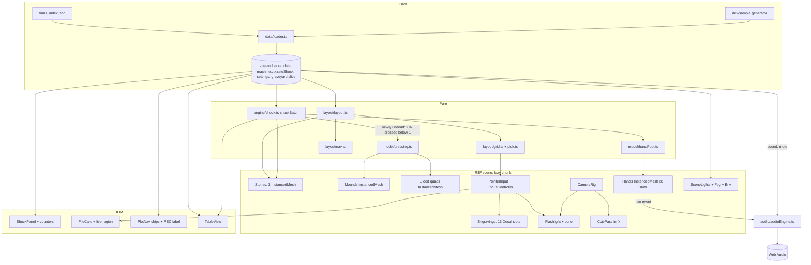
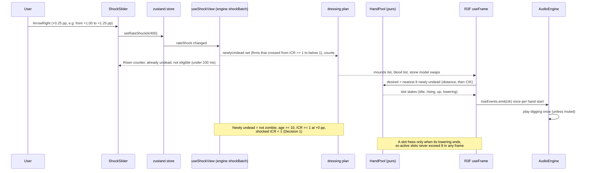

# Design Document

## Overview

The graveyard scene is the first screen of Zombie Firm Radar: one headstone per firm, grouped in sector plots, filmed by a night-time security camera. This design covers requirements 1 to 21 in `requirements.md`.

The work splits into five layers that follow the steering rule "ingestion, metrics and presentation stay separate":

1. **Data entry** (`web/src/data`, `web/src/dev/sample`): the existing loader keeps its production order (real data, then mock data, then the error screen) and gains a development-only seeded 3,000-firm generator labelled "Sample data".
2. **Pure logic** (`web/src/engine/shock.ts`, `web/src/scenes/graveyard/layout`, `.../model`): shock model, layout, spatial grid and picking, keyboard navigation, hand budget, dressing plan. No React or three.js imports, so they are unit and property tested.
3. **3D scene** (`web/src/scenes/graveyard/r3f`, `web/src/fx`): React Three Fiber components, the stone material, the CCTV pass.
4. **HUD and controls** (`web/src/ui/graveyard`, `web/src/ui/controls`, `web/src/ui/CreditsDialog.tsx`, `web/src/ui/table`): DOM panels, shared by the scene and the Table_View.
5. **Audio and tooling** (`web/src/audio`, `web/scripts`): Web Audio engine, fps measurement and screenshot scripts.

Key decisions (each is justified in the sections below):

| Decision | Choice | Why |
| --- | --- | --- |
| Draw calls for 3,000 firms | 3 stone InstancedMeshes, compacted to the instances near the camera (fog radius) | Fog hides everything past about 25 m (lights off), so per-frame cost follows what is visible, not the data set size. Requirement 4.3 (exactly 3 stone InstancedMesh) still holds. |
| Hover and focus picking | Own 2D uniform grid plus ray march, `raycast` disabled on instanced meshes | R3F raycasting tests every instance. A grid tests about 10 stones per ray. |
| Engravings | 13 drei `Decal` slots on proxy meshes that share the stone geometry | `Decal` wraps the real surface (cracked stone included) and 13 projections are cheap. |
| Blood decals | One InstancedMesh of quads with a runtime atlas of 7 existing decal images | Hundreds of zombies need one draw call, not one `Decal` each. |
| Hands | One InstancedMesh with 8 slots, driven by a pure slot manager and a procedural pose | The Craggle hand file has no animation clips (verified below). |
| Mounds | One InstancedMesh of a half-ellipsoid, soil material | One draw call for every undead firm. |
| Layout location | `web/src/scenes/graveyard/layout` (pure, with a purity test) | Layout is presentation. `web/src/engine` stays reserved for finance rules. |
| Shock rule location | `web/src/engine/shock.ts`, exported from `engine/index.ts` | Requirement 2.1 and the shared `icr()` rule. |
| Shock value in the store | Existing `machine.ctx.rateShock` through `setRateShock` | Already validated (0 to 0.05) and shared; requirement 13.9. |
| Post-processing | `@react-three/postprocessing` with built-in effects plus one custom glitch effect | Matches the steering stack. The tracking glitch needs a scheduler we control. |
| Stone material | `three-custom-shader-material` on an opaque, single-sided `MeshStandardMaterial` | Per-instance contact darkening only. The base flap is removed from the geometry at load time (Decision 2), not in the shader. |
| Base flap | Runtime geometry clip when the GLB loads (Intact and Cracked only) | No new asset files, no shader `discard`, one pure function that is unit tested on the real geometry. |
| Production data | No fixtures, no generated firms in the production bundle | Fixtures and `?firms=3000` sit behind `import.meta.env.DEV` and are tree-shaken; a build check proves it (Decision 4). |

Decisions that changed this design after review are listed in the **Decisions** section at the end (numbers 1 to 8); they are referenced inline as "Decision N".

### Research summary

Documentation looked up with the context7 MCP server before relying on an API:

- **@react-three/fiber 9.8.2** (`/pmndrs/react-three-fiber/v9.8.2`): `Canvas` props `frameloop`, `dpr`, `shadows`, `gl`, `flat` (default is ACES tone mapping unless `flat`), `raycaster`, `onCreated`; `useFrame`; `invalidate`. The scene uses `frameloop="always"` because flicker, sway, fog drift and hands animate continuously.
- **@react-three/drei 10.7.9** (`/pmndrs/drei`): `Environment` takes `files`, `background`, `backgroundIntensity`, `environmentIntensity` (three 0.163 and up). `useGLTF(path, useDraco, useMeshOpt, extendLoader)`: Draco defaults to a Google CDN, so every call passes `useDraco = false` (all our files are Meshopt). `useGLTF.preload` is used for the critical models.
- **@react-three/postprocessing 3.2.2** (`/pmndrs/react-postprocessing`): `EffectComposer` (`multisampling`, `mergeMode`), `Bloom`, `Vignette`, `Noise`, `Scanline` (density, opacity, blend function), `ChromaticAberration` (`offset`), `HueSaturation` (`saturation`), `ToneMapping` (`mode = ToneMappingMode.ACES_FILMIC`, from `postprocessing`). Bloom construction-only options (`luminanceThreshold`, `radius`, `mipmapBlur`) go through props that rebuild the effect.
- **three-custom-shader-material 6.4.0** (`/farazzshaikh/three-customshadermaterial`): `baseMaterial`, `vertexShader`, `fragmentShader`, `uniforms`, `csm_*` outputs. Instancing is handled by the base material unless `csm_PositionRaw` is used, which the design avoids.
- **three 0.187.0** (`/mrdoob/three.js`): `InstancedMesh.setMatrixAt`, `setColorAt`, `instanceMatrix.needsUpdate`, `count`, and `computeBoundingSphere()` after moving instances (needed or frustum culling uses a stale sphere).
- **Not used:** `@theatre/core` (cinematics belong to the capture and lab specs), `CameraControls` (the rig is custom), KTX2 (the manifest ships WebP textures).

Package versions. Installed today in `web/package.json`: `react 19.3.1`, `react-dom 19.3.1`, `three 0.187.0`, `@types/three 0.187.0`, `@react-three/fiber 9.8.2`, `zustand 5.1.0`, `fast-check 4.10.2`, `vitest 5.1.0`, fonts `@fontsource/*`. **Not yet installed** (verified with `npm view`; pin exact, no range prefix, requirement 21.13):

| Package | Version | Type | Peer check |
| --- | --- | --- | --- |
| `@react-three/drei` | `10.7.9` | dependency | react ^19, fiber ^9, three >=0.159 |
| `@react-three/postprocessing` | `3.2.2` | dependency | fiber >=9.7.0, postprocessing ^6.36.0 |
| `postprocessing` | `6.39.6` | dependency (peer of the previous) | three >=0.168 and <0.188, so 0.187.0 is inside the range |
| `three-custom-shader-material` | `6.4.0` | dependency | fiber >=8, three >=0.159 |
| `playwright` | `1.65.0` | devDependency (scripts only) | drives the installed Google Chrome (`channel: 'chrome'`), so no browser download is needed |

These versions and the install command below are approved (Decision 3). The packages are installed by task 1, because the Craggle close-up render already needs `playwright`.

Install command (PowerShell, from the repo root): `Set-Location web; pnpm add --save-exact @react-three/drei@10.7.9 @react-three/postprocessing@3.2.2 postprocessing@6.39.6 three-custom-shader-material@6.4.0; pnpm add --save-dev --save-exact playwright@1.65.0`.

## Architecture

### Existing code this design extends

| Existing file | What it provides | Change |
| --- | --- | --- |
| `web/src/scenes/SceneHost.tsx` | Lazy-loads `./graveyard/GraveyardScene` with retry and an error boundary. | None. `check-bundle.mjs` keys on `src/scenes/graveyard/GraveyardScene.tsx`, so that path and a default export stay. |
| `web/src/scenes/ScenePlaceholder.tsx`, `webgl.ts` | Empty canvas, `hasWebGL()`. | The graveyard reuses `hasWebGL()` and the "3D view unavailable. Use Table view." notice. |
| `web/src/state/store.ts` | zustand store: `machine`, `settings` (`lights`, `sound`, `lowQuality`, `reducedMotion`), `data`, `overlay`, `effectiveReducedMotion`. | Adds a `graveyard` slice (below). |
| `web/src/state/machine.ts` | `setRateShock` is allowed in every state; `parseRateShock` accepts 0 to 0.05. | None. |
| `web/src/data/loader.ts`, `source.ts` | `real` then `mock` in production; `mock` then dev `fixture` in development. A missing source in production is an error screen. | Production behaviour is unchanged (Decision 4). Adds a dev-only `sample` source behind `import.meta.env.DEV` for the 3,000-firm generator and the `?firms=3000` flag. |
| `web/src/ui/Hud.tsx` | Top-left REC header with `Clock`, right-hand controls, footer text. | REC label gets the plot label; "Mock data" badge stays for the `mock` source; "Sample data" is added for dev fixtures and the dev generator. |
| `web/src/state/settings.ts` | `Settings` with `sound: false` default; `parseSettings` per-field fallback. | Default `sound` becomes `true`; adds a stored version marker for the migration (Decision 5). |
| `web/vite.config.ts` | Plugins and `build.manifest`. | Adds `server.fs.allow` (Decision 7). |
| `web/src/ui/SettingsMenu.tsx` | Dialog with Lights, Sound, Low quality, Reduced motion rows. | Adds the "Credits" button. |
| `web/src/ui/table/TableView.tsx` | Sortable table of `index.firms`. | Reads the shared shock view; adds slider, lights and sound controls, sector filter, File_Card on row activation. |
| `web/src/ui/useFocusTrap.ts` | Focus trap with Esc. | Reused by `CreditsDialog`. |
| `web/src/engine/icr.ts`, `index.ts`, `errors.ts`, `rng.ts` | Shared `icr()`, typed `EngineError` (`delta_out_of_range` exists), `mulberry32`. | `shock.ts` imports `icr`; `index.ts` exports the shock API and `mulberry32`. |
| `web/src/dev/fixtures` | Three fictional firms (CIKs 9000000001 to 9000000003); the bundle check forbids the string "Ashgrove Works" in production JS. | Untouched. The new generator lives in its own folder and uses other names. |
| `web/scripts/check-bundle.mjs` | 400 KB gzip JS budget on the initial closure, lab outside the initial closure, forbidden strings. | Extended to fail when the asset bytes before first frame exceed 25 MB (requirement 21.4). |

### Component and data flow



### Shock to hands sequence



### Scene graph and draw-call budget

| Object | Draw calls | Triangles in view (worst case, lights off, about 800 stones within 38 m) |
| --- | --- | --- |
| Stones: Intact (378 tris), Cracked (938), Broken (810) | 3 | about 0.5M |
| Ground, three fog layers | 4 | tiny |
| Mounds (1 instanced), blood quads (1), hands (1, 8 slots of 23,482 tris) | 3 | about 0.2M |
| Props: gate (38,140 tris, 4 meshes), statue (27,739), trunk (30,000), 2 stump models (41,046 and 62,345), lantern (33,902, 2 meshes), rubble (instanced, procedural), cobwebs (419 tris, 3 meshes), Mutant (26,116), Greenall corpse (7,698) | about 20 | about 0.35M, mostly culled by the frustum |
| Engraving proxies (13, invisible) and 13 decal meshes | 13 | small |
| Post-processing | 1 scene pass, 1 bloom chain (normal), 1 merged effect pass | full screen |
| Shadow passes (moon, flashlight, normal quality) | about 3 each | moon shadow box is 40 m x 40 m around the focus; the flashlight shadow only covers its 0.32 rad cone |

Target total: under 100 draw calls, under 1.5M triangles per pass. This is an estimate; requirement 21.5 measures it.

## Components and Interfaces

### 1. Data entry, mock fallback and dev-only samples (Requirement 1)

`web/src/data/loader.ts` keeps its structure and its production behaviour. Production loads `/data/firms_index.json`, then `/data/mock/firms_index.json`; there are no fixtures and no generated firms in production (Decision 4). Changes:

```ts
// source.ts
export type DataSource = 'real' | 'mock' | 'fixture' | 'sample';
export const SAMPLE_FIRM_COUNT = 3000;
/**
 * `?firms=3000` only, and only in a development build.
 * `dev` is a parameter (callers pass `import.meta.env.DEV`) so tests cover both values.
 */
export function sampleCountFromSearch(search: string, dev: boolean): number | null;
```

- `LoaderDeps` gains `search?: string`. The dev-only branches are literal `if (import.meta.env.DEV) { ... await import('../dev/sample/generate') ... }` blocks. Vite replaces `import.meta.env.DEV` with `false` in a production build, so the branch and the dynamic import are removed as dead code and the generator chunk is never emitted (1.8).
- `loadStartup()` order:
  1. Development and `sampleCountFromSearch(search, true) === 3000`: build the generated bundle and return `source: 'sample'` without requesting any data file (1.5). In production the `firms` value is ignored (1.6); in development any other value is ignored too (1.7).
  2. Otherwise request `/data/firms_index.json` once. On any failure (network failure, non-success status, invalid JSON, failed `guardFirmsIndex`) request `/data/mock/firms_index.json` once with the same validation. The result has `source: 'mock'` and the HUD shows "Mock data" (1.2).
  3. If the mock also fails: in production return the load error and the existing `ErrorScreen` is shown, with no fixtures (1.3). In development return the existing `fixture` bundle (or, if that is not usable, the generated bundle), `source: 'fixture'` or `'sample'`, and the HUD shows "Sample data" (1.4).
- Labels: `real` shows none, `mock` shows "Mock data", `fixture` and `sample` show "Sample data". "Sample data" is therefore only reachable in a development build.
- The request is made once per page load: `loadStartup()` already memoises (`loaded`/`startup`) and only validated successes are cached (1.1). Firm order is the file's order; the graveyard never sorts the index (1.1).
- `Hud.tsx` shows the badge within one render of `setData` (well inside 500 ms).
- `TableView.tsx` `captionFor` keeps the mock case and adds a sample case ("Generated sample firms. ...") so the caption never claims SEC EDGAR for fake data.

**Production bundle guard (1.8).** `check-bundle.mjs` gets a forbidden-marker list for the production build output. The generator exports `SAMPLE_GENERATOR_MARKER = '__zfr_sample_generator__'` and uses it in its first statement. The check fails the build if that string, the path fragment `dev/sample/generate` or the name fragment `Larkspur` appears in any file under `dist/`. A Vitest test (`web/scripts/check-bundle.test.mjs`) runs the check function on a fake `dist` that contains the marker (must fail) and on one that does not (must pass). The existing rule that forbids the "Ashgrove Works" fixture string in production JS stays.

**Sample generator** `web/src/dev/sample/generate.ts` (not under `dev/fixtures`, so the bundle check rule about the Ashgrove fixture is unaffected):

```ts
export interface SampleBundle { index: FirmsIndex; macro: Macro; firms: Record<string, Firm> }
export function generateSampleFirms(count: number, seed: number): SampleBundle;
```

- Uses `mulberry32(seed)` (exported from the engine) and a fixed word list for invented names ("Larkspur Holdings 0001"-style, never real tickers; `ticker: null` for most firms). CIK `9100000000 + i` zero-padded to 10 digits, unique by construction.
- Mix by weight: zombie 10%, endangered 15%, healthy 65%, insufficient_data 10%; 10 to 11 SIC division names for sectors; age 3 to 40; `latest_icr`, `total_debt_usd`, `implied_rate` are `null` only for `insufficient_data` and a few endangered firms; `shock_eligible` follows the rule `implied_rate > 0 && total_debt_usd > 0 && latest_icr !== null`; `rescue_eligible` true for about 85%.
- Consistency by construction: `status` zombie implies `latest_icr < 1` and `age_years >= 10`; counts in `meta.counts` equal the tallies; `fiscal_years` is `[2020, ..., 2024]`.
- Each `Firm` file is generated lazily from the index entry (`indexEntryFrom` inverse), five years of plausible numbers, `reasons` text like the zombie definition ("ICR below 1 in FY2022, FY2023, FY2024").
- ICR spread: healthy and endangered firms draw `latest_icr` so that about 30% of the eligible firms with `age_years >= 10` have an ICR between 1.0 and 1.6 (just above 1) and about 15% between 0.4 and 1.0, so the slider moves firms across ICR 1 at many deltas and the fps measurement sees a realistic number of Mounds and hands.
- Dynamic `import()` only inside the `import.meta.env.DEV` blocks of `source.ts` (see above); the chunk is never fetched or emitted in production.
- The module does not write files (1.11). A test asserts `generateSampleFirms(n, s)` deep-equals itself on a second call (1.9) and every output passes `guardFirmsIndex` and `guardFirm` (1.10).

### 2. Shock model (Requirement 2) `web/src/engine/shock.ts`

```ts
import { icr } from './icr';
import type { EngineResult } from './errors';

export type ShockStatus = 'zombie' | 'endangered' | 'healthy' | 'insufficient_data';

/** Structural subset of FirmIndexEntry; the engine does not import UI types. */
export interface ShockInput {
  readonly status: ShockStatus;
  readonly age_years: number;
  readonly latest_icr: number | null;
  readonly total_debt_usd: number | null;
  readonly implied_rate: number | null;
  readonly shock_eligible: boolean;
}

export interface ShockResult {
  readonly shockEligible: boolean;
  /** Original status when not eligible or not newly undead. */
  readonly status: ShockStatus;
  readonly undead: boolean;            // status === 'zombie' || newlyUndead
  readonly newlyUndead: boolean;       // crossed from ICR >= 1 to ICR < 1 because of the shock
  readonly shockedIcr: number | null;  // null when not eligible
}

export function shockFirm(f: ShockInput, delta: number): EngineResult<ShockResult>;

export interface ShockBatch {
  readonly delta: number;
  readonly newlyUndead: Uint8Array;        // 1 per index
  readonly shockedIcr: Float64Array;       // NaN where null
  readonly eligible: Uint8Array;
  readonly counts: { risen: number; alreadyUndead: number; notEligible: number };
}
export function shockBatch(firms: readonly ShockInput[], delta: number): EngineResult<ShockBatch>;
```

Rules (single place, `isNewlyUndead`):

1. `delta` not finite, below 0 or above 0.05 returns `fail({ code: 'delta_out_of_range', message, detail: { param: 'delta', value } })` (2.4). No status, no ICR.
2. Not eligible (`shock_eligible === false`, or `latest_icr`, `total_debt_usd` or `implied_rate` is `null`, or `total_debt_usd <= 0`, or `implied_rate <= 0` as in `zombie-definition.md`) returns `{ shockEligible: false, status: f.status, undead: f.status === 'zombie', newlyUndead: false, shockedIcr: null }` (2.3).
3. `EBIT = latest_icr * implied_rate * total_debt_usd`; `shockedInterest = total_debt_usd * (implied_rate + delta)`; `shockedIcr = icr(EBIT, shockedInterest)`. A `null` from `icr()` (interest 0 or negative) returns the not-eligible result (2.5). `icr()` is the only division (2.2, 2.13).
4. `delta === 0` returns `shockedIcr = latest_icr` exactly, no recomputation, so float noise cannot change a status (2.8).
5. Rounding guard: when `EBIT >= 0`, `shockedIcr = Math.min(shockedIcr, latest_icr)`. Without it, `(x * r * D) / (D * (r + 1e-18))` can exceed `x` by one ulp and break 2.9.
6. `newlyUndead = status !== 'zombie' && age_years >= 10 && latest_icr >= 1 && shockedIcr < 1` (2.6, Decision 1). It needs no `delta > 0` clause: at delta 0 the shocked ICR equals `latest_icr`, which is at least 1, so nobody crosses (2.8). A firm already below 1 is never newly undead; it is either a zombie or stays in its own status.
7. Status zombie stays `undead: true` at every delta (2.7).

**Pseudocode of the whole decision** (what `evaluate()` does; `Δ` is `delta`):

```text
evaluate(f, Δ):
  if Δ is not finite or Δ < 0 or Δ > 0.05:  return Error(delta_out_of_range)
  if f is not eligible (null fields, shock_eligible = false, D <= 0, r <= 0):
        return { shockEligible: false, status: f.status, newlyUndead: false, shockedIcr: null }
  EBIT       = f.latest_icr * f.implied_rate * f.total_debt_usd
  shockedInt = f.total_debt_usd * (f.implied_rate + Δ)
  shocked    = (Δ == 0) ? f.latest_icr : icr(EBIT, shockedInt)       // shared icr(), the only division
  if shocked is null:  return not-eligible result (as above)
  if EBIT >= 0:  shocked = min(shocked, f.latest_icr)                  // rounding guard
  newly = f.status != 'zombie' and f.age_years >= 10
          and f.latest_icr >= 1 and shocked < 1
  return { shockEligible: true, status: f.status, newlyUndead: newly,
           undead: f.status == 'zombie' or newly, shockedIcr: shocked }
```

**Threshold and example.** Because `shockedIcr = icr_0 * r / (r + Δ)`, a firm with `latest_icr = icr_0 >= 1` and implied rate `r` crosses below 1 exactly when `Δ > r * (icr_0 - 1)`. Example: `latest_icr = 1.2`, `implied_rate = 0.05`, `total_debt_usd = 100,000,000`, `age_years = 18`, status `healthy`. EBIT is 6,000,000. Crossing point `Δ* = 0.05 * 0.2 = 0.01` (+1.00 pp). At +0.75 pp (slider step k = 3, stored 0.0075) interest is 100M x 0.0575 = 5.75M and ICR is 1.043, not undead. At +1.00 pp the ICR is exactly 1.000 and the firm is still not undead (the rule is strictly below 1). At +1.25 pp (k = 5, stored 0.0125) interest is 6.25M and ICR is 0.96, so the firm is newly undead and gets a Mound and a hand. A firm with `latest_icr = 3.0` at the same rate crosses at +10 pp, outside the slider range, so it never rises. The Risen_Counter therefore grows in steps as the slider moves, one firm group per crossing delta, instead of jumping once at +0.25 pp.

`shockBatch` loops once over the array, reuses the same logic through a private `evaluate()` (no per-firm object allocation), and returns the three counters used by the HUD and the Table_View. 3,000 firms take well under 1 ms.

`engine/index.ts` additions: `export { shockFirm, shockBatch } from './shock'; export { mulberry32 } from './rng'; export type { ShockInput, ShockResult, ShockBatch, ShockStatus } from './shock';`. `purity.test.ts` already scans the engine for `react`, `three`, `scenes`, `fx`, `ui` imports.

**Hook** `web/src/state/shockView.ts`:

```ts
export function useShockView(): { firms: readonly FirmIndexEntry[]; batch: ShockBatch | null; error: EngineError | null }
```

It memoises `shockBatch(data.index.firms, machine.ctx.rateShock)` on `[firms, delta]`. The scene, the HUD counters and the Table_View all call it, which is how requirement 19.5 (same counters) holds by construction.

### 3. Layout engine (Requirement 3) `web/src/scenes/graveyard/layout/layout.ts`

```ts
export interface StoneLayout {
  readonly firmIndex: number;       // index into the input list
  readonly plot: number;
  readonly x: number; readonly z: number;   // world metres, base centre
  readonly yaw: number; readonly pitch: number; readonly roll: number;
  readonly width: number; readonly height: number; readonly depth: number;
  readonly sink: number;            // metres below ground
  readonly lean: number;            // hypot(pitch, roll), radians
}
export interface PlotLayout {
  readonly index: number; readonly sector: string; readonly count: number;
  readonly rect: { x0: number; z0: number; x1: number; z1: number };
  readonly frontZ: number;          // world z of the first row
  readonly centerX: number;
  readonly stones: readonly number[];   // indices into stones[], reading order
}
export interface GraveyardLayout { readonly stones: readonly StoneLayout[]; readonly plots: readonly PlotLayout[]; readonly bounds: Rect }
export function computeLayout(firms: readonly LayoutInput[]): GraveyardLayout;
```

`LayoutInput` is `{ cik, sector, status, total_debt_usd }` (structural, no UI import). The function never mutates its input (3.11) and uses no `Math.random`, `Date` or module state; all variation comes from `hash32(cik)` (FNV-1a) seeding `mulberry32` (3.4).

Algorithm (constants are named exports so tests and the renderer share them):

- **Plots (3.1):** group by `sector` string; plot order is the sector names sorted by UTF-16 code unit order (not locale dependent). Within a plot, stones keep input order. Plots sit on a grid of `ceil(sqrt(plotCount))` columns; the gap between adjacent plot rectangles is `PLOT_GAP = 1.6 m` (requirement: at least 1.2 m, 3.3). Plot 1 is placed so its first row is at `z = +3` and its centre at `x = 0`, which makes the initial camera pose of requirement 10.7 frame its front rows.
- **Grid inside a plot (3.2):** `cols = max(1, ceil(sqrt(n * PITCH_Z / PITCH_X)))`, row-major in reading order (left to right, then front to back). `PITCH_X = 1.30`, `PITCH_Z = 1.80`, jitter of at most `±0.06 m` per axis and `±0.10 rad` yaw. Each stone's footprint is the bounding circle of its oriented rectangle, radius `r = 0.5 * hypot(width, depth)` with `depth = 0.45 * width`. Worst case `r = 0.483`, so edge distance is at least `1.30 - 2 * 0.483 - 2 * 0.06 = 0.214 m` along a row and `1.80 - 0.966 - 0.12 = 0.714 m` between rows, both above 0.15 m. The circle is conservative for any yaw, lean included (lean is applied about the base, so the base footprint does not move).
- **Plot rectangle:** the union of cell rectangles plus `PAD = 0.4 m`.
- **Height (3.5, 3.6):** `t = (log10(D) - log10(Dmin)) / (log10(Dmax) - log10(Dmin))` over firms with `D > 0` (`t = 0` if the range is empty or degenerate); `height = 0.85 + 0.75 * t` (0.85 to 1.6 m). `null`, zero or negative debt gives 0.85 m.
- **Width (3.7):** `0.62 + 0.26 * u` with `u` from the firm's hash stream.
- **Lean (3.9):** pitch (about the x axis, forward or back) and roll by status. Healthy and insufficient_data: total lean at most 0.02 rad. Endangered: 0.05 to 0.09 rad. Zombie: 0.09 to 0.14 rad. The lowest endangered or zombie lean (0.05) is above the highest healthy lean (0.02) by construction. Roll is at most 0.03 rad so neighbouring tops do not cross: worst top offset is `1.6 * sin(0.14) = 0.22 m`, less than the `1.30 - 0.88 = 0.42 m` gap.
- **Sink (3.10):** `sink = height * (0.15 + 0.05 * u2)`.
- **Empty list (3.8):** returns `{ stones: [], plots: [], bounds: zero rect }`.

**Spatial grid** `layout/grid.ts`: `buildGrid(layout, cell = 2)` stores stones in CSR arrays (`cellStart: Uint32Array`, `cellItems: Uint32Array`) over the layout bounds. `queryRadius(grid, x, z, r)` returns stone indices. It is also the source for instance compaction and for the nearest-N queries.

**Picking** `layout/pick.ts` (pure, plain `{x,y,z}` vectors):

```ts
export interface Ray { ox: number; oy: number; oz: number; dx: number; dy: number; dz: number }
export function pickStone(grid, layout, ray, maxT = 60): { stone: number; t: number } | null;
export function nearestToRay(grid, layout, ray, n: number, maxT = 60): { stone: number; perp: number }[];
```

`pickStone` walks the ray's ground projection through grid cells (2D DDA) and slab-tests each stone's box (`width x height x depth`, yaw only; lean is ignored for picking, it is at most 0.22 m at the top). `nearestToRay` widens a band around the ray (2 m, then doubling up to 64 m) until at least `n` stones lie inside it, then returns the `n` smallest perpendicular distances exactly (everything inside the band is a candidate, so nothing closer can be outside). Ties break by lower stone index.

### 4. Stone models, instancing and materials (Requirement 4)

**Verified model data** (probed with `GLTFLoader` plus the Meshopt decoder on the files in `web/public/assets`; textures stripped for the probe; units are the models' own, effectively centimetres):

| Model (manifest key) | Role | Nodes | Triangles | Bounds W x H x D (model units) | Animations |
| --- | --- | --- | --- | --- | --- |
| `models/sketchfab-small-gravestone-drydoctoregg/...glb` | Intact_Stone | `Sketchfab_model` (rot -90 deg x) > `Collada visual scene group` (rot +90 deg x) > `6` (rot -90 deg x, scale 100) > `defaultMaterial` (mesh 0, scale 0.349) | 378, 278 vertices, no vertex colour | 59.2 x 69.8 x 50.3 (x -30.7..28.5, y -0.49..69.3, z -29.2..21.1) | none |
| `models/own-headstone-cracked/...glb` | Cracked_Stone | same chain, mesh scale 0.330 | 938 (two fractured pieces: upper y 11.9..65.5, lower y -0.5..47.4), vertex colour on | 59.1 x 66.0 x 50.3 | none |
| `models/sketchfab-damaged-tombstone-drydoctoregg/...glb` | Broken_Stone | `Cube` node with translation y 6.61, mesh scale 0.827 | 810 | 58.5 x 165.5 x 58.3 (base plinth y -0.5..26.9, tall shaft above) | none |
| `models/sketchfab-zombie-hand-craggle/...glb` | Craggle_Hand | `root` > `GLTF_SceneRootNode` (rot 90 deg x) > `model_2` > `Object_4` (mesh 0) | 23,482, 15,698 vertices, no skin | 2.02 x 0.68 x 1.67, thin (y 0.05..0.73), lying flat; principal axis (0.887, 0.065, 0.456); wide end (radius about 0.8) at -axis, narrow forearm end (radius about 0.4) at +axis | none |

Findings that shape the design:

- **All three stone files use `alphaMode: BLEND` and `doubleSided` materials.** Rendering 3,000 blended double-sided instances is slow and mis-sorts. The loader replaces them for all three models (4.10, Decision 2): `transparent = false`, `depthWrite = true`, `alphaTest = 0` (opaque), `side = FrontSide` (single-sided). A screenshot in the first stone task confirms there are no see-through faces or missing back faces; if a texture really carries alpha, the fallback is `alphaTest = 0.5`, still opaque and single-sided.
- **All files use `EXT_meshopt_compression`, `EXT_texture_webp` and `KHR_mesh_quantization`.** `useGLTF(url, false)` (no Draco CDN) handles Meshopt.
- **Local transforms differ per file** (model origin is not the base centre; x and z centres are about -1 and -4). `stoneModels.ts` stores, per model, the measured `origin` (centre x, base y, centre z of the body) and `body` size (W, H, D) so one instance matrix is `T(x, -sink, z) * Ry(yaw + frontFlip) * Rx(pitch) * Rz(roll) * S(width / W, height / H, depth / D) * T(-origin)`. The probe values above are the defaults; `measureModel()` recomputes them from the loaded geometry and a test compares them to the constants.
- **The thin bent flap.** In Intact and Cracked a thin sheet (vertices with model-local `z > 9`: Intact 10 vertices, x -25.1..20.2, y -0.4..12.3, z 11.3..21.1; Cracked adds three vertices up to y 16.0) curves from the base up and back toward the body. Its top is 17.6% of the Intact height and 24% of the Cracked height, which is **above** the 15 to 20 percent sink range. Sink alone cannot hide it. The Broken model has no such sheet (its lowest 16% is a square plinth that the sink buries), so it is rendered unmodified (Decision 2).
- **Flap handling: a runtime geometry clip when the GLB loads.** It is the least risky option: no new asset file (so no `CREDITS.md` row and no recipe change in `manifest.json`), no edit of a licensed model file, no shader change, and it runs once per page session on a few hundred triangles. `STONE_MODELS[m].flapClip` is `{ zMin: 8, yMax: 14 }` for Intact, `{ zMin: 8, yMax: 18 }` for Cracked (model units, a little above the measured flap tops of 12.3 and 16.0) and `null` for Broken. The pure function `clipFlap(positions: ArrayLike<number>, index: ArrayLike<number> | null, clip): Uint32Array` in `model/clipFlap.ts` returns a new index list that drops every triangle with at least one vertex in the flap region (`z > zMin && y < yMax`, model space). Body vertices have `z <= 6`, so 8 leaves a margin. `Stones.tsx` calls it once per model right after `useGLTF` resolves, builds the geometry's new `index` attribute (a non-indexed geometry gets a sequential index first) and calls `geometry.setIndex(...)` and `geometry.computeBoundingSphere()`. The vertices stay in the buffer, unreferenced, which is harmless. Together with the sink, nothing of the flap shows above the ground plane (4.4).
  - **Documentation:** the function and `stoneModels.ts` carry a comment naming the measured flap bounds, why the sink alone is not enough, and that the model files are untouched.
  - **Test (node environment):** loads the real Intact and Cracked GLBs with `GLTFLoader` and the Meshopt decoder, runs `clipFlap`, and asserts (a) no remaining triangle references a vertex with `z > zMin && y < yMax`, (b) the number of removed triangles is greater than 0 and equals the number of triangles that touched flap vertices, (c) every body triangle (all vertices with `z <= 6`) is kept. A property test on synthetic meshes checks that `clipFlap` never drops a triangle whose vertices all lie outside the region and always drops one with a vertex inside. `clipFlap` is not applied to Broken (a test asserts `STONE_MODELS.broken.flapClip === null`).

**Stone_Renderer** `r3f/Stones.tsx`:

- Three `instancedMesh` elements, one per model, with `raycast={() => null}` (4.3, picking uses the grid). Capacity per mesh equals the number of firms (max 3,000); `mesh.count` is set to the number of visible instances.
- **Model per instance (4.1, 4.2):** healthy to Intact, endangered to Cracked, zombie to Broken, insufficient_data to Intact with `setColorAt(i, 0.45, 0.45, 0.45)` (colour multiplies the material colour on all three channels). A Newly_Undead firm uses Broken (4.5), and returns to its base model when it stops being Newly_Undead (4.6).
- **Instance compaction.** A pure `visibleStones(grid, camPos, radius)` returns the stone indices within `radius` of the camera focus. `radius = 38 m` (lights off, density 0.085, fog factor above 0.99 beyond about 25 m, flashlight reach 34 m) or `52 m` (lights on, density 0.05, about 43 m). The renderer rewrites the three `instanceMatrix`/`instanceColor` buffers only when (a) the camera moves into a new 4 m cell, (b) the shock view changes, or (c) the lights mode changes. Writing 800 matrices takes under 1 ms. The `instanceToFirm` map (`Uint32Array` per mesh) is kept for the focus marker and the engravings. After a rewrite, `mesh.computeBoundingSphere()` is called.
- **Swap latency (4.5, 4.6):** a shock change rewrites buffers in the same frame, well inside 1,000 ms.
- **Load (4.8, 4.9):** models load through one `useGLTF` call each, cached by drei for the page session (loaded exactly once). Keys come from `ASSET_KEYS`; if a key is missing from `manifest.json` or a load rejects, `Stones` renders no instances for that model and calls `reportAssetError(key, error)`, which logs and posts a non-blocking HUD notice ("A model failed to load: ...") while the other models keep rendering. Each model sits in its own `Suspense` plus error boundary so one failure does not unmount the scene.

- **Overview.** In the overview the fog distance is 99 m (lights off) or 132 m (lights on), so the compaction radius grows with the camera pose: when the rig shows the overview, all stones of the layout are written (up to 3,000 instances in the same three draw calls, about 2.7M triangles in the worst case, accepted for a transitional view; the 50 fps target of 4.7 is measured with a plot framed). During a camera move the radius is interpolated by the same progress value as the fog (Requirement 7.15).

**Stone material** `fx/StoneMaterial.tsx` (three-custom-shader-material, `baseMaterial = MeshStandardMaterial`, opaque and `FrontSide`, textures taken from the GLB material): a vertex shader that passes the world height and a fragment shader with a contact darkening term `csm_DiffuseColor.rgb *= mix(0.55, 1.0, smoothstep(0.0, 0.25, vWorldHeight))` so the base looks dirty where it meets the soil. There is no `discard`; the flap is already gone from the geometry. Instancing is handled by the base material.

### 5. Engravings (Requirement 5) `r3f/Engravings.tsx`

- Pool of exactly 13 slots, each: an invisible proxy `Mesh` (stone geometry, `colorWrite=false`, `depthWrite=false`) and a drei `<Decal>` child with a `CanvasTexture` (256 x 384, `colorSpace = SRGBColorSpace`, anisotropy 4). 13 textures exist for the whole session; "release" means clearing the canvas and hiding the slot in the same rebuild (5.4, 5.5).
- **Trigger:** `engravingSet` changes when the hovered or focused stone changes. The set is the hovered stone plus the 12 other stones with the smallest perpendicular distance to the pointer ray (`nearestToRay`), or all stones when fewer than 13 exist (5.1 to 5.3). With no hover, the slots keep their last content (5.6). For keyboard focus the ray is the camera-to-stone ray.
- **Front face:** `deriveFaceAnchor(positions, normals, indices)` (pure, no three) finds the largest nearly vertical face cluster (|normal.y| < 0.3) with normal along +z or -z and returns `{ z, frontSign, centreY, size }`. The proxy matrix flips yaw by `PI` if `frontSign` is negative so the face looks toward +z (toward the camera). The decal box is `[0.8 * W, 0.5 * H, 0.2]` in model units around the anchor. A test runs `deriveFaceAnchor` on a synthetic box (property) and on the real Intact geometry.
- **Content (5.1, 5.7 to 5.10):** line 1 firm name in `600 28px "Cormorant Garamond", Georgia, serif` (wrapped to two lines, shrink to fit); line 2 `first_filing_year` (4 digits); line 3 `ICR x.xx` or `ICR n/a`, both in `500 20px "JetBrains Mono", ui-monospace, monospace`. Before drawing, `await document.fonts.load(...)` for both families with a 300 ms cap; if a family is not loaded the generic family is used and the text stays legible (5.9). Endangered firms get a crack polyline drawn over the text (5.10). A small cross glyph is drawn above the name.
- The ICR text uses `formatIcr` from `ui/table/format.ts` (one formatter for card, table and engraving).

### 6. Blood decals (Requirement 6) and dressing plan

`model/dressing.ts` is pure and shared by blood, mounds and hands:

```ts
export interface DressingPlan {
  undead: number[];                       // firm indices: zombie or newly undead
  mounds: number[];                       // same set (7.10, 14.1)
  blood: { firm: number; count: number; seeds: number[] }[]; // lights off only
}
export function planDressing(firms, batch, lights: 'off' | 'on'): DressingPlan;
```

- `undead` = status zombie at delta 0, or `batch.newlyUndead[i]`. `mounds` equals `undead` exactly (7.10).
- `blood` is empty in lights on (6.2). In lights off, each undead stone gets `1 + hash(cik) % 5` quads (1 to 5, 6.1) and every other stone gets none (6.4).
- **Source images** (all already in the manifest and credited): `textures/oga-blood-splatter-exilegl/oga-blood-splatter-exilegl_color.webp` (1024 x 768, CC0, group `lab`), `textures/own-handprint-decal/own-handprint-decal_handprint-{0,1,2}.webp` and `textures/own-drag-mark-decal/own-drag-mark-decal_drag-mark-{0,1,2}.webp` (512 x 512 each). At first need they are drawn into one 2048 x 1024 canvas atlas (7 cells) and used by one `InstancedMesh` of quads (shared `PlaneGeometry`, per-instance atlas cell via an instanced `vec4` attribute, `polygonOffset`, `depthWrite=false`, multiplied by a dark red tint so the CC0 splatter reads as blood). Quads sit on the stone front face at the anchor from section 5.
- **Lights toggle (6.3):** the instance count switches in the same frame the lights tween starts; the quads fade with the mode tween (0.35 s), so the count is 0 after the toggle and matches rule 1 in lights off.
- Only the 4 textures of the first lights-off need are fetched at start; the whole set is 679,000 bytes. In lights on it is never fetched until the user switches to lights off.

### 7. Ground, sky, fog, lights (Requirement 7)

`scenes/graveyard/model/sceneParams.ts` is a pure function:

```ts
/** What the camera rig publishes every frame (11.10). */
export interface CameraFogState {
  readonly from: 'overview' | number;   // plot index or overview
  readonly to: 'overview' | number;
  readonly progress: number;            // 0..1, 1 when at rest
}
/** Weight of the full Plot_Fog: 0 = Overview_Fog, 1 = Plot_Fog (7.14, 7.15, 7.17). */
export function plotFogWeight(c: CameraFogState): number;
//   overview -> plot: progress;  plot -> overview: 1 - progress;
//   plot -> plot (different or same plot): 1;  overview -> overview: 0.
export function sceneParams(lights: 'off' | 'on', delta: number, cam: CameraFogState): SceneParams;
// fogColor '#171b21'
// fogDensity = lerp(overview, plot, plotFogWeight(cam)),  overview 0.02 | 0.015, plot 0.085 | 0.05   (7.3, 7.4, 7.14, 7.15)
// groundFogFactor = lerp(0.5, 1, plotFogWeight(cam))                                                  (7.14, 7.15)
// backgroundIntensity 0.045 | 0.12, envIntensity 0.05 | 0.3,
// moon { color '#8ea9d6', pos [-14,18,-22], intensity 0.12 | 0.7 },
// hemi { sky '#3a4a66', ground '#0b0806', intensity 0.03 | 0.35 },
// fogLayers [{ y: 0.1, opacity: 0.42 | 0.26 }, { y: 0.38, 0.26 | 0.16 }, { y: 0.8, 0.12 | 0.08 }]
//   opacity_i = base_i * groundFogFactor * (1 + 0.5 * delta / 0.05)   (7.12, 7.14)
```

- `r3f/SceneLights.tsx` evaluates `sceneParams` for both lights modes and blends them with one eased value `lb` (0 = lights off, 1 = lights on, `lb += (target - lb) * (1 - exp(-dt * 10))` per frame), so a mode change settles within 0.5 s (17.2, 7.18) and never produces a single-frame luminance flash (17.6). The camera term (`plotFogWeight`) is **not** eased: it follows the rig's `progress` directly, so the fog reaches its final values exactly when the camera move ends (7.15). Rapid toggling is rate-limited to one change per 350 ms in the Lights button (at most 3 per second).
- **Fog and camera moves (7.14 to 7.17, 11.10).** `CameraRig` publishes `CameraFogState` every frame through a mutable ref (not the store, to avoid 60 store updates per second). Overview to plot and plot to overview interpolate linearly with `progress`; plot to plot keeps the weight at 1 for the whole move; with Reduced_Motion the rig publishes `progress = 1` in the same frame as the cut, so the density switches in that frame (7.16). The same weight scales the Ground_Fog layer opacities between 0.5 and 1 times their value.
- **Ground (7.1, 7.2):** one 480 m x 480 m plane with the excavated soil wall PBR set (`..._diffuse.webp`, `..._nor-gl.webp`, `..._rough.webp`, all 2048 x 2048), repeat 120 x 120 (4 m tiles), anisotropy 8. It follows the camera x and z snapped to the 4 m tile so the texture does not swim. The fog distance is `1.98 / density` (the distance where FogExp2 reaches 98 percent), evaluated at the **lowest density in use**, Overview_Fog lights on (0.015): 132 m. The nearest ground edge is at least 240 m from the camera, which is at least 1.5 times 132 m (198 m). With the other densities the distances are 99 m (overview, lights off), 23.3 m (plot, lights off) and 38.8 m (plot, lights on). Camera `far = 360`.
- **Sky (7.5):** `<Environment files={hdri1k} background backgroundIntensity={...} environmentIntensity={...} />` first, then the 2k file swaps in after the first frame (8.7 to 8.9). The swap keeps the old texture until the new one is decoded and then replaces both `scene.background` and `scene.environment` in one synchronous commit, so no frame lacks an environment. Because drei `Environment` with `background` sets both from one map, the 1k and 2k files use the same component with a different `files` prop inside `Suspense` with the previous element kept mounted until the next resolves (the `startTransition` pattern), verified in task 6.
- **Moon:** one `directionalLight` with `castShadow`, shadow camera ortho 40 m x 40 m following the camera focus, map 2048 (1024 in low quality).
- **Tone mapping (7.9):** ACES on the renderer; when the composer is active a `ToneMapping` effect (`ToneMappingMode.ACES_FILMIC`) sits in the chain so exposure matches (task 6 compares screenshots with and without the composer).
- **Failure (7.13):** if the soil textures or the HDRI reject, `Ground` falls back to `meshBasicMaterial color #0b0806`, `scene.background = fog colour`, and the HUD posts the non-blocking notice "An environment asset failed to load." (`role="status"`).

### 8. Props, Mutant, corpse (Requirements 8 and 9)

**Asset keys** (exact manifest paths; all license CC0 or CC BY, all rows present in `CREDITS.md`, 0 files added, requirement 21.12):

| Role | Manifest key | Bytes | Notes |
| --- | --- | --- | --- |
| Ground soil | `textures/polyhaven-excavated-soil-wall/polyhaven-excavated-soil-wall_diffuse.webp`, `..._nor-gl.webp`, `..._rough.webp` | 339,992 + 1,889,866 + 38,316 | 2048 x 2048 each |
| Lichen rock (rubble, plot curbs) | `textures/polyhaven-lichen-rock/polyhaven-lichen-rock_diffuse.webp`, `..._nor-gl.webp`, `..._rough.webp` | 313,218 + 489,270 + 106,362 | 1024 x 1024 |
| Intact_Stone | `models/sketchfab-small-gravestone-drydoctoregg/sketchfab-small-gravestone-drydoctoregg.glb` | 298,608 | |
| Cracked_Stone | `models/own-headstone-cracked/own-headstone-cracked.glb` | 330,348 | |
| Broken_Stone | `models/sketchfab-damaged-tombstone-drydoctoregg/sketchfab-damaged-tombstone-drydoctoregg.glb` | 432,520 | |
| Mutant | `models/sketchfab-zombie-mutant/sketchfab-zombie-mutant.glb` | 570,220 | 26,116 tris, static (no skin, no clips), 2.26 x 2.84 x 0.51 |
| Greenall_Corpse | `models/sketchfab-zombie-corpse-greenall/sketchfab-zombie-corpse-greenall.glb` | 503,480 | 7,698 tris, static, 0.08 x 0.12 x 0.02 (about 12 cm raw: scale 14 to reach about 1.7 m) |
| Craggle_Hand | `models/sketchfab-zombie-hand-craggle/sketchfab-zombie-hand-craggle.glb` | 351,240 | **The Ruella hand (`sketchfab-zombie-hand-ruella`) is never referenced** (14.2) |
| Gate | `models/polyhaven-large-iron-gate/polyhaven-large-iron-gate.glb` | 656,884 | 2.95 x 2.93 x 0.1, 4 meshes (two doors, bolt, frame), scale 3 |
| Statue | `models/polyhaven-gothic-statue/polyhaven-gothic-statue.glb` | 1,037,824 | 1.48 x 1.74 x 1.56 |
| Trunk | `models/polyhaven-dead-tree-trunk/polyhaven-dead-tree-trunk.glb` | 701,424 | lying trunk 3.05 x 0.29 x 0.28 |
| Stumps | `models/polyhaven-tree-stump-01/polyhaven-tree-stump-01.glb`, `models/polyhaven-tree-stump-02/polyhaven-tree-stump-02.glb` | 1,009,032 + 1,192,448 | 41,046 and 62,345 tris |
| Lantern | `models/polyhaven-lantern-01/polyhaven-lantern-01.glb` | 604,068 | 0.12 x 0.29 x 0.1, glass uses `KHR_materials_transmission` (replaced by a plain transparent emissive material to avoid the transmission pass) |
| Rubble stones | **no model in the manifest** | 0 | procedural low-poly rock geometry (`IcosahedronGeometry`, detail 0, seeded vertex jitter) with the lichen rock PBR set, one InstancedMesh. Geometry is code, not an asset. |
| Cobweb cards | `models/sketchfab-cobwebs-asset-pack-emarshall/sketchfab-cobwebs-asset-pack-emarshall.glb` (group `lab`, CC BY 4.0) | 934,404 | 3 meshes, 419 tris, 192 x 58 x 27 units. Reused from the lab group; each of the three meshes is one card variant. |
| Sky, environment | `hdri/polyhaven-moonlit-golf-environment/polyhaven-moonlit-golf-environment_1k.hdr` / `hdri/polyhaven-moonlit-golf/polyhaven-moonlit-golf_2k.hdr` | 1,725,527 / 6,981,963 | |
| Blood and decals | `textures/oga-blood-splatter-exilegl/oga-blood-splatter-exilegl_color.webp` (607,246), `textures/own-handprint-decal/own-handprint-decal_handprint-{0,1,2}.webp` (69,240 total), `textures/own-drag-mark-decal/own-drag-mark-decal_drag-mark-{0,1,2}.webp` (39,214 total) | 715,700 | |
| Audio (ogg first, mp3 fallback) | `audio/freesound-tomhannen-howling-wind-tower/...ogg|mp3` (241,168 / 280,896), `audio/freesound-giddster-crows-cawing/...` (503,992 / 611,376), `audio/freesound-guyburns-digging-with-shovel/...` (251,325 / 347,376), `audio/freesound-launemax-open-close-iron-gate/...` (167,231 / 187,728) | | |

`web/src/scenes/graveyard/assets.ts` exports `ASSET_KEYS` (the table above as a typed const), `assetUrl(key)` (returns `null` when the key is not in the statically imported `manifest.json`) and `pickAudioKey(base)` (uses `HTMLAudioElement.canPlayType('audio/ogg; codecs="vorbis"')`, falls back to mp3). A test asserts every `ASSET_KEYS` entry is in the manifest, in `CREDITS.md`, and none contains `ruella` (4.8, 8.4, 14.2, 16.10).

**Props file** `scenes/graveyard/props.json` (requirement 8.2), validated by `props.ts`:

```json
{
  "gate":    { "key": "gate",    "anchor": "behindLast", "offset": [0, 0, -6], "yaw": 0, "scale": 3 },
  "statue":  { "anchor": "plot:0", "offset": [-7.5, 0, -4], "yaw": 0.6, "scale": 1.0 },
  "trunk":   { "anchor": "plot:0", "offset": [8.5, 0, -2.5], "yaw": 1.2, "scale": 1.0 },
  "stumps":  [ { "model": 1, "anchor": "plot:0", "offset": [-5, 0, 1], "yaw": 0.3, "scale": 0.9 } ],
  "lantern": { "anchor": "plot:0", "offset": [3.2, 0, 4.2], "scale": 1.6, "light": { "color": "#ff9a4a", "intensity": 8, "distance": 14, "decay": 2 } },
  "rubble":  [ { "anchor": "plot:0", "offset": [0, 0, 0], "yaw": 0, "scale": 0.3 } ],
  "cobwebs": [ { "mesh": 0, "anchor": "prop:statue", "offset": [0.4, 1.2, 0.3], "scale": 0.012 } ]
}
```

(values above show the shape; the real file has 1 statue, 1 trunk, 4 stumps, 24 rubble, 6 cobwebs, tuned against the reference frame). `anchor` is `world`, `plot:<n>` (plot centre-front) or `behindLast` (centre of the last plot row's back edge); positions are therefore identical on every load for the same data set. Counts are asserted by a unit test: gate 1, statue 1, trunk 1, stumps 2 to 8, rubble 10 to 60, cobwebs 2 to 10, lantern 1 (8.1, 8.2). The lantern point light has a positive intensity and a finite distance (8.3).

**Loading (8.5 to 8.10):** props and the 2k HDRI start loading from a `requestAnimationFrame` callback scheduled in the first-frame `useFrame` (well inside the 100 ms limit). A prop whose key is missing from the manifest or whose load fails is skipped with `console.warn('[graveyard] asset skipped', key, reason)`; others render. Everything the first frame needs (3 stones, 1k HDRI, soil set) is fetched before the Canvas shows; see the budget below.

**Mutant and corpse (Requirement 9):** `model/placement.ts` computes both from the layout.

- Mutant: placed at `z = lastRowBackZ - 24` (at least 20 units behind the centre of the last plot row, 9.1), `x = centreOfLastRow`, `mesh.visible = false` by default. The raw model lies on its side (2.26 wide, 2.84 tall, centred about the origin with min y -1.41), so it gets `rotation.z = -PI/2`-style correction and a ground offset measured at load (`measureModel`).
- **Visibility test (9.2 to 9.4):** pure `coneCovers(origin, dir, halfAngle, range, sphere)` returns true when the mutant's bounding sphere intersects the flashlight cone (angle between `dir` and the vector to the sphere centre is at most `halfAngle + asin(radius / dist)` and `dist - radius <= range`). `useFrame` evaluates it every frame and sets `visible`, so the change appears within one frame (about 17 ms, under 100 ms) in both lights modes. No audio call exists in this path (9.5).
- Corpse: the zombie stone with the smallest straight-line distance to `(0, 2.15, 9.4)` (ties: lower index). Its centre lies on the line between the stone's grave opening (the mound's front edge, 0.35 m in front of the stone base) and the camera, rotated flat (long axis pointing toward the camera) and pitched 8 degrees into the ground, so half the length (50% plus or minus 10%) is below the soil, hidden by the opaque ground. If no zombie stone exists, the corpse is omitted and the rest still renders (9.7). In lights on both creatures use the same meshes and add no blood geometry, textures or particles (9.8); the Mutant and corpse materials have no blood layer at all.

### 9. Mounds, hands and the hand budget (Requirement 14)

**Craggle_Hand rig.** The file has no skin, no node animation and no clips (verified: `animations: none`). The rising motion is therefore procedural and designed against the measured mesh: it lies flat with its long axis on the horizontal plane, fingers at the negative end of the principal axis and the narrow forearm at the positive end. This is inferred from vertex statistics only, so it is **verified by the user in the first task** (Decision 2).

**Craggle hand close-up (task 1, alone).**

- **Single orientation constant.** `web/src/scenes/graveyard/model/handConstants.ts` exports `HAND_WRIST_END: 1 | -1 = 1` (which end of the principal axis is the wrist, `+1` = the narrow end at `+axis`) and `HAND_PRINCIPAL_AXIS = [0.887, 0.065, 0.456]` (measured). `wristPivot`, the rise pose and the close-up markers all derive from these. After the user's review, the wrist orientation is changed by editing this one constant (`1` or `-1`); no other code depends on the sign.
- **Dev-only page.** `web/src/dev/handCloseup/HandCloseup.tsx`, mounted when the URL has `?view=hand-closeup`. `main.tsx` reaches it through a literal `if (import.meta.env.DEV && new URLSearchParams(location.search).get('view') === 'hand-closeup') { await import('./dev/handCloseup/mount'); }`, so it is tree-shaken from the production bundle and covered by the same bundle check as the sample generator (marker `__zfr_hand_closeup__`). It renders only the hand on a neutral grey background with a fixed key light and a ground grid, with an overlay legend: a green sphere at the proposed wrist end (`HAND_WRIST_END`), a red sphere at the opposite end, an x/y/z axis helper, and a text label "wrist end = +axis" or "-axis". It reads the camera angle from `?angle=<name>` so a script can set it without mouse input.
- **Screenshot script.** `web/scripts/hand-closeup.mjs` uses the shared headed-Chrome launcher (`channel: 'chrome'`), opens the page for each angle at 1280 x 960 and saves `reference/progress/craggle-hand-{angle}.png` for six angles: `top`, `side`, `front`, `three-quarter-left`, `three-quarter-right` and `rising-preview` (the pose at progress 1, so the user sees which end would point up out of the ground). The script exits non-zero if the dev server is unreachable or a file is not written. It prints the six file paths.
- **Stop for review.** Task 1 contains only: install the approved packages, the constants file, the close-up page, the script, a small unit test (the principal axis from the loaded geometry matches `HAND_PRINCIPAL_AXIS` within 0.05 and the geometry has no skin and no clips; the wrist side is judged visually, not by a test, so flipping `HAND_WRIST_END` never breaks a test) and the six screenshots. **Tasks stop after task 1 for the user's review.** No hand pose, mound or layout work starts before the user confirms the wrist end or changes `HAND_WRIST_END`.

`model/handPose.ts` (pure):

```ts
export interface HandPose { y: number; tilt: number; scale: number }
/** progress 0 (buried, flat) to 1 (raised, 70 degrees). Monotone in progress. */
export function handPose(progress: number): HandPose;
```

- Hand scale to world: `HAND_SCALE = 0.34` (2.05 units to about 0.7 m).
- The instance matrix: `T(mound.x, mound.top, mound.z + 0.15) * Ry(faceCamera) * Rx(-tilt) * S(HAND_SCALE) * T(-wristPivot)`. `wristPivot` is the centroid of the end bin selected by `HAND_WRIST_END` (the end of the principal axis on that side, measured at load from the geometry). At progress 0 the hand is flat and mostly below the mound top; at 1 it points up and toward the camera at 70 degrees from horizontal. Rise duration 1.4 s with an ease-out, plus ±6 degrees of noisy sway when raised (standard motion only).
- Reduced motion (14.8): `progress` is set to 1 in the first frame after assignment; no animation, no sway.
- Material: the GLB material, tinted with `color #9fb094` multiplied in (grey-green) and the stone fog; no blood in lights on.

**Mounds:** one `instancedMesh` (`SphereGeometry(1, 16, 8)` scaled `0.7 x 0.22 x 0.55`, soil PBR set with a different UV offset per instance), capacity = firm count, count = `plan.mounds.length` limited to what the visibility radius includes. Position: 0.55 m in front of the stone base on the camera side (+z), `y = -0.02`. A mound appears within 1 s of the status change (14.1); removing one on fall-back is immediate, and its hand lowers over 1.2 s (under 2 s, 14.7).

**Hand budget** `model/handPool.ts` (pure, no timers):

```ts
export const HAND_BUDGET = 8;
/** Which newly undead firms deserve a hand: nearest first, ties by lower CIK (string order). */
export function assignHands(candidates: { cik: string; dist: number }[], budget = HAND_BUDGET): string[];

export type SlotState = 'idle' | 'rising' | 'up' | 'lowering';
export interface HandSlot { cik: string | null; state: SlotState; t: number }
export interface HandPoolState { slots: HandSlot[] }   // length 8
export function stepHandPool(
  s: HandPoolState, desired: string[], dt: number,
  opts: { reduced: boolean; riseSeconds: number; lowerSeconds: number },
): { state: HandPoolState; started: string[] };        // `started` = CIKs whose rise began this step
```

- `assignHands` sorts by `(dist asc, cik asc)` with plain string comparison and takes `min(budget, n)` (14.3 to 14.5).
- `stepHandPool`: a slot whose `cik` is not in `desired` switches to `lowering` (or `idle` at once if it was still `rising` at `t < 0.1`); a `desired` CIK without a slot takes an `idle` slot only. Slots in `rising`, `up` or `lowering` count as active, and there are 8 slots, so the active count can never exceed 8 in any frame (14.3, 14.6). When no slot is idle, the new CIK waits until a lowering slot finishes; with `lowerSeconds = 1.2` the wait is under 2 s (14.7 frees the slot "for the nearest Newly_Undead Firm without a hand").
- `started` feeds `riseEvents.emit(cik)` exactly once per transition into `rising` (14.9). Reduced motion enters `up` directly and still emits one event (the sound plays once; audio behaviour does not depend on motion, 16.7).
- **Reassignment on camera rest (14.6):** `CameraRig` exposes `camera.atRest` (movement below 1 mm per frame for 0.5 s). `desired` is recomputed from `assignHands` while the camera moves, but only copied to the pool when the camera comes to rest, or immediately when the set of Newly_Undead firms changes (shock slider). The pool then converges within 1 s of rest, since rising and lowering run in parallel on different slots.
- **Model failure (14.10):** if the Craggle_Hand fails to load, `Hands` renders nothing, `stepHandPool` still runs but the `started` list is discarded (no events); mounds and Broken stones are unaffected.

### 10. Flashlight and camera rig (Requirements 10 and 11)

`r3f/Flashlight.tsx`: a `SpotLight` child of the camera (so it is attached at local offset `(0.28, -0.32, 0.1)`), parameters color `#fff1d6`, intensity 240, distance 34, angle 0.32, penumbra 0.5, decay 1.7, `castShadow` (off in low quality, 21.9; shadow map 1024).

- **Aim (10.3, 10.4):** every frame, if the pointer is over the canvas, cast the camera-through-pointer ray; the target is the nearest of `pickStone` (stone box) and the ground plane `y = 0` intersection (props are covered by their bounding boxes in a small list of at most 20 boxes). A miss or a pointer outside the canvas keeps the last valid target, initial `(0, 0.2, -2)`. For keyboard focus the target is the focused stone's centre within 300 ms (18.6) using the same damping.
- **Flicker (10.5):** `intensity = 240 * (1 + 0.06 * n(t))` where `n(t)` is a sum of two slow sines `0.5 * sin(2.1 t) + 0.5 * sin(3.7 t + 1)` rounded to a step function that changes at most 2 times per second; `n` stays in [-1, 1], so intensity is within 225.6 to 254.4. Pure function `flickerFactor(t)` for tests.
- **Cone (10.6):** a `ConeGeometry` mesh (additive blend, `opacity 0.11`, `depthWrite=false`, `fog=false`) parented to the same spot, sized from `angle` and `distance`, updated every frame with the light.
- **Lights on (10.11):** the same parameters in both modes.

`r3f/CameraRig.tsx` with pure math in `layout/camera.ts`:

- Perspective camera, FOV 52, initial `(0, 2.15, 9.4)`, `near 0.1`, `far 360` (10.7; far covers the 480 m ground whose nearest edge is 240 m away).
- **Pose per plot:** `position = (plot.centerX, 2.15, plot.frontZ + 6.4)`; base look target `(plot.centerX, 0.2, plot.frontZ - 5)`. For plot 1 (`frontZ = 3`) this gives exactly `(0, 2.15, 9.4)` and a target z of -2, matching requirement 10.7/10.8.
- **Look smoothing (10.8):** `target = base + (pointer.x * 3.2, pointer.y * 1.3, 0)` and the smoothed target uses `smooth(cur, goal, dt, lambda = 4)` with `cur += (goal - cur) * (1 - exp(-lambda * dt))`. Remaining error after 1 s is `exp(-4) = 1.8%`, below 5%, independent of the frame rate.
- **Plot moves (11.8):** a 1.2 s smoothstep tween of position between poses (under 1.5 s). Reduced motion (10.10, 11.9): the pose is set in the same frame as the trigger, no interpolation, and look smoothing is disabled.
- **Sway (10.9, 10.10):** `A * (sin(0.7 t), 0.6 * sin(1.1 t + 1))` with `A = 0.035` (lights off) or `0.02` (lights on); `A = 0` with Reduced_Motion.
- **Overview (11.3):** a high pose computed by `overviewPose(layout.bounds, fov, aspect)`: the camera sits above the bounds centre at the height where the bounds rectangle (plus 5% margin) fits both the vertical and horizontal frustum, looking straight down-forward at 60 degrees. The lighter Overview_Fog (0.02 lights off, 0.015 lights on) and half-opacity Ground_Fog keep every plot outline readable from that height (7.14, Decision 6).
- **Published state (11.10):** every frame the rig writes `{ from, to, progress }` (a `CameraFogState`) to a mutable ref read by `SceneLights`, `GroundFog` and `Stones` (compaction radius), and `target` (overview or plot) to the store only when it changes. At rest `from === to` and `progress = 1`.
- **Focus pan:** when keyboard focus moves to a stone outside the middle 60% of the view in the same plot, the rig translates along x by the needed amount (clamped to the plot rectangle, same 1.2 s or instant tween rules). Without this, wide plots would be unusable by keyboard.
- **Plot navigation (11.2, 11.4, 11.5):** pure `nextPlot(current, dir, count)` clamps to `[0, count - 1]` and never wraps; ArrowLeft and ArrowRight only act when no stone has focus (`document.activeElement` is not the stone proxy).

### 11. CCTV pass (Requirement 15) `web/src/fx`

`fx/CctvPass.tsx` renders an `EffectComposer` (`multisampling={0}`, `mergeMode="auto"`) with children in this order:

1. `Bloom` (normal quality only): `mipmapBlur`, `intensity 0.55`, `radius 0.6`, `luminanceThreshold 0.82` (15.4).
2. `ChromaticAberration` (normal quality only): `offset [0.0022, 0.0022]`, `radialModulation` on.
3. `HueSaturation saturation = -0.45` (lights off) or `-0.3` (lights on). `HueSaturation` saturation of -1 is full grey, so -0.45 keeps 55% of the colour, which is desaturation 0.45.
4. `ToneMapping mode={ToneMappingMode.ACES_FILMIC}`.
5. `Vignette darkness={1.15 | 0.95} offset={0.3}`.
6. `Noise opacity={0.11 | 0.05}` (blend OVERLAY, premultiply).
7. `Scanline density={1.25} opacity={0.12}` (at most 0.15 on the 0 to 1 scale, 15.3).
8. `TrackingGlitch` (custom `Effect`, `fx/TrackingGlitchEffect.ts`): fragment shader shifts horizontal bands by a hashed offset and adds a small RGB split, driven by one uniform `uAmount` in [0, 1].

Everything lives inside the Canvas, so HTML HUD text is never affected (15.8). Low quality (15.9) removes items 1 and 2 only; grain, desaturation, vignette and scanlines keep the same values.

`fx/glitchScheduler.ts` (pure):

```ts
export interface GlitchState { nextAt: number; endAt: number | null }
export function createGlitchScheduler(rand: () => number): {
  update(now: number, enabled: boolean): number;   // returns amount 0..1
  reset(now: number): void;
};
```

- Enabled only when lights off and Reduced_Motion false. When enabled becomes true, `nextAt = now + 20 + 40 * rand()` (first glitch in 20 to 60 s). A glitch lasts `0.15 + 0.25 * rand()` seconds (at most 0.4 s) with a 3-step amount curve; when it ends `nextAt = end + 20 + 40 * rand()`.
- When `enabled` becomes false during a glitch, `update` returns 0 on that same call (ends within one frame) and clears `nextAt` (15.5 to 15.7). The glitch changes at most 4 times per second, inside the 3-flashes rule because the glitch is a band offset, not a full-screen luminance flip.

### 12. HUD, controls, File_Card (Requirements 11, 12, 13, 17)

**Store additions** `web/src/state/graveyard.ts`, merged into `useStore`:

```ts
export interface GraveyardSlice {
  framedPlot: number | 'overview';          // 0-based plot index, or 'overview'
  hoveredCik: string | null;
  focusedCik: string | null;                // keyboard focus on a stone
  cardCik: string | null;                   // open File_Card
  cardOpener: 'pointer' | 'keyboard' | 'table' | null;
  liveMessage: string;                      // polite live region text
  notices: string[];                        // non-blocking asset notices
  audioBlocked: boolean;                    // browser refused to start audio
  setFramedPlot(p: number | 'overview'): void;
  setHovered(cik: string | null): void;
  setFocused(cik: string | null): void;
  openCard(cik: string, by: 'pointer' | 'keyboard' | 'table'): void;
  closeCard(): void;
  announce(msg: string): void;
  pushNotice(msg: string): void;
  setAudioBlocked(v: boolean): void;
}
```

- `rateShock` stays in `machine.ctx.rateShock` (13.9). `lights` and `sound` stay in `settings`. The mute state is `!settings.sound`.
- Hover changes call `setHovered` only when the id changes (not per `pointermove`), so store updates are rare.

**Shared controls** `web/src/ui/controls`:

- `ShockSlider.tsx`: `<input type="range" min=0 max=20 step=1>` over an integer `k`; value sent to the store is `k / 400` (0.0025 steps; 21 values, 13.1). Accessible name "Interest rate shock", `aria-valuetext = "+{(k * 0.25).toFixed(2)} percentage points"` (13.7). Native range inputs already handle Arrow Left/Down (-1), Right/Up (+1), Home (min) and End (max) without leaving the bounds. Visible label `IF INTEREST RATES RISE BY +{(k * 0.25).toFixed(2)} pp` (13.2). Static lines in the same panel: "Approximation based on index data; simplified rate shock" (2.14) and "Debt reprices at once; simplified model" (13.8).
- Counters in `ShockPanel.tsx`: "Risen from the grave: {N}" (`aria-live="polite"`, throttled to 1 announcement per second), "{N} already undead", and "{N} not shock-eligible" only when N > 0 (13.3 to 13.6). All three come from `useShockView().batch.counts`.
- `LightsButton.tsx`: label names the target mode ("Lights on" while off, "Lights off" while on, 17.1); toggles `settings.lights` and ignores clicks within 350 ms of the last change. A failed storage read already yields `lights: 'off'` (`readSettings` falls back to defaults), which gives the label "Lights on" (17.8).
- `SoundButton.tsx`: "Sound on" / "Sound off" from `settings.sound && !audioBlocked`; click toggles `settings.sound` and, on the first click after a blocked start, retries `audioEngine.resume()` (16.12).

**Panels** (`ui/graveyard`): `GraveyardHud` mounts from `GraveyardScene` and docks `ShockPanel` and `PlotNav` to the bottom-left and right edges (never over the centre; stacks under 900 px like the app shell). `PlotNav` has one chip per sector (button list), a "← Overview" button, and updates the REC header label "PLOT {n} — {SECTOR} · {count} GRAVES" or "OVERVIEW · {plotCount} PLOTS" (11.2, 11.6, 11.7). The existing `Hud.tsx` header keeps "REC · CAM 03" and the `Clock` (1 s ticks, existing `Clock` component) and renders the label from `framedPlot`.

**FileCard** `ui/graveyard/FileCard.tsx`:

- Content (12.5 to 12.10): name (display font), sector, ICR via `formatIcr` ("n/a" for null), total debt via `formatDebt` ("n/a" for null), `StatusLabel` (text plus glyph, never colour alone), and reasons. `reasons` come from the firm file when loaded (`loadFirm`) and from a status-based line when not: `insufficient_data` shows "not enough data" (12.8); a Newly_Undead firm shows "undead under this rate shock" and the shocked ICR to two decimals (12.9).
- Show/hide: hover or focus sets `cardCik` within one render (about 16 ms, under 100 ms, 12.1 to 12.3). Moving directly from stone to stone replaces the content; a single `FileCard` element exists (12.4).
- **Docking (12.11):** the card is a 320 px column on the right edge by default. A pure `chooseDock(stoneScreenRect, viewport)` picks `right` unless the projected stone rectangle intersects the right column, then `bottom` (a 480 px strip on the bottom-left); if both would overlap it uses the one with the smaller overlap area, still docked to an edge. Rects come from projecting the stone's box corners in the frame loop.
- Colours: status colours from the existing tokens on `--color-panel` (contrast already tested by `contrast.test.ts`; the card adds a test for each status colour against the card background at 4.5:1).
- The footer "Data: SEC EDGAR. Not investment advice." is the existing `FOOTER_TEXT` in `Hud.tsx` and is always present (12.13).

### 13. Keyboard navigation (Requirement 18)

Stones are not DOM nodes, so a **roving proxy** carries focus: `ui/graveyard/StoneFocusProxy.tsx` renders one visually hidden `<button role="button">` after the plot chips in DOM order. It is the only tab stop for stones.

- **Tab (18.1):** focus enters the proxy; the first time in a plot, `focusedCik` is the first stone in the plot's reading order. Tab again leaves to the next control (Shift+Tab goes back).
- **Arrows (18.2, 18.3):** pure `nextFocus(layout, plot, current, dir)` in `layout/nav.ts`. For direction vectors (left `(-1, 0)`, right `(1, 0)`, up `(0, -1)`, down `(0, 1)` in ground x,z, matching the fixed camera orientation) it keeps stones in the same plot whose centre lies within 45 degrees either side of the direction (inclusive), returns the nearest by ground-plane Euclidean distance (ties: lower reading-order index), or `null` (focus stays).
- **Enter / Esc (18.4, 18.5):** Enter opens the card (`openCard(cik, 'keyboard')`) and moves DOM focus to the first focusable element inside it (a "Close" button); Esc closes it and returns focus to the proxy, which still holds the same stone.
- **Focus effects (18.6):** the Flashlight aims at the focused stone within 300 ms and the 13 engraving slots rebuild around it.
- **Marker (18.7):** `FocusMarker` draws a ring (`RingGeometry`, 0.7 m outer radius, `depthTest=false`, colour `#E6E2D6`) at the stone base. Contrast of the ring against the dark ground is far above 3:1 in lights off; in lights on the ring is `#0d1319` with a light inner stroke. Other controls get a 2 px outline from the existing `focus-visible` classes.
- **Plot change (18.8):** if the next stone belongs to another plot (only reachable through the table "show in graveyard" or a future link), the rig moves to that plot within 1.2 s and focus stays.
- **Live region (18.9):** `LiveRegion.tsx`, `aria-live="polite"`, text "{name}, {status text}" set by `announce` when focus changes (within 500 ms).

### 14. Table_View parity (Requirement 19)

Changes to `ui/table/TableView.tsx` (the existing file already lists all firms with name, sector, status, ICR, debt, "n/a" formatting):

- Rows read from `useShockView()`: columns gain "Shocked ICR" and a "Newly undead" marker (text, not colour); status shown is the shocked status. Rows with `shock_eligible === false` keep the original status and ICR and carry the text "Excluded from the shock" (19.3, 19.4). Update happens in the same render as the store change (well inside 200 ms).
- The panel above the table reuses `ShockPanel`'s counters, so the Risen_Counter and Already_Undead line equal the scene's (19.5).
- Controls row: `ShockSlider`, `LightsButton`, `SoundButton` (each tabbable, named, 19.7).
- Sector filter: a `<select>` with "All sectors"; empty result shows "No firms match this sector." and keeps the select (19.8, 19.9).
- Row activation (click, Enter or Space on the row's button) calls `openCard(cik, 'table')` and renders the same `FileCard` component (19.6). The existing "Select" button (starts the capture flow) stays.
- Sorting from the existing `sort.ts` is unchanged; the new columns reuse `formatIcr`.

### 15. Credits dialog (Requirement 20) `ui/CreditsDialog.tsx`

- `SettingsMenu.tsx` gets a "Credits" button below the rows (a normal tab stop, 20.1) that opens `CreditsDialog` (20.2, within one render).
- The text comes from a raw import: `const credits = (await import('../../../CREDITS.md?raw')).default` executed on first open so the 29,271-character file is a lazy chunk, not initial JS. The dialog renders `<pre>`-style text in a scrollable region so table rows and link URLs stay visible as text (20.3). A Markdown renderer is not added (no new dependency).
- `role="dialog"`, `aria-modal="true"`, `aria-label="Credits"`, a close button with accessible name "Close" and initial focus (20.5, 20.7). `useFocusTrap` provides the Tab/Shift+Tab wrap and Esc (20.4, 20.6); the SettingsMenu button is refocused on close.
- Empty text shows "No credits are available." and the close button keeps working (20.9). Colours: text `--color-text`/panel background, tested at 4.5:1 in both lights modes (20.8).
- **Vite config (20.10, Decision 7).** `CREDITS.md` lives in the repository root, outside the `web` project root, and Vite's dev server refuses to serve files outside `server.fs.allow`. Setting `allow` replaces Vite's default (which is the detected workspace root), so the config lists the repository root and the detected workspace root explicitly:

  ```ts
  // web/vite.config.ts
  import { fileURLToPath } from 'node:url';
  import { defineConfig, searchForWorkspaceRoot } from 'vite';
  // ...existing imports

  export const REPO_ROOT = fileURLToPath(new URL('..', import.meta.url));

  export default defineConfig({
    plugins: [/* unchanged */],
    build: { manifest: true },
    server: {
      fs: {
        // Repository root: CREDITS.md and /data. Workspace root: pnpm's node_modules store.
        allow: [REPO_ROOT, searchForWorkspaceRoot(process.cwd())],
      },
    },
  });
  ```

  `pnpm build` does not use `server.fs`; Rollup reads the file directly, so the build needs no extra setting, but the same import is checked there by the test below and by `pnpm build` itself.
- **Test (`web/src/vite.config.test.ts`, node environment):** (a) imports the config and asserts `server.fs.allow` contains `REPO_ROOT` and that `path.relative(REPO_ROOT, <repo>/CREDITS.md)` does not start with `..`; (b) asserts that the path of `CREDITS.md` resolved from `web/src/ui/CreditsDialog.tsx` is inside one of the `allow` entries (so a future edit that removes the entry fails the test); (c) a Vitest unit test imports `../../CREDITS.md?raw` and asserts the text is non-empty and contains the table header `| Path |`, which proves the raw import resolves in the test pipeline; (d) the Credits dialog tests mock the module to cover the empty-text case (20.9).

### 16. Audio engine (Requirement 16) `web/src/audio`

`audioEngine.ts` (Web Audio, no library):

- **Gate (16.1, Decision 5):** the engine is created with no `AudioContext`. The Interaction_Gate is the first `pointerdown` (mouse click or touch tap; `touchstart` is also listened for on browsers without pointer events) or `keydown` on the document, registered in the capture phase. The first of them removes all the listeners and creates the `AudioContext`, inside that user-activation event so the browser allows playback. `pointermove`, `mousemove`, `wheel` and `focus` are never listened for, so pointer movement alone cannot open the gate. Before the gate nothing is created, decoded or played, whatever the Sound_Setting says. The HUD mute button works before the gate (it only changes the stored setting).
- **Sound default and migration (16.13, 16.14, Decision 5).** Today `web/src/state/settings.ts` has `sound: boolean` with `DEFAULT_SETTINGS.sound = false`, a comment saying the flag only stores a preference, and `parseSettings` that keeps any stored boolean. `serializeSettings` writes all four fields, so any user who changed another setting also persisted `sound: false` although the shell had no audio and nothing to hear. A plain default change would therefore leave those users muted. The migration:
  - `DEFAULT_SETTINGS.sound = true`; the comment now says that audio is created only by the audio engine after the Interaction_Gate.
  - `serializeSettings` adds a version marker: `{ "v": 2, lights, sound, lowQuality, reducedMotion }`. `Settings` itself stays four fields; `v` is a storage detail.
  - `parseSettings`: for a blob **with** `v === 2` every field is kept as stored (an explicit mute persists). For a blob **without** `v` (written by the app shell) `lights`, `lowQuality` and `reducedMotion` are kept and `sound` is taken from the default (`true`). Invalid JSON, non-objects, wrongly typed fields and unreadable storage fall back per field to the defaults, so `sound` becomes `true` (16.14, 17.8). `readSettings`'s existing never-throws behaviour is unchanged.
  - Trade-off, stated plainly: a user who muted explicitly in the old shell has to mute once more. This is accepted because the old toggle could not produce any sound.
  - Tests to update: `settings.unit.test.ts` expects `DEFAULT_SETTINGS.sound === true`; `settings.parse.property.test.ts` builds its raw objects with `v: 2` when it expects a stored `sound` to be kept and adds the legacy cases (Property 43); the round trip property (serialize then parse) keeps passing because `serializeSettings` writes `v: 2`. New examples: a legacy `{"lights":"on","sound":false}` blob parses to `lights: 'on', sound: true`; a v2 blob with `sound: false` keeps `false`; an empty storage gives `sound: true`.
- **Loading (16.10, 16.11):** after the gate, fetch and `decodeAudioData` the four keys with `Promise.allSettled`; any failure or decode error skips that sound silently (no UI error).
- **Wind (16.2):** `AudioBufferSourceNode` with `loop = true` through a `GainNode` (0.35). The file is 280,896 bytes of mp3 / 241,168 of ogg; looping a decoded buffer has no gap beyond the buffer end, so the 100 ms limit holds (the loop points are set to the buffer bounds). Starts within 500 ms of the gate.
- **Crows (16.3):** `audio/scheduler.ts` is a pure scheduler: `nextCrowDelay(rand) = 20 + 40 * rand()` seconds (20 to 60 inclusive). The first interval starts when the gate occurs; each interval draws a new delay; one `setTimeout` is live at a time. Unmount or mute cancels it (16.9, 16.8).
- **Digging (16.4, 14.9):** the scene emits `riseEvents.emit(cik)` (a tiny typed emitter in `scenes/graveyard/riseEvents.ts`, not a store field, so events cannot replay). The engine subscribes at the gate; each event plays digging once, unless muted. Events fired before the gate or while muted are dropped, never queued (16.8).
- **Gate sound (16.5):** `audioEngine.playLeave()` is called from the scene's cleanup when leaving the graveyard (capture transition or unmount) if not muted. It is a one-shot.
- **Mute (16.6, 16.8):** subscribes to `settings.sound`. Muting sets the master gain to 0 within 50 ms, stops the wind source and cancels the crow timer; unmuting restarts wind and re-arms the crow timer, with nothing replayed.
- **Unmount (16.9):** `dispose()` stops the wind, clears the timer, closes the context within 200 ms.
- **Blocked playback (16.12):** if `audioContext.state` stays `suspended` after `resume()` or `start()` throws, `setAudioBlocked(true)` makes the button read "Sound off"; the next Sound button click calls `resume()` again.
- Identical behaviour with and without Reduced_Motion (16.7): the engine never reads motion settings.

### 17. Quality and performance (Requirement 21)

- **Normal:** `dpr = min(devicePixelRatio, 1.5)`, shadows on (moon and flashlight), three fog layers, bloom and chromatic aberration.
- **Low quality (21.9):** `dpr = 0.75 * normal` (always lower, floor 0.75), Flashlight `castShadow = false`, moon shadow map 1024, exactly one fog layer (the y = 0.1 layer), no bloom or chromatic aberration. The lights tween and the other CCTV values do not change.
- **Instance compaction and the grid** keep per-frame CPU low. Allocation-free `useFrame` bodies (preallocated vectors) avoid GC pauses.
- **Fps measurement** `web/scripts/measure-fps.mjs` (Node + Playwright, requirement 21.5 to 21.8):
  The scripts do not start a server (a dev server is a long-running process; the user starts it with `pnpm dev` in a separate terminal). Shared launcher `web/scripts/lib/browser.mjs`: `chromium.launch({ channel: 'chrome', headless: false })` from `playwright`, no fallback to the bundled Chromium, so the measured browser and GPU are the ones the user actually has (Decision 8).
  1. Checks that `--url` (default `http://localhost:5173`) answers HTTP 200 within 10 s; otherwise exits non-zero with "dev server not reachable".
  2. Launches headed Chrome on the user's Windows machine at a 1920 x 1080 viewport and opens `/?firms=3000`. If Chrome is not installed or cannot launch, it exits non-zero (21.8).
  3. Checks the HUD shows "Sample data" (otherwise the flag was ignored, for example in a production build) and waits for `document.querySelector('[data-graveyard-ready="true"]')` (set by `GraveyardScene` after its first rendered frame). Then it injects a `requestAnimationFrame` counter for 10.0 s and reads the frame count.
  4. Reads the GPU name through the `WEBGL_debug_renderer_info` extension (`UNMASKED_RENDERER_WEBGL`) and the browser name and version from `browser.version()`. No GPU name means failure (21.8).
  5. Appends one line to `DEVLOG.md` only on success, in the existing pipe format: `YYYY-MM-DD | graveyard-scene | 21.x | Average 58.3 fps over 10.0 s on 3000 firms; GPU {renderer}; Chrome {version}; 1920x1080; quality normal | web/scripts/measure-fps.mjs` (fps rounded to 1 decimal, date in YYYY-MM-DD). If the renderer string does not match an integrated-GPU pattern (`/Intel.*(UHD|Iris|HD)|Radeon.*Graphics|Apple M/i`) the entry gets an extra sentence "Machine is not an integrated-GPU laptop." (21.7).
  6. If the app does not load, the ready flag never appears within 60 s, the label is missing, or fewer than 10 s of frames are recorded, it prints the cause to stderr, writes nothing to `DEVLOG.md` and exits non-zero (21.8). `--quality low` runs the low setting by pre-seeding `localStorage` key `zfr.settings.v1` with a v2 settings blob (`{ "v": 2, ..., "lowQuality": true }`).
  7. The numbers come from the dev server (unminified code, React development checks), so they are conservative compared to the Vercel build. The DEVLOG line says "dev server" so the reader knows.
- **Screenshots** `web/scripts/screenshots.mjs` (21.10): same launcher, dev server and viewport (1920 x 1080), `/?firms=3000`; seeds `zfr.settings.v1` with `lights: 'off'` (v2 blob), waits for the ready flag and 2 s of settling time, saves `reference/progress/graveyard-lights-off-1920x1080.png`; repeats with `lights: 'on'`, saves `graveyard-lights-on-1920x1080.png`. Both are checked for the 1920 x 1080 size after saving. The Craggle hand close-up script (section 9, task 1) uses the same launcher and the same output folder.
- **Bundle check (21.3, 21.4):** `check-bundle.mjs` gains `ASSET_BUDGET_MB = 25`: it reads `public/assets/manifest.json`, sums the `bytes` of the "critical" key list exported by `assets.ts` (stones, 1k HDRI, soil set), adds the gzip size of the initial JS closure plus the graveyard chunk, and fails with `Initial download X MB exceeds the 25 MB limit` when over.
- **Rule check (21.11):** after any change under `web/src/scenes/**` or `web/src/fx/**`, the agent names `reference/graveyard/graveyard-rate-shock-3pp.png` as the matching reference and offers the `scene-critic` agent (needs the dev server running; the agent does not start it).

### Lazy-loading plan and 25 MB budget (Requirements 8.10, 21.4)

Sizes are bytes in the manifest. "Before first frame" is what `GraveyardScene` awaits before it shows the canvas; "after first frame" starts within 100 ms of it.

| Stage | Items | Bytes |
| --- | --- | --- |
| Before first frame | 3 stone models (298,608 + 330,348 + 432,520) | 1,061,476 |
| | 1k HDRI | 1,725,527 |
| | Soil set (2k) | 2,268,174 |
| | Subtotal assets | 5,055,177 |
| | JS (initial closure at most 400 KB gzip by the existing check, plus the graveyard chunk: three, fiber, drei, postprocessing; estimate 500 to 650 KB gzip), fonts (about 100 KB), `firms_index.json` (3,000 firms: about 1 MB raw, about 200 KB gzip), sample chunk when used | about 1.2 MB |
| | **Estimated total before first frame** | **about 6.3 MB** (limit 25 MB) |
| After first frame (props) | Gate 656,884; statue 1,037,824; trunk 701,424; stumps 1,009,032 + 1,192,448; lantern 604,068; Mutant 570,220; corpse 503,480; lichen set 908,850; cobweb pack 934,404 | 8,118,634 |
| After first frame (sky) | 2k HDRI | 6,981,963 |
| On demand | Craggle hand (first Newly_Undead firm): 351,240; blood and decal atlas sources (first lights-off with undead firms): 715,700; audio after the gate (ogg): 1,163,716 | 2,230,656 |
| **All graveyard assets** | | **22,386,430** (about 22.4 MB, plus about 1.2 MB of code and data, about 23.6 MB) |

Even the full graveyard stays under 25 MB. The lab assets (`group: lab`: avatars, animations, lab props, lab audio, brick, slate, hessian) are never requested by the graveyard, except the three groups reused on purpose (blood splatter texture and the cobweb pack), both listed above.

## Data Models

### Existing contract types (unchanged)

`FirmIndexEntry`, `FirmsIndex`, `Firm`, `Macro` in `web/src/types/data.ts`. The data contract, the JSON Schemas and `/data` are not touched (scope boundary of the requirements). The shock model reads only index fields: `status`, `age_years`, `latest_icr`, `total_debt_usd`, `implied_rate`, `shock_eligible`.

### New types

```ts
// engine/shock.ts: ShockInput, ShockResult, ShockBatch (above)

// scenes/graveyard/layout/layout.ts
export const PITCH_X = 1.30, PITCH_Z = 1.80, PLOT_GAP = 1.6, PAD = 0.4;
export const MIN_STONE_GAP = 0.15, MIN_PATH = 1.2;
export const H_MIN = 0.85, H_MAX = 1.6, W_MIN = 0.62, W_MAX = 0.88;
export const SINK_MIN = 0.15, SINK_MAX = 0.20;
export interface LayoutInput { cik: string; sector: string; status: ShockStatus; total_debt_usd: number | null }

// scenes/graveyard/model/stoneModels.ts
export type StoneModelId = 'intact' | 'cracked' | 'broken';
export interface StoneModelSpec {
  key: string;                                  // manifest key
  origin: { x: number; y: number; z: number };  // base centre in model units
  body: { w: number; h: number; d: number };    // body size excluding the flap
  flapClip: { zMin: number; yMax: number } | null;
  side: 'front' | 'double';
}

// scenes/graveyard/model/handPool.ts: HandSlot, HandPoolState (above)

// fx/glitchScheduler.ts: GlitchState (above)

// audio/scheduler.ts
export function nextCrowDelay(rand: () => number): number;   // seconds, 20 to 60

// scenes/graveyard/riseEvents.ts
export type RiseListener = (cik: string) => void;
export const riseEvents: { emit(cik: string): void; subscribe(l: RiseListener): () => void };
```

### Initial values and invariants

| Value | Initial | Where |
| --- | --- | --- |
| `machine.ctx.rateShock` | 0 | existing `initialMachine()` |
| `settings.lights` | `'off'` | existing `DEFAULT_SETTINGS` |
| `settings.sound` | `true` (was `false`; migration in section 16, Decision 5) | `settings.ts` |
| `framedPlot` | 0 | new slice |
| Camera | position `(0, 2.15, 9.4)`, target `(0, 0.2, -2)` | `layout/camera.ts` |
| Hand pool | 8 idle slots | `handPool.ts` |
| Engraving pool | 13 hidden slots | `Engravings.tsx` |

Invariants: `0 <= rateShock <= 0.05`; `slots.length === 8`; active slots at most 8; `engravings.length <= 13`; every `StoneLayout.firmIndex` appears exactly once; `plots[i].stones` partitions `stones`.

## Correctness Properties

*A property is a characteristic or behavior that should hold true across all valid executions of a system-essentially, a formal statement about what the system should do. Properties serve as the bridge between human-readable specifications and machine-verifiable correctness guarantees.*

Reflection result: criteria that restate one another were merged (for example the blood, mound and lights-on rules all become one property over `planDressing`; the hand budget rules become two properties). Criteria about timing, visuals, audio output and frame rate are not properties; they are covered by examples and by the Playwright scripts in the Testing Strategy.

### Property 1: Loader preserves the file's firm list

For any valid `firms_index.json` content, the Firm list supplied to the scene contains every firm of the file, in the file's order, and the file is requested exactly once.

**Validates: Requirements 1.1**

### Property 2: Only `firms=3000` selects the sample set

For any URL query string and any value of the `dev` flag, `sampleCountFromSearch(search, dev)` returns 3000 if and only if `dev` is true and the query contains `firms=3000`; every other value, a missing value, or `dev = false` returns `null` and the normal loading path (real, then mock) runs.

**Validates: Requirements 1.5, 1.6, 1.7**

### Property 3: Sample generator is deterministic and schema-valid

For any seed and any count from 0 to 3,000, calling `generateSampleFirms` twice yields deeply equal bundles, every index passes `guardFirmsIndex`, every firm file passes `guardFirm`, the CIKs are unique 10-digit zero-padded strings, and `null` appears only in `ticker`, `latest_icr`, `total_debt_usd` and `implied_rate`. For counts of at least 500 the bundle contains firms on both sides of ICR 1 (some eligible firms with `age_years >= 10` and `latest_icr` in [1, 1.6], some below 1).

**Validates: Requirements 1.5, 1.6**

### Property 4: Invalid delta is a typed error

For any `delta` that is not finite, is below 0 or is above 0.05, and for any firm, `shockFirm` and `shockBatch` return `{ ok: false, error: { code: 'delta_out_of_range' } }` and no status or ICR.

**Validates: Requirements 2.4**

### Property 5: Shocked ICR comes from the shared `icr()`

For any eligible firm and any valid `delta > 0`, `shockedIcr` equals `Math.min(icr(EBIT, total_debt_usd * (implied_rate + delta)), latest_icr)` when `EBIT >= 0`, and equals `icr(EBIT, total_debt_usd * (implied_rate + delta))` otherwise, where `EBIT = latest_icr * implied_rate * total_debt_usd`.

**Validates: Requirements 2.2, 2.5, 2.13**

### Property 6: Ineligible firms are unchanged

For any firm with `shock_eligible = false`, or with `latest_icr`, `total_debt_usd` or `implied_rate` equal to `null`, or with `total_debt_usd <= 0` or `implied_rate <= 0`, and any valid delta, the result has `shockEligible = false`, the original status, `newlyUndead = false` and no shocked ICR, and `shockBatch` excludes it from the risen count and includes it in the not-eligible count.

**Validates: Requirements 2.3, 13.6**

### Property 7: Newly undead matches the rule

For any firm and valid delta, `newlyUndead` is true if and only if the firm is eligible, its status is not `zombie`, `age_years >= 10`, `latest_icr >= 1` and the shocked ICR is below 1. Equivalently, for eligible firms with `latest_icr >= 1` it is true if and only if `delta > implied_rate * (latest_icr - 1)` (up to floating-point tolerance at the boundary, where the strict "below 1" test decides). A firm with `latest_icr < 1` is never newly undead.

**Validates: Requirements 2.6, 13.4**

### Property 8: Delta zero changes nothing

For any firm, `shockFirm(firm, 0)` returns the original status, `shockedIcr` equal to `latest_icr`, and `newlyUndead = false`; for any firm list `shockBatch(firms, 0)` has `risen = 0`.

**Validates: Requirements 2.8**

### Property 9: A rate rise never raises ICR (non-negative EBIT)

For any eligible firm with `EBIT >= 0` and any valid `delta >= 0`, the shocked ICR is less than or equal to `latest_icr`.

**Validates: Requirements 2.9**

### Property 10: Status never improves and zombies stay undead

For any firm and any valid `delta_a < delta_b`, the status rank at `delta_b` is not better than at `delta_a` (order healthy better than endangered better than undead); and for any firm with status `zombie`, `undead` is true at every valid delta. As a consequence, for any firm list the count of undead firms (zombies plus newly undead) at `delta_b` is at least the count at `delta_a` (non-decreasing in delta), and the newly undead set at `delta_a` is a subset of the set at `delta_b`. The generator must produce firms on both sides of ICR 1 (ICR drawn from [-3, 0.99] and from [1, 6], with `implied_rate` and `age_years` around the thresholds), otherwise the property would hold vacuously.

**Validates: Requirements 2.7, 2.10, 2.11**

### Property 11: Every firm is in exactly one plot, grouped by sector

For any firm list, `computeLayout` assigns each firm to exactly one plot, firms with equal `sector` share a plot, firms with different `sector` values do not, and `plots[i].stones` partitions `stones`.

**Validates: Requirements 3.1**

### Property 12: Spacing between stones and between plots

For any firm list, the distance between the footprint circles of any two stones in the same plot is at least 0.15 m, and the distance between the rectangles of any two plots is at least 1.2 m.

**Validates: Requirements 3.2, 3.3**

### Property 13: Layout is deterministic and pure

For any firm list, two `computeLayout` calls give results whose numeric values are bit-identical (compared through `Object.is` on every field), and the call does not change the (deep-frozen) input.

**Validates: Requirements 3.4, 3.11**

### Property 14: Stone dimensions, sink and lean follow the rules

For any firm list, every height lies in [0.85, 1.6] and equals `0.85 + 0.75 * t` with `t` the normalised log10 debt position (0.85 for null, zero or negative debt), every width lies in [0.62, 0.88], every `sink / height` lies in [0.15, 0.20], and the smallest lean of any `endangered` or `zombie` stone is greater than the largest lean of any `healthy` or `insufficient_data` stone.

**Validates: Requirements 3.5, 3.6, 3.7, 3.9, 3.10**

### Property 15: Model choice by status and shock

For any status and any newly-undead flag, `modelFor` returns Intact for `healthy` and `insufficient_data`, Cracked for `endangered`, Broken for `zombie` and for any newly-undead firm; and for any firm list, raising delta and then lowering it back to the start restores every firm's original model.

**Validates: Requirements 4.1, 4.5, 4.6**

### Property 16: Grid picking equals brute force

For any layout and any ray, `pickStone` returns the same stone and distance as testing every stone's box, and `nearestToRay(n)` returns the same set (ties by lower index) as sorting all stones in front of the ray by perpendicular distance and taking `n`.

**Validates: Requirements 5.2, 5.3, 12.1**

### Property 17: Engraving pool never exceeds 13

For any sequence of hover and focus changes over any layout, the engraving set has `min(13, stoneCount)` entries, contains the hovered stone, has no duplicates, and the number of allocated canvas textures never exceeds 13.

**Validates: Requirements 5.1, 5.3, 5.4, 5.5**

### Property 18: Display formatting never invents values

For any firm entry (including `null` ICR or debt), the file card, engraving text and table cell render `n/a` for a `null` value and never `0` as a placeholder, render non-null ICR with exactly two decimals, and render the first filing year as a 4-digit year.

**Validates: Requirements 5.1, 5.7, 12.5, 12.6, 12.7, 19.2**

### Property 19: Dressing plan: mounds, blood and lights

For any firm list, any shock batch and any lights mode: the mound set equals the set of firms that are `zombie` or newly undead; in lights off each such firm has between 1 and 5 blood quads and no other firm has any; in lights on there are no blood quads; and the plan's non-blood content is identical in both lights modes.

**Validates: Requirements 6.1, 6.2, 6.4, 6.5, 7.10, 14.1, 17.3, 17.4**

### Property 20: Scene parameters follow the lights mode and the shock

For any delta in [0, 0.05], either lights mode and a camera state at rest on a framed plot, `sceneParams` returns the table values for fog, background, environment, moon and hemisphere lights, the fog layer opacity equals `base * (1 + 0.5 * delta / 0.05)` (base at 0, 1.5 times base at 0.05) and is non-decreasing in delta, and the ground nearest-edge distance (240 m) is at least 1.5 times the fog distance `1.98 / density` evaluated at the lowest density in use (0.015). Fog behaviour during camera moves is Property 42.

**Validates: Requirements 7.2, 7.3, 7.4, 7.5, 7.6, 7.7, 7.8, 7.11, 7.12**

### Property 21: Props resolve deterministically

For any layout, resolving the props file gives identical positions on repeated calls, exactly one gate whose depth is farther from the initial camera than every plot rectangle, and the counts required by requirement 8.2.

**Validates: Requirements 8.1, 8.2**

### Property 22: Mutant visibility equals cone coverage

For any flashlight origin, direction and mutant bounding sphere, `coneCovers` is true if and only if the sphere intersects the cone (angle and range), and the mutant's `visible` flag set from it changes in the same frame the result changes.

**Validates: Requirements 9.2, 9.3, 9.4**

### Property 23: Corpse goes to the nearest zombie stone

For any layout with at least one `zombie` stone, the corpse anchor is the zombie stone with the smallest distance to `(0, 2.15, 9.4)` (ties: lower index); with no zombie stone there is no corpse and no error.

**Validates: Requirements 9.6, 9.7**

### Property 24: Flicker stays within 6 percent and 3 events per second

For any time `t >= 0`, `flickerFactor(t)` lies in [0.94, 1.06] (intensity 225.6 to 254.4), and over any 1-second window it changes value at most 3 times.

**Validates: Requirements 10.5**

### Property 25: Look smoothing is frame-rate independent

For any starting error and any partition of one second into frames of at least 4 ms, the remaining error after one second is at most 5 percent of the starting error; with Reduced_Motion the error is zero in the first frame, and sway magnitude never exceeds 0.035 m (lights off) or 0.02 m (lights on) and is zero with Reduced_Motion.

**Validates: Requirements 10.8, 10.9, 10.10, 17.5**

### Property 26: Overview contains every plot

For any layout and any viewport aspect ratio from 0.5 to 3, `overviewPose` yields a camera whose frustum contains every plot rectangle.

**Validates: Requirements 11.3**

### Property 27: Plot navigation clamps

For any plot count, current plot and arrow key, `nextPlot` stays inside [0, count - 1] and never wraps (Left at plot 0 and Right at the last plot return the same plot).

**Validates: Requirements 11.4, 11.5**

### Property 28: Plot labels

For any plot index and plot list, the label equals `PLOT {n} — {SECTOR} · {count} GRAVES` with `n` 1-based and `count` the plot's stone count; the overview label equals `OVERVIEW · {plotCount} PLOTS`.

**Validates: Requirements 11.6, 11.7**

### Property 29: Card dock does not cover the stone

For any viewport and any projected stone rectangle, `chooseDock` returns an edge dock whose rectangle does not intersect the stone rectangle whenever at least one of the two docks can avoid it, and otherwise the dock with the smaller overlap.

**Validates: Requirements 12.11**

### Property 30: Slider value mapping

For any integer `k` from 0 to 20, the stored value is `k / 400`, the label reads `IF INTEREST RATES RISE BY +{(k * 0.25).toFixed(2)} pp`, the value text reads `+{(k * 0.25).toFixed(2)} percentage points`, and converting the stored value back gives `k`; there are exactly 21 values and none lies outside [0, 0.05].

**Validates: Requirements 13.1, 13.2, 13.7**

### Property 31: HUD counters and table rows share one source

For any firm list and valid delta, the Risen count equals the number of newly undead firms, the Already undead count equals the number of `zombie` firms at delta 0, the not-eligible count equals the number of ineligible firms, and every Table_View row's status, shocked ICR and newly-undead marker equals the `shockBatch` output for that firm (ineligible rows keep original status and ICR).

**Validates: Requirements 13.4, 13.5, 13.6, 19.3, 19.4, 19.5**

### Property 32: Hand assignment is the nearest eight by distance, then CIK

For any list of newly undead candidates with distances, `assignHands` returns `min(8, n)` distinct CIKs that are the first entries when sorted by `(distance ascending, CIK ascending as plain string)`, independent of the input order.

**Validates: Requirements 14.3, 14.4, 14.5**

### Property 33: Hand pool never exceeds eight and converges

For any sequence of `desired` sets and time steps, the number of non-idle slots is at most 8 at every step, every slot holds a distinct CIK, a `lowering` slot returns to `idle` within `lowerSeconds` (2 s at most), and after the desired set stays constant for `riseSeconds + lowerSeconds` the occupied slots hold exactly `assignHands(desired)`.

**Validates: Requirements 14.3, 14.6, 14.7**

### Property 34: One rise event per hand start

For any sequence of pool steps, `started` contains a CIK exactly once for each transition of its slot into `rising` (or into `up` with Reduced_Motion), and never otherwise; the number of dig sounds played equals the number of unmuted events received.

**Validates: Requirements 14.8, 14.9, 16.4, 16.8**

### Property 35: CCTV values and glitch scheduling

For any lights mode, quality setting and Reduced_Motion value, `cctvParams` returns the required grain, desaturation, vignette, chromatic aberration, bloom and scanline values (scanline opacity at most 0.15, bloom and aberration off in low quality). For any random sequence, the glitch scheduler enables glitches only in lights off with motion allowed, the first starts 20 to 60 s after enabling, later ones start 20 to 60 s after the previous end, each lasts at most 0.4 s, and disabling during a glitch returns amount 0 on that call.

**Validates: Requirements 15.1, 15.2, 15.3, 15.4, 15.5, 15.6, 15.7, 15.9**

### Property 36: Crow timer draws from 20 to 60 seconds

For any random source, `nextCrowDelay` lies in [20, 60] seconds inclusive.

**Validates: Requirements 16.3**

### Property 37: Muted audio is silent and nothing is queued

For any interleaving of pointer movements, clicks, key presses, mute, unmute and rise events, the Interaction_Gate opens at the first pointerdown, touchstart or keydown and never at a pointer movement; no `AudioContext` exists and no sound starts before the gate or while muted, and unmuting plays none of the events that arrived while muted.

**Validates: Requirements 16.1, 16.8**

### Property 38: Lights button label and toggle rate

For any lights mode, the button label names the other mode; for any sequence of click timestamps, the accepted toggles in any 1-second window number at most 3.

**Validates: Requirements 17.1, 17.6**

### Property 39: Each status has a distinct shape and label

For any two different statuses, `modelFor` and the status text differ (insufficient_data differs from healthy by text and colour multiplier), so no status relies on colour alone.

**Validates: Requirements 17.7, 12.10**

### Property 40: Keyboard focus moves inside the 45 degree cone

For any plot and focused stone and any arrow key, `nextFocus` returns either `null` or a stone in the same plot whose centre is within 45 degrees (inclusive) of the key direction, and no other stone satisfying that condition is nearer (ties: lower reading-order index).

**Validates: Requirements 18.2, 18.3**

### Property 41: Sector filter

For any firm list and sector, the filtered rows are exactly the firms with that sector; clearing the filter restores all rows; a sector with no firms gives zero rows.

**Validates: Requirements 19.1, 19.8, 19.9**

### Property 42: Fog follows the camera move progress

For any lights mode, any pair of states (overview or plot index) for `from` and `to`, and any progress in [0, 1], `plotFogWeight` is `progress` for overview to plot, `1 - progress` for plot to overview, and 1 for plot to plot (so the density stays at Plot_Fog for the whole move); the resulting density equals the linear interpolation between Overview_Fog (0.02 off, 0.015 on) and Plot_Fog (0.085 off, 0.05 on) with that weight, lies between the two values, and is exactly the final value at progress 1; the Ground_Fog opacity factor equals `0.5 + 0.5 * weight`; and with Reduced_Motion (published progress 1 in the cut frame) the density equals the final value in that frame.

**Validates: Requirements 7.14, 7.15, 7.16, 7.17, 11.10**

### Property 43: Settings parsing keeps stored choices and defaults sound to on

For any stored settings text (valid versioned blob, legacy blob without the version marker, invalid JSON, non-object, wrongly typed fields, or `null`), `parseSettings` never throws; a valid `v: 2` blob returns every stored field unchanged; a legacy blob returns its valid `lights`, `lowQuality` and `reducedMotion` and `sound = true`; every other input returns the defaults, including `sound = true`; and for any settings value `s`, `parseSettings(serializeSettings(s))` equals `s`.

**Validates: Requirements 16.13, 16.14, 17.8**

## Error Handling

| Condition | Source | Handling |
| --- | --- | --- |
| `firms_index.json` network failure, non-success status, invalid JSON, schema violation | Firm_Loader | Fall back to `/data/mock/firms_index.json`, `source = 'mock'`, HUD "Mock data", scene keeps running. (1.2) |
| `/data/mock/firms_index.json` also fails | Firm_Loader | Production: load error and the existing `ErrorScreen` with Retry, no fixtures (1.3). Development: the `fixture` or generated bundle, HUD "Sample data", no unhandled error (1.4). |
| `?firms=3000` | Firm_Loader | Development only: generated bundle without requesting any data file (1.5). Production ignores the flag (1.6). |
| Dev generator chunk fails to load (development only) | Firm_Loader | `LoadError { file: 'sample', status: 'invalid data' }`, the existing `ErrorScreen` with Retry. |
| Invalid delta | `shockFirm`, `shockBatch` | Typed `EngineError` `delta_out_of_range`. The slider can only produce valid values; `setRateShock` already rejects invalid ones and the machine keeps its old value. |
| Ineligible firm, interest 0 or negative | `shockFirm` | `shockEligible = false`, status unchanged, counted in the not-eligible line. |
| Stone model absent from manifest or load failure | `Stones` | Skip that model's instances, report the key through `reportAssetError`, keep the other models. (4.9) |
| Prop, texture or card absent or failed | `Props` | Skip it, `console.warn` with the key, continue. (8.5, 8.6) |
| Soil or HDRI failure | `Ground`, `Sky` | Flat ground `#0b0806`, fog colour background, HUD notice "An environment asset failed to load." (7.13) |
| Craggle hand fails to load | `Hands` | No hands and no rise events; mounds and Broken stones remain. (14.10) |
| Mutant or corpse fails to load | `Creatures` | Omit it, keep rendering. |
| Font not loaded when drawing an engraving | `Engravings` | `document.fonts.load` with a 300 ms cap, then generic serif and monospace. (5.9) |
| WebGL missing | `GraveyardScene` | Existing `hasWebGL()` path: "3D view unavailable. Use Table view."; the HUD, table and credits still work. |
| WebGL context lost | `GraveyardScene` | `webglcontextlost` listener calls `preventDefault`, shows the same notice, and rebuilds on `webglcontextrestored`. |
| Audio file fails to fetch or decode | `audioEngine` | Skip that sound silently. (16.11) |
| Browser blocks audio | `audioEngine` | `audioBlocked = true`, button reads "Sound off", next click retries `resume()`. (16.12) |
| Stored lights preference unreadable | `readSettings` | Existing fallback to `lights: 'off'`, button reads "Lights on". (17.8) |
| Stored sound preference unreadable or invalid | `readSettings` | Falls back to `sound: true` (16.14); a legacy blob without the version marker also gets `sound: true` (migration, Decision 5). |
| `CREDITS.md` text empty | `CreditsDialog` | "No credits are available." (20.9) |
| fps script cannot reach the dev server, launch headed Chrome, read the GPU name, finds no "Sample data" label, or records under 10 s | `measure-fps.mjs` | Non-zero exit, error text on stderr, no DEVLOG line. (21.8) |
| Any uncaught render error in the scene | `SceneHost` boundary | Existing "The scene failed to load" with Retry. |

Unhandled promise rejections inside loaders are caught at their `useGLTF`/`fetch` boundaries; the scene never throws for a missing optional asset.

## Testing Strategy

### Dual approach

Unit and example tests cover concrete behaviour, wiring and edge cases. Property tests (fast-check 4.10.2, already installed) cover the 41 properties above, each in one test with `numRuns` of at least 100 and a comment in the form `// Feature: graveyard-scene, Property N: <title>`. Property-based testing is appropriate here because shock, layout, picking, navigation, hand budget, schedulers and formatters are pure functions over wide input spaces. It is not used for R3F rendering, CSS, audio output or frame rate; those use examples, `vitest-axe` and the Playwright scripts.

### Test files and where they run

| File | Environment | Content |
| --- | --- | --- |
| `web/src/engine/shock.property.test.ts` | node | Properties 4 to 10. Arbitraries: `arbShockInput` draws `latest_icr` from a union of `fc.double({ min: -3, max: 0.99 })`, `fc.double({ min: 1, max: 1.6 })` (just above 1) and `fc.double({ min: 1.6, max: 6 })`, so firms lie on both sides of ICR 1 and many cross within the slider range; also statuses, ages 0 to 60 with extra weight on 9, 10 and 11, debt including 0 and negative, `implied_rate` in [0, 0.2] or null, the eligibility flag. `arbDelta` draws valid values (slider steps `k / 400` plus arbitrary doubles in [0, 0.05]) and invalid values. A guard test counts, over 1,000 generated lists, that at least 5% of firms become newly undead at +5 pp and at least 5% of the eligible old firms have `latest_icr >= 1` and stay healthy, so Properties 7 and 10 cannot pass vacuously. |
| `web/src/engine/shock.unit.test.ts` | node | Concrete firms including the worked example of section 2 (`latest_icr 1.2`, rate 0.05: not undead at +0.75 pp and +1.00 pp, undead at +1.25 pp), a firm with `latest_icr = 0.9` that is never newly undead, zero-interest edge, 3,000-firm benchmark under 100 ms (13.3), export check in `index.exports.unit.test.ts`. |
| `web/src/engine/purity.test.ts` (existing) | node | Already scans the engine for react/three imports; covers `shock.ts` (2.1). |
| `web/src/scenes/graveyard/layout/layout.property.test.ts` | node | Properties 11 to 14, 16, 21, 26, 40 with a firm-list arbitrary (1 to 400 firms, 1 to 12 sectors, debts including null/0/negative); the layout purity scan reuses the `stripComments` approach and forbids `react` and `three` imports under `layout/` and `model/` (3.11). |
| `web/src/scenes/graveyard/model/*.property.test.ts` | node | Properties 15, 19, 20, 22, 23, 32, 33, 34, 42 (`handPool`, `dressing`, `sceneParams`, `plotFogWeight`, `placement`, `coneCovers`), plus `clipFlap` property tests on synthetic meshes. The hand pool arbitrary generates sequences of `(desired set, dt)` steps with up to 40 candidates. |
| `web/src/scenes/graveyard/camera.property.test.ts` | node | Properties 24, 25, 27, 28 (`flickerFactor`, `smooth`, sway, `nextPlot`, label). |
| `web/src/fx/glitchScheduler.property.test.ts`, `cctvParams.test.ts` | node | Property 35. |
| `web/src/audio/scheduler.property.test.ts`, `audioEngine.test.ts` | node/jsdom | Properties 36, 37, 34 (fake `AudioContext`, fake timers); examples for 16.1, 16.2, 16.5 to 16.12. |
| `web/src/data/loader.sample.test.ts` | jsdom | Properties 1 and 2 plus examples: real file fails then mock loads with "Mock data" (1.2); mock fails in a production-mode loader (`dev = false`) gives the load error and never a fixture (1.3); mock fails in development gives "Sample data" (1.4); `?firms=3000` in development gives exactly 3,000 firms and no data request (1.5); the same query with `dev = false` is ignored (1.6); another `firms` value is ignored (1.7); no write under `/data` (1.11). |
| `web/src/dev/sample/generate.property.test.ts` | node | Property 3 (uses `guardFirmsIndex`/`guardFirm`). |
| `web/scripts/check-bundle.test.mjs` | node | Production bundle guard (1.8): the check fails for a fake `dist` containing `__zfr_sample_generator__`, `dev/sample/generate`, `Larkspur` or `__zfr_hand_closeup__`, and passes for one without them. |
| `web/src/state/settings.*.test.ts` (existing, updated) | node | Property 43 and the migration examples of section 16; `DEFAULT_SETTINGS.sound === true`. |
| `web/src/vite.config.test.ts` | node | `server.fs.allow` contains the repository root, `CREDITS.md?raw` resolves and is non-empty (20.10, Decision 7). |
| `web/src/ui/**/*.test.tsx` | jsdom + testing-library + vitest-axe | Properties 18, 29, 30, 31, 38, 39, 41 on the pure helpers; examples for FileCard content (12.5 to 12.10, 12.13), ShockSlider keys (13.7), counters, Table_View controls and File_Card (19.6, 19.7), Credits dialog (20.1 to 20.9), contrast tests, focus-trap behaviour, live region. |
| `web/src/scenes/graveyard/stoneModels.geometry.test.ts` | node | Loads the three stone GLBs and the Craggle hand with `GLTFLoader` and the Meshopt decoder (textures stripped as in the design probe). Asserts: measured bounds equal `STONE_MODELS` within 0.05, `clipFlap` on the real Intact and Cracked geometry removes every triangle that touches the flap vertices (Intact 10, Cracked 13) and keeps all body triangles, `STONE_MODELS.broken.flapClip` is `null` (4.4), the stone materials are opaque and `FrontSide` (4.10), `deriveFaceAnchor` returns a +z or -z face, the hand has no animation clips and no skin, `ASSET_KEYS` all exist in `manifest.json` and `CREDITS.md`, no key contains `ruella` (4.8, 8.4, 14.2, 16.10). |
| `web/src/scenes/graveyard/props.test.ts` | node | Counts and lantern parameters (8.2, 8.3). |
| `web/src/config.smoke.test.ts` (existing, extended) | node | Exact pins and no `^ ~ > < *` on react, fiber, drei, postprocessing, custom shader material (21.13). |
| `web/src/scenes/graveyard/GraveyardScene.test.tsx` | jsdom | With a mocked `@react-three/fiber` Canvas: counts of stone `instancedMesh` elements is 3 for 3 and for 3,000 firms (4.3), HUD texts, "Sample data" within 500 ms (1.2), plot labels (11.6, 11.7), no WebGL fallback. |
| `web/scripts/*.test.mjs` | node | Pure helpers of the fps script (DEVLOG line formatter, integrated-GPU test, failure paths exit non-zero without writing, 21.6 to 21.8) and the 25 MB check (21.4). |

### Mocking

`@react-three/fiber` `Canvas` and `useFrame` are mocked in jsdom unit tests (no WebGL). `useGLTF` is mocked to return small synthetic scenes for component tests; real geometry is only used in the node geometry test. The Web Audio API is replaced by a recording fake.

### End-to-end and visual checks (not part of `pnpm test`)

- With the dev server running in a separate terminal (`pnpm dev`), `node scripts/measure-fps.mjs` measures the 3,000-firm frame rate in headed Chrome (4.7, 21.5 to 21.8) and `node scripts/screenshots.mjs` saves the two 1920 x 1080 screenshots in `reference/progress/` (21.10). `node scripts/hand-closeup.mjs` saves the six Craggle hand angles (task 1).
- **Reference to match:** `reference/graveyard/graveyard-rate-shock-3pp.png` (the Reference_Frame). After any change under `web/src/scenes/**` or `web/src/fx/**`, this is the screenshot the change must match, and the `scene-critic` agent can verify it against the running dev server at 1440x900 and 390x844 in both lights modes. Per the workflow rule, the agent offers that review after the first scene commit and after each later scene or fx change.
- Manual checks that cannot be automated: the HDRI swap shows no blank frame (8.9), the glitch looks like a short tracking tear, the Mutant is invisible outside the flashlight cone.

### Commands (PowerShell, from the repo root)

```powershell
Set-Location web
pnpm typecheck; pnpm lint; pnpm format; pnpm test; pnpm build
pnpm dev                                 # in a separate terminal (long-running), then:
node scripts/hand-closeup.mjs --url http://localhost:5173
node scripts/measure-fps.mjs --url http://localhost:5173 --seconds 10
node scripts/screenshots.mjs --url http://localhost:5173
```

The scripts drive the installed Google Chrome (`channel: 'chrome'`), so no `playwright install` download is needed.

## Requirement to Component Mapping

| Req | Primary components and files |
| --- | --- |
| 1 | `data/loader.ts`, `data/source.ts`, `dev/sample/generate.ts`, `ui/Hud.tsx` ("Sample data") |
| 2 | `engine/shock.ts`, `engine/index.ts`, `state/shockView.ts`, `ui/graveyard/ShockPanel.tsx` (labels 2.14, 13.8) |
| 3 | `scenes/graveyard/layout/layout.ts`, `grid.ts` |
| 4 | `r3f/Stones.tsx`, `fx/StoneMaterial.tsx`, `model/stoneModels.ts`, `model/modelFor.ts`, `model/clipFlap.ts` |
| 5 | `r3f/Engravings.tsx`, `layout/pick.ts`, `model/engravingText.ts` |
| 6 | `model/dressing.ts`, `r3f/BloodDecals.tsx` |
| 7 | `model/sceneParams.ts`, `r3f/SceneLights.tsx`, `r3f/Ground.tsx`, `r3f/Sky.tsx`, `r3f/GroundFog.tsx`, `r3f/Mounds.tsx` |
| 8 | `props.json`, `props.ts`, `r3f/Props.tsx`, `assets.ts` |
| 9 | `model/placement.ts`, `r3f/Creatures.tsx`, `model/coneCovers.ts` |
| 10 | `r3f/Flashlight.tsx`, `r3f/CameraRig.tsx`, `layout/camera.ts` |
| 11 | `ui/graveyard/PlotNav.tsx`, `r3f/CameraRig.tsx`, `ui/Hud.tsx` |
| 12 | `ui/graveyard/FileCard.tsx`, `ui/graveyard/chooseDock.ts` |
| 13 | `ui/controls/ShockSlider.tsx`, `ui/graveyard/ShockPanel.tsx`, `state/shockView.ts` |
| 14 | `model/handConstants.ts`, `model/handPool.ts`, `model/handPose.ts`, `r3f/Hands.tsx`, `r3f/Mounds.tsx`, `riseEvents.ts`, dev-only `dev/handCloseup/*`, `scripts/hand-closeup.mjs` |
| 15 | `fx/CctvPass.tsx`, `fx/TrackingGlitchEffect.ts`, `fx/glitchScheduler.ts`, `fx/cctvParams.ts` |
| 16 | `audio/audioEngine.ts`, `audio/scheduler.ts`, `ui/controls/SoundButton.tsx` |
| 17 | `ui/controls/LightsButton.tsx`, `r3f/SceneLights.tsx`, `layout/camera.ts` |
| 18 | `ui/graveyard/StoneFocusProxy.tsx`, `layout/nav.ts`, `r3f/FocusMarker.tsx`, `ui/graveyard/LiveRegion.tsx` |
| 19 | `ui/table/TableView.tsx`, `ui/graveyard/FileCard.tsx`, `state/shockView.ts` |
| 20 | `ui/SettingsMenu.tsx`, `ui/CreditsDialog.tsx` |
| 21 | `web/scripts/measure-fps.mjs`, `screenshots.mjs`, `check-bundle.mjs`, `package.json`, quality settings in `GraveyardScene.tsx` |

Steering compliance: `engine` has no React or three imports; `/pipeline`, `/data` and `data-contract.md` are not edited; no asset is added and `CREDITS.md` gets no row (all assets used already have rows; the cobweb pack and blood splatter belong to group `lab` but are credited); commit messages use `feat(graveyard-scene): ...`; `structure.md` is updated in the same change as the new `web/src/audio` and `web/src/data` entries (a docs-only follow-up task).

## Decisions

The user answered the former open questions. Each decision is recorded with the places in this document it changed.

1. **Newly_Undead rule.** A firm is Newly_Undead when it is not `zombie` at +0 pp, has `age_years >= 10`, has `latest_icr >= 1` and has a shocked ICR below 1 (requirement 2.6). It crosses below 1 because of the shock; a firm already below 1 is never "newly" anything. Effects: the `evaluate()` rule and pseudocode with a worked example (section 2), Properties 6, 7 and 10 (undead count and newly undead set non-decreasing in delta), the fast-check generators (ICR values on both sides of 1, plus a guard against vacuous passes), the sample generator's ICR spread (section 1), and the Mermaid diagrams. The risen counter now grows gradually along the slider.
2. **Assets and hand check.** Rubble is procedural low-poly geometry with the lichen rock textures; cobweb cards use the existing cobweb pack (`sketchfab-cobwebs-asset-pack-emarshall.glb`, its meshes and textures). The thin base flap is removed by a runtime geometry clip when the GLB loads (`model/clipFlap.ts`, Intact and Cracked only; Broken has no flap and is unmodified), which adds no asset file and leaves the licensed models untouched. All three stone materials are opaque and single-sided. **The first task is the Craggle hand close-up render** (dev-only page plus `hand-closeup.mjs`, six angles saved under `reference/progress/`). Tasks stop after it so the user can verify the wrist end; the wrist orientation is a single constant, `HAND_WRIST_END` in `model/handConstants.ts`, adjusted after review. See sections 4 and 9.
3. **Packages.** The pins and the PowerShell install command in the research summary are approved as listed. They are installed by task 1.
4. **Production data.** No fixtures and no generated mock firms in production. `?firms=3000`, the three-firm fixture and the 3,000-firm generator sit behind `import.meta.env.DEV` and are tree-shaken. Production loads `/data`, then `/data/mock` (label "Mock data"), then shows the app-shell error screen. Development fixtures and the generator show "Sample data". `check-bundle.mjs` fails the build if the generator marker, path or name fragment appears in `dist/`, with a unit test of the check (section 1).
5. **Sound.** The Sound_Setting defaults to on. No audio is created until the first pointerdown, touchstart or keydown (the Interaction_Gate); pointer movement alone does not open it. The HUD has the mute button. `settings.ts` today defines `sound: boolean` with default `false` and keeps any stored boolean; the migration adds a `v: 2` marker to the stored blob and ignores the stored `sound` of legacy blobs, so users whose old blob carries a never-chosen `sound: false` are not stuck muted, while v2 blobs keep explicit choices. Settings tests are updated and Property 43 added (section 16).
6. **Fog.** Overview_Fog is 0.02 (lights off) and 0.015 (lights on) with Ground_Fog layers at half opacity; the density and layer opacity interpolate linearly to Plot_Fog with the camera move progress, stay at Plot_Fog from plot to plot, and switch in the cut frame under Reduced_Motion. The ground extent uses the lowest density (0.015, fog distance 1.98 / 0.015 = 132 m, ground 480 m, nearest edge 240 m). Effects: `plotFogWeight`, `CameraFogState`, Property 20 (static values) and Property 42 (moves), the camera rig's published state (sections 7 and 10).
7. **Credits import.** `CREDITS.md` is imported with `?raw`, lazily on first open. `vite.config.ts` sets `server.fs.allow` to the repository root and the detected workspace root (exact config in section 15), with `web/src/vite.config.test.ts`.
8. **Frame rate and screenshots.** Measured in headed Google Chrome on the user's Windows machine through Playwright (`channel: 'chrome'`, `headless: false`) against the dev server with `?firms=3000`. The GPU name from `WEBGL_debug_renderer_info` is recorded in `DEVLOG.md`. Screenshots are 1920 x 1080 and saved to `reference/progress/`. The scripts never start a server (section 17).

### Remaining assumptions (not asked, kept as designed)

- **Blood decal sources.** One runtime atlas from `oga-blood-splatter-exilegl_color.webp` (CC0) plus the three handprint and three drag-mark decals (own work); all are listed and credited.
- **Wide plots.** The rig pans along x to keep the focused stone in the middle 60% of the view; pointer users navigate with the sector chips and the Overview button.
- **Mutant reachability.** It is only found from the last plot with the flashlight aimed far, kept as an Easter egg.
- **Props placement.** `props.json` stores offsets relative to named anchors (`world`, `plot:n`, `behindLast`), so positions are fixed for a given data set.
- **Lantern light units.** The `props.json` values (intensity 8, distance 14, decay 2) are starting points, judged on screenshots against the Reference_Frame.

## Task batching

Implementation tasks are grouped in batches of 3 to 4 tasks with an explicit review stop after each batch: the agent stops, reports what changed and which checks ran, and waits for the user before starting the next batch. **Task 1 is the Craggle hand close-up alone** (its own batch): install the approved packages, `handConstants.ts`, the dev-only close-up page, `hand-closeup.mjs`, one small test and the six screenshots in `reference/progress/`. Suggested batches after it, each fixing the constants the next one depends on:

1. Pure engine and data: shock model with its property tests, the dev-only sample generator, the loader changes and the production bundle guard, the settings migration.
2. Pure scene logic: layout, grid and picking, `clipFlap` and stone model constants (geometry test), camera math, `sceneParams` and `plotFogWeight`, dressing plan, hand pool.
3. Scene and effects: stones, ground, fog, lights, props, flashlight and camera rig, the CCTV pass, with a `scene-critic` offer against `reference/graveyard/graveyard-rate-shock-3pp.png` after each batch that touches `web/src/scenes/**` or `web/src/fx/**`.
4. HUD, table and credits: slider and counters, File_Card, keyboard navigation, Table_View parity, Credits dialog and `vite.config.ts`.
5. Audio, scripts and checks: audio engine, `measure-fps.mjs`, `screenshots.mjs`, the 25 MB check, the full command run.

The exact grouping is fixed in `tasks.md`; this note records the rule (3 to 4 tasks per batch, a review stop after each).
