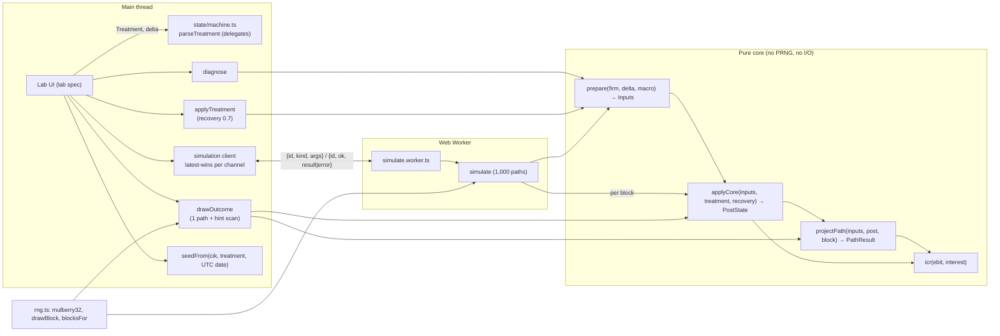
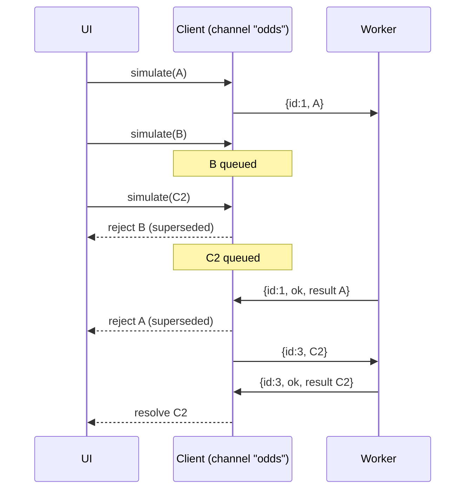

# Design Document: rescue-engine

## Overview

The rescue-engine answers "what would it take to bring this company back?" for one firm. It is pure TypeScript in `web/src/engine`, with no React, three.js, clock or `Math.random`. It:

1. validates a firm, a rate shock and a Treatment (`parseTreatment`, `prepare`),
2. diagnoses the firm before treatment (`diagnose`),
3. applies up to three v1 tools in a fixed order (`applyTreatment`),
4. projects interest coverage for 3 years over 1,000 seeded Monte Carlo paths (`simulate`, run in a Web Worker),
5. draws one reproducible real outcome with a failure reason and a hint (`drawOutcome`, `seedFrom`),
6. scores the result and computes liquidation recovery (`score`, `liquidationRecovery`).

Every result is a hypothetical ("what it would take"), never a recommendation.

The design rests on four decisions, each explained in its own section below:

- **Pure core, thin wrappers, fixed random block per path.** All maths lives in two pure functions, `applyCore` and `projectPath`. Randomness enters only as a `RandomBlock` value of 6 uniforms per path, so two treatments can be compared on "the same random numbers" by passing the same object.
- **Hint by grid scan, not bisection.** The coverage of the failing year is not monotone in the cost cut, so bisection can return a wrong answer. A linear scan over a 0.1 pp grid is exact and cheap (Open question A).
- **Latest-wins worker client.** Simulation requests are coalesced per channel; stale requests are rejected with `superseded` instead of terminating the worker (Open question B).
- **Floating-point rules chosen so monotonicity properties hold exactly.** The refinance cost is computed as `debtPreFee * min(1.02 * newRate, r + delta)`, which makes property 4 (delta monotonicity) and property 7 (refinance never raises cost) exact in IEEE arithmetic, with no epsilon.

Sources used: `.kiro/steering/rescue-rules.md`, `zombie-definition.md`, `data-contract.md`, `tech.md`; `web/src/types/data.ts`; `web/src/state/{types,machine}.ts` and their tests; `web/src/test/arbitraries.ts`; `web/src/dev/fixtures/{firms,macro}.ts`; the mulberry32 reference in [bryc/code PRNGs](https://github.com/bryc/code/blob/master/jshash/PRNGs.md); the FNV-1a definition and test vectors at [isthe.com FNV](http://www.isthe.com/chongo/tech/comp/fnv/index.html); Vite's worker import pattern in the [Vite features guide](https://vite.dev/guide/features#web-workers).

## Architecture



### Layers

| Layer | Files | Pure | Notes |
| --- | --- | --- | --- |
| Validation | `errors.ts`, `treatment.ts`, `inputs.ts` | yes | Returns `EngineResult<T>`; never throws. |
| Core maths | `icr.ts`, `tools.ts`, `refinance.ts`, `apply.ts`, `project.ts` | yes | No PRNG, no allocation of shared state. |
| Randomness | `rng.ts`, `hash.ts` | yes | PRNG state lives in a closure returned by `mulberry32(seed)`. |
| Wrappers | `diagnose.ts`, `simulate.ts`, `outcome.ts`, `score.ts`, `liquidation.ts` | yes | Compose validation, core and randomness. |
| Worker | `worker/protocol.ts`, `worker/simulate.worker.ts`, `worker/client.ts` | entry imports only the engine | The client holds per-instance state in a closure, not at module level. |

### Data flow for one simulation

1. `parseTreatment(treatment)` → canonical Treatment, or `EngineError`.
2. `prepare(firm, delta, macro)` → `Inputs`, or `EngineError`.
3. `blocksFor(seed, paths)` → `RandomBlock[]`; block k is always uniforms 6k..6k+5 of the seed's stream.
4. For each block: `post = applyCore(inputs, treatment, block.recovery)`; `path = projectPath(inputs, post, block)`.
5. Aggregate survival odds, medians and debt-free share.

### Validation order (deterministic, Req 3.11, 4.1)

Every public function that takes them checks, in this order, and returns the first error:

1. `delta` (`delta_out_of_range`),
2. `treatment` (parser order below),
3. `firm` (`not_rescuable`),
4. `macro.dgs10.value` (see Open question G),
5. function-specific options: `paths` (`invalid_paths`), `seed` (Open question F), `isoDate` (`invalid_date`).

## Components and Interfaces

### File layout

```
web/src/engine/
  index.ts                 public entry (exact export list below)
  types.ts                 public types
  errors.ts                EngineError, EngineResult, constructors, messages
  icr.ts                   the single icr() implementation
  inputs.ts                prepare(): latest year, validation, Inputs
  treatment.ts             parseTreatment, canonicalise, serialiseTreatment, deserialiseTreatment
  tools.ts                 tool registry (v1 tools + extension points), cut/sell/swap maths
  refinance.ts             spreadFor, refinanceApplies, evaluateRefinance
  apply.ts                 applyCore, applyTreatment
  rng.ts                   mulberry32, drawBlock, blocksFor
  hash.ts                  fnv1a32, seedFrom, isValidIsoDate
  project.ts               projectPath
  diagnose.ts              diagnose
  simulate.ts              simulate, median
  outcome.ts               drawOutcome, failureMessage, hintScan, formatting helpers
  score.ts                 score
  liquidation.ts           liquidationRecovery
  worker/protocol.ts       message types
  worker/simulate.worker.ts worker entry (imports only ../simulate and ./protocol)
  worker/client.ts         createSimulationClient
  test/engineArbitraries.ts fast-check generators for valid engine inputs
  *.test.ts, *.property.test.ts next to the code
```

Changes outside the engine (allowed by Req 16.4):

- `web/src/state/types.ts`: remove the placeholder `ToolChoice` and `Treatment`; `export type { ToolChoice, Treatment } from '../engine';`.
- `web/src/state/machine.ts`: `parseTreatment` delegates to the engine and maps the error (below). The unused `ToolChoice` import is removed.
- `web/src/test/arbitraries.ts`: `arbTreatment` generates valid engine Treatments in random click order; the junk generator keeps arbitrary `{ name, params }` tools (renamed `arbRawTool`) for 4 to 6 tool arrays.

Not changed: `web/src/dev/fixtures/firms.ts` keeps its local `icr` helper. Replacing it with the engine `icr` is a one-line follow-up outside this spec's allowed paths (Req 16.4); Req 1.5 binds the Engine only.

### Public entry (`index.ts`, Req 2.1)

Runtime exports, exactly:

```ts
export { icr } from './icr';
export { diagnose } from './diagnose';
export { applyTreatment } from './apply';
export { simulate } from './simulate';
export { drawOutcome } from './outcome';
export { score } from './score';
export { seedFrom } from './hash';
export { parseTreatment } from './treatment';
export { liquidationRecovery } from './liquidation';
export { createSimulationClient } from './worker/client';
export type * from './types';
export type { EngineError, EngineErrorCode, EngineResult } from './errors';
```

Cents on the dollar (Req 11.8) is a field of the `liquidationRecovery` result, so no extra runtime symbol is exported. Internal helpers (`prepare`, `applyCore`, `projectPath`, `drawBlock`, `blocksFor`, `mulberry32`, `fnv1a32`, `serialiseTreatment`, `deserialiseTreatment`, `refinanceApplies`, `hintScan`) are exported from their own modules for tests only.

### `icr.ts` (Req 1)

```ts
export function icr(ebit: number | null | undefined, interest: number | null | undefined): number | null {
  if (typeof ebit !== 'number' || Number.isNaN(ebit)) return null;
  if (typeof interest !== 'number' || !Number.isFinite(interest) || !(interest > 0)) return null;
  return ebit / interest;
}
```

This is the only coverage division in the engine (Req 1.5). The diagnosis computes needed debt cut as `1 - icr(E, D * (r + delta))`, which equals `1 - E / ((r + delta) * D)` because IEEE multiplication is commutative. Projected years call `icr(EBIT_t, interest)`. The graveyard imports `icr` from `web/src/engine`. The Python pipeline cannot import it, so `data/fixtures/icr_cases.json` (partner-owned, optional) is the cross-language contract (Open question I).

### `treatment.ts` (Req 2.6, 3)

**Type decision.** The engine keeps the existing wire shape `{ name, params }` and narrows it into a discriminated union on `name`:

```ts
export type V1ToolName = 'cut_costs' | 'sell_assets' | 'debt_for_equity' | 'refinance';
export type ToolChoice =
  | { readonly name: 'cut_costs'; readonly params: { readonly c: number } }
  | { readonly name: 'sell_assets'; readonly params: { readonly s: number } }
  | { readonly name: 'debt_for_equity'; readonly params: { readonly w: number } }
  | { readonly name: 'refinance'; readonly params: Readonly<Record<string, never>> };
export type Treatment = readonly ToolChoice[];
```

Reason: `machine.unit.test.ts` asserts `expect(outcome.ctx.treatment).toEqual([{ name: 'cut_costs', params: { c: 0.05 } }])` and `store.unit.test.ts` passes the same shape. A `{ tool: 'cut_costs', c }` union would force a different stored value and break those assertions, which Req 3.12 forbids. The `{ name, params }` union keeps them green with no adapter and still gives exhaustive `switch (t.name)` narrowing.

**Parser.**

```ts
export function parseTreatment(input: unknown): EngineResult<Treatment>;
```

Checks, in this fixed order, returning the first failure (Req 3.11):

1. `input` is not an array → `invalid_treatment` (Open question F).
2. `input.length > 3` → `too_many_tools`.
3. For each entry in input order: not a plain object or `name` not a string → `invalid_treatment`; `name` not a v1 tool (including `issue_equity`, `chapter_11`, `liquidate`) → `unknown_tool` with `detail.tool = name`.
4. First name that appears twice, in input order → `duplicate_tool`.
5. For each entry in input order: params check → `param_out_of_range` with `detail.tool` and `detail.param`.
   - `cut_costs` needs exactly key `c`, `sell_assets` exactly `s`, `debt_for_equity` exactly `w`. Missing key, extra key, non-number, NaN or ±Infinity, or value outside the inclusive range → error. No clamping.
   - `refinance`: `params` may be absent or `{}`; any key → error.
6. Success: a new array in Canonical_Order (cut_costs, sell_assets, debt_for_equity, refinance), each entry a fresh object. `-0` is normalised to `0` so serialisation round-trips (`String(-0) === "0"`). The input is never mutated.

**Serialisation** (used by `seedFrom` and the round-trip property):

```ts
export function serialiseTreatment(t: Treatment): string;      // canonical order, sorted keys
export function deserialiseTreatment(s: string): EngineResult<Treatment>;
```

Format: tools joined by `;`; each tool is `name` followed by `,key=value` per param in ascending key order; numbers as `String(n)` (ECMAScript shortest round-trip form, so `Number(String(n)) === n` for finite n). Examples: `""` (empty), `"cut_costs,c=0.05;refinance"`, `"sell_assets,s=0.2;debt_for_equity,w=0.3"`. Tool names and keys use `[a-z_]`; numbers use `[0-9.eE+-]`; so `;`, `,`, `=` and `|` never occur inside a part. `deserialiseTreatment` splits, builds `{ name, params }` objects and calls `parseTreatment`.

**Machine delegation (Req 3.2).**

```ts
// web/src/state/machine.ts
import { parseTreatment as parseEngineTreatment, type Treatment } from '../engine';
export function parseTreatment(v: unknown): Parsed<Treatment> {
  const r = parseEngineTreatment(v);
  return r.ok ? { ok: true, value: r.value } : { ok: false, reason: r.error.message };
}
```

`MAX_TOOLS` stays exported from the machine (it equals the engine's limit). The machine stores the canonical Treatment, so `pullSwitch` and `setTreatment` keep a canonically ordered list.

### `tools.ts`: registry (Req 2.5)

```ts
export type ToolStatus = 'v1' | 'extension';
export interface ToolSpec {
  readonly name: string;
  readonly status: ToolStatus;
  readonly params: readonly { key: string; min: number; max: number }[];
  readonly order: number;          // position in Canonical_Order
}
export const TOOL_REGISTRY: readonly ToolSpec[] = [
  { name: 'cut_costs',       status: 'v1', params: [{ key: 'c', min: 0, max: 0.08 }], order: 0 },
  { name: 'sell_assets',     status: 'v1', params: [{ key: 's', min: 0, max: 0.30 }], order: 1 },
  { name: 'debt_for_equity', status: 'v1', params: [{ key: 'w', min: 0, max: 0.60 }], order: 2 },
  { name: 'refinance',       status: 'v1', params: [], order: 3 },
  { name: 'issue_equity',    status: 'extension', params: [{ key: 'k', min: 0, max: 0.25 }], order: 4 },
  { name: 'chapter_11',      status: 'extension', params: [], order: 5 },
  { name: 'liquidate',       status: 'extension', params: [], order: 6 },
];
```

The registry is a frozen constant (not mutable state). The parser accepts only `status: 'v1'`. Adding issue_equity later means switching its status and adding a step in `applyCore`; no exported signature changes. `chapter_11` will use `block.haircut`, which is already drawn.

### `inputs.ts`: `prepare` (Req 4)

```ts
export interface Inputs {
  readonly cik: string; readonly name: string; readonly fy: number;
  readonly R: number; readonly E: number; readonly I: number;
  readonly D: number; readonly A: number; readonly Q: number;
  readonly r: number;          // I / D
  readonly b: number;          // macro.dgs10.value
  readonly delta: number;
  readonly marginMean: number; // rescue_inputs.margin_mean
  readonly kappa: 0.3;
  readonly sigma: number;      // clamp(margin_change_sd, 0.01, 0.08)
  readonly g: number;          // clamp(revenue_growth_median, -0.15, 0.15)
}
export function prepare(firm: Firm, delta: number, macro: Macro): EngineResult<Inputs>;
```

Steps:

1. `delta` finite and `0 <= delta <= 0.05`, else `delta_out_of_range` (no clamping).
2. `firm.years` empty → `not_rescuable`.
3. Latest year = entry with the highest `fy` (not assumed sorted).
4. Collect every one of R, E, I, D, A, Q that is `null` (or not a finite number) → `not_rescuable` naming all of them in `detail.inputs`, in the order R, E, I, D, A, Q.
5. Value checks, in order D, R, I: `D <= 0` → `not_rescuable` naming D (covers D = 0, Req 4.2 and 14.8, and D < 0, Req 4.6); `R <= 0` → names R; `I <= 0` → names I.
6. `r = I / D`; `b = macro.dgs10.value`; sigma and g clamped as listed. `margin_change_mean` is never read (Req 4.11).

kappa is the constant 0.3 (inside the steering range [0.1, 0.6], so no clamp is needed). A firm with D = 0 is reported as `not_rescuable` and never as debt-free (Req 14.8); debt-free is only a post-treatment state (Req 14.9).

### `diagnose.ts` (Req 5)

```ts
export interface Diagnosis {
  readonly shockedIcr: number;                 // icr(E, D * (r + delta))
  readonly neededEbitIncrease: number | null;  // D * (r + delta) / E - 1, null if E <= 0
  readonly neededDebtCut: number | null;       // 1 - shockedIcr, null if E <= 0
  readonly neededRate: number;                 // E / D, any sign of E
  readonly belowCoverage: boolean;             // Req 5.8
  readonly summary: string;                    // "Below coverage 1 under the shock." | "Already covers its interest under the shock."
}
export function diagnose(firm: Firm, delta: number, macro: Macro): EngineResult<Diagnosis>;
```

`belowCoverage = neededEbitIncrease === null || neededEbitIncrease >= 0`, exactly as Req 5.8 states (see Open question H for the ICR = 1 boundary). With `delta = 0`, `shockedIcr = icr(E, D * (I / D))`, which equals `icr(E, I)` within relative 1e-12 (Req 5.6, Property 3).

### `apply.ts` and `refinance.ts`: treatment (Req 6, 7)

```ts
export function applyCore(inputs: Inputs, treatment: Treatment, recovery: number): PostState;
export function applyTreatment(firm: Firm, treatment: Treatment, delta: number, macro: Macro): EngineResult<PostState>;
// applyTreatment = parse + prepare + applyCore(inputs, canonical, 0.7)
```

`applyCore` steps (canonical order, Req 6.1, 7.1). Start: `R' = R, E' = E, D' = D, c = 0`, pains 0, keep 1.

1. **cut_costs c**: `E' = E + c * (R - E)`; `growthCut = 0.5 * c`; `workers += (c / 0.08) * 50`.
2. **sell_assets s**: `sale = s * A * recovery`; `D' = Math.max(0, D' - sale)`; `R' = R' * (1 - s)`; `E' = E' * (1 - s)`; `workers += (s / 0.30) * 35`. Because cut runs first, E' is the cut EBIT (Req 6.3).
3. **debt_for_equity w**: `converted = w * D'` (after the sale); `D' = D' - converted`; `q = Math.max(Q, 0)`; `keep = q + converted === 0 ? 1 : q / (q + converted)`; `shareholders += (1 - keep) * 100`; `creditors += w * 60` (Req 6.6, 6.7, 14.3).
4. **refinance** (always last): `evaluateRefinance(inputs, E', D')`.
5. Pains clamped to [0, 100] with `Math.min(100, Math.max(0, x))` (Req 6.8). In v1 the maxima are 85, 100 and 36, so the cap never binds, but it is applied.

`D' - w * D'` is used, not `D' * (1 - w)`, so `D'_with <= D'_without` holds exactly in floating point (`w * D' >= 0`), which Property 1 relies on.

**Refinance** (`refinance.ts`):

```ts
export function spreadFor(icrPre: number): 0.09 | 0.06 | 0.035 | 0.02 {
  if (icrPre < 1) return 0.09;      // includes negative icr_pre (Req 7.3)
  if (icrPre < 1.5) return 0.06;
  if (icrPre < 3) return 0.035;
  return 0.02;
}
export function refinanceApplies(oldRate: number, newRate: number): boolean {
  return 1.02 * newRate < oldRate;  // strict: equality does not apply (Req 7.6, 15.4)
}
```

`evaluateRefinance(inputs, E', D'pre)` with `oldRate = r + delta`:

- `D'pre === 0` → not applied; `note = "No debt remains to refinance."`; no fee (Req 7.7).
- Otherwise `icrPre = icr(E', D'pre * oldRate)` (non-null because both factors are > 0), `spread = spreadFor(icrPre)`, `newRate = b + delta + spread`, `applied = refinanceApplies(oldRate, newRate)`.
- Applied: `effRate = 1.02 * newRate`, `debtShown = D'pre * 1.02`, `rateShown = newRate`, note `"Refinanced from 6.81% to 4.70% plus a 2% fee."` (rates to 2 decimals).
- Not applied: `effRate = oldRate`, `debtShown = D'pre`, `rateShown = oldRate`, note `"Refinancing at 14.20% plus the 2% fee would not lower the annual interest cost of 6.81%."` (Req 7.6).
- In all cases `interest = D'pre * effRate`.

**Why `interest = D'pre * effRate`.** Req 7.5 describes "rate = newRate, D' *= 1.02", i.e. `interest = (1.02 * D') * newRate`. That is the same real number as `D' * (1.02 * newRate)`, but the two IEEE results can differ by 1 ulp. Computing `effRate = applied ? 1.02 * newRate : oldRate` makes `effRate` exactly `min(1.02 * newRate, oldRate)` (when the two are equal, both branches give the same value). This gives three exact guarantees used later:

- `interest_after = D'pre * effRate <= D'pre * oldRate = interest_before` (IEEE multiplication by a non-negative factor is monotone), so refinance never raises the annual cost (Property 7, Req 7.8).
- effRate is a non-decreasing function of delta (Property 4).
- effRate is a non-increasing function of icr_pre, hence of E' and of 1/D' (Properties 1 and 2).

`debtShown` and `rateShown` are kept for display; coverage always uses `interest`.

**Year-0 coverage.** `year0 = D'pre === 0 ? debt-free : icr(E', interest)`. With an empty Treatment and delta = 0 this is `icr(E, D * (I / D))` (Property 3).

### `rng.ts`: PRNG and the fixed random block (Req 8.3, 8.4)

mulberry32, pinned to the reference implementation in bryc's PRNG collection:

```js
// Reference (bryc/code, jshash/PRNGs.md)
function mulberry32(a) {
  return function() {
    var t = a += 0x6D2B79F5;
    t = Math.imul(t ^ t >>> 15, t | 1);
    t ^= t + Math.imul(t ^ t >>> 7, t | 61);
    return ((t ^ t >>> 14) >>> 0) / 4294967296;
  }
}
```

TypeScript port (equivalent: every read of `t` in the reference goes through ToInt32 or ToUint32, so keeping `a` reduced mod 2^32 with `| 0` gives the same outputs, and it cannot drift past 2^53 on long streams):

```ts
export function mulberry32(seed: number): () => number {
  let a = seed | 0;
  return () => {
    a = (a + 0x6d2b79f5) | 0;
    let t = a;
    t = Math.imul(t ^ (t >>> 15), t | 1);
    t ^= t + Math.imul(t ^ (t >>> 7), t | 61);
    return ((t ^ (t >>> 14)) >>> 0) / 4294967296;   // [0, 1)
  };
}
```

No numeric mulberry32 vectors are invented here. The test task computes the first 5 outputs for one seed once, pins them, and cross-checks them against an independent implementation written inside the test (uint32 arithmetic with `BigInt`), Req 15.6.

The random block:

```ts
export interface RandomBlock {
  readonly recovery: number;                 // [0.6, 0.8)
  readonly haircut: number;                  // [0.30, 0.60), reserved for chapter_11; unused in v1
  readonly eps: readonly [number, number, number];
}
export function drawBlock(next: () => number): RandomBlock {
  const u0 = next(), u1 = next(), u2 = next(), u3 = next(), u4 = next(), u5 = next();
  const rA = Math.sqrt(-2 * Math.log(1 - u2));   // 1 - u in (0, 1]: log(0) never happens
  const rB = Math.sqrt(-2 * Math.log(1 - u4));
  return {
    recovery: 0.6 + 0.2 * u0,
    haircut: 0.3 + 0.3 * u1,
    eps: [rA * Math.cos(2 * Math.PI * u3), rA * Math.sin(2 * Math.PI * u3), rB * Math.cos(2 * Math.PI * u5)],
  };
}
export function blocksFor(seed: number, n: number): RandomBlock[];   // n successive drawBlock calls on mulberry32(seed)
```

Consequences:

- Exactly 6 uniforms per path, always, whatever the Treatment (Req 8.4). Block k of a seed is uniforms 6k..6k+5, so `blocksFor(seed, n)` is a prefix of `blocksFor(seed, n + m)`.
- The largest uniform is `1 - 2^-32`, so `|eps| <= sqrt(-2 ln 2^-32) ≈ 6.66`. Path-level generators use eps in [-6.7, 6.7] to cover every value the PRNG can produce.
- `drawOutcome(…, seed)` uses block 0 of `seed`, so its path equals path 0 of `simulate` with the same seed and treatment. A unit test checks this.

### `project.ts`: one path (Req 8.5 to 8.8)

```ts
export interface PathResult {
  readonly margin: readonly [number, number, number];   // m_1..m_3
  readonly revenue: readonly [number, number, number];  // R_1..R_3
  readonly ebit: readonly [number, number, number];
  readonly icr: readonly [number, number, number];      // +Infinity when debt-free (internal only)
  readonly debtFree: boolean;
}
export function projectPath(inputs: Inputs, post: PostState, block: RandomBlock): PathResult;
```

`m_0 = E' / R'`; for t = 1..3: `m_t = m_{t-1} + kappa * (marginMean - m_{t-1}) + sigma * eps_t`; `R_t = R_{t-1} * (1 + g - growthCut)` with `R_0 = R'`; `EBIT_t = m_t * R_t`; `ICR_t = post.debtFree ? Infinity : icr(EBIT_t, post.interest)`. Debt stays constant over the 3 years. The growth factor is at least `1 - 0.15 - 0.04 = 0.81 > 0`, so `R_t > 0`. Delta enters only through `post.interest`; EBIT_t does not depend on delta or on debt.

### `simulate.ts` (Req 8)

```ts
export interface SimulateOptions { readonly paths?: number; readonly seed: number }
export function simulate(firm: Firm, treatment: Treatment, delta: number, macro: Macro,
                         options: SimulateOptions): EngineResult<SimulationResult>;
```

1. Validate (order above). `paths` defaults to 1000; must be an integer in [1, 100000], else `invalid_paths` with no path run (Req 8.13).
2. `blocks = blocksFor(seed, paths)`.
3. If the canonical Treatment has no `sell_assets`, `applyCore` does not read `recovery`, so `post` is computed once with recovery 0.7 and reused. Otherwise `post_k = applyCore(inputs, t, blocks[k].recovery)`. Both branches produce bit-identical results, because `applyCore` is a pure function whose output does not depend on `recovery` when sell_assets is absent. A unit test compares this against a naive version that always recomputes.
4. `survivalOdds = covered / paths`, where a path is covered when `ICR_t >= 1` for t = 1, 2, 3 (`Infinity >= 1` is true).
5. Medians per year from `Float64Array.from(values).sort()` (numeric sort, handles Infinity, deterministic). Even count: `(a[n/2 - 1] + a[n/2]) / 2`. A mix gives `(x + Infinity) / 2 = Infinity` and never NaN, because no subtraction of infinities happens.
6. Display mapping: `{ icr: Number.isFinite(m) ? m : null, debtFree: m === Infinity }`.

### `outcome.ts`: real outcome, message and hint (Req 9)

```ts
export function drawOutcome(firm: Firm, treatment: Treatment, delta: number, macro: Macro,
                            seed: number): EngineResult<Outcome>;
```

1. Validate; `block = blocksFor(seed, 1)[0]`; `post = applyCore(inputs, t, block.recovery)`; `path = projectPath(inputs, post, block)`.
2. `failingYear` = smallest t with `ICR_t < 1`, or null. `rescued = failingYear === null`.
3. Message (Req 9.4): `` `Year ${t}: operating margin ${pct1(m_t)}%, coverage ${fix2(ICR_t)}. ${name} stays undead.` `` where `pct1(x) = clean((x * 100).toFixed(1))`, `fix2(x) = clean(x.toFixed(2))`, and `clean` turns `"-0.0"` / `"-0.00"` into `"0.0"` / `"0.00"`. A failing year is never debt-free, so ICR_t is finite.
4. Hint: `hintScan` below.

**Hint scan (replaces bisection, Open question A).** Let `t*` be the failing year, `c0` the chosen cut (0 if cut_costs is absent) and

```
f(c) = projectPath(inputs, applyCore(inputs, withCut(t, c), block.recovery), block).icr[t* - 1]
```

`withCut` replaces or inserts cut_costs in an internal treatment shape that has no 3-tool cap. f is the full pipeline on the same block: sell_assets uses the path's recovery, debt_for_equity follows, and refinance is re-evaluated because E' changes icr_pre and so the spread.

f is not monotone in c:

- A larger cut raises the margin but lowers growth by 0.5c. Example: E/R = 0.9, margin_mean = 0.9, eps = 0, g = 0.01, no other tools. At c = 0: m_1 = 0.9, R_1 = 1.01 R, EBIT_1 = 0.909 R. At c = 0.08: m_0 = 0.908, m_1 = 0.908 + 0.3 (0.9 - 0.908) = 0.9056, R_1 = 0.97 R, EBIT_1 = 0.878432 R. Coverage falls by 3.4%.
- With refinance and EBIT_t < 0, a cut that switches refinance on lowers the interest and makes ICR_t more negative.

So bisection on f(c) >= 1 can stop at a wrong boundary. The scan:

```ts
const K = Math.floor((0.08 - c0) / 0.001 + 1e-9);
for (let k = 1; k <= K; k++) {
  const c = Math.min(0.08, c0 + k / 1000);
  if (f(c) >= 1) return { extraCut: k / 1000, totalCut: c, text: hintText(k, c0 > 0, t*) };
}
return null;
```

At most 80 single-path evaluations (microseconds). It returns exactly the smallest extra cut on the 0.1 pp grid with no monotonicity assumption, so the result is already "rounded up to 0.1 pp" and capped at 0.08, and the stated extra cut is the one actually verified. Text:

- cut_costs present: "What it would take: an extra cost cut of 1.3 percentage points would have kept year 2 at coverage 1 or above."
- cut_costs absent: "What it would take: a cost cut of 1.3 percentage points would have kept year 2 at coverage 1 or above."

The pp value is `(k / 10).toFixed(1)`. The text never contains "should", "recommend" or "advise" (Req 9.8). If the Treatment already has 3 tools and no cut_costs, the hint describes a hypothetical 4th tool; it is still computed and worded as "what it would take" (Open question A).

### `hash.ts`: seed derivation (Req 10)

```ts
export function fnv1a32(s: string): number {
  let h = 0x811c9dc5;
  for (const byte of new TextEncoder().encode(s)) { h ^= byte; h = Math.imul(h, 0x01000193); }
  return h >>> 0;
}
export function seedFrom(cik: string, treatment: Treatment, isoDate: string): EngineResult<number>;
```

- Pinned published vectors: `fnv1a32("") = 0x811c9dc5`, `fnv1a32("a") = 0xe40c292c`, `fnv1a32("foobar") = 0xbf9cf968`.
- Input string: `` `${cik}|${serialiseTreatment(canonical)}|${isoDate}` ``. `|` cannot occur in a 10-digit CIK, a valid date or the serialisation.
- `isoDate` must match `^\d{4}-\d{2}-\d{2}$` with month 01..12 and a day valid for that month, with leap years by the Gregorian rule (`y % 4 === 0 && (y % 100 !== 0 || y % 400 === 0)`); else `invalid_date` (Req 10.5). Validation is arithmetic, not `new Date(...)`, so the purity check stays simple.
- The treatment is parsed first; any parser error is returned. The CIK is checked against `^\d{10}$` (Open question F).
- The engine has no clock. The caller (lab spec) passes `new Date().toISOString().slice(0, 10)`, the UTC date.

### `score.ts` and `liquidation.ts` (Req 11)

```ts
export interface ScoreInput { readonly rescued: boolean; readonly survivalOdds: number; readonly pain: PainMeters }
export function score(input: ScoreInput): number;
// (rescued ? 1 : 0) * clamp01(odds) * (1 - (w + s + c) / 300) * 100, each pain clamped to [0, 100]
export function liquidationRecovery(A: number, D: number): { recovery: number; centsOnDollar: number };
```

`clamp(x, lo, hi) = x >= lo ? (x <= hi ? x : hi) : lo`, so NaN maps to `lo` and the score is always in [0, 100]. Recovery: `!(D > 0)` → 1 (D = 0, Req 11.7); otherwise `Math.min(1, 0.5 * Math.max(0, A) / D)`, with non-finite A treated as 0 if NaN and capped by `min` if +Infinity. `centsOnDollar = Math.round(recovery * 100)`; `Math.round` rounds halves up for non-negative values. The rounding is applied to the IEEE product, so a value such as 0.285 (stored as 0.28499…) gives 28.

### `worker/*`: simulation off the main thread (Req 12)

What runs where:

- `diagnose`, `applyTreatment` and `drawOutcome` (1 path plus at most 80 hint evaluations) are cheap and run on the main thread.
- `simulate` (1,000 paths × 3 years, about 6,000 uniforms plus 1,000 `applyCore` calls with sell_assets) goes to the worker. Expected time is around 1 ms; a benchmark task records the real number (not a test gate).

Protocol (`protocol.ts`):

```ts
export interface SimulateArgs {
  readonly firm: Firm; readonly treatment: Treatment; readonly delta: number;
  readonly macro: Macro; readonly options: SimulateOptions;
}
export type WorkerRequest = { readonly id: number; readonly kind: 'simulate'; readonly args: SimulateArgs };
export type WorkerResponse =
  | { readonly id: number; readonly ok: true; readonly result: SimulationResult }
  | { readonly id: number; readonly ok: false; readonly error: EngineError };
```

Worker entry (`simulate.worker.ts`) imports only `../simulate` and `./protocol`:

```ts
self.onmessage = (ev: MessageEvent<WorkerRequest>) => {
  const { id, args } = ev.data;
  const r = simulate(args.firm, args.treatment, args.delta, args.macro, args.options);
  self.postMessage(r.ok ? { id, ok: true, result: r.value } : { id, ok: false, error: r.error });
};
```

Client (`client.ts`):

```ts
export interface WorkerLike {
  postMessage(msg: WorkerRequest): void;
  terminate(): void;
  onmessage: ((ev: { data: WorkerResponse }) => void) | null;
}
export interface SimulationClient {
  simulate(args: SimulateArgs, opts?: { channel?: string; signal?: AbortSignal }): Promise<SimulationResult>;
  dispose(): void;
}
export function createSimulationClient(deps?: { createWorker?: () => WorkerLike }): SimulationClient;
```

- Default factory: `new Worker(new URL('./simulate.worker.ts', import.meta.url), { type: 'module' })`, the pattern documented in the Vite guide. It is used only when no factory is injected (Req 12.3), and only on the first request, so jsdom tests never construct a real Worker.
- Promises reject with the plain `EngineError` value from the response (Req 12.4).
- Every request gets a unique, increasing id. Responses resolve only the request with the matching id; unknown ids are ignored (Req 12.5, 12.6).

**Latest-wins per channel (Open question B).** A worker running a synchronous loop cannot read messages mid-run, and terminating it costs a new worker start-up each time a slider moves. With simulate around 1 ms, coalescing is cheaper than terminating:

- Each channel (default `'default'`) has at most one request in flight and at most one queued.
- New request while one is in flight: the queued request, if any, is rejected with `superseded` and replaced by the new one.
- In-flight response arrives: if a newer request is queued, the in-flight promise is rejected with `superseded` (its result is stale) and the queued request is posted; otherwise it resolves or rejects with the response.
- `signal` aborted: a queued request is removed and rejected with `aborted`; an in-flight one is rejected with `aborted` at once and its later response is ignored.
- Channels are independent; a request on one channel never supersedes another channel.
- `dispose()`: terminates the worker if one exists, rejects every in-flight and queued request with `worker_disposed`, and marks the client disposed. Later requests reject with `worker_disposed` and create no worker (Req 12.7, 12.8).

Fallback, described but not built in v1: a `terminate-on-cancel` mode that terminates and respawns the worker when a request is superseded, to be used only if the benchmark shows simulate above 16 ms. UI-side `requestAnimationFrame` throttling of slider events belongs to the lab spec.



### Purity checks (Req 2.2, 2.3)

`engine/purity.test.ts` reads every `.ts` file under `web/src/engine` (skipping itself, because it contains the patterns as strings) and fails, naming file and line, on:

- `from '…'`, `import('…')` or `require('…')` whose specifier is `react`, `react-dom`, `three`, starts with `react/`, `three/` or `@react-three/`, or is a relative path that resolves (with `node:path`) into `src/scenes`, `src/fx` or `src/ui`;
- `Math.random`, `Date.now`, `performance.now`, `new Date(` followed by optional spaces and `)`;
- a top-level `let` or `var` declaration (module-level mutable state).

The existing ESLint `no-restricted-imports` rule for `src/engine/**` stays as a second line of defence.

## Data Models

```ts
// errors.ts
export type EngineErrorCode =
  | 'unknown_tool' | 'too_many_tools' | 'duplicate_tool' | 'param_out_of_range'
  | 'delta_out_of_range' | 'not_rescuable' | 'invalid_paths' | 'invalid_date'
  | 'worker_disposed'
  | 'superseded' | 'aborted'                          // proposed, Open question B
  | 'invalid_treatment' | 'invalid_seed' | 'invalid_cik'; // proposed, Open question F
export type InputName = 'R' | 'E' | 'I' | 'D' | 'A' | 'Q' | 'b' | 'years';
export interface EngineError {
  readonly code: EngineErrorCode;
  readonly message: string;             // human-readable, plain sentence case
  readonly detail?: {
    readonly tool?: string; readonly param?: string; readonly index?: number;
    readonly inputs?: readonly InputName[]; readonly value?: unknown;
  };
}
export type EngineResult<T> = { readonly ok: true; readonly value: T } | { readonly ok: false; readonly error: EngineError };

// types.ts
export interface PainMeters { readonly workers: number; readonly shareholders: number; readonly creditors: number }
export interface CoverageView { readonly icr: number | null; readonly debtFree: boolean } // icr null only when debtFree
export interface RefinanceInfo {
  readonly requested: boolean; readonly applied: boolean;
  readonly icrPre: number | null; readonly spread: number | null;
  readonly oldRate: number;            // r + delta
  readonly newRate: number | null;     // b + delta + spread, null when not evaluated
  readonly note: string | null;        // Refinance_Note, null when refinance not requested
}
export interface PostState {
  readonly revenue: number;            // R'
  readonly ebit: number;               // E'
  readonly debtPreFee: number;         // D' after cut/sell/swap, before the refinance fee
  readonly debt: number;               // displayed D' (x 1.02 when refinance applied)
  readonly rate: number;               // displayed r' (newRate when applied, else r + delta)
  readonly effRate: number;            // min(1.02 * newRate, r + delta) when evaluated, else r + delta
  readonly interest: number;           // debtPreFee * effRate
  readonly cut: number;                // c (0 if absent)
  readonly growthCut: number;          // 0.5 * c
  readonly keep: number;               // shareholders' kept share, 1 without a swap
  readonly pain: PainMeters;
  readonly refinance: RefinanceInfo;
  readonly debtFree: boolean;          // debtPreFee === 0
  readonly year0: CoverageView;
  readonly coverageText: string;       // "debt-free" or fix2(year0 icr)
}
export interface SimulationResult {
  readonly paths: number; readonly seed: number;
  readonly survivalOdds: number;                                  // [0, 1]
  readonly medianIcr: readonly [CoverageView, CoverageView, CoverageView];
  readonly debtFree: boolean;                                     // every path debt-free (Req 8.8, 8.14)
  readonly debtFreeShare: number;                                 // share of debt-free paths
  readonly post: PostState;                                       // with recovery 0.7, for display
  readonly constantDebtNote: 'Debt stays constant over the 3 projected years (simplification).';
}
export interface OutcomeYear { readonly t: 1 | 2 | 3; readonly margin: number; readonly coverage: CoverageView }
export interface Hint { readonly extraCut: number; readonly totalCut: number; readonly text: string }
export interface Outcome {
  readonly seed: number; readonly rescued: boolean; readonly debtFree: boolean;
  readonly years: readonly [OutcomeYear, OutcomeYear, OutcomeYear];
  readonly failingYear: 1 | 2 | 3 | null;
  readonly message: string | null;
  readonly hint: Hint | null;
}
```

Display rule: no field of `Diagnosis`, `PostState`, `SimulationResult` or `Outcome` holds NaN or ±Infinity for valid inputs. Infinity exists only inside `PathResult` and is mapped to `CoverageView { icr: null, debtFree: true }`.

The UI maps `Outcome.rescued` to the machine's `Result`: `true` → `'revived'`, `false` → `'undead'`. `'liquidated'` comes from the liquidate action in the lab, not from `drawOutcome`.

### Worked example: Ashgrove Works (cik 9000000001, `fixtureMacro`, delta = 0.01)

Inputs: R = 1.20e9, E = 38e6, I = 61e6, D = 1.05e9, A = 1.60e9, Q = 140e6, b = 0.042, margin_mean = 0.035, sigma = 0.018, g = 0.01.

| Quantity | Formula | Value |
| --- | --- | --- |
| r | 61 / 1050 | 0.0580952381 |
| r + delta | | 0.0680952381 |
| Shocked interest | 1.05e9 × 0.0680952381 = 61e6 + 10.5e6 | 71.5e6 |
| Shocked ICR | 38 / 71.5 | 0.531469 |
| Needed EBIT increase | 71.5 / 38 − 1 | 0.881579 (88.2%) |
| Needed debt cut | 1 − 38 / 71.5 | 0.468531 (46.9%) |
| Needed rate | 38 / 1050 | 0.0361905 (3.62%) |

Single tools (recovery 0.7):

| Tool | Result |
| --- | --- |
| cut_costs c = 0.05 | E' = 38e6 + 0.05 × 1162e6 = 96.1e6; R' = 1.2e9; D' = 1.05e9; workers = 31.25 |
| sell_assets s = 0.2 | sale = 0.2 × 1.6e9 × 0.7 = 224e6; D' = 826e6; R' = 960e6; E' = 30.4e6; workers = 23.3333… |
| debt_for_equity w = 0.3 | converted = 315e6; D' = 735e6; keep = 140 / 455 = 0.307692; shareholders = 69.2308; creditors = 18 |
| refinance alone | icr_pre = 0.5315 → spread 0.09; newRate = 0.042 + 0.01 + 0.09 = 0.142; 1.02 × 0.142 = 0.14484 ≥ 0.068095 → not applied; D' unchanged |

Refinance can never apply to Ashgrove (Open question E). The condition `1.02 (b + delta + spread) < r + delta` is equivalent to `1.02 b + 1.02 spread + 0.02 delta < r`. The left side is at least `0.04284 + 0.0204 + 0 = 0.06324`, above r = 0.05810, for every delta and every treatment (no v1 tool changes r).

Proposed "applies" fixture, **Ashgrove variant** (I = 120e6, everything else equal), delta = 0.01, treatment cut_costs 0.08 + debt_for_equity 0.6 + refinance:

| Step | Value |
| --- | --- |
| r, r + delta | 120 / 1050 = 0.1142857; 0.1242857 |
| E' | 38e6 + 0.08 × 1162e6 = 130.96e6 |
| D'pre | 1050e6 − 0.6 × 1050e6 = 420e6 |
| icr_pre | 130.96e6 / (420e6 × 0.1242857) = 130.96 / 52.2 = 2.50881 → spread **0.035** |
| newRate | 0.042 + 0.01 + 0.035 = 0.087; 1.02 × 0.087 = 0.08874 < 0.1242857 → applies |
| debt shown, interest | 428.4e6; 420e6 × 0.08874 = 37.2708e6 |
| year-0 ICR | 130.96 / 37.2708 = 3.51374 (2.50881 before refinance) |
| pains | workers 50; keep = 140 / 770 = 0.181818, shareholders 81.8182; creditors 36 |

The same variant with refinance alone does not apply: icr_pre = 38 / 130.5 = 0.29119 → spread 0.09 → 1.02 × 0.142 = 0.14484 ≥ 0.1242857.


## Correctness Properties

*A property is a characteristic or behavior that should hold true across all valid executions of a system-essentially, a formal statement about what the system should do. Properties serve as the bridge between human-readable specifications and machine-verifiable correctness guarantees.*

Titles marked **RR-n** are the eight properties of `rescue-rules.md`. Generator names refer to the domains in the Testing Strategy. "Same random numbers" is proved in two ways:

- **Path level** (RR-1, RR-2, no-NaN): fast-check generates the `RandomBlock` directly, and the test passes the same block object to `applyCore` and `projectPath` for both treatments. This is independent of the PRNG.
- **Seed level** (RR-4, RR-6, RR-8): the test calls `simulate` with the same seed; block k depends only on (seed, k) (Property 19).

### Floating-point tolerances

| Check | Comparison | Why |
| --- | --- | --- |
| Determinism (RR-6), click order, worker equals direct, seed tests, round trip | exact deep equality (`toEqual`, `Object.is` for numbers) | Same sequence of IEEE operations; `-0` normalised by the parser. |
| RR-4 delta monotone odds | exact (`<=`, no epsilon) | Interest is `D'pre * min(1.02 * (b + delta + spread), r + delta)`; each term is non-decreasing in delta under correctly rounded add and multiply; EBIT_t does not depend on delta; division of a non-negative numerator by a larger denominator never gives a larger rounded quotient; EBIT_t < 0 fails at every delta. |
| RR-7 refinance cost | exact (`<=`, `===`) | `effRate` is exactly `min(1.02 * newRate, r + delta)`; multiplication by `D'pre >= 0` is monotone. |
| RR-1 debt-for-equity, years with EBIT_t >= 0 | exact (`>=`) | Derivation under Property 11. |
| RR-2 cost cut | relative 1e-12 via `geq` | EBIT_1 is monotone in exact arithmetic under the precondition, but near a flat derivative rounding can reverse the order by a few ulps. |
| RR-3 year-0 ICR | relative 1e-12 | `D * (I / D)` need not equal `I` exactly. |
| Diagnosis formulas vs reference | relative 1e-12 | Same formulas, different but equivalent operation order in the reference. |
| Hand-computed tool examples | relative 1e-9; expected values written as arithmetic expressions in the test, not rounded literals | Literal decimals like 96.1e6 are not exactly representable. Req 15.3's 1e-6 is met. |
| Ashgrove headline figures | the tolerances stated in Req 5.7 and 15.1–15.2 | As required. |
| Ranges [0, 1], [0, 100], D' >= 0, R' > 0 | exact bounds | Clamps use `Math.min` / `Math.max`. |

```ts
// test/geq.ts: a >= b within relative tolerance; Infinity handled without NaN.
export const geq = (a: number, b: number, relTol: number): boolean =>
  a === b || a === Infinity || b === -Infinity || a >= b - relTol * Math.max(Math.abs(a), Math.abs(b));
```

`toBeCloseTo` with its default 2 digits is never used for money values.

### Property 1: icr contract

For any `ebit` and `interest` drawn from finite numbers, null, undefined, NaN and ±Infinity: `icr` never throws; it returns `ebit / interest` (by `Object.is`) when `ebit` is a non-NaN number and `interest` is finite and > 0, and null otherwise. A negative ebit with positive interest gives a negative result.

**Validates: Requirements 1.1, 1.2, 1.3, 1.4**

### Property 2: icr is monotone in EBIT

For any interest > 0 and any finite a <= b, `icr(a, interest) <= icr(b, interest)` (exact).

**Validates: Requirements 1.8**

### Property 3: The parser rejects invalid treatments with one deterministic error

For any treatment built from a valid one by one or more corruptions (unknown or extension tool name, a 4th to 6th tool, a duplicate name, a parameter that is out of range, NaN, ±Infinity, a non-number, missing, or an extra key, any key on refinance, a non-array, a malformed entry), `parseTreatment` returns `ok: false` with the code given by the precedence order (invalid_treatment, too_many_tools, unknown_tool, duplicate_tool, param_out_of_range), the error names the offending tool when there is one, two calls return deeply equal errors, the input is deeply equal to a `structuredClone` taken before the call, and `applyTreatment`, `simulate` and `drawOutcome` return the same error for the same treatment.

**Validates: Requirements 2.6, 3.3, 3.4, 3.5, 3.6, 3.8, 3.11, 4.12, 6.10, 9.10**

### Property 4: The state machine delegates treatment parsing

For any input (valid treatments, corrupted treatments and arbitrary junk), the machine's `parseTreatment` returns `ok: true` with the engine's value exactly when the engine accepts it, and otherwise `ok: false` with `reason` equal to the engine error's `message`.

**Validates: Requirements 3.2**

### Property 5: Treatment serialisation round trip

For any valid Treatment in any click order, `deserialiseTreatment(serialiseTreatment(t))` returns `ok: true` with a value deeply equal to `parseTreatment(t).value` (canonical order, keys sorted).

**Validates: Requirements 3.14, 10.3**

### Property 6: Click order never matters

For any valid firm, delta, seed, date and valid Treatment, and any permutation of that Treatment: `parseTreatment`, `applyTreatment` (including the Refinance_Note), `simulate`, `drawOutcome` and `seedFrom` return deeply equal results for the original and the permutation.

**Validates: Requirements 3.9, 6.1, 7.1, 7.9, 10.6**

### Property 7: Invalid firm, delta and paths inputs give typed errors

For any valid firm with one injected defect (empty `years`; any non-empty subset of R, E, I, D, A, Q set to null; D <= 0; R <= 0; I <= 0), and for any delta that is NaN, ±Infinity, < 0 or > 0.05, and any `paths` that is non-integer, < 1 or > 100000: each of `diagnose`, `applyTreatment`, `simulate` and `drawOutcome` returns `ok: false` with the expected code (`not_rescuable` naming exactly the null subset or the defective input, `delta_out_of_range`, `invalid_paths` for simulate), never throws, and leaves firm and macro deeply equal to their clones. No delta value is clamped.

**Validates: Requirements 4.1, 4.2, 4.3, 4.4, 4.5, 4.6, 4.7, 4.12, 8.13, 14.8**

### Property 8: Latest year selection and unused inputs

For any valid firm, shuffling the order of `years` and changing `rescue_inputs.margin_change_mean` to any finite value leave `diagnose`, `applyTreatment`, `simulate` and `drawOutcome` results deeply equal.

**Validates: Requirements 4.8, 4.11**

### Property 9: Diagnosis formulas

For any valid firm and delta: `shockedIcr = icr(E, D * (r + delta))`; `neededRate = E / D`; when E > 0, `neededEbitIncrease` and `neededDebtCut` equal `D * (r + delta) / E - 1` and `1 - E / ((r + delta) * D)` within relative 1e-12, and when E <= 0 both are null; `belowCoverage` is true exactly when `neededEbitIncrease` is null or >= 0.

**Validates: Requirements 5.1, 5.2, 5.3, 5.4, 5.5, 5.8, 14.2**

### Property 10: No treatment and no shock leave coverage unchanged (RR-3)

For any valid firm, with an empty Treatment and delta = 0, `applyTreatment(...).year0.icr` and `diagnose(...).shockedIcr` equal `icr(E, I)` within relative 1e-12.

**Validates: Requirements 5.6, 13.4**

### Property 11: Debt-for-equity never worsens coverage on the same path (RR-1, amended)

For any valid firm, delta, RandomBlock, base Treatment T without debt_for_equity (refinance included in the generator) and any w in [0, 0.60], let `with = T + debt_for_equity(w)`. For each year t = 1, 2, 3, on the same block:

1. if EBIT_t >= 0, `ICR_t(with) >= ICR_t(T)` exactly;
2. if year t is covered (ICR_t >= 1) under T, it is covered under `with`.

EBIT_t is identical under both (the swap does not change R' or E'). A failing case is reported by fast-check with its seed and shrunk inputs; refinance is never filtered out of the generator.

Why this holds exactly: `D'with = D' - w * D' <= D'` in IEEE arithmetic. If `D'with = 0` the year is debt-free (+Infinity). Otherwise, if refinance is in T and E' >= 0, `icr_pre` with the smaller denominator is >= the one without, so the spread is <= and `newRate` is <=; `effRate = min(1.02 * newRate, r + delta)` is then <=. If E' < 0, both spreads are 0.09 and effRate is equal. So `interest_with = D'with * effRate_with <= D' * effRate = interest_without`, and dividing EBIT_t >= 0 by a smaller positive denominator gives a quotient that is >= (exact). Part 1 fails for EBIT_t < 0 (for example EBIT_t = -10: -10 / 100 = -0.1 without, -10 / 50 = -0.2 with), which is why the property is amended (Open question C); part 2 still holds because a negative EBIT_t fails both.

**Validates: Requirements 13.1, 13.2**

### Property 12: A larger cost cut never lowers year-1 coverage (RR-2, restricted domain)

For any firm and block in the RR-2 domain (E/R in [-0.3, 0.3], margin_mean in [-0.2, 0.3], eps in [-4, 4], other inputs as `arbValidFirm`), any treatment T (sell_assets, debt_for_equity and refinance allowed) and any 0 <= c1 <= c2 <= 0.08, on the same block:

1. the test computes the precondition `0.7 * (1 - m_b) * (1 + g - 0.04) >= 0.5 * m_1(c = 0.08)` (m_b = E/R) and asserts that it holds, so no case is silently discarded;
2. `geq(EBIT_1(c2), EBIT_1(c1), 1e-12)`;
3. if `EBIT_1(c1) >= 0`, `geq(ICR_1(c2), ICR_1(c1), 1e-12)`.

The precondition always holds in this domain: m_1 <= 0.7 × 0.356 + 0.3 × 0.3 + 0.08 × 4 = 0.6592, so the right side is <= 0.3296, while the left side is >= 0.7 × 0.7 × 0.81 = 0.3969. A larger cut also gives a larger E', a larger icr_pre and an effRate that is <=, so interest never rises with c. Outside the domain the rule fails; a unit test records the counterexample E/R = 0.9, margin_mean = 0.9, eps = 0, g = 0.01, where year-1 EBIT is 0.909 R at c = 0 and 0.878432 R at c = 0.08 (Open question D).

**Validates: Requirements 13.3**

### Property 13: A higher rate shock never gives higher survival odds (RR-4)

For any valid firm, valid Treatment (refinance included), seed, `paths` in [1, 200] and 0 <= d1 <= d2 <= 0.05, `simulate(..., d2).survivalOdds <= simulate(..., d1).survivalOdds` exactly. Failures are reported with seed and shrunk inputs, never filtered.

**Validates: Requirements 13.5**

### Property 14: Liquidation recovery is bounded (RR-5)

For any A >= 0 (including 0 and very large values) and D > 0, `liquidationRecovery(A, D).recovery` equals `Math.min(1, 0.5 * A / D)` and lies in [0, 1], and `centsOnDollar` is an integer in [0, 100] equal to `Math.round(recovery * 100)`.

**Validates: Requirements 11.5, 11.6, 11.8, 13.6**

### Property 15: The same seed always gives the same outcome (RR-6)

For any valid arguments and seed, two calls of each of `applyTreatment`, `simulate`, `drawOutcome` and `seedFrom` return deeply equal results, and all argument objects stay deeply equal to clones taken before the calls. For any cik, Treatment and valid date, `drawOutcome` with `seedFrom(cik, t, date)` returns deeply equal Outcomes on repeated calls.

**Validates: Requirements 2.4, 8.12, 9.9, 10.7, 13.7**

### Property 16: Refinance never raises annual interest cost (RR-7, amended)

For any valid firm, delta and Treatment containing refinance, with `oldRate = r + delta`: `refinance.applied === (1.02 * newRate < oldRate)` whenever D'pre > 0; when not applied, `rate === oldRate`, `effRate === oldRate` and `debt === debtPreFee`; when applied, `debt === debtPreFee * 1.02` and `rate === newRate`; and in every case `interest <= debtPreFee * oldRate` exactly. When D'pre = 0, nothing changes and no fee is charged.

**Validates: Requirements 7.5, 7.6, 7.7, 7.8, 13.8**

### Property 17: Odds, pain and post-state ranges (RR-8)

For any valid arguments (including treatments that drive D' to 0 and firms with Q <= 0 or E <= 0), `survivalOdds` and `debtFreeShare` are in [0, 1], each pain meter is in [0, 100], `debtPreFee >= 0`, `debt >= 0` and `revenue > 0` in every PostState, and `keep` is in [0, 1].

**Validates: Requirements 6.8, 8.11, 13.9, 14.6**

### Property 18: No NaN or Infinity in display fields

For any valid arguments, every number reachable in the `Diagnosis`, `PostState`, `SimulationResult` and `Outcome` objects is finite; every `CoverageView` has `icr === null` exactly when `debtFree` is true; and when D' = 0 after treatment, every year counts as covered, `debtFree` is true and `coverageText` is "debt-free".

**Validates: Requirements 8.8, 8.14, 14.1, 14.5, 14.9**

### Property 19: Fixed random block per path

For any seed and n, m in [1, 50]: `blocksFor(seed, n)` deeply equals the first n entries of `blocksFor(seed, n + m)`; `drawBlock` calls `next` exactly 6 times; and `simulate` with any Treatment and `paths = n` consumes exactly 6n uniforms (counted with an instrumented generator injected through the test-only `blocksFor`).

**Validates: Requirements 8.2, 8.4**

### Property 20: Simulation and outcome are built from the core functions

For any valid arguments and seed with `paths` in [1, 200], `survivalOdds` equals the share of blocks in `blocksFor(seed, paths)` whose `projectPath(inputs, applyCore(inputs, t, block.recovery), block)` covers all three years, and `drawOutcome(..., seed)` returns the years, margins and coverage of that computation for block 0.

**Validates: Requirements 8.5, 8.9, 9.1**

### Property 21: Outcome consistency and wording

For any valid arguments and seed, `rescued` is true exactly when every year's coverage is >= 1 (or debt-free); when rescued, `failingYear`, `message` and `hint` are null; otherwise `failingYear` is the smallest t with coverage < 1, `message` matches `^Year [123]: operating margin -?\d+\.\d%, coverage -?\d+\.\d{2}\. .+ stays undead\.$` with the values of that year and the firm name, and neither the message nor the hint contains "should", "recommend" or "advise" (case-insensitive).

**Validates: Requirements 9.2, 9.3, 9.4, 9.8**

### Property 22: The hint is the smallest working extra cut on the grid

For any failed Outcome with chosen cut c0 (0 when absent) and failing year t*, with `f` evaluated on the drawn block: if `hint` is not null, `hint.extraCut = k / 1000` for an integer k >= 1, `hint.totalCut <= 0.08`, `f(hint.totalCut) >= 1`, and `f(c0 + j / 1000) < 1` for every j in 1..k-1; if `hint` is null, `f(c0 + j / 1000) < 1` for every j in 1..K.

**Validates: Requirements 9.5, 9.6, 9.7**

### Property 23: seedFrom output and date validation

For any 10-digit cik, valid Treatment and valid calendar date between 1900-01-01 and 2199-12-31, `seedFrom` returns `ok: true` with an integer in [0, 4294967295] equal to `fnv1a32(cik + "|" + serialiseTreatment(t) + "|" + date)`. For any string that is not `YYYY-MM-DD` or names an impossible day (month 00 or 13, day 00, day 31 in a 30-day month, 29 February in a non-leap year), it returns `invalid_date`.

**Validates: Requirements 10.1, 10.2, 10.4, 10.5**

### Property 24: Score formula and bounds

For any `rescued`, any `survivalOdds` and pain values drawn from finite numbers (in and out of range) and NaN, `score` returns `(rescued ? 1 : 0) * clamp(odds, 0, 1) * (1 - (sum of clamped pains) / 300) * 100`, the result is in [0, 100], and it is 0 whenever `rescued` is false.

**Validates: Requirements 11.1, 11.2, 11.3, 11.4**

### Property 25: Worker responses are matched by id

For any sequence of requests on distinct channels, any permutation of their responses (each ok or error), and any extra responses with unknown ids inserted anywhere, each promise settles exactly once with the response carrying its own id; unknown ids change nothing; an error response rejects only its own request with that EngineError.

**Validates: Requirements 12.4, 12.5, 12.6**

### Property 26: The worker gives the same result as a direct call

For any valid simulation arguments (`paths` in [1, 200]), the result returned by the client with an in-process fake worker that passes messages through `structuredClone` is deeply equal to `simulate` called directly with the same arguments.

**Validates: Requirements 12.10**

## Error Handling

- **No throws.** Every exported function returns `EngineResult<T>` (except `icr`, `score` and `liquidationRecovery`, which are total and return plain values). Internal invariants that cannot fail for validated input (for example `icr` returning null on a positive interest) are guarded with an `EngineError` of the nearest code rather than an exception.
- **No clamping of user input.** Delta and tool parameters outside their ranges are errors (Req 3.6, 4.1). Only model constants are clamped as the steering file says (sigma, g) and outputs are capped (pain meters, score inputs).
- **Error messages** are plain sentences the UI can show directly, for example "Rate shock must be between 0 and 0.05." and "Not rescuable: missing revenue and equity for FY2024." `detail` carries machine-readable data (tool, param, inputs) for UI highlighting.
- **Precedence** is fixed (Validation order above) so one input always gives one code.
- **Display safety.** Infinity is confined to `PathResult`; display types use `CoverageView` and "debt-free" text. Negative zero is printed as "0.0" / "0.00".
- **Worker failures.** Error responses reject only their own request. `superseded` and `aborted` are expected control-flow results and the UI should ignore them quietly. `worker_disposed` follows `dispose()`. A worker `error` event (script failed to load) rejects all in-flight requests with `worker_disposed` and disposes the client; the lab spec decides whether to fall back to running `simulate` on the main thread.
- **Cross-runtime determinism.** `Math.sqrt` is correctly rounded, but ECMAScript does not require `Math.log`, `Math.cos` and `Math.sin` to be. The same engine version in the same browser always gives the same outcome (Req 10.7), but two different JS engines could differ by an ulp in eps and, in a borderline case, flip one player's outcome compared with another's (Open question J).

## Testing Strategy

### Tools and configuration

- Vitest 5 with the existing jsdom environment; fast-check 4.10.2. Run with `pnpm test` from `web` (and `node tools/run-engine-tests.mjs` for engine-only runs).
- Every property test uses `fc.assert(fc.property(...), { numRuns: 100 })` or more (200 for cheap properties). fast-check prints the seed, path and shrunk counterexample on failure; tests do not override `seed` so failures are reproducible from that output.
- Each property is implemented by exactly one property test, tagged with a comment in the form used elsewhere in the repo:
  `// Feature: rescue-engine, Property 13: A higher rate shock never gives higher survival odds`
  followed by `// **Validates: Requirements 13.5**`.
- Simulation-heavy properties use `paths` in [1, 200] to keep the suite fast; the 1,000-path default is covered by unit tests.

### Generators (`web/src/engine/test/engineArbitraries.ts`)

| Generator | Domain |
| --- | --- |
| `arbValidFirm` | One to five years, shuffled `fy`; latest year: R in [1e6, 1e11]; margin E/R in [-0.3, 0.3] (so E may be <= 0); D in [1e5, 1e11]; r = I/D in [0.005, 0.25]; A in [0, 1e11] (includes A large enough that a sale clears all debt); Q in [-1e10, 1e10] (includes Q <= 0); margin_mean in [-0.2, 0.3]; margin_change_sd in [0, 0.2] and revenue_growth_median in [-0.3, 0.3] (both exercise the clamps); fixed name and 10-digit cik. |
| `arbMacroValid` | b in [0, 0.08]. |
| `arbDelta` | [0, 0.05] plus the constants 0 and 0.05. |
| `arbTreatment` | `fc.shuffledSubarray` of the 4 v1 tools, length 0 to 3, parameters in their full inclusive ranges with the endpoints as constants, then shuffled (random click order). |
| `arbBlock` | recovery in [0.6, 0.8], haircut in [0.3, 0.6], eps each in [-6.7, 6.7] (the full PRNG range); RR-2 uses eps in [-4, 4]. |
| `arbSeed` | integer in [0, 4294967295]. |
| `arbBadTreatment`, `arbBadFirm`, `arbBadDelta`, `arbBadPaths`, `arbBadDate` | One or more defects on top of a valid value, labelled with the expected error code. |

`web/src/test/arbitraries.ts`: `arbTreatment` reuses the engine generator so valid events carry valid treatments; `arbJunk` keeps 4 to 6 tool arrays of arbitrary `{ name, params }` (`arbRawTool`). The existing machine properties keep their assertions (Req 3.12).

### Unit tests (examples and edge cases)

- **Ashgrove worked example** (Req 5.7, 15.1–15.3): diagnosis figures with the stated tolerances; one test per tool with the values in the worked-example table, written as expressions (`38e6 + 0.05 * (1.2e9 - 38e6)`), relative 1e-9, asserting E', R', D' and the affected pain meters; empty Treatment returns the original values and zero pain (Req 6.11).
- **Refinance** (Req 7.2–7.7, 15.4 as amended): not applied on Ashgrove (refinance alone); applied on the Ashgrove variant with the figures in the table (spread 0.035, newRate 0.087, debt 428.4e6, interest 37.2708e6); boundary on `refinanceApplies(1.02 * x, x)` returning false for several x; D' = 0 note and no fee; spread tiers at icr_pre = -1, 0.999, 1, 1.499, 1.5, 2.999, 3.
- **Every EngineError code** with its exact code, message and detail (Req 15.5).
- **Edge cases**: debt-free after a large sale (D > 0, D' = 0, "debt-free", rescued); D = 0 before treatment gives `not_rescuable`; E <= 0 diagnosis nulls; Q <= 0 keep = 0 with converted > 0 and keep = 1 with converted = 0; s = 0.30 gives R' = 0.7 R and E' = 0.7 E'prev; median of [1, 3, 2, 10] = 2.5 and of [1, Infinity] = Infinity; failure message for a constructed path; margin -0.04% printed as "0.0".
- **Hint**: a constructed case where the scan finds k; a case with no hint; a case with c0 = 0.08 (no hint, K = 0); the RR-2 counterexample showing that f falls with c.
- **PRNG and hash** (Req 15.6): the first 5 mulberry32 outputs for seed 42, pinned once and checked against a `BigInt` uint32 reimplementation inside the test; FNV-1a vectors `""`, `"a"`, `"foobar"`; one pinned `seedFrom('9000000001', [{ name: 'cut_costs', params: { c: 0.05 } }], '2025-02-20')` value computed by the task and cross-checked against the test's own FNV implementation; each asserted twice. Distinct seeds for cik-only, parameter-only, tool-set-only and date-only changes (Req 10.8). `2025-02-30` and `2023-02-29` give `invalid_date`; `2024-02-29` is accepted.
- **Simulate**: default 1000 paths; `constantDebtNote` present; optimised path equals naive recompute for treatments with and without sell_assets; `drawOutcome` path equals simulate path 0.
- **Worker client** with a fake worker (Req 15.7): request posted; response resolves; error rejects; dispose rejects pending with `worker_disposed` and calls `terminate`; request after dispose rejects without calling the factory; latest-wins sequence from the diagram (`superseded`); abort of queued and in-flight requests (`aborted`); two channels do not supersede each other.
- **Golden cases** (Req 1.6, 1.7, 1.9): `it.skipIf(!existsSync(path))` over `data/fixtures/icr_cases.json` resolved from the test file; tolerance 1e-9; null must be null; a parse helper is unit-tested with invalid JSON and an unrunnable case so the error names the file and the case index.
- **Purity and exports** (Req 2.1–2.3, 12.9): the static scan described above; `Object.keys(await import('./index'))` sorted equals the expected list.
- **Machine** (Req 3.2, 3.12): all existing state tests run unchanged.

### Benchmark (not a gate)

A task runs `simulate` on Ashgrove with 1,000 paths and each treatment combination 50 times in Node and records the median time in the task notes. If it exceeds 16 ms, the `terminate-on-cancel` fallback is reconsidered.

### Why some criteria are not property tests

Registry contents (2.5), default worker construction (12.3), export list (2.1), purity (2.2, 2.3), the 1000-path default (8.1), messages for specific notes, and the process criteria in Requirement 16 do not vary meaningfully with input. They are covered by unit tests, static scans, `pnpm typecheck` / `lint` / `format`, or review.

## Open questions for review

Each item has a proposed resolution. None is applied to `requirements.md` or the steering file by this design.

**A. Hint search: grid scan instead of bisection (Req 9.5).** f(c) is not monotone (growth penalty 0.5c; refinance switching on with negative EBIT), so bisection can return a cut that is not the smallest or does not work. *Proposal:* amend 9.5 to "found by a linear scan over extra cuts of 0.1 percentage point, from the smallest upward, using the full treatment pipeline on the same random numbers". Two side notes to confirm: (1) when c0 is not a multiple of 0.001, a sliver above `c0 + K / 1000` and below 0.08 (less than 0.1 pp) is not tested; (2) when the Treatment already has 3 tools and no cut_costs, the hint describes a hypothetical 4th tool. *Alternative:* discrete bisection over k with a final check that f(c_k) >= 1; valid but not always the smallest.

**B. Worker cancellation (Req 12).** Requirement 12 has no criteria for latest-wins coalescing, channels, AbortSignal or the codes `superseded` and `aborted`. *Proposal:* add criteria: "WHEN a new request is made on a channel with a request queued, THE Worker_Wrapper SHALL reject the queued request with `superseded`"; "WHEN an in-flight response arrives and a newer request is queued on its channel, THE Worker_Wrapper SHALL reject the in-flight request with `superseded` and post the queued one"; "WHEN a request's AbortSignal fires, THE Worker_Wrapper SHALL reject it with `aborted` and ignore its response"; and add both codes to the EngineError list.

**C. RR-1 has a real counterexample (Req 13.1).** With EBIT_t < 0, reducing debt makes ICR more negative (-10/100 = -0.1 becomes -10/50 = -0.2). This does not depend on refinance. `zombie-definition.md` property 2 already restricts itself to EBIT >= 0. *Proposal:* amend 13.1 and steering property 1 to "never lowers the projected ICR of any year with non-negative EBIT, and never turns a covered year into an uncovered one, on the same random path" (Property 11). Refinance stays in the generator.

**D. RR-2 has a real counterexample (Req 13.3).** With E/R = 0.9, margin_mean = 0.9, eps = 0, g = 0.01, year-1 EBIT is 0.909 R at c = 0 and 0.878432 R at c = 0.08. With refinance and negative EBIT, a cut can also lower ICR. *Proposal (a), used in this design:* keep RR-2 as stated, test it on the realistic domain in Property 12 with the precondition asserted, keep a unit test recording the counterexample, and add a note to Req 13.3 naming the domain. *Proposal (b):* amend the steering property to "on firms whose operating margin is at most 30%, a larger cost cut never gives a lower year-1 EBIT, nor a lower year-1 ICR when year-1 EBIT is non-negative".

**E. Refinance can never apply to Ashgrove (Req 15.4).** `1.02 (b + delta + spread) < r + delta` ⇔ `1.02 b + 1.02 spread + 0.02 delta < r`; the left side is >= 0.06324 and r = 0.05810. *Proposal:* amend 15.4 so the "applies" case uses the documented Ashgrove variant (I = 120e6; cut 0.08, swap 0.6, refinance; delta 0.01), and the boundary case is tested on `refinanceApplies(oldRate, newRate)` with `oldRate = 1.02 * newRate` computed in floating point, because exact equality through firm data is fragile. **Correction to the brief:** in that variant icr_pre is 2.50881, not >= 3, so the spread is 0.035 and newRate is 0.087 (not 0.02 and 0.072). Refinance still applies: 1.02 × 0.087 = 0.08874 < 0.12429.

**F. Error codes for malformed input.** The requirements list no code for a non-array treatment or a malformed tool entry, a seed that is not a uint32, or a cik that is not 10 digits (which `seedFrom` needs so that `|` cannot appear in it). *Proposal:* add `invalid_treatment`, `invalid_seed` (seed must be an integer in [0, 4294967295]; no `>>> 0` coercion) and `invalid_cik` to the EngineError list, with the precedence given in this design.

**G. Treasury rate validation.** If `macro.dgs10.value` were negative enough, `newRate` could be <= 0 and interest <= 0, making `icr` return null. *Proposal:* require b finite and >= 0, else `not_rescuable` naming `b`, checked after the firm (Validation order step 4). The data guards already bound real data, so this only affects hand-made input.

**H. Diagnosis wording at ICR exactly 1 (Req 5.8).** `neededEbitIncrease = 0` means coverage is exactly 1, which counts as covered, yet 5.8 says "below coverage 1". *Proposal:* change 5.8 to "greater than 0 → below coverage 1; less than or equal to 0 → already covers". The design follows 5.8 as written until this is decided.

**I. Golden case file format (Req 1.6).** `data/fixtures/icr_cases.json` is partner-owned and has no defined shape. *Proposal:* `{ "cases": [{ "ebit": number|null, "interest": number|null, "expected": number|null, "note"?: string }] }`, to be agreed with the partner; the test treats any other shape as an unrunnable case (Req 1.9).

**J. Cross-browser determinism (Req 9.9, 10.7).** `Math.log`, `Math.cos` and `Math.sin` are not required to be correctly rounded, so two browsers could produce eps values that differ by an ulp. *Proposal:* accept this for v1 and document that "same day, same outcome" holds per browser; if it matters later, replace them with a deterministic port (for example fdlibm) inside `rng.ts`.

**K. Interest computed as `D'pre * (1.02 * newRate)` (Req 7.5, 8.7).** Mathematically equal to "D' × 1.02 at newRate", but it can differ by 1 ulp and is what makes RR-4 and RR-7 exact. The displayed debt is still `D'pre * 1.02` and the displayed rate `newRate`. *Proposal:* confirm; optionally add one sentence to 8.7.
