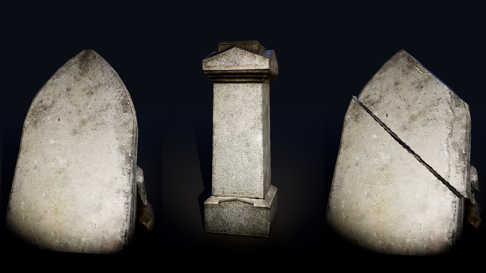
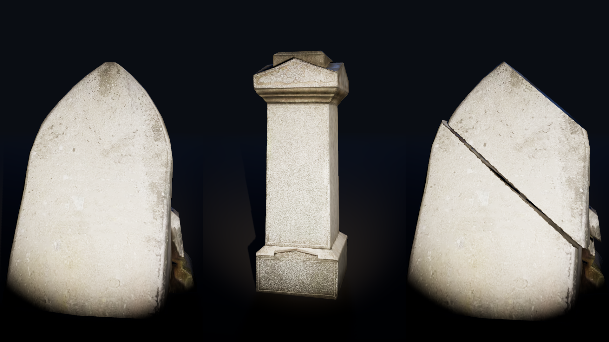
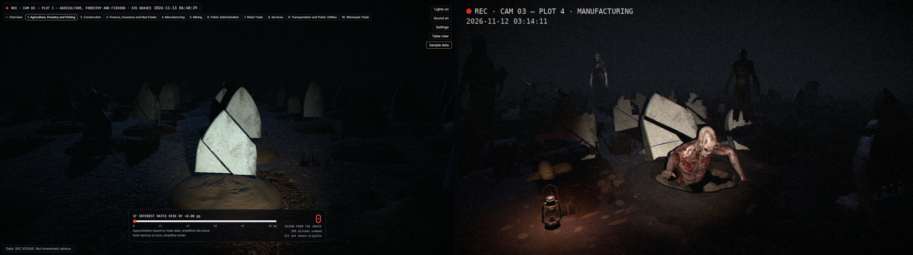

# graveyard-horror-pass: Batch 2b report

Date: 2026-11-13. Tasks 3.4 to 3.28 and 3.31. Tasks 3.1 to 3.3 were skipped by user decision. Nothing committed. No new dependencies.

The Batch 1 and Batch 2 reports were delivered in chat only (DEVLOG.md lines for 1.16 and 2.29). This is the first batch report written to a file.

## 1. What was done

### Requirement 25: shock reset (H2 fix)

- `?shock=` is now applied once per page load, guarded by a module-level flag in `web/src/scenes/graveyard/dev/HorrorDebug.tsx`. The same flag guards the `?horror=` shock reset and the plot framing.
- `web/src/scenes/graveyard/dev/HorrorDebug.test.tsx` (jsdom remount test) fails on the old ref-based code (confirmed by a temporary revert) and passes now.
- `web/src/ui/controls/LightsButton.test.tsx`: 14 jsdom tests for the Lights toggle and slider-key preservation. They pass before and after the fix, as expected.
- **H1** (click landing on the slider when the HUD stacks below 900 px) and **H3** (synthetic input event from tooling) were not investigated, because the HUD Lights button and slider are replaced in control-room-ui. **The H2 fix was applied without proof that H2 was the cause.**

### Requirement 23: look values

- `web/src/scenes/graveyard/look.ts` is the single constants module. `look.test.ts` parses `reference/graveyard/horror-direction-params.md` and checks every listed value.
- Camera: FOV 46, eye 1.2 m, look target 0.6 m, `CAMERA_BACK` 2.7 m (Property 46).
- Plot lighting, blended in at the end of the existing camera move:
  - FogExp2 #0a0d13, density 0.075; background uses the fog colour (sky dome mixed to fog colour).
  - Hemisphere #3a4a66 / #0a0806, 0.18.
  - Environment intensity 0.
  - Moon #7f9cd6, 1.1, at plot centre + (-4, 9, -22).
  - Overview lights off and lights on are unchanged.
- Flashlight: #ffe7c4, 55 / 26 / 0.36 / 0.95 / 2, shadow bias -0.0004. One-frame x0.35 flicker with chance 0.006 per frame, capped at 3 per second.
- Lantern point light #ff9a4a: intensity 1.2 x (0.85 + 0.15 sin 13t sin 7.3t), distance 4 m, decay 2, at 0.28 m. Constant in reduced motion.
- Ground fog fades out in lights-off framed plots. No volumetric cone mesh existed, so none was removed.
- CCTV grade: `web/src/fx/CctvGradeEffect.ts` (six steps). Lights-off chain is ToneMapping then grade: 2 passes, mergeMode none. The tracking-glitch band shift is folded into the grade, without RGB split. Grain is frozen in reduced motion. Low quality keeps all steps.
- Stones at x0.55 base colour in lights off. ACES exposure 1.0 set explicitly.

### Requirement 24: soil and grass

- Soil glow removed. Black-emissive material factories for soil, closed mound, torn heap, pit, clod and grass.
- Clods flat #3b2c1f, roughness 1. Pit: MeshStandardMaterial #040302.
- Grass emissive map removed. Mounds fallback tint guard fixed.
- `web/src/scenes/graveyard/r3f/soilMaterials.test.tsx`: 34 tests, including a source scan for `emissiveMap` and glow.

### Stone blotches (task 3.31, Requirement 24.6 and 24.7 rewritten)

- The alpha premise was wrong: 0 % of texels have alpha below 255, in both the source and the published textures of all three stones.
- Cause: the three stone glbs have `metallicFactor` 1 and a metal/roughness texture with near-zero metallic. `web/src/fx/StoneMaterial.tsx` passed `metalness` without `metalnessMap`, so the stones rendered fully metallic and went black with environment intensity 0.
- Fix: pass `metalnessMap`. `web/src/fx/StoneMaterial.test.ts` reads the three glb materials.
- Average RGB of the close-up: 72.0 / 70.1 / 67.3 before, 87.6 / 85.9 / 83.7 after. Mottling gone.
- Preview scene: `tools/preview/horror-stones.html`, `tools/preview/horror-stones.js`.
- No asset, pick, `CREDITS.md` or Manifest change.

| Before | After | Diagnostic (metalness map) |
| --- | --- | --- |
|  |  |  |

## 2. Check results (task 3.28)

All exit 0: `pnpm typecheck`, `pnpm lint`, `pnpm format`, `pnpm test`, `pnpm build`, and `pnpm test` in `tools`.

| Suite | Files | Tests | Property tests |
| --- | --- | --- | --- |
| web (Vitest) | 142 passed, 1 skipped | 945 passed, 3 skipped | 57 `*.property.test.*` files with 130 tests; 64 files use `fc.assert` (205 tests, 134 `fc.assert` calls) |
| tools | 60 | 379 | 28 property files, 77 `fc.assert` calls |

Skips are pre-existing: `web/src/engine/icr.golden.test.ts` needs `data/fixtures/icr_cases.json`; 2 tests in `web/src/data/ajv.agreement.test.ts` need `data/mock`.

New properties this batch: 46 (plot pose, `layout/camera.property.test.ts`) and 47 (grade steps, `fx/cctvGrade.property.test.ts`). The flashlight flicker-cap property in `r3f/flashlightState.test.ts` replaces the old 10.5 cap property.

`check-bundle`:

| Measure | Value | Limit |
| --- | --- | --- |
| Initial JS (gzip) | 102.3 KB | |
| Total JS (gzip) | 351.2 KB | |
| Initial download | 5.4 MB (critical assets 5,055,177 + JS 359,655 bytes) | 25 MB |
| Graveyard_Asset_Group | 18,598,249 bytes | 25,000,000 |
| HDRI (counted separately) | 8,707,490 bytes | |

Graveyard_Asset_Group by category (bytes): ground 1,131,082; characters 3,758,580; stones 1,061,476; props 11,102,508; sounds 1,544,603.

No changes under `/pipeline`, `/data`, `web/public/assets` or `CREDITS.md`.

## 3. Screenshot

New capture on the left, `reference/graveyard/horror-direction.png` on the right. The app shot is shock +0.00 pp on Plot 1. The reference shows a risen-zombie state on another plot (Plot 4), so zombies and the lantern are expected to differ.

Single shot: [horror-batch2b-look.png](../../reference/progress/horror-batch2b-look.png).

## 4. Look values that could not be matched

- **Black field.** The left and right thirds are dark blue-grey, not near-black. The hemisphere (#3a4a66, 0.18) and moon (1.1) give too much blue fill in the app, although the values equal the params file. Likely causes: different renderer or light units, the shadow map, or the grade gain 1.4 on top. Needs tuning, or a check against the prototype in the same browser.
- **Only one warm pool.** The lantern is not in the Plot 1 frame: `web/src/scenes/graveyard/props.json` places it at plot 0 offset [3.2, 0, 4.2], probably beside or behind the camera. Intensity 1.2 and distance 4 m also give a small pool.
- **Moon rim weak.** The offset (-4, 9, -22) from plot centre does not graze stone edges toward the camera as in the prototype. The hero stone has no cool rim.
- **Stones in the beam near-white** (RGB about 200 to 215, flat). Cause: after the metalness fix, flashlight 55 at the shorter distance plus grade gain 1.4. The 0.55 factor is applied.
- **Camera back 2.7 m**, not the prototype's about 3.2 m to the hero grave. 3.0 m and the 2.9 m fallback both break Requirement 9.4. About 18 % of nearest-row mound centres fall below the bottom edge at 1440 x 900 (still "lower half" per 23.3).
- **Camera centring.** The prototype camera is off-centre at (-0.55, 1.2, 1.35), looking at a hero grave. The app pose is plot-centred by design.
- **Red ghost and grain.** Spec order (f) mixes the raw neighbour red at the end; the prototype mixes red before the grade, so the app ghost is dimmer. Grain is gaussian per spec; the prototype uses uniform noise of width 0.11. The wording of Requirement 23.11 decides.
- **Shadows.** The console warns `PCFSoftShadowMap has been removed. Using PCFShadowMap instead`, so shadows are harder than intended. There is also a `THREE.Clock` deprecation warning.
- **Stale config.** The `lantern.light` block in `web/src/scenes/graveyard/props.json` is no longer used for rendering.
- **Not covered by `look.test.ts`**, because the params file does not list them: environment intensity 0, flashlight shadow bias and flicker, lantern flicker formula, luma weights, camera back and ahead distances.

## 5. Superseded tests updated

| Test | Change |
| --- | --- |
| `web/src/scenes/graveyard/layout/camera.test.ts` | New pose; flickerFactor 10.5 case removed |
| `web/src/scenes/graveyard/model/placement.test.ts` | New pose |
| `web/src/scenes/graveyard/model/sceneParams.test.ts` | New plot fog and light values |
| `web/src/scenes/graveyard/r3f/lightsBlend.test.ts` | Plot blend values |
| `web/src/scenes/graveyard/r3f/flashlightState.test.ts` | New flicker and cap |
| `web/src/fx/fx.test.ts` | Effect chain per mode |
| `layout/cameraPose.property.test.ts`, `layout/cameraProjection.property.test.ts` | Deleted; replaced by `layout/camera.property.test.ts` |
| `r3f/TornMounds.test.ts`, `model/tornMound.test.ts`, `r3f/Grass.test.ts`, glitch scheduler tests (in `fx/fx.test.ts`) | No change needed |

## 6. Open decisions for the user

1. Lighting tune: black field, moon rim, stone brightness in the beam.
2. Lantern placement for Plot 1.
3. Camera back 2.7 m and mound-edge clipping versus Requirement 9.4.
4. Red ghost order and grain distribution: spec or prototype.
5. Wording of Requirement 25.4 now that the browser test was dropped.
6. Earlier open items: Content_Notice (Requirement 18), 10.13, 9.5, 26.9, store field.

No new dependencies.

## 7. Scene review

Matching references: `reference/graveyard/horror-direction.png`, `reference/graveyard/horror-direction-sequence.png`, and the prototype in `reference/graveyard/prototype/demo/` with `reference/graveyard/control-room-direction.md`. A scene-critic review is offered.
